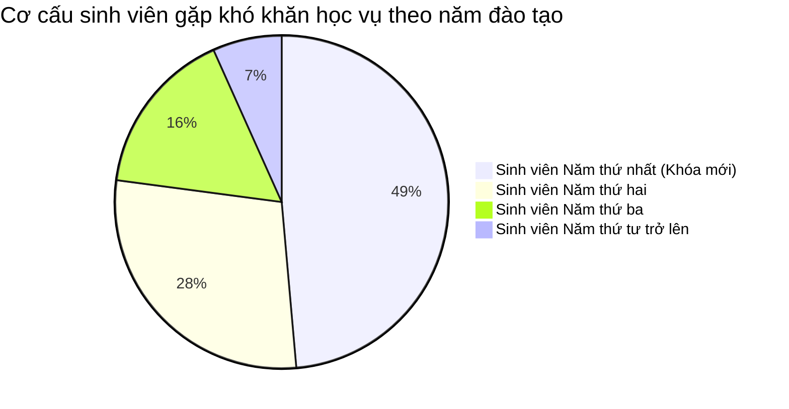
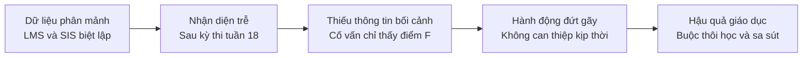

# 02. ĐẶT VẤN ĐỀ

## 1. Bối cảnh thực tiễn tại Đại học Bách khoa Hà Nội
Trường Đại học Bách khoa Hà Nội là một trong những cơ sở giáo dục đại học kỹ thuật và công nghệ trọng điểm hàng đầu tại Việt Nam, với quy mô đào tạo chính quy hiện vượt quá 35.000 sinh viên. Với đặc thù khối lượng kiến thức khoa học cơ bản và kỹ thuật cơ sở rất nặng như các học phần Giải tích, Đại số, Vật lý đại cương và Lập trình cơ bản, tỷ lệ sinh viên gặp khó khăn trong việc thích ứng với phương pháp tự học ở môi trường đại học là rất lớn. Tình trạng này diễn ra nghiêm trọng nhất trong hai năm đầu tiên, vốn là giai đoạn chuyển tiếp quan trọng từ môi trường trung học phổ thông lên đại học.

Xét về phương diện hạ tầng số, Đại học Bách khoa Hà Nội đã đầu tư và vận hành nhiều hệ thống quản trị và dạy học quy mô lớn. Nền tảng Student Information System (Hệ thống Thông tin Sinh viên - SIS) đảm nhiệm việc quản lý chương trình đào tạo, đăng ký tín chỉ, thời khóa biểu và bảng điểm lịch sử của người học. Song song với đó, nền tảng Learning Management System (Hệ thống Quản trị Học tập - LMS) được triển khai trên nền tảng Moodle và Microsoft Teams kết hợp Office 365, đóng vai trò là không gian diễn ra các hoạt động giao nhận bài tập, thảo luận trực tuyến, bài kiểm tra nhanh và phân phối học liệu số. Ngoài ra, Cổng thông tin sinh viên và ứng dụng di động eHUST hỗ trợ tra cứu lịch học và kết quả học tập cá nhân.

Về quy chế đào tạo và quản lý học vụ, nhà trường áp dụng Quy chế đào tạo đại học chính quy mới nhất theo Quyết định số 5445/QĐ-ĐHBK ban hành ngày 28/5/2025 của Giám đốc Đại học Bách khoa Hà Nội (thay thế Quyết định 4600/QĐ-ĐHBK năm 2023). Quy chế quy định rõ ba mức xử lý kết quả học tập gồm Cảnh báo học tập mức một, Cảnh báo học tập mức hai và Buộc thôi học (khi sinh viên vi phạm cảnh báo mức hai liên tiếp hoặc vượt quá thời gian đào tạo tối đa). Sinh viên bị cảnh báo từ mức hai trở lên sẽ bị hạn chế khối lượng tín chỉ đăng ký học tập trong học kỳ tiếp theo.

Mặc dù có nguồn tài nguyên hạ tầng số dồi dào, nhà trường vẫn đối mặt với nghịch lý mà Uskov và cộng sự (2018) đã cảnh báo: cơ sở giáo dục có thể rất giàu có về mặt hệ thống nhưng lại nghèo nàn về trải nghiệm và thiếu hụt hành động phối hợp liên thông. Theo số liệu công bố chính thức từ lãnh đạo Đại học Bách khoa Hà Nội, trung bình mỗi năm trường có từ 700 đến 800 sinh viên hệ chính quy bị buộc thôi học, trong đó có tới 70% đến 80% trường hợp xuất phát từ việc sinh viên mất phương hướng hoặc không kịp thích ứng với phương pháp học tập ở giai đoạn chuyển tiếp các năm đầu (Phùng Nhung, 2022). Gần đây nhất, trong đợt rà soát học vụ năm học 2024–2025, nhà trường tiếp tục ghi nhận gần 700 sinh viên bị ngừng học chính quy, bao gồm khoảng 120 sinh viên quá hạn đào tạo tối đa và phần lớn còn lại do kết quả học tập kém tích lũy qua nhiều kỳ.

Để chứng minh rằng bài toán khủng hoảng học tập ở giai đoạn chuyển tiếp không phải là hiện tượng cá biệt mà là quy luật chung tại các trường đại học khối kỹ thuật và công nghệ, nghiên cứu thực hiện đối sánh bối cảnh giữa Đại học Bách khoa Hà Nội với các cơ sở đào tạo kỹ thuật tương đồng tại Việt Nam.

**Bảng 2.1. Đối sánh thực trạng sinh viên bị xử lý học vụ tại một số cơ sở giáo dục đại học khối kỹ thuật**

| Cơ sở đào tạo | Quy mô sinh viên chính quy | Số lượng sinh viên bị xử lý học vụ / thôi học | Cơ cấu sinh viên năm 1–2 trong diện nguy cơ | Quy trình phát hiện hiện tại | Bằng chứng và Nguồn dữ liệu công bố (Proof) |
| :--- | :---: | :---: | :---: | :---: | :--- |
| **Đại học Bách khoa Hà Nội (HUST)** | ~35.000 | 700 – 800 thôi học/năm (Năm 2024–2025: gần 700 SV ngừng học) | **70% – 80%** tổng số ca thôi học | Hồi cứu sau đợt thi cuối kỳ (Tuần 18–19) | Quyết định 5445/QĐ-ĐHBK (2025); Phỏng vấn lãnh đạo trường trên Báo Lao Động (Phùng Nhung, 2022); Báo Tiền Phong (2024). |
| **ĐH Sư phạm Kỹ thuật TP.HCM (HCMUTE)** | ~26.000 | Đợt HK2/2023–2024: **1.944 SV** bị xử lý (964 cảnh báo, 892 thử thách, 88 thôi học) | **77.1%** (Khóa 2023: 945 SV; Khóa 2022: 554 SV) | Hồi cứu sau khi có quyết định điểm chính thức | Thông báo Phòng Đào tạo HCMUTE (AAO, 2024); Báo Thanh Niên (Hà Ánh, 2024); Báo Lao Động (Chân Phúc, 2024). |
| **ĐH Bách khoa – ĐHQG-HCM (HCMUT)** | ~25.000 | Tỷ lệ thôi học vì học lực yếu: **5% – 6% mỗi khóa** (~500–600 SV/năm) | Ước tính **~70%** sinh viên các năm đầu | Rà soát định kỳ sau mỗi học kỳ | Báo cáo đào tạo và khảo sát tốt nghiệp; Phỏng vấn Trưởng phòng Đào tạo trên Báo VietnamNet (Bùi Hoài Thắng, 2023). |

*(Ghi chú nguồn: Dữ liệu thực tế và thứ cấp tổng hợp từ văn bản đào tạo và công bố chính thức của các trường đại học).*

Số liệu thực chứng trên khẳng định một mẫu hình chung rõ nét: **Hơn 70% đến gần 80% khó khăn học vụ tập trung tuyệt đối vào sinh viên năm thứ nhất và năm thứ hai.**

Nguyên nhân kỹ thuật sâu xa dẫn đến tỷ lệ sa sút nghiêm trọng của sinh viên các năm đầu tại Đại học Bách khoa Hà Nội nằm ở cơ chế đánh giá điểm học phần theo quy định của nhà trường. Đối với các học phần Toán đại cương và Khoa học cơ bản (do Viện Toán ứng dụng và Tin học cùng các đơn vị chuyên môn phụ trách), điểm học phần ($\text{ĐHP}$) được xác định theo công thức:

$$\text{ĐHP} = 50\% \times \text{ĐQT} + 50\% \times \text{ĐTCK}$$

Trong đó, $\text{ĐQT}$ là Điểm quá trình (gồm chuyên cần, bài tập tuần, kiểm tra giữa kỳ) và $\text{ĐTCK}$ là Điểm thi cuối kỳ. Theo quy chế đánh giá học phần, sinh viên **chắc chắn bị điểm F (trượt môn)** nếu thuộc một trong các điều kiện:
1. Không tham gia bài kiểm tra giữa kỳ;
2. Điểm quá trình $\text{ĐQT} < 3.0$;
3. Điểm thi cuối kỳ $\text{ĐTCK} < 3.0$;
4. Điểm tổng kết học phần $\text{ĐHP} < 4.0$.

Quy định này chỉ ra rằng: Nếu một sinh viên lơ là việc học tập ở 4–5 tuần đầu tiên dẫn đến vắng học quá số buổi, nợ bài tập trên LMS và đạt điểm kiểm tra giữa kỳ dưới 3.0, thì **điểm quá trình $\text{ĐQT} < 3.0$ sẽ tước quyền qua môn của sinh viên ngay trước khi bước vào phòng thi cuối kỳ**. Đây chính là "nút thắt cổ chai" sư phạm then chốt: Việc nhận diện sớm sự suy giảm tương tác ở tuần thứ ba đến tuần thứ năm để can thiệp nâng $\text{ĐQT} \ge 3.0$ chính là chiếc phao cứu sinh duy nhất giúp người học không bị rơi vào điểm F tự động.

**Bảng 2.2. Phân tích các học phần khoa học cơ bản có tỷ lệ không đạt cao tại Đại học Bách khoa Hà Nội**

| Mã học phần | Tên học phần nền tảng | Khối lượng tín chỉ | Tỷ lệ sinh viên nhận điểm F ước tính | Nguyên nhân sa sút chủ yếu của sinh viên năm 1–2 | Tác động nếu không được can thiệp sớm |
| :---: | :--- | :---: | :---: | :--- | :--- |
| **MI1111** | **Giải tích I** | 4 (3-2-0-8) | **~21.4%** | Khối lượng bài tập lớn, khái niệm giới hạn và tích phân trừu tượng; bỏ bài tập tuần 2–4. | Bị điểm $\text{ĐQT} < 3.0$; trượt môn tiên quyết của Giải tích II (MI1121). |
| **PH1110** | **Vật lý đại cương I** | 3 (2-1-1-6) | **~19.5%** | Lạ lẫm với phương pháp tính vi phân trong cơ nhiệt; thiếu kỹ năng thực hành thí nghiệm. | Tích lũy nợ tín chỉ ngay học kỳ 1; tụt điểm CPA xuống dưới ngưỡng cảnh báo mức 1. |
| **MI1141** | **Đại số** | 3 (3-1-0-6) | **~17.8%** | Không quen với tư duy ma trận và không gian vector; lơ là bài kiểm tra giữa kỳ tuần 8. | Không đủ điều kiện tích lũy học phần cơ sở ngành. |
| **IT1110** | **Tin học đại cương** | 4 (3-1-1-8) | **~14.2%** | Chênh lệch kỹ năng lập trình đầu vào giữa sinh viên thành thị và nông thôn. | Nảy sinh tâm lý mặc cảm, sợ hãi các môn chuyên ngành kỹ thuật tiếp theo. |

*(Ghi chú: Tỷ lệ điểm F được ước tính dựa trên dữ liệu thứ cấp từ đề cương học phần Viện SAMI HUST và báo cáo rà soát kết quả học tập khối kỹ thuật).*

## 2. Các điểm nghẽn hiện trạng và khoảng trống từ dữ liệu đến hành động
Qua phân tích chu trình vận hành hiện tại, nghiên cứu chỉ ra bốn điểm nghẽn mang tính hệ thống đang cản trở việc trợ giúp người học.

Trước hết, điểm nghẽn lớn nhất nằm ở sự phân mảnh dữ liệu giữa các hệ thống biệt lập. Toàn bộ dữ liệu phản ánh hành vi học tập thực tế của sinh viên như mức độ chuyên cần, thời gian xem video bài giảng, tiến độ nộp bài và tương tác diễn đàn trên LMS hoàn toàn tách biệt với dữ liệu hành chính học vụ lưu tại SIS. Giảng viên phụ trách lớp học phần nhận biết được sinh viên vắng học nhưng không có cơ chế chuyển giao thông tin sang cho cố vấn học tập. Ngược lại, bộ phận quản lý đào tạo nắm giữ điểm trung bình tích lũy nhưng hoàn toàn không biết sinh viên đang gặp khủng hoảng tâm lý hay bế tắc về phương pháp tự học.

Điểm nghẽn thứ hai thể hiện ở quy trình cảnh báo mang tính hồi cứu với độ trễ thời gian quá lớn. Quy trình cảnh báo học vụ hiện hành của trường chỉ được kích hoạt sau khi đã có đầy đủ điểm thi kết thúc học phần, thường rơi vào tuần thứ 17 đến tuần thứ 19 hoặc thậm chí đầu học kỳ kế tiếp. Khi sinh viên nhận quyết định cảnh báo học vụ, điểm số kém đã chính thức ghi vào học bạ và số tín chỉ đã bị tích lũy nợ, khiến các nỗ lực can thiệp sư phạm trở nên muộn màng.

Ở khía cạnh nhân lực hỗ trợ, đội ngũ cố vấn học tập đang thiếu hụt cả công cụ phân tích lẫn thông tin bối cảnh. Mỗi giảng viên kiêm nhiệm công tác cố vấn thường phụ trách từ 80 đến 120 sinh viên. Với áp lực giảng dạy và nghiên cứu khoa học lớn, cố vấn học tập không thể nắm bắt tình trạng của từng sinh viên nếu chỉ nhìn vào bảng điểm tổng kết học kỳ. Khi tiếp xúc với sinh viên thuộc diện cảnh báo, cố vấn học tập chỉ thấy kết quả học lực yếu mà hoàn toàn thiếu vắng các dữ liệu bối cảnh để tìm ra căn nguyên của vấn đề.

Cuối cùng, quy trình can thiệp hiện nay thiếu vắng sự phân quyền và trách nhiệm khép kín giữa các đơn vị liên quan. Khi phát hiện một trường hợp sa sút, hành động xử lý chủ yếu dừng lại ở việc gửi thông báo giấy hoặc thư điện tử nhắc nhở mang tính thủ tục hành chính. Nhà trường chưa thiết lập được một dòng công việc liên thông quy định rõ thời hạn phản hồi, cơ chế kết nối giữa cố vấn học tập với các đơn vị trợ giúp chuyên biệt như phòng tư vấn tâm lý, ban công tác sinh viên hay các lớp phụ đạo kiến thức.

## 3. Bản đồ các bên liên quan trong hệ sinh thái dịch vụ
Dịch vụ hỗ trợ sớm là một cam kết giá trị đòi hỏi sự phối hợp đồng bộ giữa nhiều chủ thể trong nhà trường.

**Bảng 2.3. Phân tích các bên liên quan trong hệ sinh thái dịch vụ hỗ trợ sớm**

| Bên liên quan | Vai trò trong hệ sinh thái | Giá trị mong đợi nhận được | Rủi ro và Điểm nghẽn lớn nhất |
| :--- | :--- | :--- | :--- |
| **Sinh viên** | Chủ thể trung tâm, người tiếp nhận dịch vụ và tạo dữ liệu | Được nhận diện khó khăn sớm từ giữa kỳ; nhận hỗ trợ tôn trọng, bảo đảm quyền riêng tư | Bị dán nhãn tiêu cực là sinh viên yếu kém, lo ngại bị giám sát đời tư |
| **Cố vấn học tập** | Cầu nối sư phạm, người đánh giá bối cảnh và trực tiếp can thiệp | Được cung cấp thông tin bối cảnh súc tích; gợi ý can thiệp phù hợp; giảm tải thủ tục hành chính | Quá tải do nhận quá nhiều cảnh báo nhiễu; thiếu thẩm quyền kết nối can thiệp |
| **Giảng viên bộ môn** | Nguồn tạo dữ liệu tiến trình học tập của lớp học phần | Biết được sinh viên nào trong lớp cần trợ giúp; nhận phản hồi về chất lượng giảng dạy | Tăng thêm gánh nặng nhập liệu điểm danh và cập nhật điểm quá trình |
| **Ban Đào tạo và Ban Công tác Sinh viên** | Đơn vị chủ trì chính sách, điều phối nguồn lực hỗ trợ | Giảm tỷ lệ sinh viên trượt môn và thôi học; quản lý dữ liệu học tập tập trung, minh bạch | Xung đột thẩm quyền giải quyết; dữ liệu không đồng nhất giữa các phòng ban |
| **Lãnh đạo Đại học và Khoa Viện** | Cấp phê duyệt chiến lược, phân bổ nguồn lực | Nâng cao chất lượng đào tạo, tăng tỷ lệ tốt nghiệp đúng hạn, bảo đảm uy tín của trường | Đầu tư công nghệ tốn kém nhưng không tạo ra thay đổi hành vi thực tế |

## 4. Câu hỏi nghiên cứu và Phạm vi giới hạn của đề tài

### 4.1. Câu hỏi nghiên cứu trọng tâm
Để giải quyết các điểm nghẽn nêu trên, tiểu luận tập trung trả lời ba câu hỏi nghiên cứu:
1. Làm thế nào để kiến trúc một hệ sinh thái dữ liệu liên thông giữa SIS, LMS và các hệ thống hỗ trợ, nhằm chuyển đổi tín hiệu học tập vi mô thành chỉ báo cảnh báo sớm có ý nghĩa sư phạm?
2. Làm thế nào để thiết kế một quy trình hỗ trợ sớm bảo đảm tính nhân văn, đặt con người làm trung tâm (Human-in-the-loop), nơi công nghệ hỗ trợ cố vấn học tập ra quyết định mà không tự động phán quyết hay dán nhãn người học?
3. Cần thiết lập khung quản trị, đạo đức dữ liệu và lộ trình triển khai như thế nào để dịch vụ có thể mở rộng bền vững từ thử nghiệm cục bộ sang chuẩn hóa trên toàn trường?

### 4.2. Phạm vi và Giới hạn đề tài
Về đối tượng nghiên cứu, đề tài tập trung vào sinh viên đại học chính quy năm thứ nhất và năm thứ hai thuộc khối ngành kỹ thuật và công nghệ của Đại học Bách khoa Hà Nội, do đây là nhóm đối tượng có tỷ lệ sa sút học vụ cao nhất. 

Về phạm vi dịch vụ, nghiên cứu giới hạn trong chu trình năm bước gồm cảm nhận tín hiệu học tập, suy diễn nguy cơ, cố vấn học tập đánh giá bối cảnh, thực hiện can thiệp sư phạm và đánh giá hiệu quả phục hồi. 

Về mặt kỹ thuật, báo cáo không đi sâu vào việc lập trình chi tiết mã nguồn thuật toán hoặc cấu hình máy chủ, mà tập trung thiết kế kiến trúc hệ sinh thái dịch vụ, mô hình luồng dữ liệu, quy trình phối hợp đa bên, khung quản trị rủi ro và bộ chỉ số đo lường hiệu quả kiểm chứng được.

