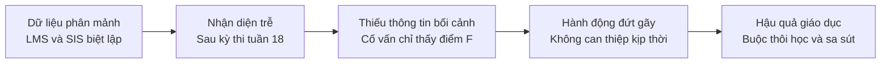

# 02. ĐẶT VẤN ĐỀ

## 1. Bối cảnh thực tiễn tại Đại học Bách khoa Hà Nội
Trường Đại học Bách khoa Hà Nội là một trong những cơ sở giáo dục đại học kỹ thuật và công nghệ trọng điểm tại Việt Nam, với quy mô đào tạo chính quy hiện vượt quá 35.000 sinh viên. Với đặc thù khối lượng kiến thức khoa học cơ bản và kỹ thuật cơ sở rất nặng như các học phần Giải tích, Đại số, Vật lý đại cương và Lập trình cơ bản, tỷ lệ sinh viên gặp khó khăn trong việc thích ứng với phương pháp tự học ở môi trường đại học là rất lớn. Tình trạng này diễn ra nghiêm trọng nhất trong hai năm đầu tiên, vốn là giai đoạn chuyển tiếp quan trọng từ môi trường trung học phổ thông lên đại học.

Xét về phương diện hạ tầng số, Đại học Bách khoa Hà Nội đã đầu tư và vận hành nhiều hệ thống quản trị và dạy học quy mô lớn. Nền tảng Student Information System (Hệ thống Thông tin Sinh viên - SIS) đảm nhiệm việc quản lý chương trình đào tạo, đăng ký tín chỉ, thời khóa biểu và bảng điểm lịch sử của người học. Song song với đó, nền tảng Learning Management System (Hệ thống Quản trị Học tập - LMS) được triển khai trên nền tảng Moodle và Microsoft Teams kết hợp Office 365, đóng vai trò là không gian diễn ra các hoạt động giao nhận bài tập, thảo luận trực tuyến, bài kiểm tra nhanh và phân phối học liệu số. Ngoài ra, Cổng thông tin sinh viên và ứng dụng di động eHUST hỗ trợ tra cứu lịch học và kết quả học tập.

Mặc dù có nguồn tài nguyên dồi dào, nhà trường vẫn đối mặt với nghịch lý mà Uskov và cộng sự (2018) đã cảnh báo: cơ sở giáo dục có thể rất giàu có về mặt hệ thống nhưng lại nghèo nàn về trải nghiệm và thiếu hụt hành động phối hợp liên thông. Dù hàng triệu bản ghi tương tác được sinh ra mỗi tuần trên hệ thống LMS và SIS, nhà trường vẫn ghi nhận tỷ lệ sinh viên sa sút học vụ ở mức đáng lo ngại. Theo số liệu thứ cấp do lãnh đạo Đại học Bách khoa Hà Nội công bố chính thức trên báo chí, trung bình mỗi năm có từ 700 đến 800 sinh viên hệ chính quy bị buộc thôi học, trong đó có tới 70% đến 80% trường hợp xuất phát từ việc sinh viên mất phương hướng hoặc không kịp thích ứng với phương pháp học tập ở giai đoạn chuyển tiếp các năm đầu (Phùng Nhung, 2022). Xuất phát từ số liệu thực tế đó, trong khuôn khổ nghiên cứu tình huống của đề án, nhóm tác giả xây dựng giả định bối cảnh: tỷ lệ sinh viên nhận cảnh báo học vụ mức một hoặc mức hai trước khi rơi vào nguy cơ thôi học ước tính dao động từ 5% đến 8% mỗi học kỳ, trong đó trên 65% trường hợp tập trung vào sinh viên năm thứ nhất và năm thứ hai khi đối mặt với các học phần khoa học cơ bản.

## 2. Các điểm nghẽn hiện trạng và khoảng trống từ dữ liệu đến hành động
Qua phân tích chu trình vận hành hiện tại, nghiên cứu chỉ ra bốn điểm nghẽn mang tính hệ thống đang cản trở việc trợ giúp người học.

Trước hết, điểm nghẽn lớn nhất nằm ở sự phân mảnh dữ liệu giữa các hệ thống biệt lập. Toàn bộ dữ liệu phản ánh hành vi học tập thực tế của sinh viên như mức độ chuyên cần, thời gian xem video bài giảng, tiến độ nộp bài và tương tác diễn đàn trên LMS hoàn toàn tách biệt với dữ liệu hành chính học vụ lưu tại SIS. Giảng viên phụ trách lớp học phần nhận biết được sinh viên vắng học nhưng không có cơ chế chuyển giao thông tin sang cho cố vấn học tập. Ngược lại, bộ phận quản lý đào tạo nắm giữ điểm trung bình tích lũy nhưng hoàn toàn không biết sinh viên đang gặp khủng hoảng tâm lý hay bế tắc về phương pháp tự học.

Điểm nghẽn thứ hai thể hiện ở quy trình cảnh báo mang tính hồi cứu với độ trễ thời gian quá lớn. Quy trình cảnh báo học vụ hiện hành của trường chỉ được kích hoạt sau khi đã có đầy đủ điểm thi kết thúc học phần, thường rơi vào tuần thứ 16 đến tuần thứ 18 hoặc thậm chí đầu học kỳ kế tiếp. Khi sinh viên nhận quyết định cảnh báo học vụ, điểm số kém đã chính thức ghi vào học bạ và số tín chỉ đã bị tích lũy nợ, khiến các nỗ lực can thiệp sư phạm trở nên muộn màng.

Ở khía cạnh nhân lực hỗ trợ, đội ngũ cố vấn học tập đang thiếu hụt cả công cụ phân tích lẫn thông tin bối cảnh. Mỗi giảng viên kiêm nhiệm công tác cố vấn thường phụ trách từ 50 đến 120 sinh viên. Với áp lực giảng dạy và nghiên cứu khoa học lớn, cố vấn học tập không thể nắm bắt tình trạng của từng sinh viên nếu chỉ nhìn vào bảng điểm tổng kết học kỳ. Khi tiếp xúc với sinh viên thuộc diện cảnh báo, cố vấn học tập chỉ thấy kết quả học lực yếu mà hoàn toàn thiếu vắng các dữ liệu bối cảnh để tìm ra căn nguyên của vấn đề.

Cuối cùng, quy trình can thiệp hiện nay thiếu vắng sự phân quyền và trách nhiệm khép kín giữa các đơn vị liên quan. Khi phát hiện một trường hợp sa sút, hành động xử lý chủ yếu dừng lại ở việc gửi thông báo giấy hoặc thư điện tử nhắc nhở mang tính thủ tục hành chính. Nhà trường chưa thiết lập được một dòng công việc liên thông quy định rõ thời hạn phản hồi, cơ chế kết nối giữa cố vấn học tập với các đơn vị trợ giúp chuyên biệt như phòng tư vấn tâm lý, ban công tác sinh viên hay các lớp phụ đạo kiến thức.

## 3. Bản đồ các bên liên quan trong hệ sinh thái dịch vụ
Dịch vụ hỗ trợ sớm là một cam kết giá trị đòi hỏi sự phối hợp đồng bộ giữa nhiều chủ thể trong nhà trường.

**Bảng 2.1. Phân tích các bên liên quan trong hệ sinh thái dịch vụ hỗ trợ sớm**

| Bên liên quan | Vai trò trong hệ sinh thái | Giá trị mong đợi nhận được | Rủi ro và Điểm nghẽn lớn nhất |
| :--- | :--- | :--- | :--- |
| **Sinh viên** | Chủ thể trung tâm, người tiếp nhận dịch vụ và tạo dữ liệu | Được nhận diện khó khăn sớm từ giữa kỳ; nhận hỗ trợ tôn trọng, bảo đảm quyền riêng tư | Bị dán nhãn tiêu cực là sinh viên yếu kém, lo ngại bị giám sát đời tư |
| **Cố vấn học tập** | Cầu nối sư phạm, người đánh giá bối cảnh và trực tiếp can thiệp | Được cung cấp thông tin bối cảnh súc tích; gợi ý can thiệp phù hợp; giảm tải thủ tục hành chính | Quá tải do nhận quá nhiều cảnh báo nhiễu; thiếu thẩm quyền kết nối can thiệp |
| **Giảng viên bộ môn** | Nguồn tạo dữ liệu tiến trình học tập của lớp học phần | Biết được sinh viên nào trong lớp cần trợ giúp; nhận phản hồi về chất lượng giảng dạy | Tăng thêm gánh nặng nhập liệu điểm danh và cập nhật điểm quá trình |
| **Ban Đào tạo và Ban Công tác Sinh viên** | Đơn vị chủ trì chính sách, điều phối nguồn lực hỗ trợ | Giảm tỷ lệ sinh viên trượt môn và thôi học; quản lý dữ liệu học tập tập trung, minh bạch | Xung đột thẩm quyền giải quyết; dữ liệu không đồng nhất giữa các phòng ban |
| **Lãnh đạo Đại học và Khoa Viện** | Cấp phê duyệt chiến lược, phân bổ nguồn lực | Nâng cao chất lượng đào tạo, tăng tỷ lệ tốt nghiệp đúng hạn, bảo đảm uy tín của trường | Đầu tư công nghệ tốn kém nhưng không tạo ra thay đổi hành vi thực tế |

## 4. Câu hỏi nghiên cứu và Phạm vi giới hạn của đề tài

### 4.1. Câu hỏi nghiên cứu trọng tâm
Để giải quyết các điểm nghẽn nêu trên, tiểu luận tập trung trả lời ba câu hỏi nghiên cứu:
1. Làm thế nào để kiến trúc một hệ sinh thái dữ liệu liên thông giữa SIS, LMS và các hệ thống hỗ trợ, nhằm chuyển đổi tín hiệu học tập vi mô thành chỉ báo cảnh báo sớm có ý nghĩa sư phạm?
2. Làm thế nào để thiết kế một quy trình hỗ trợ sớm bảo đảm tính nhân văn, đặt con người làm trung tâm (Human-in-the-loop), nơi công nghệ hỗ trợ cố vấn học tập ra quyết định mà không tự động phán quyết hay dán nhãn người học?
3. Cần thiết lập khung quản trị, đạo đức dữ liệu và lộ trình triển khai như thế nào để dịch vụ có thể mở rộng bền vững từ thử nghiệm cục bộ sang chuẩn hóa trên toàn trường?

### 4.2. Phạm vi và Giới hạn đề tài
Về đối tượng nghiên cứu, đề tài tập trung vào sinh viên đại học chính quy năm thứ nhất và năm thứ hai thuộc khối ngành kỹ thuật và công nghệ của Đại học Bách khoa Hà Nội, do đây là nhóm đối tượng có tỷ lệ sa sút học vụ cao nhất. 

Về phạm vi dịch vụ, nghiên cứu giới hạn trong chu trình năm bước gồm cảm nhận tín hiệu học tập, suy diễn nguy cơ, cố vấn học tập đánh giá bối cảnh, thực hiện can thiệp sư phạm và đánh giá hiệu quả phục hồi. 

Về mặt kỹ thuật, báo cáo không đi sâu vào việc lập trình chi tiết mã nguồn thuật toán hoặc cấu hình máy chủ, mà tập trung thiết kế kiến trúc hệ sinh thái dịch vụ, mô hình luồng dữ liệu, quy trình phối hợp đa bên, khung quản trị rủi ro và bộ chỉ số đo lường hiệu quả kiểm chứng được.
