# 04. ĐÁNH GIÁ HIỆN TRẠNG VÀ KHOẢNG TRỐNG NĂNG LỰC

## 1. Bằng chứng hiện trạng tại Đại học Bách khoa Hà Nội
Để bảo đảm tính khách quan và liêm chính học thuật, hiện trạng công tác cố vấn học tập và cảnh báo học vụ tại Đại học Bách khoa Hà Nội được tổng hợp thông qua sự kết hợp giữa dữ liệu thứ cấp được công bố chính thức (Phùng Nhung, 2022; Báo Tiền Phong, 2024), văn bản Quy chế đào tạo đại học chính quy mới nhất theo Quyết định số 5445/QĐ-ĐHBK (Trường Đại học Bách khoa Hà Nội, 2025), và các số liệu tham số hóa bối cảnh của nhóm nghiên cứu.

Xét trên phương diện hạ tầng kỹ thuật và dữ liệu, hệ thống thông tin sinh viên của trường hiện lưu trữ hơn 35.000 hồ sơ sinh viên và cập nhật điểm học phần theo từng học kỳ. Hệ thống quản trị học tập ghi nhận trung bình hơn 200.000 lượt tương tác mỗi tuần, nhưng toàn bộ nguồn dữ liệu này mới chỉ được lưu trữ dưới dạng nhật ký thô mà chưa được trích xuất để phân tích tương quan với kết quả học tập. Đáng lưu ý là giữa hai hệ thống này chưa có giao diện lập trình ứng dụng hay đường ống dữ liệu tự động kết nối theo thời gian thực; việc chuyển giao điểm số từ hệ thống quản trị học tập sang hệ thống quản lý đào tạo vẫn thực hiện thủ công thông qua việc xuất và nhập các tệp bảng tính Excel.

Đối với khía cạnh công tác cố vấn học tập, mỗi giảng viên đảm nhiệm vai trò cố vấn hiện phụ trách trung bình từ 80 đến 120 sinh viên. Theo quy chế đào tạo hiện hành, cố vấn học tập chủ yếu thực hiện nhiệm vụ họp lớp từ một đến hai lần mỗi kỳ nhằm phổ biến quy chế đăng ký học tập. Khi nhận danh sách sinh viên bị cảnh báo học vụ sau khi đã có kết quả thi cuối kỳ, cố vấn học tập chỉ có thể lập biên bản nhắc nhở mà không có bất kỳ công cụ sư phạm nào để hỗ trợ phục hồi điểm số cho học kỳ đã khép lại.

**Bảng 4.1. Thống kê định lượng hiện trạng công tác Cố vấn học tập (CVHT) tại một số đơn vị của Đại học Bách khoa Hà Nội**

| Đơn vị đào tạo | Quy mô sinh viên chính quy | Số lượng giảng viên kiêm nhiệm CVHT | Tỷ lệ trung bình (SV / 1 CVHT) | Thời lượng tiếp xúc thực tế | Thời điểm nhận danh sách sinh viên nguy cơ | Khả năng tiếp cận dữ liệu bối cảnh LMS |
| :--- | :---: | :---: | :---: | :---: | :---: | :---: |
| **Trường CNTT&TT (SoICT)** | ~6.500 | ~65 | **~100 SV** | 1–2 buổi họp lớp/kỳ | Tuần 18–19 (sau kỳ thi) | **0%** (Chỉ thấy điểm tổng kết cuối kỳ) |
| **Trường Cơ khí (SME)** | ~7.200 | ~70 | **~103 SV** | 1 buổi sinh hoạt lớp/kỳ | Tuần 18–19 (sau kỳ thi) | **0%** (Không có dữ liệu nộp bài tập) |
| **Trường Điện - Điện tử (SEEE)**| ~6.800 | ~68 | **~100 SV** | 1–2 buổi họp lớp/kỳ | Tuần 18–19 (sau kỳ thi) | **0%** (Không biết sinh viên vắng học) |
| **Khoa KH&CN Giáo dục (SEST)** | ~850 | ~10 | **~85 SV** | 2 buổi trao đổi/kỳ | Tuần 17–18 (sau kỳ thi) | **0%** (Trao đổi trực tiếp nhưng thiếu công cụ) |

*(Ghi chú: Dữ liệu định lượng được tổng hợp và tham số hóa dựa trên quy mô thực tế các đơn vị đào tạo của ĐHBK Hà Nội năm học 2024–2025).*

Bảng số liệu trên chỉ rõ nghịch lý: Cố vấn học tập đang phải gánh khối lượng phụ trách rất lớn (xấp xỉ 100 sinh viên mỗi giảng viên), nhưng lại hoàn toàn "mù thông tin" về tiến trình học tập hàng tuần của sinh viên. Hệ quả là có một độ trễ thời gian nghiêm trọng giữa thời điểm sinh viên thực sự rơi vào khủng hoảng và thời điểm nhà trường phát hiện ra.

```mermaid
gantt
    title SO SÁNH ĐỘ TRỄ PHÁT HIỆN HỌC VỤ HIỆN TẠI VÀ MỤC TIÊU PHÁT HIỆN SỚM
    dateFormat  X
    axisFormat  Tuần %s
    section DIỄN BIẾN THỰC TẾ
    Sinh viên bắt đầu nợ bài tập và vắng học    :crit, 1, 5
    Điểm quá trình ĐQT tụt dốc (< 3.0)           :active, 5, 9
    Thi giữa kỳ và trượt kiểm tra                :crit, 8, 10
    Thi cuối kỳ và chính thức nhận điểm F        :crit, 16, 18
    section QUY TRÌNH HIỆN HÀNH
    Không có cảnh báo (Độ trễ mù thông tin)      :0, 17
    Xử lý học vụ hồi cứu (Đã quá muộn)          :milestone, 18, 19
    section QUY TRÌNH THÔNG MINH MỤC TIÊU
    Cảm nhận tín hiệu suy giảm tương tác LMS     :active, 1, 4
    KÍCH HOẠT CAN THIỆP SỚM TUẦN 3 ĐẾN 5         :milestone, 4, 5
    Cố vấn hỗ trợ phục hồi ĐQT kịp thời          :done, 5, 8
```

## 2. Bảng đánh giá trưởng thành kép
Để đánh giá toàn diện năng lực của nhà trường, nghiên cứu áp dụng phương pháp Đánh giá trưởng thành kép, trình bày song song hai khung đánh giá độc lập gồm Smart University Maturity Model (Mô hình Trưởng thành Đại học Thông minh - SMM) do Uskov và cộng sự (2018) đề xuất gồm năm cấp độ và Khung trưởng thành số giáo dục đại học của Amiri và cộng sự (2026) gồm tám chiều năng lực được đánh giá theo bốn cấp độ.

Quá trình đánh giá tuân thủ nguyên tắc không quy đổi cơ học giữa hai thang đo do hai khung có đối tượng và logic đánh giá khác nhau. Khung SMM phản ánh mức độ thể chế hóa và năng lực thông minh của hệ thống công nghệ, trong khi khung của Amiri và cộng sự phản ánh năng lực vận hành tổ chức số toàn diện.

**Bảng 4.2. Đánh giá trưởng thành kép cho Dịch vụ Cố vấn học tập và Hỗ trợ sớm tại ĐHBK Hà Nội**

| Khung đánh giá | Chiều năng lực hoặc Đặc tính | Hiện tại (AS-IS) | Mục tiêu (TO-BE) | Độ tin cậy minh chứng | Mức độ ưu tiên | Minh chứng thực tế hỗ trợ đánh giá |
| :--- | :--- | :---: | :---: | :---: | :---: | :--- |
| **SMM (Uskov et al., 2018)** *(Thang 1–5)* | **01. Cảm nhận (Sensing)** | **2** (Repeatable) | **4** (Managed) | Cao | Đã thu thập nhật ký truy cập hệ thống quản trị học tập Moodle và điểm danh SIS, nhưng chưa đồng bộ hóa tự động theo thời gian thực. |
| | **02. Suy diễn (Inferring)** | **1** (Initial) | **4** (Managed) | Trung bình | Hiện tại không có công cụ suy diễn; cố vấn học tập tự suy đoán nguyên nhân khi sinh viên giải trình đơn cứu xét. |
| | **03. Tự học (Learning)** | **1** (Initial) | **3** (Defined) | Cao | Chưa có mô hình thuật toán học từ dữ liệu các khóa trước; việc phân tích học vụ hoàn toàn thủ công trên bảng tính Excel. |
| | **04. Dự đoán (Anticipating)** | **1** (Initial) | **4** (Managed) | Cao | Hoàn toàn không có dự đoán; cảnh báo mang tính hồi cứu sau khi kỳ thi đã kết thúc ở tuần thứ 18–19. |
| | **05. Thích ứng (Adapting)** | **2** (Repeatable) | **3** (Defined) | Trung bình | Một số giảng viên tự điều chỉnh đề cương phụ đạo, nhưng nhà trường chưa có cơ chế thích ứng hệ thống dịch vụ theo từng mức nguy cơ. |
| | **06. Tự tổ chức (Self-organizing)**| **1** (Initial) | **3** (Defined) | Thấp | Phân bổ cố vấn học tập theo niên chế cố định (~100 SV/thầy cô); chưa tự động phân bổ nguồn lực trợ giảng theo mức độ rủi ro của lớp học phần. |
| **Amiri et al. (2026)** *(Thang 1–4)* | **01. Quản trị chiến lược** | **2** (Established) | **3** (Enhanced) | Cao | Chiến lược chuyển đổi số đã ban hành; Quy chế đào tạo QĐ 5445/QĐ-ĐHBK (2025) đã quy định cảnh báo học tập, nhưng chưa có quy chế dữ liệu học tập. |
| | **02. Văn hóa số** | **2** (Established) | **3** (Enhanced) | Trung bình | Giảng viên sẵn sàng sử dụng LMS Moodle và Teams, nhưng còn tâm lý e ngại dữ liệu giám sát và định kiến dán nhãn sinh viên yếu kém. |
| | **03. Năng lực số** | **2** (Established) | **3** (Enhanced) | Cao | Giảng viên thành thạo sử dụng phần mềm dạy học, nhưng thiếu kỹ năng khai thác bảng điều khiển phân tích học tập bối cảnh hóa. |
| | **04. Hạ tầng số** | **3** (Enhanced) | **3** (Enhanced) | Rất cao | Hạ tầng mạng diện rộng, trung tâm dữ liệu, tài khoản Microsoft Office 365, eHUST và Moodle đã phủ sóng 100% sinh viên và cán bộ. |
| | **05. Dữ liệu và Phân tích** | **2** (Established) | **3** (Enhanced) | Rất cao | Dữ liệu lớn nhưng tồn tại ở các ốc đảo biệt lập giữa SIS và LMS; thiếu kiến trúc dữ liệu tập trung Data Lakehouse và API liên thông. |
| | **06. Dạy và học** | **2** (Established) | **3** (Enhanced) | Cao | Đào tạo kết hợp Blended Learning phổ biến; các hoạt động đánh giá quá trình chưa được chuẩn hóa thời hạn nhập điểm trước tuần 5. |
| | **07. Vận hành dịch vụ** | **2** (Established) | **3** (Enhanced) | Trung bình | Dịch vụ sinh viên một cửa đã vận hành qua eHUST, nhưng chưa tích hợp dòng công việc can thiệp học vụ liên thông của cố vấn học tập. |
| | **08. Nghiên cứu và Đổi mới** | **2** (Established) | **3** (Enhanced) | Thấp | Trường có các nhóm nghiên cứu trí tuệ nhân tạo hàng đầu nhưng chưa ứng dụng trực tiếp vào chính bài toán quản trị học tập của trường. |

*(Quy ước cấp độ SMM: 1-Khởi phát, 2-Có thể lặp lại, 3-Được chuẩn hóa, 4-Được quản trị định lượng, 5-Tối ưu hóa liên tục. Quy ước cấp độ Amiri et al.: 1-Mới nổi, 2-Thiết lập, 3-Tăng cường, 4-Trưởng thành).*

## 3. Hai Nhận định Ưu tiên Cốt lõi và Điều kiện Nền tảng
Từ kết quả đối chiếu trên bảng đánh giá trưởng thành kép và phân tích ma trận khoảng cách, nghiên cứu rút ra hai nhận định ưu tiên mang tính quyết định đối với sự thành công của dịch vụ.

Nhận định ưu tiên thứ nhất chỉ ra rằng điểm nghẽn cổ chai lớn nhất hiện nay nằm ở năng lực suy diễn, dự đoán và sự phân mảnh của dữ liệu. Mặc dù nhà trường đã đạt mức Tăng cường về hạ tầng số với hệ thống máy chủ và mạng diện rộng sẵn sàng, nhưng năng lực suy diễn và dự đoán của hệ sinh thái đào tạo vẫn chỉ dừng ở mức Khởi phát. Nguyên nhân gốc rễ là nguồn dữ liệu hành vi trên hệ thống quản trị học tập và dữ liệu học vụ trên hệ thống thông tin sinh viên bị giam cầm trong các cơ sở dữ liệu riêng rẽ. Việc tiếp tục đầu tư các mô hình trí tuệ nhân tạo phức tạp sẽ không mang lại giá trị nếu chưa giải quyết được việc đồng bộ luồng dữ liệu thời gian thực. Do đó, ưu tiên kỹ thuật số một trong giai đoạn khởi đầu là xây dựng đường ống tích hợp dữ liệu và động cơ phân tích rủi ro học tập.

Nhận định ưu tiên thứ hai khẳng định sự lệch pha nghiêm trọng giữa năng lực công nghệ và văn hóa quy trình can thiệp sư phạm. Sự chênh lệch giữa công nghệ sẵn có và khả năng hành động thực tế là một rủi ro lớn. Nếu hệ thống công nghệ đưa ra cảnh báo sớm ở tuần thứ ba nhưng nhà trường không thiết lập một quy trình bàn giao trách nhiệm rõ ràng và cố vấn học tập không được bồi dưỡng kỹ năng tư vấn bối cảnh, các tín hiệu cảnh báo sẽ nhanh chóng bị bỏ qua do hiện tượng trơ lì cảnh báo. Vì vậy, ưu tiên tổ chức hàng đầu cần triển khai song song với kỹ thuật là thể chế hóa sổ tay quy trình hỗ trợ sớm và ban hành chính sách công nhận giờ làm việc cho cố vấn học tập khi thực hiện tư vấn cá nhân hóa.

Để bảo đảm việc mở rộng dịch vụ diễn ra bền vững, nhà trường bắt buộc phải thỏa mãn hai điều kiện nền tảng. Thứ nhất, trường cần hoàn thiện chính sách quản trị và bảo vệ dữ liệu cá nhân thông qua việc ban hành quy chế sử dụng dữ liệu học tập có trách nhiệm tuân thủ Nghị định 13/2023/NĐ-CP, bảo đảm sinh viên có quyền kiểm soát thông tin cá nhân. Thứ hai, trường cần chuẩn hóa quy trình đánh giá quá trình bằng việc yêu cầu giảng viên bộ môn cam kết cập nhật điểm danh và tối thiểu hai đầu điểm đánh giá quá trình hoặc tiến độ nộp bài trước tuần thứ năm của học kỳ nhằm cung cấp dữ liệu đầu vào chuẩn xác cho hệ thống phân tích.

