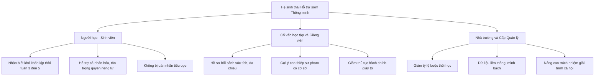
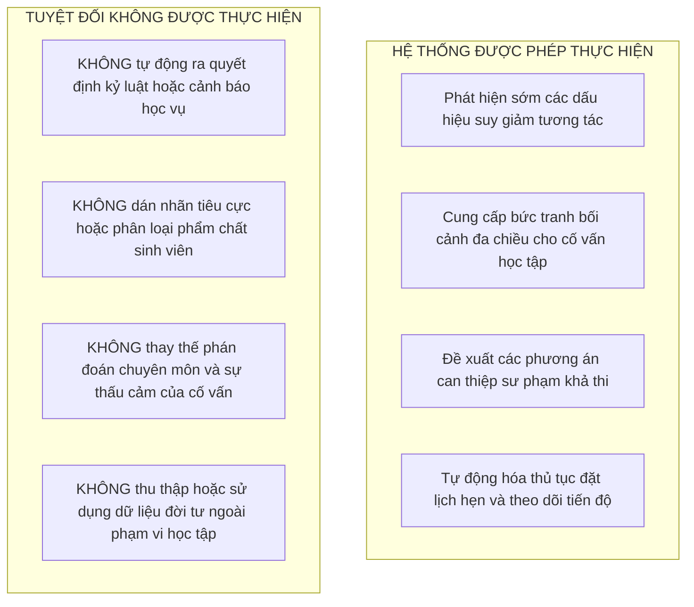

# 05. TRẠNG THÁI MỤC TIÊU VÀ TUYÊN BỐ GIÁ TRỊ

## 1. Tuyên bố Giá trị Đa chiều
Quá trình chuyển đổi từ mô hình cảnh báo học vụ truyền thống sang Dịch vụ Cố vấn học tập và Hỗ trợ sớm thông minh nhằm xác lập lại lời hứa giá trị đối với từng chủ thể trong hệ sinh thái giáo dục của Đại học Bách khoa Hà Nội.

Đối với người học, giá trị lớn nhất nhận được là khả năng nhận diện khó khăn ngay từ giai đoạn khởi đầu của học kỳ, cụ thể từ tuần thứ ba đến tuần thứ năm khi cơ hội cải thiện kết quả học tập còn nguyên vẹn, thay vì nhận các thông báo xử lý kỷ luật sau khi đã trượt môn. Trải nghiệm sư phạm của sinh viên được nâng tầm thông qua sự đồng hành thấu cảm, các khuyến nghị học tập mang tính khích lệ tư duy phát triển, cùng cơ hội kết nối kịp thời với các nguồn lực bổ trợ như lớp phụ đạo của trợ giảng, tư vấn phương pháp tự học ở bậc đại học, hỗ trợ tâm lý hoặc học bổng hỗ trợ hoàn cảnh khó khăn. Quan trọng hơn cả, quyền tự chủ của người học được bảo vệ tuyệt đối: sinh viên không bị dán nhãn yếu kém, mọi thông tin khó khăn được bảo mật nghiêm ngặt và người học luôn giữ quyền chủ động trong việc lựa chọn các gói giải pháp can thiệp.

Đối với cố vấn học tập và giảng viên bộ môn, giải pháp cung cấp một bảng điều khiển bối cảnh thông minh, giúp người thầy nhận biết nhanh chóng những trường hợp sinh viên thực sự cần trợ giúp mà không phải rà soát thủ công qua hàng trăm dòng số liệu bảng tính. Bên cạnh tín hiệu cảnh báo, cố vấn học tập còn được cung cấp bản phân tích nguyên nhân gốc rễ xuất phát từ việc vắng học, nợ bài tập quá trình hay rỗng kiến thức tiên quyết, kèm theo danh mục các giải pháp can thiệp khả thi được hệ thống đề xuất. Nền tảng còn tự động hóa các khâu hành chính tác nghiệp như lên lịch hẹn tư vấn, gửi tin nhắn nhắc nhở và ghi nhận biên bản làm việc số, giúp cố vấn học tập tiết kiệm tới 70% thời gian sự vụ để tập trung vào việc lắng nghe, thấu cảm và hướng dẫn người học.

Đối với nhà trường và các cấp quản lý, dịch vụ giúp xóa bỏ tình trạng cát cứ dữ liệu giữa các phòng ban, hình thành dòng dữ liệu sống động xuyên suốt từ lớp học đến cấp điều hành chiến lược. Nhờ đó, việc phân bổ ngân sách trợ giảng và học bổng được thực hiện tối ưu, dựa trên nhu cầu thực tế của từng đơn vị. Về mặt chiến lược, việc giảm thiểu tỷ lệ sinh viên bị cảnh báo học vụ và buộc thôi học sẽ trực tiếp nâng cao tỷ lệ tốt nghiệp đúng hạn, bảo vệ uy tín học thuật và bảo đảm trách nhiệm giải trình xã hội của một đại học trọng điểm quốc gia.

## 2. Định vị Sáu Đặc tính Thông minh Mục tiêu
Trong trạng thái mục tiêu, hệ thống dịch vụ tại Đại học Bách khoa Hà Nội được nâng cấp năng lực tương ứng với sáu đặc tính thông minh theo khung phân loại của Uskov và cộng sự (2018).

**Bảng 5.1. Định vị sáu đặc tính thông minh mục tiêu của hệ thống**

| Đặc tính thông minh | Trạng thái hiện tại (AS-IS) | Trạng thái mục tiêu (TO-BE) | Cơ chế hiện thực hóa trong giải pháp |
| :--- | :--- | :--- | :--- |
| **01. Cảm nhận (Sensing)** | Dữ liệu điểm thi cuối kỳ, ghi nhận thủ công sau 18 tuần. | Thu nhận đa nguồn theo thời gian thực từ nhật ký hệ thống quản trị học tập và điểm danh tuần một đến tuần năm. | Nền tảng dữ liệu tập trung tự động thu thập sự kiện tương tác qua giao diện lập trình ứng dụng. |
| **02. Suy diễn (Inferring)** | Không có suy diễn; chỉ biết điểm số thuần túy khi có điểm không đạt. | Tự động chuyển đổi các tương tác vi mô thành chỉ số rủi ro học tập có bối cảnh sư phạm rõ ràng. | Mô hình tính toán điểm số tham gia học tập dựa trên trọng số của từng học phần. |
| **03. Tự học (Learning)** | Không có khả năng học hỏi từ dữ liệu lịch sử các khóa trước. | Thuật toán học từ dữ liệu các khóa trước để liên tục tinh chỉnh trọng số rủi ro qua từng học kỳ. | Tự động hiệu chuẩn ngưỡng cảnh báo theo từng học kỳ dựa trên phản hồi của cố vấn học tập. |
| **04. Dự đoán (Anticipating)** | Hoàn toàn bị động; chỉ thống kê sau khi sinh viên đã trượt môn. | Nhận diện nguy cơ sa sút học vụ trước kỳ thi từ tám đến mười tuần với độ chính xác cao. | Mô hình phân loại rủi ro phân tầng thành ba mức độ cảnh báo ở tuần thứ ba đến tuần thứ năm. |
| **05. Thích ứng (Adapting)** | Quy trình cứng nhắc; áp dụng chung một thông báo nhắc nhở hành chính. | Cá nhân hóa nội dung thông điệp và gợi ý lộ trình hỗ trợ cho từng trường hợp cụ thể. | Phân hệ khuyến nghị tự động đề xuất tài liệu bổ trợ hoặc kết nối cố vấn tùy mức nguy cơ. |
| **06. Tự tổ chức (Self-organizing)** | Phân bổ cố vấn học tập tĩnh; không điều phối nguồn lực theo nhu cầu thực. | Tự động điều phối lịch làm việc của cố vấn và bố trí trợ giảng đến lớp học phần có rủi ro cao. | Tự động cân bằng tải công việc tư vấn và đề xuất mở lớp phụ đạo cho học phần khó. |

## 3. Tuyên bố Ranh giới Hệ thống
Để bảo đảm tính khả thi và giữ vững nguyên tắc đạo đức học thuật, trạng thái mục tiêu xác định ranh giới rõ ràng giữa những hành vi hệ thống được phép thực hiện và những hành vi tuyệt đối không được thực hiện.

Nguyên tắc bất biến trong thiết kế là công nghệ chỉ đóng vai trò như một chiếc ống nhòm giúp người cố vấn nhìn xa và rõ hơn trên hành trình đồng hành cùng người học, tuyệt đối không bao giờ là người cầm lái thay thế con người.
