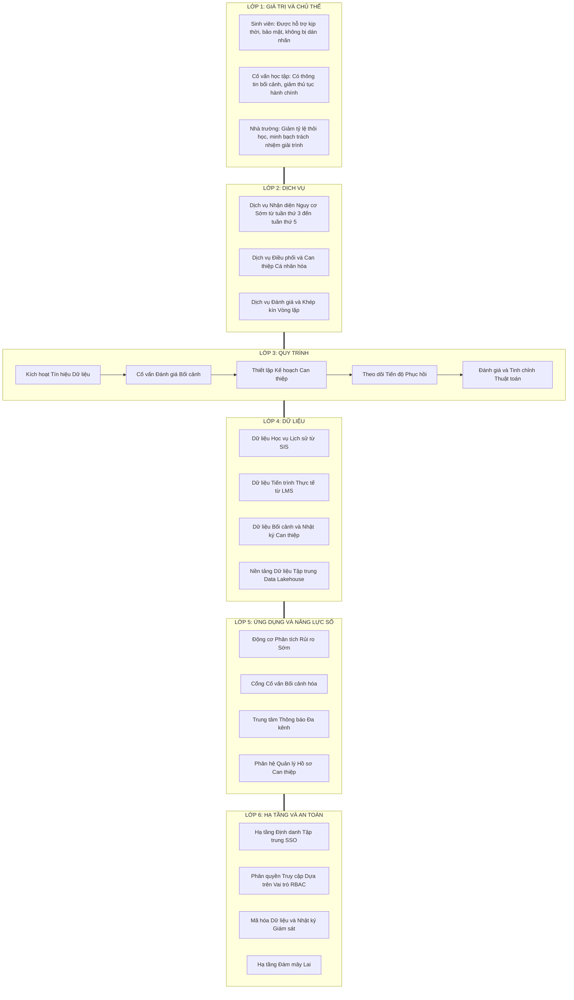
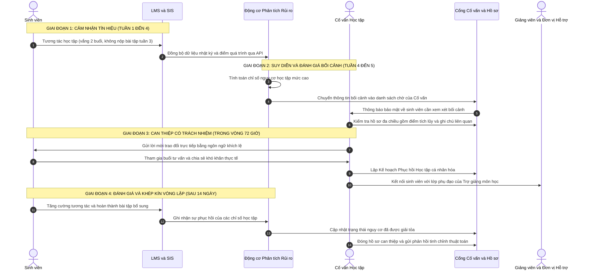
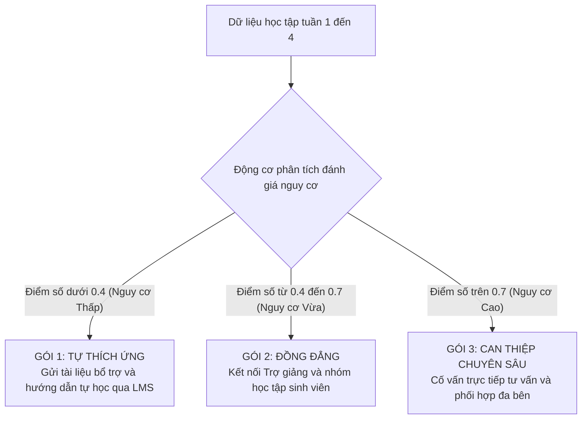

# 06. THIẾT KẾ GIẢI PHÁP KIẾN TRÚC VÀ DỊCH VỤ

## 1. Sơ đồ kiến trúc tổng thể sáu lớp
Vận dụng khung kiến trúc hệ sinh thái Đại học thông minh được tổng hợp từ Uskov và cộng sự (2018), Tổ chức Hợp tác và Phát triển Kinh tế (OECD, 2023) cùng nội dung bài giảng chuyên đề, giải pháp Dịch vụ Cố vấn học tập và Hỗ trợ sớm thông minh tại Đại học Bách khoa Hà Nội được thiết kế theo cấu trúc sáu lớp đồng bộ. Kiến trúc này bảo đảm tính truy vết giá trị xuyên suốt: mọi quyết định công nghệ và hạ tầng ở các lớp dưới đều hướng tới việc phục vụ quy trình, dịch vụ và giá trị giáo dục ở các lớp phía trên.

### Phân tích chi tiết sáu lớp kiến trúc
Xét ở Lớp 1 là Giá trị và Chủ thể, kiến trúc định vị rõ người thụ hưởng và các giá trị cốt lõi được cam kết. Mọi giải pháp công nghệ bên dưới đều quy tụ về mục tiêu giúp sinh viên được nhận diện khó khăn kịp thời để phục hồi học kỳ, hỗ trợ cố vấn học tập có đủ bức tranh bối cảnh sư phạm, và nâng cao hiệu quả đào tạo chung của nhà trường.

Về phương diện Lớp 2 là Dịch vụ, hệ thống chuyển dịch từ việc cung cấp các phần mềm rời rạc sang ba gói dịch vụ liên thông gồm Dịch vụ nhận diện nguy cơ sớm ở giai đoạn giữa kỳ, Dịch vụ điều phối can thiệp đa bên và Dịch vụ theo dõi phục hồi kết hợp đánh giá sau can thiệp.

Đối với Lớp 3 là Quy trình, thiết kế xác lập chu trình năm bước với trách nhiệm bàn giao rõ ràng. Thời hạn cam kết xử lý dịch vụ được quy định nghiêm ngặt: kể từ khi xuất hiện tín hiệu rủi ro đến khi cố vấn học tập tiếp cận người học không được vượt quá 72 giờ.

Về mặt Lớp 4 là Dữ liệu, kiến trúc phá vỡ các ốc đảo thông tin bằng việc tích hợp hai nguồn dữ liệu thẩm quyền gồm dữ liệu học vụ lịch sử từ hệ thống SIS và dữ liệu tiến trình học tập thời gian thực từ hệ thống LMS, lưu trữ tập trung tại nền tảng dữ liệu chung của trường.

Ở Lớp 5 là Ứng dụng và Năng lực số, hệ thống tích hợp động cơ phân tích rủi ro học tập ứng dụng mô hình học máy có khả năng giải thích, Cổng cố vấn học tập trực quan và phân hệ quản lý hồ sơ can thiệp giúp lưu trữ lịch sử tư vấn an toàn.

Cuối cùng, Lớp 6 là Hạ tầng và An toàn bảo đảm tính sẵn sàng cao và tuân thủ pháp lý thông qua hệ thống định danh tập trung của Đại học Bách khoa Hà Nội, cơ chế phân quyền dựa trên vai trò nghiêm ngặt, mã hóa cơ sở dữ liệu và lưu vết toàn bộ nhật ký truy cập theo quy định pháp luật.

## 2. Service Blueprint và Luồng dữ liệu can thiệp
Bản đồ dịch vụ Service Blueprint trực quan hóa toàn bộ hành trình trải nghiệm, phân định ranh giới giữa tương tác trực tiếp của người dùng, hoạt động nghiệp vụ hậu trường và các luồng công nghệ hỗ trợ bên dưới.

**Bảng 6.1. Ma trận chi tiết Service Blueprint dịch vụ hỗ trợ sớm**

| Tầng kiến trúc dịch vụ | Bước 1: Phát hiện tín hiệu | Bước 2: Đánh giá bối cảnh | Bước 3: Tiếp cận và Tư vấn | Bước 4: Thực hiện can thiệp | Bước 5: Đánh giá phục hồi |
| :--- | :--- | :--- | :--- | :--- | :--- |
| **Bằng chứng vật lý và số** | Giao diện nộp bài tập; Bảng điểm danh lớp học. | Bảng điều khiển bối cảnh trên Cổng cố vấn học tập. | Thông điệp mời gặp gỡ; Phòng tư vấn trực tiếp hoặc trực tuyến. | Bản cam kết kế hoạch học tập cá nhân; Lịch phụ đạo. | Biểu đồ phục hồi học tập; Kết quả bài thi giữa kỳ. |
| **Hành động của Sinh viên** | Vắng học không phép hoặc chậm nộp bài tập quá trình. | Chưa nhận thông báo rủi ro để tránh áp lực tâm lý. | Nhận thông điệp đồng hành; Xác nhận lịch hẹn với cố vấn. | Tham gia buổi tư vấn; Chia sẻ khó khăn và tham gia lớp phụ đạo. | Hoàn thành bài tập bổ sung; Cải thiện kết quả học tập. |
| **Tương tác trực tiếp** | Giảng viên ghi nhận vắng mặt trên hệ thống. | Không có tương tác trực tiếp. | Cố vấn học tập trực tiếp lắng nghe và thấu cảm khó khăn. | Giảng viên bộ môn hoặc trợ giảng hỗ trợ bù đắp kiến thức rỗng. | Cố vấn học tập gửi thông điệp biểu dương sự tiến bộ. |
| **Hành động hậu trường** | Hệ thống tự động tổng hợp dữ liệu vi mô vào kho dữ liệu. | Cố vấn học tập tra cứu lịch sử học tập và chuẩn bị phương án. | Cố vấn học tập lựa chọn gói can thiệp học thuật hoặc tâm lý. | Ban Đào tạo phân bổ trợ giảng; Ban Công tác Sinh viên hỗ trợ thủ tục. | Cố vấn học tập xác nhận đóng hồ sơ can thiệp trên hệ thống. |
| **Hệ thống hỗ trợ và Luồng dữ liệu** | Đường ống dữ liệu tự động đồng bộ dữ liệu lúc 00:00 hàng ngày. | Động cơ phân tích tính toán điểm số nguy cơ học tập. | Phân hệ thông báo bảo mật gửi thư điện tử mã hóa. | Phân hệ quản lý hồ sơ ghi nhận kế hoạch hành động. | Thuật toán so sánh chỉ số trước và sau can thiệp để tự học. |

## 3. Quy trình Can thiệp Sư phạm và Ma trận Phân tầng Nguy cơ
Để bảo đảm tính công bằng và cá nhân hóa, hệ thống phân loại rủi ro thành ba cấp độ với các kịch bản can thiệp tương ứng.

Đối với nhóm sinh viên có mức độ nguy cơ thấp tương ứng với điểm rủi ro dưới 0.4 do chỉ quên nộp một bài tập hoặc vắng một buổi học, hệ thống tự động gửi thông báo nhắc nhở nhẹ nhàng trên hệ thống quản trị học tập kèm tài liệu hướng dẫn tự học mà không làm phiền đến cố vấn học tập. 

Đối với nhóm sinh viên có mức độ nguy cơ trung bình tương ứng với điểm rủi ro từ 0.4 đến 0.7 khi có dấu hiệu vắng hai buổi học và điểm kiểm tra nhanh dưới trung bình, hệ thống đề xuất sinh viên tham gia nhóm hỗ trợ học tập đồng đẳng do các trợ giảng sinh viên khóa trên phụ trách. 

Đối với nhóm sinh viên có mức độ nguy cơ cao tương ứng với điểm rủi ro từ 0.7 trở lên do vắng trên 30% thời lượng hoặc không tương tác liên tục trong hai tuần, hệ thống lập tức kích hoạt cảnh báo gửi đến cố vấn học tập. Cố vấn học tập bắt buộc phải tổ chức phiên tư vấn trực tiếp trong vòng 72 giờ và phối hợp cùng ban đào tạo để thiết lập kế hoạch can thiệp cá nhân hóa.
