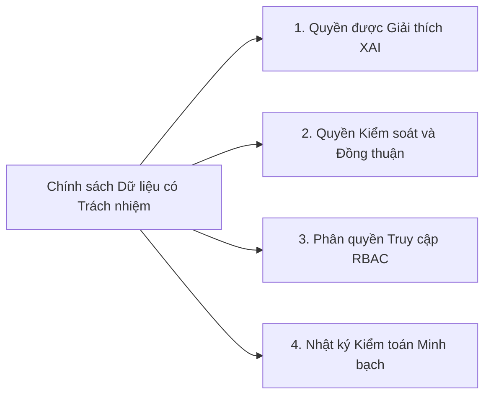

# 07. QUẢN TRỊ VÀ QUẢN TRỊ RỦI RO CÓ TRÁCH NHIỆM

## 1. Ma trận Phân định Trách nhiệm
Để giải quyết triệt để điểm nghẽn về việc có dữ liệu nhưng không có đơn vị chịu trách nhiệm hành động, giải pháp thiết lập ma trận phân định trách nhiệm RACI quy định rõ vai trò của từng bên liên quan qua từng khâu vận hành dịch vụ.

Trong ma trận này, chữ R đại diện cho chủ thể trực tiếp thực hiện công việc; chữ A quy định người chịu trách nhiệm giải trình cuối cùng về kết quả và có thẩm quyền phê duyệt; chữ C thể hiện các bên được tham vấn chuyên môn hai chiều; và chữ I đại diện cho các đối tượng được thông báo kết quả thực hiện.

**Bảng 7.1. Ma trận phân định trách nhiệm RACI cho Dịch vụ Cố vấn học tập và Hỗ trợ sớm**

| Giai đoạn và Hoạt động nghiệp vụ | Sinh viên | Cố vấn học tập | Giảng viên bộ môn | Ban Đào tạo và Ban Công tác Sinh viên | Bộ phận Công nghệ Thông tin và Dữ liệu |
| :--- | :---: | :---: | :---: | :---: | :---: |
| **1. Thu thập và chuẩn hóa dữ liệu LMS và SIS** | I | I | C | A | **R** |
| **2. Cập nhật điểm danh và điểm quá trình** | I | I | **R / A** | C | I |
| **3. Phân tích rủi ro và kích hoạt cảnh báo** | I | I | I | A | **R** |
| **4. Tiếp nhận và đánh giá hồ sơ bối cảnh** | I | **R / A** | C | I | I |
| **5. Liên hệ và tổ chức phiên tư vấn cá nhân** | C | **R / A** | I | I | I |
| **6. Lập kế hoạch can thiệp phục hồi học tập** | **R** | **A** | C | I | I |
| **7. Phối hợp phụ đạo và hỗ trợ tâm lý** | **R** | C | **R** | **A** | I |
| **8. Ghi nhận nhật ký và đóng hồ sơ can thiệp** | I | **R / A** | I | C | I |
| **9. Đánh giá hiệu quả KPI toàn trường** | I | C | C | **R / A** | C |

## 2. Sổ đăng ký rủi ro
Trong các dự án ứng dụng dữ liệu và phân tích học tập trong giáo dục đại học, rủi ro không chỉ dừng lại ở vấn đề kỹ thuật phần mềm mà nghiêm trọng hơn là rủi ro đạo đức, tâm lý và xã hội (Prinsloo & Slade, 2017; OECD, 2023). Bảng dưới đây định danh năm nhóm rủi ro trọng yếu kèm theo chiến lược giảm thiểu tương ứng.

**Bảng 7.2. Sổ đăng ký rủi ro cho Dịch vụ Cố vấn học tập và Hỗ trợ sớm**

| Mã | Tên rủi ro và Bản chất | Xác suất (L: 1-5) | Tác động (I: 1-5) | Điểm rủi ro (L×I) | Mức độ rủi ro | Biện pháp kiểm soát và Giảm thiểu cụ thể | Chủ sở hữu rủi ro |
| :---: | :--- | :---: | :---: | :---: | :---: | :--- | :--- |
| **R01** | **Dán nhãn định kiến:** Sinh viên bị gán mác kém cỏi, dẫn đến tâm lý mặc cảm, tự ti và từ bỏ nỗ lực phấn đấu. | 3 | 5 | **15** | **Rất cao** | Hệ thống không gửi thông báo trực tiếp chữ cảnh báo rủi ro cho sinh viên mà chỉ dùng ngôn ngữ phát triển để gợi ý hỗ trợ học thuật; chỉ có cố vấn học tập mới tiếp cận chỉ số phân tích rủi ro trong hồ sơ bảo mật. | Cố vấn học tập và Ban Công tác Sinh viên |
| **R02** | **Thiên lệch thuật toán và Cảnh báo sai:** Thuật toán đánh giá sai do sinh viên học nhóm, nộp bài qua kênh khác, hoặc mô hình phân biệt đối xử với nhóm yếu thế. | 4 | 3 | **12** | **Cao** | Bắt buộc áp dụng nguyên tắc Human-in-the-loop để mọi cảnh báo đều qua bước cố vấn học tập thẩm định bối cảnh; kiểm định mô hình định kỳ bảo đảm tỷ lệ cảnh báo sai dưới 15%; không đưa các thuộc tính nhạy cảm vào mô hình. | Bộ phận Dữ liệu và Hội đồng Sư phạm |
| **R03** | **Xâm phạm riêng tư và Giám sát quá mức:** Thu thập quá nhiều dữ liệu cá nhân ngoài học tập dẫn đến nguy cơ rò rỉ thông tin nhạy cảm của người học. | 2 | 5 | **10** | **Cao** | Tuân thủ nghiêm ngặt Nghị định 13/2023/NĐ-CP; áp dụng nguyên tắc tối thiểu hóa dữ liệu chỉ thu thập tương tác học tập; thực hiện mã hóa cơ sở dữ liệu và kiểm soát truy cập nghiêm ngặt. | Giám đốc Công nghệ Thông tin và Pháp chế |
| **R04** | **Quá tải cho Cố vấn học tập:** Quá nhiều cảnh báo đổ về cùng lúc khiến giảng viên kiêm nhiệm cố vấn bị trơ lì và bỏ qua thông báo. | 4 | 3 | **12** | **Cao** | Phân tầng rủi ro để chỉ gửi cảnh báo mức nguy cơ cao cho cố vấn học tập; nhóm nguy cơ nhẹ tự động nhận học liệu qua hệ thống; quy đổi giờ làm việc chuẩn cho công tác cố vấn vào định mức lao động năm. | Ban Đào tạo và Lãnh đạo Khoa Viện |
| **R05** | **Đứt gãy quy trình bàn giao:** Cố vấn học tập phát hiện sinh viên khó khăn nhưng không thể kết nối sang đơn vị phụ đạo hoặc hỗ trợ tâm lý và tài chính. | 3 | 4 | **12** | **Cao** | Tích hợp phân hệ quản lý hồ sơ can thiệp liên thông giữa các phòng ban; ban hành quy định thời hạn xử lý cam kết trong vòng 48 giờ đối với đơn vị chuyên môn. | Ban Đào tạo và Ban Công tác Sinh viên |

*(Quy ước: Điểm rủi ro = Xác suất nhân Tác động. Mức độ: 1–5: Thấp; 6–9: Trung bình; 10–14: Cao; 15–25: Rất cao).*

Để trực quan hóa hiệu quả kiểm soát của các biện pháp đề xuất, Bảng 7.3 đối sánh mức độ rủi ro trước và sau khi áp dụng khung quản trị có trách nhiệm.

**Bảng 7.3. Đối sánh mức độ rủi ro trước và sau khi áp dụng biện pháp kiểm soát tại ĐHBK Hà Nội**

| Mã rủi ro | Tên nhóm rủi ro trọng yếu | Mức rủi ro ban đầu (AS-IS) | Biện pháp kiểm soát chủ chốt áp dụng | Mức rủi ro sau kiểm soát (TO-BE) | Mức độ giảm thiểu điểm rủi ro |
| :---: | :--- | :---: | :--- | :---: | :---: |
| **R01** | Dán nhãn định kiến người học | **15 (Rất cao)** | Ngôn ngữ phát triển; bảo mật điểm số nguy cơ; chỉ CVHT tiếp cận. | **3 (Thấp)** | **Giảm 80.0%** |
| **R02** | Thiên lệch thuật toán & cảnh báo sai | **12 (Cao)** | Cơ chế Human-in-the-loop bắt buộc; kiểm định mô hình định kỳ $< 15\%$. | **4 (Thấp)** | **Giảm 66.7%** |
| **R03** | Xâm phạm riêng tư dữ liệu cá nhân | **10 (Cao)** | Tuân thủ Nghị định 13/2023/NĐ-CP; tối thiểu hóa dữ liệu; mã hóa AES-256. | **3 (Thấp)** | **Giảm 70.0%** |
| **R04** | Quá tải cho đội ngũ CVHT | **12 (Cao)** | Phân tầng nguy cơ 3 cấp độ; tự động hóa Gói 1; quy đổi giờ lao động chuẩn. | **4 (Thấp)** | **Giảm 66.7%** |
| **R05** | Đứt gãy quy trình bàn giao hỗ trợ | **12 (Cao)** | Tích hợp hệ sinh thái một cửa liên thông; cam kết SLA phản hồi 48–72h. | **3 (Thấp)** | **Giảm 75.0%** |

*(Ghi chú: Toàn bộ 5 rủi ro từ vùng "Nguy cơ Cao/Rất cao" đều được kéo giảm thành công về vùng "Nguy cơ Thấp" an toàn).*

## 3. Khung Pháp lý và Chính sách Dữ liệu có Trách nhiệm
Để vận hành dịch vụ bền vững, Đại học Bách khoa Hà Nội cần ban hành Quy chế Quản trị và Sử dụng Dữ liệu Học tập có Trách nhiệm với bốn trụ cột pháp lý và đạo đức.

Trụ cột thứ nhất là tính minh bạch và quyền được giải thích. Khi một sinh viên được thuật toán xếp vào diện có nguy cơ, hệ thống phải giải thích rõ ràng các căn cứ định lượng dẫn đến kết luận đó như số buổi vắng học hoặc điểm bài tập quá trình sụt giảm, tuyệt đối không sử dụng các mô hình hộp đen không thể giải trình lý do sư phạm.

Trụ cột thứ hai là quyền đồng thuận và bảo vệ quyền riêng tư theo tinh thần Nghị định 13/2023/NĐ-CP. Sinh viên được thông báo đầy đủ về mục đích sử dụng dữ liệu nhằm hỗ trợ học tập, có quyền tra cứu hồ sơ của chính mình và yêu cầu đính chính nếu thông tin ghi nhận chưa chính xác.

Trụ cột thứ ba là cơ chế phân quyền truy cập nghiêm ngặt dựa trên vai trò. Sinh viên chỉ có quyền xem dữ liệu của bản thân; giảng viên bộ môn chỉ tiếp cận dữ liệu của lớp học phần mình giảng dạy; cố vấn học tập xem dữ liệu tổng hợp của sinh viên trong lớp phụ trách; và bộ phận kỹ thuật dữ liệu chỉ làm việc với dữ liệu đã được ẩn danh hóa.

Trụ cột thứ tư là hệ thống nhật ký kiểm toán minh bạch. Mọi thao tác truy cập, tra cứu hoặc xuất dữ liệu hồ sơ sinh viên đều được hệ thống tự động lưu vết nhật ký về danh tính người truy cập, thời gian và nội dung tra cứu nhằm ngăn chặn triệt để hành vi lạm dụng dữ liệu ngoài mục đích giáo dục.
