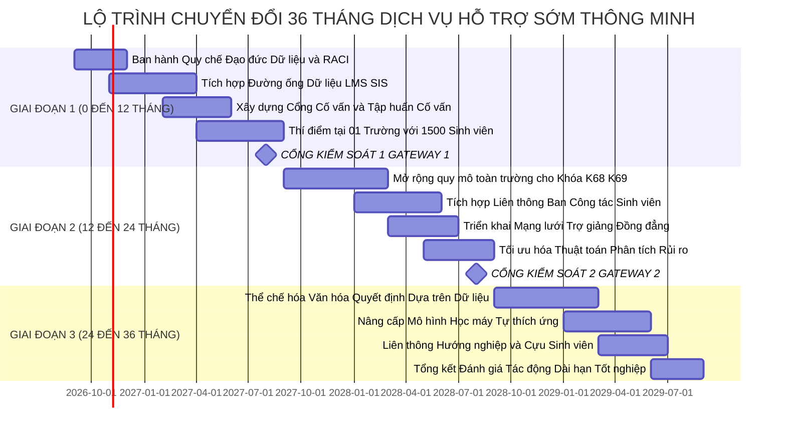
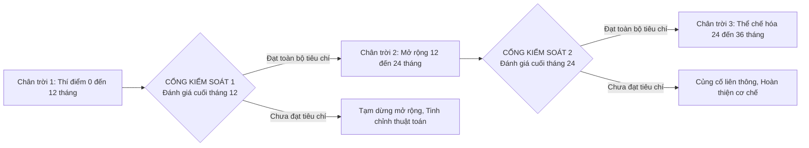

# 08. LỘ TRÌNH TRIỂN KHAI BA GIAI ĐOẠN VÀ CÁC CỔNG KIỂM SOÁT

## 1. Lộ trình chuyển đổi ba giai đoạn
Chuyển đổi một quy trình hỗ trợ sinh viên tại đại học quy mô hơn 35.000 người học như Đại học Bách khoa Hà Nội không thể thực hiện dàn trải trong một thời gian ngắn. Theo khuyến nghị từ mô hình ba chân trời đổi mới (Three Horizons Framework) trong bài giảng chuyên đề, nghiên cứu đề xuất Lộ trình triển khai 36 tháng với các mục tiêu, phạm vi và sản phẩm cụ thể qua từng giai đoạn.

### Chi tiết ba giai đoạn chuyển đổi

Giai đoạn một kéo dài từ tháng thứ 0 đến tháng thứ 12, tập trung vào việc Thiết lập nền tảng và thí điểm phạm vi hẹp. Mục tiêu cốt lõi của giai đoạn này là xây dựng đường ống tích hợp dữ liệu ban đầu, chuẩn hóa quy trình sư phạm và kiểm chứng tính khả thi của giải pháp ở quy mô hẹp. Phạm vi triển khai được chọn là Trường Công nghệ Thông tin và Truyền thông thuộc Đại học Bách khoa Hà Nội với quy mô khoảng 1.500 sinh viên năm thứ nhất và năm thứ hai. Các nhiệm vụ trọng tâm gồm ban hành quy chế sử dụng dữ liệu học tập có trách nhiệm, xây dựng phiên bản phần mềm thử nghiệm ban đầu kết nối giữa hệ thống quản trị học tập và hệ thống thông tin sinh viên, phát triển Cổng cố vấn học tập và tổ chức tập huấn kỹ năng tư vấn bối cảnh cho 30 giảng viên làm cố vấn học tập tại đơn vị thí điểm.

Giai đoạn hai kéo dài từ tháng thứ 12 đến tháng thứ 24, hướng tới việc Mở rộng quy mô toàn trường và tích hợp dịch vụ liên thông. Mục tiêu là mở rộng giải pháp ra toàn bộ các trường và khoa chuyên ngành, phục vụ toàn bộ khoảng 15.000 sinh viên năm nhất và năm hai của Đại học Bách khoa Hà Nội. Trong giai đoạn này, nhà trường nâng cấp hạ tầng tính toán để đáp ứng dữ liệu quy mô lớn, chuyển đổi mô hình phân tích rủi ro sang học máy có khả năng giải thích nhằm giảm tỷ lệ cảnh báo sai, đồng thời kết nối liên thông dòng công việc giữa cố vấn học tập với phòng tư vấn tâm lý, ban công tác sinh viên và mạng lưới trợ giảng sinh viên hỗ trợ học tập đồng đẳng.

Giai đoạn ba kéo dài từ tháng thứ 24 đến tháng thứ 36, tập trung vào việc Thể chế hóa toàn diện và tự thích ứng. Mục tiêu là đưa năng lực tổ chức đạt cấp độ Được quản trị định lượng và Tối ưu hóa liên tục, hình thành văn hóa ra quyết định dựa trên bằng chứng dữ liệu trong toàn trường. Hệ thống kích hoạt tính năng tự tổ chức và thích ứng, tự động nhận diện các học phần có tỷ lệ sinh viên gặp khó khăn bất thường để cảnh báo điều chỉnh đề cương môn học, tự động cân bằng tải tư vấn cho cố vấn học tập, mở rộng kết nối với mạng lưới cựu sinh viên và thực hiện đánh giá tác động dài hạn đối với tỷ lệ tốt nghiệp đúng hạn.

## 2. Các Cổng Kiểm soát Quyết định
Để bảo đảm kiểm soát rủi ro và tránh lãng phí nguồn lực đầu tư, lộ trình thiết lập hai cổng kiểm soát quyết định nghiêm ngặt.

**Bảng 8.1. Tiêu chí đánh giá tại các cổng kiểm soát quyết định**

| Cổng kiểm soát | Thời điểm | Tiêu chí phê duyệt để tiếp tục mở rộng | Hành động nếu không đạt tiêu chí |
| :--- | :---: | :--- | :--- |
| **Cổng kiểm soát 1 (Đánh giá Thí điểm)** | Cuối tháng 12 | Tỷ lệ cảnh báo sai dưới 18%; tỷ lệ cố vấn học tập tại đơn vị thí điểm sử dụng hệ thống thường xuyên đạt từ 70% trở lên; mức độ hài lòng của sinh viên được hỗ trợ đạt từ 75% trở lên; không xảy ra bất kỳ sự cố vi phạm an toàn dữ liệu nào. | Tạm dừng việc mở rộng toàn trường; dành thêm ba tháng để rà soát lại các trọng số thuật toán và đơn giản hóa giao diện làm việc của cố vấn học tập. |
| **Cổng kiểm soát 2 (Đánh giá Toàn diện)** | Cuối tháng 24 | Tỷ lệ sinh viên có nguy cơ tiếp nhận can thiệp đạt từ 75% trở lên; tỷ lệ sinh viên được can thiệp vượt qua diện cảnh báo học vụ đạt từ 55% trở lên; thời gian phản hồi trung bình của cố vấn học tập dưới 72 giờ; 100% các ca can thiệp liên thông được đóng hồ sơ đúng thời hạn cam kết. | Giữ nguyên quy mô vận hành hiện tại; tổ chức đối thoại mở với các đơn vị đào tạo để tháo gỡ vướng mắc về cơ chế tính giờ lao động cho cố vấn học tập. |
