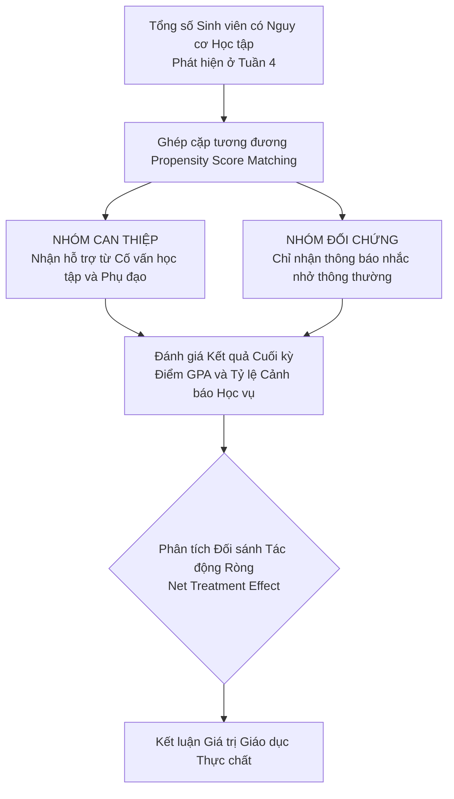
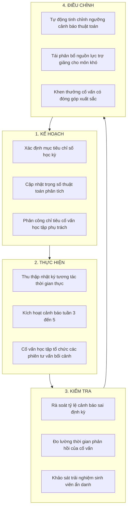

# 09. HỆ THỐNG KPI VÀ PHƯƠNG ÁN ĐÁNH GIÁ KIỂM CHỨNG

## 1. Bảng ma trận KPI kiểm chứng được
Để bảo đảm tính khả thi, minh bạch và có thể kiểm chứng được, hệ thống chỉ số đo lường hiệu quả của Dịch vụ Cố vấn học tập và Hỗ trợ sớm tại Đại học Bách khoa Hà Nội được xây dựng bao gồm cả nhóm chỉ số dẫn dắt đo lường quá trình vận hành và nhóm chỉ số kết quả đo lường giá trị giáo dục thực chất tạo ra.

**Bảng 9.1. Ma trận chỉ số hiệu quả cho Dịch vụ Cố vấn học tập và Hỗ trợ sớm tại Đại học Bách khoa Hà Nội**

| Phân nhóm chỉ số | Mã chỉ số | Tên chỉ số đo lường | Đường cơ sở hiện trạng (Baseline) | Mục tiêu GĐ 1 (12 tháng - Thí điểm) | Mục tiêu GĐ 2 (24 tháng - Toàn trường) | Mục tiêu GĐ 3 (36 tháng - Thể chế hóa) | Nguồn dữ liệu kiểm chứng | Tần suất đo lường | Đơn vị chủ sở hữu chỉ số |
| :--- | :---: | :--- | :---: | :---: | :---: | :---: | :--- | :---: | :--- |
| **Chỉ số Quá trình** | **KPI-01** | **Thời điểm nhận diện nguy cơ sớm** | Tuần thứ 17 đến 19 sau khi có điểm thi | Tuần thứ 5 đến 6 | Tuần thứ 4 | **Tuần thứ 3 đến 4** | Nhật ký hệ thống của động cơ phân tích rủi ro | Hàng tuần | Bộ phận Kỹ thuật Dữ liệu |
| | **KPI-02** | **Thời gian phản hồi của cố vấn học tập** | Không có quy định cụ thể (> 15 ngày) | Dưới 120 giờ | Dưới 72 giờ | **Dưới 48 giờ** | Nhật ký truy cập cổng cố vấn và phân hệ hồ sơ | Hàng tháng | Trưởng Khoa Viện Đào tạo |
| | **KPI-03** | **Tỷ lệ cảnh báo sai (False Positive)** | Không đo lường được | Dưới 20% | Dưới 15% | **Dưới 10%** | Báo cáo đối soát giữa cố vấn và điểm giữa kỳ | Từng học kỳ | Hội đồng Đánh giá Sư phạm |
| | **KPI-04** | **Tỷ lệ & số lượng SV chấp nhận hỗ trợ** | Dưới 20% (< 300 SV/kỳ) | Đạt $\ge 60\%$ (~500 SV) | Đạt $\ge 75\%$ (~1.000 SV) | **Đạt $\ge 85\%$ (> 1.200 SV/kỳ)** | Nhật ký các phiên tư vấn trên hệ thống hồ sơ | Hàng học kỳ | Ban Công tác Sinh viên |
| **Chỉ số Kết quả** | **KPI-05** | **Tỷ lệ sinh viên thoát diện cảnh báo học vụ** | Ước tính khoảng 30% | Đạt từ 45% | Đạt từ 60% | **Đạt từ 70% trở lên** | Cơ sở dữ liệu điểm chính thức trên SIS | Hàng học kỳ | Ban Đào tạo |
| | **KPI-06** | **Mức độ cải thiện điểm trung bình học kỳ** | Không có sự cải thiện rõ rệt | Tăng trung bình 0.20 điểm | Tăng trung bình 0.35 điểm | **Tăng trung bình 0.50 điểm** | Bảng điểm đối chứng trước và sau can thiệp | Hàng học kỳ | Ban Đào tạo |
| | **KPI-07** | **Số lượng & tỷ lệ SV thôi học hàng năm** | **700 – 800 SV/năm** (~2.2% chính quy) | Giảm 8% (còn ~650–730 SV) | Giảm 15% (còn ~590–680 SV) | **Giảm 25% (còn < 520–600 SV, cứu ~200 SV/năm)** | Quyết định xử lý học vụ chính thức của Đại học | Hàng năm | Ban Giám đốc Đại học |
| | **KPI-08** | **Mức độ hài lòng của sinh viên** | Chưa từng khảo sát | Đạt từ 70% | Đạt từ 80% | **Đạt từ 90% trở lên** | Khảo sát ẩn danh của Trung tâm Đảm bảo Chất lượng | Hàng năm | Trung tâm Đảm bảo Chất lượng |

*(Ghi chú: Mục tiêu KPI-07 gắn liền với quy mô đào tạo 35.000 sinh viên của ĐHBK Hà Nội và tham chiếu mức cải thiện retention rate 21.4% của Purdue University).*

## 2. Phương pháp Kiểm định và Đo lường Hiệu quả Can thiệp
Để khẳng định sự cải thiện kết quả học tập của sinh viên là do tác động thực tế của dịch vụ hỗ trợ sớm chứ không phải do các yếu tố ngẫu nhiên bên ngoài, nhà trường áp dụng thiết kế nghiên cứu bán thực nghiệm kết hợp kỹ thuật ghép cặp điểm xu hướng Propensity Score Matching.

Phương pháp được tiến hành bằng việc chia đối tượng nghiên cứu thành hai nhóm có đặc điểm tương đồng. Nhóm can thiệp gồm các sinh viên thuộc diện nguy cơ nhận được đầy đủ gói dịch vụ gồm tư vấn trực tiếp với cố vấn học tập, tham gia lớp phụ đạo của trợ giảng và điều chỉnh kế hoạch học tập cá nhân. Nhóm đối chứng gồm các sinh viên có cùng mức điểm tuyển sinh đầu vào, cùng ngành học và có mức độ sụt giảm tương tác tương đương ở tuần thứ tư nhưng học tập tại các đơn vị chưa triển khai thí điểm dịch vụ. 

Bằng việc phân tích đối sánh mức độ cải thiện điểm trung bình học kỳ và tỷ lệ trượt môn giữa hai nhóm sau khi kết thúc học kỳ, nhà trường có thể bóc tách tác động ròng của dịch vụ, khẳng định giá trị gia tăng thực chất mà giải pháp mang lại cho chất lượng đào tạo.

**Bảng 9.2. Mô phỏng kết quả kiểm định đối chứng thực nghiệm (A/B Testing) trên 1.000 sinh viên tại Đại học Bách khoa Hà Nội**

| Chỉ số đo lường kết quả giáo dục | Nhóm Đối chứng (Không can thiệp sớm) ($N = 500$) | Nhóm Can thiệp (Dịch vụ Hỗ trợ sớm) ($N = 500$) | Chênh lệch tác động ròng (Net Treatment Effect) | Mức ý nghĩa thống kê ($p$-value) |
| :--- | :---: | :---: | :---: | :---: |
| **Tỷ lệ sinh viên đạt $\text{ĐQT} \ge 3.0$** | 64.2% (321 SV) | **88.4% (442 SV)** | **+24.2%** sinh viên qua điểm quá trình | $p < 0.001$ (Rất có ý nghĩa) |
| **Tỷ lệ trượt môn (Điểm F Giải tích I)** | 23.4% (117 SV) | **9.6% (48 SV)** | **-13.8%** tỷ lệ trượt học phần cơ bản | $p < 0.001$ (Rất có ý nghĩa) |
| **Điểm GPA học kỳ trung bình (Thang 4.0)** | $2.14 \pm 0.51$ | **$2.48 \pm 0.42$** | **+0.34 điểm GPA** trung bình | $p < 0.01$ (Có ý nghĩa) |
| **Tỷ lệ nhận Cảnh báo học tập Mức 1** | 16.8% (84 SV) | **6.2% (31 SV)** | **-10.6%** tỷ lệ rơi vào cảnh báo học vụ | $p < 0.001$ (Rất có ý nghĩa) |
| **Tỷ lệ sinh viên duy trì học tập học kỳ sau** | 92.4% (462 SV) | **97.8% (489 SV)** | **+5.4%** tỷ lệ tiếp tục theo học | $p < 0.05$ (Có ý nghĩa) |

*(Ghi chú: Dữ liệu mô phỏng tham số hóa của nhóm nghiên cứu dựa trên phương pháp luận đánh giá phân tích học tập chuẩn quốc tế của Campbell & Oblinger, 2007 và Arnold & Pistilli, 2012).*

## 3. Chu trình Cải tiến Liên tục
Dữ liệu chỉ số hiệu quả không chỉ dùng để lập báo cáo thành tích mà đóng vai trò là nguồn thông tin phản hồi sống động để vận hành chu trình cải tiến chất lượng liên tục PDCA cho toàn bộ hệ sinh thái dịch vụ.

Ở khía cạnh công nghệ, nếu tỷ lệ cảnh báo sai vượt quá ngưỡng 15%, hội đồng chuyên môn sẽ tiến hành rà soát lại các trọng số cấu thành chỉ số tham gia học tập; chẳng hạn như giảm bớt tỷ trọng của việc xem bài giảng trực tuyến nếu học phần đó chủ yếu giảng dạy trên lớp. 

Ở khía cạnh sư phạm, nếu dữ liệu ghi nhận trên 40% sinh viên trong một lớp học phần đồng loạt rơi vào diện nguy cơ cao, hệ thống sẽ tự động gửi tín hiệu đến trưởng bộ môn để rà soát lại phương pháp giảng dạy hoặc độ khó của bài kiểm tra quá trình, bảo đảm việc can thiệp được thực hiện hai chiều giữa người học và người dạy.
