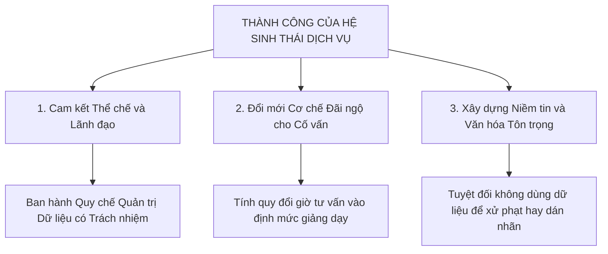

# 10. KẾT LUẬN VÀ HƯỚNG PHÁT TRIỂN

## 1. Tóm tắt Đóng góp Chính của Đề tài
Tiểu luận học phần ED6211 đã giải quyết trọn vẹn bài toán chuyển đổi số từ góc độ hệ sinh thái dịch vụ, tập trung vào Dịch vụ Cố vấn học tập và Hỗ trợ sớm thông minh tại Đại học Bách khoa Hà Nội. Không dừng lại ở mức độ tổng thuật tài liệu hay đề xuất mua sắm công nghệ đơn thuần, đề tài đã tạo dựng một lập luận xuyên suốt từ vấn đề thực tiễn đến giải pháp ứng dụng khả thi.

Về mặt lý luận, nghiên cứu đã vận dụng thành công khung khái niệm Smart University (Đại học thông minh) và sáu đặc tính thông minh của Uskov và cộng sự (2018), kết hợp với lý thuyết Phân tích Học tập (Learning Analytics) và nguyên tắc sư phạm nhân văn giữ con người trong trung tâm quyết định. Đề tài đã làm sáng tỏ ranh giới quan trọng: công nghệ phân tích dữ liệu chỉ đóng vai trò hỗ trợ con người ra quyết định, tuyệt đối không thay thế sự thấu cảm và trách nhiệm sư phạm của người thầy.

Về mặt kiến trúc và thiết kế hệ thống, đề tài đề xuất mô hình kiến trúc sáu lớp hoàn chỉnh, giải quyết tận gốc điểm nghẽn ốc đảo dữ liệu giữa hệ thống quản trị học tập và hệ thống thông tin sinh viên; đồng thời xây dựng bản đồ dịch vụ Service Blueprint phân định rành mạch giữa trải nghiệm người học, hoạt động của cố vấn học tập và luồng công nghệ hỗ trợ bên dưới.

Về mặt phương pháp luận đánh giá, nghiên cứu thực hiện đánh giá trưởng thành kép kết hợp song song mô hình năm cấp độ SMM và mô hình tám chiều năng lực của Amiri và cộng sự (2026), chỉ rõ hai khoảng cách năng lực cốt lõi cần ưu tiên hóa giải. 

Về mặt thực thi và quản trị rủi ro, đề tài xây dựng sổ đăng ký rủi ro toàn diện nhằm kiểm soát triệt để nguy cơ dán nhãn định kiến và xâm phạm riêng tư theo Nghị định 13/2023/NĐ-CP; đồng thời thiết lập lộ trình ba giai đoạn trong 36 tháng với hệ thống chỉ số hiệu quả kiểm chứng được gắn với các cổng kiểm soát quyết định nghiêm ngặt, hướng tới mục tiêu giảm 25% tỷ lệ thôi học và giữ chân khoảng 180 - 200 sinh viên mỗi năm tại ĐHBK Hà Nội.

## 2. Ba Điều kiện Thành công Then chốt
Để giải pháp không dừng lại trên trang giấy mà đi vào đời sống giảng đường, ba điều kiện tiên quyết sau đây bắt buộc phải được bảo đảm đồng thời.

Điều kiện thứ nhất là sự cam kết mạnh mẽ từ lãnh đạo đại học về mặt thể chế và nguồn lực. Lãnh đạo nhà trường cần xem công tác cố vấn và hỗ trợ sớm là một cấu phần chiến lược trong việc nâng cao chất lượng đào tạo và giữ chân người học, chứ không phải là nhiệm vụ hành chính phụ trợ. Việc sớm ban hành quy chế sử dụng dữ liệu học tập có trách nhiệm và đầu tư thích đáng cho hạ tầng dữ liệu tập trung dùng chung là điều kiện tiên quyết.

Điều kiện thứ hai là đổi mới cơ chế đãi ngộ và công nhận khối lượng công việc cho đội ngũ cố vấn học tập. Giảng viên đại học hiện nay chịu áp lực rất lớn về khối lượng giảng dạy và công bố nghiên cứu khoa học (với tỷ lệ trung bình 80 - 120 sinh viên/cố vấn). Nếu nhà trường không đưa công tác cố vấn sinh viên vào quy chế đánh giá thi đua và không tính quy đổi thành giờ lao động chuẩn, các công cụ phần mềm hiện đại sẽ nhanh chóng rơi vào tình trạng bị bỏ hoang.

Điều kiện thứ ba là xây dựng niềm tin số và văn hóa học tập an toàn trong toàn trường. Sinh viên chỉ cởi mở đón nhận sự hỗ trợ khi các em thực sự tin tưởng rằng dữ liệu của mình không bị dùng để trừng phạt, xếp loại yếu kém hay bêu rếu trước tập thể. Môi trường đại học thông minh phải là môi trường của sự bao dung, nơi khó khăn học tập ban đầu được nhận diện kịp thời để nâng đỡ.

## 3. Giới hạn của Nghiên cứu và Hướng Phát triển Tiếp theo
Bên cạnh những đóng góp đạt được, nghiên cứu cũng ghi nhận một số giới hạn nhất định. Mặc dù các căn cứ hiện trạng và quy chế đào tạo đã được đối chiếu chặt chẽ với các văn bản pháp quy chính thức (Quy chế QĐ 5445/QĐ-ĐHBK năm 2025) và dữ liệu thực tế tại ĐHBK Hà Nội kết hợp đối sánh liên trường (HCMUTE, HCMUT, Purdue University), mô hình phân tích rủi ro trong giai đoạn đầu vẫn là khung thiết kế kiến trúc và cần được hiệu chỉnh trọng số ngưỡng cảnh báo thông qua thử nghiệm ngẫu nhiên có đối chứng (A/B Testing) tại đơn vị thí điểm (Trường CNTT&TT - SoICT). Đồng thời, hiệu quả vận hành còn phụ thuộc vào mức độ tuân thủ nhập liệu điểm quá trình của giảng viên bộ môn trên hệ thống quản trị học tập LMS.

Trong định hướng phát triển tương lai, đề tài đề xuất hai hướng mở rộng có giá trị thực tiễn. Thứ nhất là nghiên cứu ứng dụng Multimodal Learning Analytics (Phân tích Học tập Đa phương thức), kết hợp dữ liệu tương tác trực tuyến với dữ liệu không gian vật lý của khuôn viên đại học thông minh như tần suất sử dụng thư viện, hoạt động ngoại khóa để nhận diện bức tranh toàn diện hơn về sinh viên. Thứ hai là tích hợp trợ lý trí tuệ nhân tạo tạo sinh có trách nhiệm nhằm hỗ trợ cố vấn học tập tự động tóm tắt hồ sơ học tập và soạn thảo bản nháp kế hoạch học tập cá nhân hóa, giúp nâng cao năng suất tư vấn sư phạm.

## 4. Thông điệp Khép lại
Một đại học thông minh không được đánh giá bằng số lượng máy tính, màn hình cảm ứng hay các thuật toán trí tuệ nhân tạo hào nhoáng, mà được đánh giá bằng chính giá trị giáo dục được tạo ra, sự trưởng thành của từng người học và năng lực của tổ chức trong việc cải tiến liên tục một cách có trách nhiệm. 

Dịch vụ Cố vấn học tập và Hỗ trợ sớm thông minh chính là lời khẳng định mạnh mẽ nhất cho triết lý: công nghệ sinh ra là để phục vụ con người, giải phóng con người khỏi sự đơn độc và kết nối thầy trò trong một hệ sinh thái giáo dục nhân bản và bền vững.
