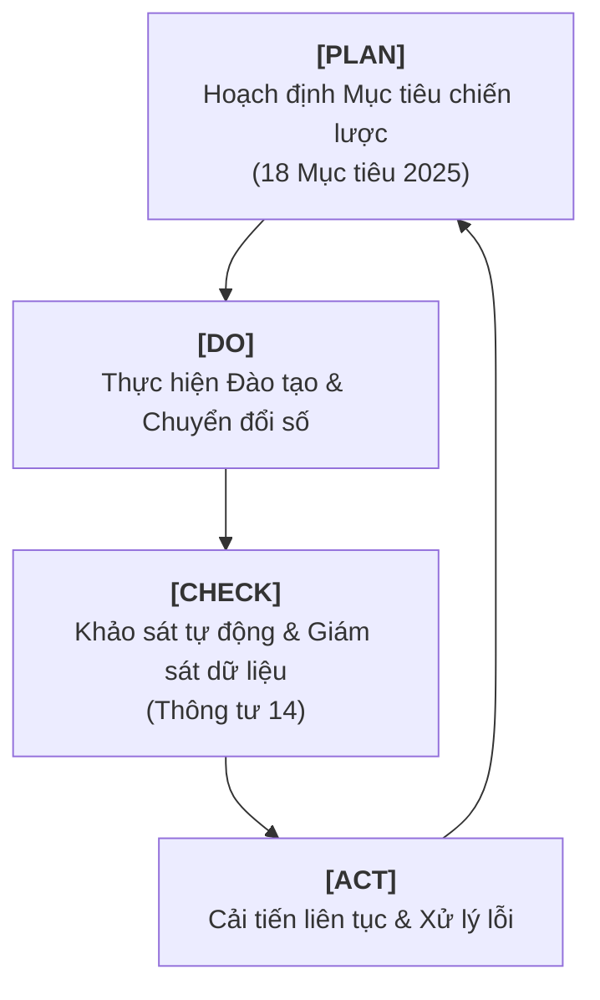

## 3. Thiết kế hệ thống đảm bảo chất lượng bên trong

Để giải quyết các khoảng trống trên và bám sát Thông tư 14/2024/TT-BLĐTBXH Quy định tiêu chí, tiêu chuẩn kiểm định chất lượng giáo dục nghề nghiệp, hệ thống đảm bảo chất lượng (ĐBCL) bên trong mới của Trường Cao đẳng Kỹ Nghệ II (TP. Hồ Chí Minh) sẽ được thiết kế lại theo mô hình **Digital-driven TQM** (Quản lý chất lượng toàn diện thúc đẩy bởi công nghệ số) với chu trình PDCA khép kín ở mọi cấp độ:

### Tái cấu trúc cơ cấu tổ chức ĐBCL bên trong:
- **Ban ĐBCL Trường (Chiến lược):** Định hướng chính sách chất lượng và phân bổ nguồn lực.
- **Phòng ĐBCL (Chuyên trách):** Đóng vai trò hạt nhân điều phối, phát triển các công cụ đánh giá, quản trị hệ thống dữ liệu chất lượng và hỗ trợ tự đánh giá.
- **Mạng lưới ĐBCL tại các Khoa/Phòng (Tác nghiệp):** Chuyển dịch trách nhiệm chất lượng về từng cá nhân: *“Mỗi giáo viên, nhân viên tự quản lý và chịu trách nhiệm về chất lượng công việc của chính mình”* (Kaizen tự giác).

### Thiết kế các quy trình kiểm soát chủ động tương thích Thông tư 14:
- **Quy trình Giám sát biến động sĩ số chủ động (Tiêu chuẩn 8.1 & 8.5):** Xây dựng hệ thống cảnh báo sớm trên nền tảng số. Nếu sinh viên nghỉ học không lý do quá 3 buổi hoặc kết quả kiểm tra định kỳ dưới trung bình, hệ thống ĐBCL bên trong tự động báo về cố vấn học tập để tư vấn hỗ trợ, nhằm kiểm soát tỷ lệ bỏ học dưới mức 15% (vượt mục tiêu 25% hiện tại của trường).
- **Quy trình Rà soát chương trình học tích hợp Năng lực số (Tiêu chí 4 & Tiêu chuẩn 1.3 của Chương trình):** Thiết lập quy chuẩn thẩm định chương trình bắt buộc phải có mô-đun hoặc chuẩn đầu ra năng lực số phù hợp với từng ngành nghề cụ thể.
- **Hệ thống Khảo sát tự động và liên tục (Real-time Feedback - Tiêu chí 8):** Thay vì khảo sát giấy cuối kỳ, tích hợp các công cụ khảo sát trực tuyến ngắn (*micro-survey*) trên ứng dụng nội bộ của trường:
  - **Với người học (Tiêu chuẩn 8.4):** Đánh giá chất lượng môn học/mô-đun ngay sau khi kết thúc môn học.
  - **Với nhà giáo (Tiêu chuẩn 8.3):** Khảo sát định kỳ về chính sách đào tạo, bồi dưỡng và môi trường làm việc.
  - **Với doanh nghiệp (Tiêu chuẩn 8.2):** Khảo sát tự động qua email/hệ thống quản lý đối tác khi người học đi thực tập hoặc sau khi tốt nghiệp 6–12 tháng.

Việc ban hành Thông tư 14/2024/TT-BLĐTBXH (có hiệu lực từ ngày 15/02/2025) đặt ra những chuẩn mực mới, khắt khe và thực chất hơn cho quản trị chất lượng giáo dục nghề nghiệp. Đối với Trường Cao đẳng Kỹ nghệ II (COKII), đây không đơn thuần là một cuộc rà soát tuân thủ, mà là thời điểm chiến lược để tái cấu trúc hệ thống Đảm bảo chất lượng bên trong (IQA). Đề án này hướng tới việc dịch chuyển trọng tâm quản trị từ “đối phó kiểm định” sang “quản trị số toàn diện”, tích hợp tiêu chuẩn ISO 21001:2018 và triết lý Kaizen nhằm xác lập vị thế đơn vị giáo dục kiểu mẫu.

---

### 1. Phân tích bối cảnh và Thực trạng chất lượng tại COKII

Hệ thống IQA hiện tại của COKII đã hoàn thành xuất sắc sứ mệnh ở giai đoạn “Tuân thủ”. Tuy nhiên, để tiến tới sự “Xuất sắc” trong kỷ nguyên số, nhà trường cần nhìn nhận thẳng thắn các giới hạn của phương thức quản trị truyền thống dựa trên hồ sơ giấy và các đợt khảo sát định kỳ có độ trễ lớn.

#### 1.1. Đánh giá thành tựu tuân thủ (Compliance)
Dựa trên *Báo cáo tự đánh giá chất lượng năm 2025*, COKII đã đạt ngưỡng điểm tuyệt đối theo các yêu cầu của pháp luật hiện hành. Đây là minh chứng cho sự nỗ lực của tập thể sư phạm trong việc chuẩn bị minh chứng và vận hành quy trình.

**Bảng 1: Kết quả tự đánh giá 8 Tiêu chí theo Phụ lục 01, Thông tư 14/2024/TT-BLĐTBXH**

| STT | Tên tiêu chí | Số tiêu chuẩn | Điểm chuẩn | Điểm tự đánh giá | Tỷ lệ đạt |
| :-: | :--- | :-: | :-: | :-: | :-: |
| 1 | Sứ mạng, mục tiêu, tổ chức và quản lý | 5 | 10 | 10 | 100% |
| 2 | Hoạt động đào tạo | 8 | 16 | 16 | 100% |
| 3 | Nhà giáo, cán bộ quản lý, viên chức, người lao động | 7 | 14 | 14 | 100% |
| 4 | Chương trình đào tạo, giáo trình | 7 | 14 | 14 | 100% |
| 5 | Cơ sở vật chất, thiết bị đào tạo | 8 | 16 | 16 | 100% |
| 6 | Nghiên cứu khoa học và hợp tác quốc tế | 4 | 8 | 8 | 100% |
| 7 | Người học và hoạt động hỗ trợ người học | 5 | 10 | 10 | 100% |
| 8 | Giám sát, đánh giá chất lượng | 6 | 12 | 12 | 100% |
| **Tổng** | | **50** | **100** | **100** | **100%** |

#### 1.2. Nhận diện “Khoảng trống chất lượng” (Quality Gaps) và Quản trị rủi ro
Dưới góc độ Quản lý chất lượng toàn diện (TQM) và Điều khoản 6.1 (Clause 6.1) của ISO 21001, việc đạt điểm tuyệt đối không đồng nghĩa với việc hệ thống đã triệt tiêu được rủi ro. Các “khoảng trống” cần được đưa vào Danh mục rủi ro chất lượng (Quality Risk Register) bao gồm:

- **Rủi ro sĩ số và Hiệu quả tài chính:** Dù mục tiêu đạt trên 75% duy trì sĩ số (Mục tiêu 1-5), nhưng thực tế 25% người học bỏ học là một sự lãng phí nguồn lực cực lớn. Hệ thống cần cơ chế kiểm soát chủ động theo Tiêu chuẩn 8.1 thay vì chỉ ghi nhận con số sau khi sự việc đã rồi.
- **Khoảng cách Năng lực số (Digital Competence Gap):** Theo Tiêu chuẩn 1.3 của Tiêu chí 1 trong kiểm định chương trình, việc tích hợp năng lực số vào Chuẩn đầu ra (CLOs) tại COKII vẫn mang tính cơ học, chưa thẩm thấu sâu vào phương thức đánh giá kết quả học tập thực tế.
- **Sự sai lệch giữa “Minh chứng” và “Thực tế”:** Sự thiếu hụt cơ chế Kiểm chứng chéo (Cross-verification) dữ liệu khiến hệ thống IQA dễ rơi vào tình trạng *"số liệu sạch trên giấy nhưng nghẽn mạch trong vận hành"*.
- **Độ trễ của phản hồi (Feedback Latency):** Đối soát **Tiêu chuẩn 8.2, 8.3, 8.4** cho thấy các khảo sát cuối kỳ không còn giá trị cải tiến cho chính khóa học đó. COKII thiếu các công cụ thu thập dữ liệu thời gian thực.

---

### 2. Khung thiết kế lại hệ thống IQA theo mô hình Digital-driven TQM

Khung quản trị mới sẽ chuyển đổi từ hệ thống quản lý tài liệu sang Hệ thống quản lý tổ chức giáo dục (EOMS) dựa trên dữ liệu, nơi công nghệ số đóng vai trò là “mạch máu” truyền dẫn chất lượng.

#### 2.1. Cơ cấu tổ chức và Trao quyền (Empowerment)
Tuân thủ Tiêu chuẩn 5.3 của ISO 21001 về trách nhiệm và quyền hạn, cơ cấu IQA được tái thiết lập như sau:
- **Lãnh đạo cao nhất (Top Management):** Hiệu trưởng chịu trách nhiệm cao nhất về hiệu quả của EOMS, phê duyệt chiến lược rủi ro và cam kết nguồn lực cho chuyển đổi số.
- **Đại diện lãnh đạo về Chất lượng (QMR):** Cô Phạm Ngọc Hoa (phụ trách công tác kiểm định, đảm bảo chất lượng của trường) được trao quyền hạn can thiệp trực tiếp vào các quy trình đào tạo khi phát hiện sai lệch nghiêm trọng, quản trị tính Liêm chính học thuật trong dữ liệu minh chứng.
- **Hệ thống Mạng lưới Kaizen:** Thành lập các tổ ĐBCL tại từng Khoa, thực hiện tự đánh giá thường xuyên thay vì chỉ làm báo cáo định kỳ.

#### 2.2. Vận hành theo chu trình PDCA tích hợp số hóa
- **Plan (Lập kế hoạch):** Xây dựng mục tiêu dựa trên dữ liệu lịch sử và dự báo (Predictive Analysis).
- **Do (Thực hiện):** Triển khai đào tạo thông qua hệ thống LMS/EMS, tạo ra các “dấu vết số” (Digital footprints) không thể làm giả cho mọi hoạt động giảng dạy.
- **Check (Kiểm tra):** Giám sát thông qua Digital Dashboard với các tính năng:
  - **Heatmap:** Bản đồ nhiệt hiển thị tỷ lệ vắng học theo từng khoa/lớp theo thời gian thực.
  - **Quality Alerts:** Tự động cảnh báo khi một tiêu chuẩn chất lượng có dấu hiệu suy giảm.
- **Act (Cải tiến):** Ra quyết định dựa trên bằng chứng (Evidence-based decisions), triệt tiêu các quyết định mang tính cảm tính của cấp quản lý.

---

### 3. Thiết kế chi tiết các quy trình IQA cốt lõi (Tương thích Thông tư 14)

#### 3.1. Quy trình Hệ thống cảnh báo sớm (Early Warning System - EWS)
Tích hợp Tiêu chuẩn 8.1 & 8.5 để can thiệp kịp thời, hướng tới giảm tỷ lệ bỏ học xuống dưới 15%:
- **Thu thập dữ liệu đa nguồn:** Hệ thống tự động truy xuất dữ liệu chuyên cần phối hợp cùng dữ liệu nợ học phí và kết quả đánh giá thường xuyên.
- **Phân tích rủi ro:** Thuật toán nhận diện người học có xu hướng vắng mặt 3 buổi liên tiếp hoặc nợ học phí quá hạn làm chỉ dấu cho rủi ro bỏ học.
- **Kích hoạt quy trình hỗ trợ:** Hệ thống gửi lệnh cảnh báo đến Giáo viên chủ nhiệm và Bộ phận Công tác sinh viên trong vòng 24 giờ.
- **Hành động hỗ trợ:** Thực hiện tư vấn tâm lý, giãn nợ học phí hoặc phụ đạo kiến thức theo Tiêu chí 7.
- **Đóng vòng lặp:** Cập nhật kết quả hỗ trợ vào hồ sơ người học để đánh giá hiệu quả biện pháp can thiệp.

#### 3.2. Quy trình Cập nhật CLOs tích hợp Năng lực số (Tiêu chuẩn 4.3 & 4.4)
Rà soát chương trình đào tạo với sự tham gia của chuyên gia doanh nghiệp (Tiêu chuẩn 4.1) thông qua ma trận năng lực:

**Bảng 2: Ma trận chuyển đổi Chuẩn đầu ra (CLOs)**

| Nhóm năng lực | Chuẩn đầu ra truyền thống | Chuẩn đầu ra tích hợp Năng lực số |
| :--- | :--- | :--- |
| **Kỹ thuật chuyên ngành** | Thực hiện quy trình thủ công tại xưởng. | Sử dụng mô phỏng và điều khiển số trong quy trình sản xuất. |
| **Quản trị dữ liệu** | Ghi chép nhật ký thực hành trên giấy. | Khai thác và phân tích dữ liệu sản xuất trên phần mềm quản lý chuyên dụng. |
| **Hợp tác & Liêm chính** | Làm việc nhóm trực tiếp. | Cộng tác trên nền tảng số, tuân thủ đạo đức thông tin và Liêm chính học thuật. |

#### 3.3. Quy trình Khảo sát phản hồi Micro-surveys (Tiêu chuẩn 8.4)
Thay thế phiếu khảo sát dài bằng các câu hỏi nhanh (3–5 câu) ngay sau khi kết thúc một mô-đun hoặc hoạt động dịch vụ hỗ trợ:
- **Bộ câu hỏi mẫu:**
  1. Bạn đánh giá thế nào về sự tương tác của giảng viên trong buổi học? *(1–5 sao)*
  2. Thiết bị thực hành có hoạt động tốt và sẵn sàng không? *(Có/Không)*
  3. Dịch vụ hỗ trợ (thư viện/wifi/vệ sinh) có đáp ứng nhu cầu hôm nay không?
- **Xử lý dữ liệu:** Kết quả được tổng hợp tự động và gửi cho Trưởng khoa/Phòng liên quan trong vòng 48 giờ. Giảng viên phải có phản hồi về các ý kiến tiêu cực trên hệ thống trước buổi học kế tiếp.

---

### 4. Giải pháp xây dựng Văn hóa chất lượng và Tính bền vững

Hệ thống IQA chỉ thực sự sống động khi nó trở thành một phần của Văn hóa chất lượng, nơi mỗi cá nhân đều tự nguyện Kaizen mỗi ngày.

#### 4.1. Cam kết của Lãnh đạo và Trách nhiệm giải trình
Hiệu trưởng không chỉ đóng vai trò người phê duyệt mà phải là người tiên phong sử dụng dữ liệu từ Dashboard trong mọi cuộc họp giao ban. Sự cam kết này thúc đẩy tính minh bạch và trách nhiệm giải trình trong toàn bộ tổ chức. COKII sẽ thiết lập cơ chế khen thưởng định kỳ (theo Tiêu chuẩn 6.1) cho các sáng kiến số hóa quy trình ĐBCL hiệu quả.

#### 4.2. Hỗ trợ người học có nhu cầu đặc biệt (Special Needs)
Theo Clause 5.1.3 của ISO 21001, hệ thống IQA mới tại COKII sẽ tích hợp phân mục giám sát riêng cho người học có nhu cầu đặc biệt (người khuyết tật, người học vùng sâu vùng xa). Điều này đảm bảo tính bình đẳng trong tiếp cận giáo dục, đưa COKII trở thành cơ sở GDNN nhân văn và đạt chuẩn quốc tế.

#### 4.3. Đảm bảo tính Liêm chính học thuật (Academic Integrity)
Nhà trường ban hành quy định nghiêm ngặt về tính trung thực của minh chứng chất lượng. Mọi hành vi “làm đẹp” số liệu hay gian lận trong khảo sát sẽ bị hệ thống nhận diện thông qua các thuật toán đối soát chéo và xử lý theo quy chế (bám sát CLO4 của chương trình Quản trị chất lượng).

> *Như vậy, nội dung thiết kế lại hệ thống IQA không chỉ là việc chuẩn bị cho kỳ kiểm định theo Thông tư 14/2024/TT-BLĐTBXH, mà là lời cam kết của COKII về một nền giáo dục nghề nghiệp chất lượng cao, minh bạch và luôn luôn cải tiến. Với nền tảng số và tư duy TQM, COKII sẵn sàng dẫn dắt các tiêu chuẩn xuất sắc trong hệ thống GDNN tại Việt Nam.*

---

## 4. Các vấn đề về liêm chính và trách nhiệm nghề nghiệp

Việc thiết kế và vận hành một hệ thống IQA hiện đại, tự động hóa và dựa trên dữ liệu thời gian thực cho Trường Cao đẳng Kỹ Nghệ II không chỉ là một nhiệm vụ kỹ thuật, mà còn là một cam kết sâu sắc về liêm chính học thuật và đạo đức nghề nghiệp. Dưới đây là các vấn đề cốt lõi về liêm chính và trách nhiệm nghề nghiệp được rút ra trực tiếp từ khung lý thuyết quản lý chất lượng giáo dục nghề nghiệp, bám sát các tình huống xung đột đạo đức trong thu thập minh chứng và công bố kết quả:

### 4.1. Tính trung thực và khách quan của dữ liệu, minh chứng
- **Rủi ro từ bẫy “làm đẹp” số liệu:** Khi COKII đặt ra các mục tiêu định lượng cụ thể (như tỷ lệ hài lòng của người học đạt tối thiểu 80%, hay tỷ lệ duy trì sĩ số trên 75%), Phòng ĐBCL và các Khoa/Phòng sẽ đối mặt với áp lực đạt chỉ tiêu. Xung đột đạo đức xảy ra khi có xu hướng can thiệp, chọn lọc hoặc làm giả dữ liệu phản hồi (chỉ giữ lại các đánh giá tốt, loại bỏ đánh giá tiêu cực của sinh viên hoặc doanh nghiệp) để báo cáo thành tích hoàn hảo.
- **Liêm chính trong quản lý minh chứng:** Theo nguyên tắc TQM và quy trình tự đánh giá, mọi hoạt động kiểm định và bảo đảm chất lượng phải khách quan, trung thực, công khai và hoàn toàn dựa trên minh chứng thực tế. Việc cố tình hợp thức hóa hồ sơ, tạo ra các minh chứng không có thật hoặc không tương thích để đối phó với các đoàn đánh giá ngoài là sự vi phạm nghiêm trọng về liêm chính học thuật và đạo đức quản lý giáo dục.

### 4.2. Trách nhiệm giải trình và phòng ngừa xung đột lợi ích
- **Sự độc lập của bộ phận ĐBCL:** Phòng ĐBCL phải hoạt động dựa trên tính khách quan tuyệt đối, không bị chi phối bởi áp lực thành tích của các khoa chuyên môn. Người làm công tác chất lượng có trách nhiệm nghề nghiệp là phản ánh đúng thực trạng (*“nói thật về chất lượng”*) thay vì tìm cách che giấu các yếu điểm.
- **Kiểm soát xung đột lợi ích:** Hệ thống quản lý chất lượng (đặc biệt theo tiêu chuẩn ISO 21001:2018) đòi hỏi nhà trường phải thiết lập các biện pháp cụ thể nhằm tránh xung đột lợi ích, phòng chống hối lộ trong đánh giá và có cơ chế khuyến khích cán bộ, giáo viên, nhân viên báo cáo các hành vi phi đạo đức hoặc thiếu liêm chính đến cấp quản lý.

### 4.3. Trách nhiệm xã hội khi công bố thông tin chất lượng (Social Responsibility in Disclosure)
- **Cam kết với cộng đồng:** Đảm bảo chất lượng giáo dục nghề nghiệp không chỉ để đạt chứng nhận kiểm định, mà cốt lõi là cam kết về trách nhiệm xã hội của ngành giáo dục đối với người học, gia đình và toàn xã hội.
- **Độ chính xác của thông tin công bố:** Nhà trường có trách nhiệm nghề nghiệp phải mô tả rõ ràng, đầy đủ và công khai các thông tin về chuẩn đầu ra, chương trình, cơ sở vật chất và đặc biệt là tỷ lệ việc làm thực tế của sinh viên sau tốt nghiệp (Tiêu chuẩn 8.6). Việc công bố sai lệch các chỉ số này để thu hút tuyển sinh là hành vi vi phạm nghiêm trọng trách nhiệm xã hội và đạo đức nghề nghiệp.

### 4.4. Bảo vệ người phản hồi và công bằng trong đánh giá
- **Đối xử bình đẳng và tôn trọng người học:** Sinh viên và nhà giáo khi tham gia hệ thống khảo sát thời gian thực phải được tôn trọng, đối xử bình đẳng và bảo vệ quyền riêng tư.
- **Cam kết không trù dập:** Một vấn đề đạo đức lớn trong khảo sát là nỗi e sợ bị trù dập của người học khi đánh giá thấp chất lượng giảng dạy của nhà giáo, hoặc của giảng viên khi phản hồi trái chiều về chính sách quản lý. Trách nhiệm của hệ thống IQA số hóa là phải đảm bảo tính bảo mật thông tin tuyệt đối và xây dựng một văn hóa chất lượng an toàn, nơi mọi góp ý mang tính xây dựng đều được trân trọng để cải tiến liên tục.