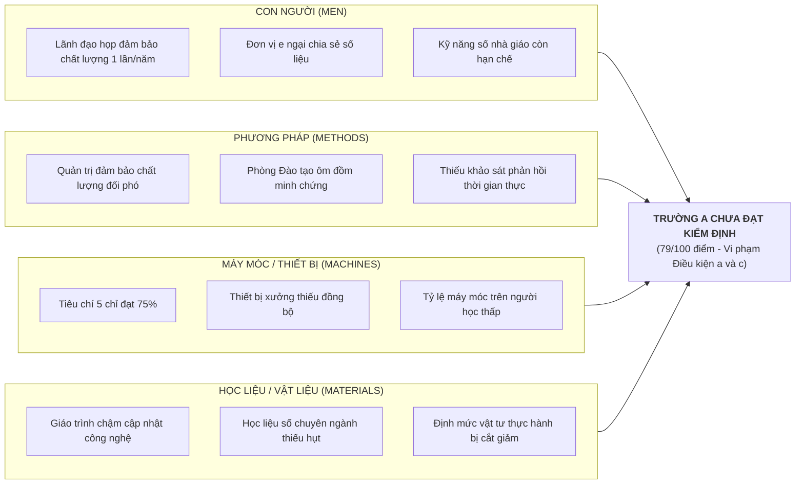

# PHẦN I. BỐI CẢNH CHẤT LƯỢNG VÀ HIỆN TRẠNG KIỂM ĐỊNH CẤP CƠ SỞ TẠI TRƯỜNG CAO ĐẲNG NGHỀ KỸ THUẬT - CÔNG NGHIỆP A

## 1.1. Căn cứ pháp lý và kết quả đối chiếu hiện trạng theo Thông tư số 14/2024/TT-BLĐTBXH

Công tác tự đánh giá chất lượng cơ sở giáo dục nghề nghiệp của Trường Cao đẳng nghề Kỹ thuật - Công nghiệp A được thực hiện vào năm 2026 trên nền tảng pháp lý trực tiếp là Thông tư số 14/2024/TT-BLĐTBXH của Bộ Lao động - Thương binh và Xã hội ban hành Quy định tiêu chí, tiêu chuẩn kiểm định chất lượng giáo dục nghề nghiệp. Văn bản quy phạm pháp luật này đã thiết lập một hệ thống chuẩn mực toàn diện bao gồm tám tiêu chí và năm mươi tiêu chuẩn, áp dụng thang điểm một trăm nhằm đánh giá thực chất mọi mặt hoạt động của nhà trường. Kết quả tự đánh giá chính thức của trường ghi nhận tổng số điểm đạt được là 79 trên 100 điểm, với sự phân bổ điểm số cụ thể qua từng tiêu chí được thể hiện chi tiết trong bảng tổng hợp dưới đây.

**Bảng 1.1. Ma trận đối chiếu kết quả tự đánh giá của Trường Cao đẳng nghề Kỹ thuật - Công nghiệp A với các điều kiện tại Khoản 1 Điều 5 Thông tư số 14/2024/TT-BLĐTBXH**

| Số thứ tự | Tên tiêu chí kiểm định | Số lượng tiêu chuẩn | Điểm chuẩn tối đa | Điểm tự đánh giá | Tỷ lệ hoàn thành | Đánh giá ngưỡng tối thiểu 60% (Điểm b) | Đánh giá ngưỡng trọng điểm 80% (Điểm c) |
| :-: | :--- | :-: | :-: | :-: | :-: | :-: | :-: |
| 1 | Sứ mạng, mục tiêu, tổ chức và quản lý | 5 | 10 | 8 | 80.0% | Đạt | Không thuộc diện áp dụng |
| 2 | Hoạt động đào tạo | 8 | 16 | 12 | 75.0% | Đạt | **Không đạt (Dưới 80%)** |
| 3 | Nhà giáo, cán bộ quản lý, viên chức và người lao động | 7 | 14 | 12 | 85.7% | Đạt | Đạt |
| 4 | Chương trình đào tạo và giáo trình | 7 | 14 | 12 | 85.7% | Đạt | Đạt |
| 5 | Cơ sở vật chất, thiết bị đào tạo và thư viện | 8 | 16 | 12 | 75.0% | Đạt | **Không đạt (Dưới 80%)** |
| 6 | Nghiên cứu khoa học, chuyển giao công nghệ và hợp tác quốc tế | 4 | 8 | 6 | 75.0% | Đạt | Không thuộc diện áp dụng |
| 7 | Người học và hoạt động hỗ trợ người học | 5 | 10 | 8 | 80.0% | Đạt | Không thuộc diện áp dụng |
| 8 | Giám sát, đánh giá chất lượng | 6 | 12 | 9 | 75.0% | Đạt | Không thuộc diện áp dụng |
| **Tổng** | **Toàn bộ hệ thống tiêu chí kiểm định cơ sở** | **50** | **100** | **79** | **79.0%** | **Đạt từng tiêu chí** | **Không đạt điều kiện tổng thể** |

Căn cứ theo quy định tại Khoản 1 Điều 5 Thông tư số 14/2024/TT-BLĐTBXH, một trường cao đẳng được đánh giá là đạt tiêu chuẩn kiểm định chất lượng cơ sở giáo dục nghề nghiệp khi đáp ứng đầy đủ đồng thời cả ba điều kiện pháp lý bắt buộc. Việc đối chiếu bảng điểm thực tế của Trường Cao đẳng nghề Kỹ thuật - Công nghiệp A với từng điều kiện cụ thể cho thấy những vi phạm pháp lý rõ ràng.

Xét theo Điều kiện a về tổng số điểm, văn bản quy phạm pháp luật quy định tổng số điểm đánh giá các tiêu chí kiểm định phải đạt từ 80 điểm trở lên. Dữ liệu thực tế cho thấy Trường Cao đẳng nghề Kỹ thuật - Công nghiệp A chỉ đạt 79 điểm, tức là thiếu 01 điểm so với ngưỡng sàn tối thiểu. Như vậy, nhà trường đã vi phạm Điều kiện a của Khoản 1 Điều 5.

Xét theo Điều kiện b về ngưỡng chất lượng sàn của từng tiêu chí, thông tư quy định điểm đánh giá của từng tiêu chí kiểm định phải đạt từ 60% điểm chuẩn của tiêu chí đó trở lên. Kết quả tính toán tỷ lệ đạt được của tám tiêu chí tại trường dao động từ 75.0% đến 85.7%, trong đó tiêu chí đạt tỷ lệ thấp nhất là Tiêu chí 2, Tiêu chí 5, Tiêu chí 6 và Tiêu chí 8 đều đạt mức 75.0%, vượt qua ngưỡng sàn 60%. Do đó, nhà trường hoàn toàn đáp ứng được Điều kiện b.

Xét theo Điều kiện c về ngưỡng chất lượng đối với các lĩnh vực hoạt động trọng điểm, thông tư quy định điểm đánh giá của các tiêu chí 2, 3, 4 và 5 bắt buộc phải đạt từ 80% điểm chuẩn trở lên. Đối chiếu với bảng số liệu thực tế, trong bốn tiêu chí trọng điểm này, Tiêu chí 3 về đội ngũ nhà giáo đạt 12 trên 14 điểm (tương đương 85.7%) và Tiêu chí 4 về chương trình đào tạo đạt 12 trên 14 điểm (tương đương 85.7%), đều vượt qua ngưỡng 80%. Tuy nhiên, Tiêu chí 2 về hoạt động đào tạo chỉ đạt 12 trên 16 điểm (tương ứng 75.0%) và Tiêu chí 5 về cơ sở vật chất, thiết bị đào tạo chỉ đạt 12 trên 16 điểm (tương ứng 75.0%). Cả hai tiêu chí cốt lõi này đều bị thiếu hụt 5.0% so với chuẩn bắt buộc là 80%. Do đó, nhà trường đã vi phạm nghiêm trọng Điều kiện c.

Từ các phân tích định lượng trên, có thể rút ra kết luận pháp lý chuẩn xác rằng Trường Cao đẳng nghề Kỹ thuật - Công nghiệp A không đạt tiêu chuẩn kiểm định chất lượng cơ sở giáo dục nghề nghiệp do vi phạm đồng thời cả hai điều kiện: vi phạm Điều kiện a do tổng điểm tự đánh giá không chạm ngưỡng 80 điểm và vi phạm Điều kiện c do hai tiêu chí trụ cột phản ánh năng lực vận hành trực tiếp là Tiêu chí 2 và Tiêu chí 5 không đạt ngưỡng 80% điểm chuẩn quy định.

## 1.2. Hiện trạng chất lượng dưới góc nhìn các quan điểm giáo dục nghề nghiệp hiện đại

Khi tiếp cận bối cảnh của Trường Cao đẳng nghề Kỹ thuật - Công nghiệp A dưới góc độ lý luận quản lý chất lượng giáo dục hiện đại (Trần Khánh Đức, 2004; Phạm Thành Nghị, 2000), các số liệu khảo sát thực chứng bộc lộ những khoảng cách sâu sắc giữa kết quả tự đánh giá hồ sơ nội bộ và giá trị thụ hưởng thực tế của các bên liên quan.

Theo quan điểm Giá trị gia tăng (Value-added), chất lượng giáo dục được đo lường bằng sự tiến bộ, sự tích lũy về kiến thức, kỹ năng nghề nghiệp và thái độ mà người học đạt được trong suốt quá trình đào tạo so với mức độ năng lực ban đầu khi bước chân vào nhà trường. Dữ liệu khảo sát ghi nhận tỷ lệ người tốt nghiệp của trường có việc làm trong vòng mười hai tháng đạt 72%. Mặc dù con số này chứng minh nhà trường đã tạo ra một giá trị gia tăng nhất định cho xã hội thông qua việc cung cấp lực lượng lao động kỹ thuật, nhưng khoảng trống 28% người tốt nghiệp chưa tìm được việc làm hoặc rơi vào tình trạng thất nghiệp sau một năm tốt nghiệp phản ánh năng lực cạnh tranh nghề nghiệp của người học còn hạn chế, chưa tạo ra được bước nhảy vọt thực chất về giá trị năng lực để khẳng định vị thế trên thị trường lao động.

Dưới góc nhìn của quan điểm Phù hợp với mục tiêu (Fitness for purpose), chất lượng được xác định thông qua mức độ đáp ứng của sản phẩm đào tạo đối với mục tiêu đã công bố của cơ sở đào tạo và yêu cầu sử dụng của thị trường. Kết quả khảo sát người tốt nghiệp của trường cho thấy chỉ có 58% người học khẳng định bản thân đã học được những kiến thức và kỹ năng cần thiết cho công việc thực tế. Điều này đồng nghĩa với việc có tới 42% người tốt nghiệp cảm thấy kiến thức và kỹ năng được giảng dạy trong nhà trường còn xa rời thực tiễn sản xuất, mang tính lý thuyết hàn lâm hoặc đã lạc hậu. Sự thiếu hụt tính tương thích này chứng tỏ chương trình và quá trình đào tạo của trường chưa bám sát các tiêu chuẩn thực hiện công việc tại doanh nghiệp.

Xét theo quan điểm Thỏa mãn nhu cầu của khách hàng và các bên liên quan (Stakeholder satisfaction), doanh nghiệp tiếp nhận lao động chính là khách hàng sử dụng dịch vụ cuối cùng của quá trình đào tạo nghề nghiệp. Dữ liệu khảo sát đơn vị sử dụng lao động ghi nhận một con số đáng báo động khi chỉ có 46% doanh nghiệp nhận định người tốt nghiệp của trường có thể sử dụng được ngay vào vị trí việc làm. Tỷ lệ 54% doanh nghiệp phản ánh người lao động chưa đáp ứng ngay yêu cầu công việc đồng nghĩa với việc doanh nghiệp phải tốn kém thêm chi phí, thời gian và nguồn lực để tổ chức đào tạo lại. Đây là một minh chứng thực tế rõ ràng cho thấy mức độ hài lòng của khách hàng bên ngoài đối với chất lượng đào tạo của trường đang ở mức thấp.

Đặc biệt, khi đối chiếu với các nguyên lý chất lượng của Mạng lưới các tổ chức Đảm bảo chất lượng Giáo dục đại học Quốc tế (International Network for Quality Assurance Agencies in Higher Education - INQAAHE), chất lượng giáo dục đòi hỏi sự tích hợp đồng thời của ba trụ cột: sự tuân thủ các chuẩn mực quy định, sự hoàn thành các mục tiêu công bố và sự thỏa mãn nhu cầu của người học cùng xã hội. Tại Trường Cao đẳng nghề Kỹ thuật - Công nghiệp A, việc không đạt các chuẩn mực tại Khoản 1 Điều 5 của Thông tư 14/2024/TT-BLĐTBXH, kết hợp với sự suy giảm mức độ hài lòng của cả người học lẫn đơn vị sử dụng lao động, đã khẳng định chất lượng đào tạo của nhà trường đang ở trong tình trạng báo động và thiếu hụt tính bền vững.

## 1.3. Tác động của hệ thống các yếu tố vĩ mô và vi mô đến chất lượng đào tạo

Chất lượng của một cơ sở giáo dục nghề nghiệp không tồn tại biệt lập mà chịu sự chi phối đa chiều bởi các yếu tố thuộc môi trường vĩ mô bên ngoài và các điều kiện vận hành vi mô bên trong nhà trường.

Xét trên bình diện môi trường vĩ mô, bối cảnh chính sách và thị trường đang đặt Trường Cao đẳng nghề Kỹ thuật - Công nghiệp A trước những áp lực cạnh tranh to lớn. Sự chuyển đổi cơ chế quản lý nhà nước thông qua việc ban hành Thông tư số 14/2024/TT-BLĐTBXH đòi hỏi các trường cao đẳng phải chịu trách nhiệm giải trình thực chất và minh bạch hóa cơ sở dữ liệu minh chứng. Song song với đó, chiến lược chuyển đổi số quốc gia và tác động sâu rộng của cuộc Cách mạng công nghiệp lần thứ tư đã làm thay đổi căn bản cơ cấu công nghệ trong các ngành sản xuất kỹ thuật. Sự tích hợp của công nghệ tự động hóa, điều khiển thông minh và mạng lưới vạn vật kết nối trong công nghiệp đòi hỏi nguồn nhân lực kỹ thuật phải được trang bị năng lực số và kỹ năng công nghệ mới. Nếu nhà trường không kịp thời cập nhật các tiêu chuẩn kỹ thuật này vào chương trình và điều kiện thực hành, sản phẩm đào tạo tất yếu sẽ bị thị trường đào thải.

Về phương diện các yếu tố vi mô bên trong nhà trường, sự suy giảm điểm số kiểm định bắt nguồn từ sự thiếu đồng bộ giữa bảy yếu tố cấu thành quá trình đào tạo.

Về mục tiêu đào tạo, nhà trường chưa định kỳ rà soát và điều chỉnh mục tiêu theo sự chuyển dịch của công nghệ sản xuất hiện đại, dẫn đến việc xác định chuẩn đầu ra còn chung chung và thiếu tính đo lường.

Về nội dung chương trình đào tạo, cấu trúc các mô-đun chuyên môn vẫn còn nặng về khối lượng lý thuyết truyền thống, chưa tích hợp linh hoạt các năng lực số ứng dụng và các bài tập thực hành sát với thực tế sản xuất tại các nhà máy thông minh.

Về phương pháp giảng dạy, đa số nhà giáo vẫn duy trì thói quen truyền thụ kiến thức một chiều hoặc hướng dẫn thực hành theo lối mòn thao tác mẫu lặp lại, thiếu vắng các phương pháp sư phạm kích thích tư duy phản biện, giải quyết vấn đề và học tập dựa trên dự án.

Về đội ngũ nhà giáo, mặc dù tỷ lệ đạt chuẩn bằng cấp khá cao với 32% có trình độ thạc sĩ trở lên và 45% đạt kỹ năng nghề bậc cao, nhưng năng lực cập nhật công nghệ mới, trình độ ngoại ngữ chuyên ngành và kỹ năng số ứng dụng trong dạy học thực hành còn nhiều bất cập, tạo ra rào cản trong việc dẫn dắt sinh viên tiếp cận công nghệ cao.

Về chất lượng người học đầu vào, công tác tuyển sinh đối mặt với sự cạnh tranh khốc liệt khiến năng lực học tập ban đầu của học sinh, sinh viên không đồng đều, động cơ nghề nghiệp chưa vững vàng, đòi hỏi nhà trường phải có các cơ chế phân hóa và hỗ trợ học tập chuyên sâu.

Về quá trình tổ chức đào tạo, việc sắp xếp lịch trình thực hành tại xưởng còn bị động, thời lượng tiếp xúc thực tế với thiết bị hiện đại bị chia nhỏ do hạn chế về số lượng trang thiết bị trên mỗi ca học.

Về kiểm tra và đánh giá kết quả học tập, phương thức đánh giá vẫn tập trung chủ yếu vào các bài kiểm tra định kỳ thuần túy, chưa áp dụng rộng rãi phương pháp đánh giá xác thực năng lực thực hành dựa trên sản phẩm thực tế và thiếu sự tham gia đánh giá trực tiếp từ các chuyên gia doanh nghiệp.

## 1.4. Chẩn đoán nguyên nhân gốc rễ theo quy tắc 4M

Để nhận diện chính xác các nguyên nhân cốt lõi dẫn đến việc Trường Cao đẳng nghề Kỹ thuật - Công nghiệp A không đạt tiêu chuẩn kiểm định cơ sở giáo dục nghề nghiệp và làm rõ căn nguyên khiến các tiêu chí 2, 5 rơi xuống mức điểm liệt, việc vận dụng quy tắc 4M (Jain, 2006) bao gồm Con người (Men), Phương pháp (Methods), Máy móc và thiết bị (Machines), Học liệu và nguyên vật liệu (Materials) cho phép chẩn đoán toàn diện hệ thống.

Về yếu tố Con người (Men), đây là nguyên nhân chi phối mang tính quyết định đến sự trì trệ của toàn bộ hệ thống. Mặc dù nhà trường sở hữu 180 nhà giáo với các chỉ số văn bằng ấn tượng, sự thụ động trong nhận thức về quản lý chất lượng là rào cản lớn nhất. Ban Đảm bảo chất lượng của trường mỗi năm chỉ tổ chức họp duy nhất một lần, chứng tỏ công tác quản trị chất lượng chưa được coi là một hoạt động tác nghiệp thường xuyên mà chỉ mang tính chất thủ tục đối phó cuối năm. Đáng nghiêm trọng hơn, dữ liệu tình huống chỉ rõ nhiều đơn vị trong trường có tâm lý e ngại cung cấp số liệu cho bộ phận chuyên trách. Tâm lý này xuất phát từ nỗi sợ bị nhận diện khuyết điểm, sợ bị quy trách nhiệm khi phát hiện sai lệch số liệu và thiếu niềm tin vào sự bảo mật thông tin. Khi đội ngũ cán bộ, nhà giáo không tự nguyện chia sẻ dữ liệu thực chất, bức tranh chất lượng của nhà trường tất yếu bị méo mó và mất tính trung thực.

Về yếu tố Phương pháp (Methods), quy trình quản trị chất lượng hiện hành của trường mang tính tập trung quan liêu và thiếu hụt các công cụ kiểm soát hiện đại. Toàn bộ gánh nặng thu thập và lưu giữ hồ sơ minh chứng kiểm định bị dồn nén cho Phòng Đào tạo tự xoay xở. Mô hình lưu giữ phân tán, thiếu tính liên thông giữa các phòng chức năng và các khoa chuyên môn khiến công tác đối soát dữ liệu gặp nhiều sai sót và chậm trễ. Nhà trường hoàn toàn thiếu vắng các quy trình khảo sát phản hồi thời gian thực từ người học và doanh nghiệp. Việc khảo sát giấy vào cuối khóa học tạo ra độ trễ thông tin quá lớn, khiến những phản ánh tiêu cực của sinh viên về nội dung môn học hoặc tình trạng hỏng hóc của thiết bị không thể được can thiệp và cải tiến ngay trong quá trình giảng dạy.

Về yếu tố Máy móc và thiết bị (Machines), đây chính là điểm nghẽn trực tiếp dẫn đến việc Tiêu chí 5 chỉ đạt 12 trên 16 điểm (75.0%), vi phạm nghiêm trọng Điều kiện c của thông tư kiểm định. Với quy mô đào tạo lên tới 3.200 học sinh, sinh viên trải rộng trên mười hai nghề kỹ thuật, hệ thống nhà xưởng thực hành và trang thiết bị đào tạo của trường đang đối mặt với tình trạng quá tải nghiêm trọng. Số lượng thiết bị chuyên dùng hiện đại, thiết bị tự động hóa và các bộ thực hành chuyên sâu không đủ để đáp ứng định mức quy định trên mỗi sinh viên trong giờ học thực hành. Nhiều trang thiết bị đã lạc hậu so với dây chuyền công nghệ đang vận hành tại các doanh nghiệp đối tác, dẫn đến tình trạng sinh viên chỉ được quan sát lý thuyết hoặc thao tác luân phiên theo nhóm lớn, làm suy giảm trực tiếp kỹ năng thực hành nghề nghiệp.

Về yếu tố Học liệu và nguyên vật liệu (Materials), công tác biên soạn, thẩm định và cập nhật giáo trình chưa theo kịp tốc độ thay đổi của công nghệ sản xuất công nghiệp. Các tài liệu hướng dẫn thực hành còn thiếu các bài tập tình huống mô phỏng số và chưa tích hợp các tiêu chuẩn an toàn lao động quốc tế. Bên cạnh đó, áp lực về cân đối tài chính trong cơ chế vận hành khiến định mức cấp phát vật tư tiêu hao, phôi liệu và linh kiện phục vụ cho các giờ thực hành của sinh viên bị hạn chế. Tình trạng thiếu thốn vật tư khiến giảng viên buộc phải giảm bớt thời lượng thao tác thực tế hoặc cho sinh viên tái sử dụng các vật tư đã qua sử dụng, ảnh hưởng nghiêm trọng đến tính chính xác và độ chuẩn xác của sản phẩm thực hành.

Đánh giá tổng thể từ mô hình 4M cho thấy, sự suy giảm chất lượng tại Trường Cao đẳng nghề Kỹ thuật - Công nghiệp A là kết quả tổng hòa của sự buông lỏng trong phương pháp quản trị con người, sự thiếu hụt phương pháp kiểm soát chất lượng chủ động và sự thiếu đồng bộ về điều kiện cơ sở vật chất trang thiết bị xưởng thực hành. Đây là những căn cứ thực tiễn cốt lõi để nhà trường phải tiến hành tái cấu trúc toàn diện khi triển khai tự đánh giá chương trình đào tạo và thiết lập hệ thống đảm bảo chất lượng bên trong trong giai đoạn tiếp theo.
