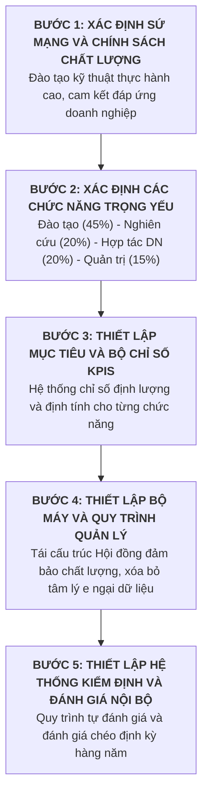
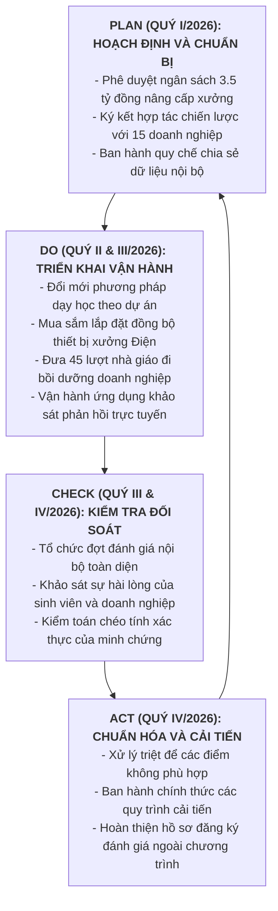

# PHẦN III. THIẾT KẾ HỆ THỐNG ĐẢM BẢO CHẤT LƯỢNG BÊN TRONG VÀ KẾ HOẠCH HÀNH ĐỘNG CẢI TIẾN THEO CHU TRÌNH PDCA

## 3.1. Thiết kế hệ thống đảm bảo chất lượng bên trong theo mô hình của David Lim (2001)

Nhằm khắc phục triệt để tình trạng quản trị chất lượng mang tính hình thức, sự thụ động trong việc thu thập dữ liệu và sự đứt gãy thông tin giữa các phòng, khoa từng xảy ra trong đợt tự đánh giá cấp trường năm 2026, Trường Cao đẳng nghề Kỹ thuật - Công nghiệp A cần tái thiết lập hệ thống đảm bảo chất lượng bên trong (Internal Quality Assurance - IQA) một cách bài bản. Mô hình thiết kế được lựa chọn dựa trên khung lý luận năm bước kinh điển của David Lim (2001) về thiết lập hệ thống đảm bảo chất lượng trong các cơ sở giáo dục, được hiệu chỉnh linh hoạt để phù hợp với bối cảnh đặc thù của một trường cao đẳng kỹ thuật công nghệ tại Việt Nam.

Ở Bước 1 về xác định sứ mạng và chính sách chất lượng, nhà trường tiến hành tái định vị sứ mạng là cơ sở đào tạo nguồn nhân lực kỹ thuật chất lượng cao, có năng lực thực hành xuất sắc, kỷ luật lao động và khả năng thích ứng linh hoạt với chuyển đổi số công nghiệp; đóng vai trò trung tâm đào tạo và thực nghiệm kỹ thuật then chốt của vùng kinh tế trọng điểm. Trên cơ sở sứ mạng đó, Hội đồng trường ban hành Chính sách chất lượng giai đoạn 2026 - 2030 với thông điệp cốt lõi: "Lấy chất lượng thực hành làm nền tảng, lấy sự hài lòng của doanh nghiệp làm thước đo, lấy tinh thần cải tiến liên tục làm động lực phát triển". Chính sách này xác lập cam kết của lãnh đạo nhà trường về việc công khai, minh bạch dữ liệu và bảo đảm mọi nguồn lực cần thiết cho công tác đảm bảo chất lượng.

Ở Bước 2 về xác định các chức năng trọng yếu và tỷ trọng chiến lược, hệ thống quản trị của trường được phân định thành bốn chức năng nền tảng có mối quan hệ tương hỗ chặt chẽ:
* Chức năng thứ nhất là Đào tạo nghề và phát triển kỹ năng thực hành, chiếm tỷ trọng chiến lược 45%, tập trung vào việc tổ chức giảng dạy các chương trình cao đẳng, trung cấp đáp ứng chuẩn đầu ra và rèn luyện kỹ năng thực tế cho người học.
* Chức năng thứ hai là Nghiên cứu ứng dụng và chuyển giao công nghệ kỹ thuật, chiếm tỷ trọng chiến lược 20%, hướng tới việc sáng chế mô hình học cụ, cải tiến thiết bị xưởng và thực hiện các đề tài kỹ thuật ứng dụng phục vụ sản xuất.
* Chức năng thứ ba là Hợp tác doanh nghiệp và giải quyết việc làm, chiếm tỷ trọng chiến lược 20%, giữ vai trò cầu nối tiếp nhận phản hồi từ thị trường lao động, tổ chức cho sinh viên thực tập tại doanh nghiệp và cam kết giới thiệu việc làm sau tốt nghiệp.
* Chức năng thứ tư là Quản trị nhà trường và phát triển nguồn lực, chiếm tỷ trọng chiến lược 15%, bảo đảm sự vận hành thông suốt của bộ máy, quản trị tài chính, nâng cấp cơ sở vật chất và bồi dưỡng đội ngũ nhà giáo.

Ở Bước 3 về xác định mục tiêu và bộ chỉ số đo lường hiệu năng cốt lõi (Key Performance Indicators - KPIs), mỗi chức năng được cụ thể hóa bằng các chỉ số định lượng và định tính có thể kiểm chứng độc lập. Đối với chức năng đào tạo, chỉ tiêu đặt ra là tỷ lệ sinh viên duy trì sĩ số toàn khóa đạt trên 88%, tỷ lệ tốt nghiệp đạt trên 85%, trong đó tối thiểu 70% xếp loại khá trở lên. Đối với chức năng nghiên cứu, mỗi khoa chuyên môn hàng năm phải hoàn thành tối thiểu hai đề tài cải tiến thiết bị dạy học được nghiệm thu và đưa vào ứng dụng xưởng. Đối với chức năng hợp tác doanh nghiệp, chỉ tiêu đặt ra là 100% sinh viên được thực tập tại các doanh nghiệp có dây chuyền công nghệ phù hợp, tỷ lệ người tốt nghiệp có việc làm đúng ngành nghề đào tạo trong vòng mười hai tháng đạt từ 80% trở lên, và tỷ lệ doanh nghiệp đánh giá người học có thể sử dụng được ngay đạt tối thiểu 70%. Đối với chức năng quản trị, 100% hồ sơ minh chứng kiểm định được quản lý trên nền tảng số và tỷ lệ nhà giáo đạt chuẩn kỹ năng nghề bậc cao nâng lên trên 60%.

Ở Bước 4 về thiết lập bộ máy quản lý và quy trình vận hành, Trường Cao đẳng nghề Kỹ thuật - Công nghiệp A tiến hành tái cấu trúc toàn diện cơ cấu tổ chức đảm bảo chất lượng nhằm xóa bỏ triệt để tình trạng Ban Đảm bảo chất lượng chỉ họp mỗi năm một lần và Phòng Đào tạo phải đơn độc gánh vác trách nhiệm lưu giữ minh chứng:
* Tái lập Hội đồng Đảm bảo chất lượng cấp trường do Hiệu trưởng trực tiếp làm Chủ tịch, Trưởng phòng Đảm bảo chất lượng làm Phó Chủ tịch thường trực, các thành viên là Trưởng các khoa chuyên môn và Trưởng các phòng ban chức năng; Hội đồng duy trì lịch họp giao ban định kỳ hàng tháng để rà soát tiến độ thực hiện mục tiêu chất lượng.
* Phòng Đảm bảo chất lượng được kiện toàn với cơ cấu chuyên trách, đóng vai trò hạt nhân tham mưu, phát triển công cụ đo lường, hướng dẫn kỹ thuật thu thập minh chứng và giám sát cơ sở dữ liệu chất lượng toàn trường.
* Thành lập Tổ Đảm bảo chất lượng tại từng khoa chuyên môn do Trưởng khoa làm Tổ trưởng và bố trí một giảng viên chuyên trách theo dõi công tác minh chứng, thực hiện nguyên tắc tự giác và phân quyền: mỗi đơn vị tự quản lý và chịu trách nhiệm về tính trung thực của dữ liệu thuộc phạm vi phụ trách.
* Ban hành Quy chế chia sẻ dữ liệu và bảo mật thông tin nội bộ, quy định rõ việc cung cấp số liệu phục vụ đảm bảo chất lượng là nghĩa vụ bắt buộc của mọi viên chức và người lao động; kết quả đánh giá chất lượng được sử dụng nhằm mục đích cải tiến quy trình chứ không dùng làm công cụ xử phạt cá nhân, qua đó xóa bỏ tâm lý e ngại cung cấp số liệu trong toàn trường.

Ở Bước 5 về thiết lập hệ thống kiểm định và đánh giá nội bộ định kỳ, nhà trường ban hành Quy trình tự đánh giá và kiểm toán chất lượng nội bộ (Internal Quality Audit) theo chu kỳ sáu tháng một lần. Hoạt động đánh giá nội bộ được tiến hành thông qua các đoàn đánh giá chéo giữa các khoa chuyên môn, tập trung kiểm tra tính xác thực của hồ sơ minh chứng, dự giờ giảng dạy thực hành, kiểm tra thực tế tình trạng an toàn của máy móc thiết bị xưởng và phỏng vấn ngẫu nhiên người học. Mọi sai lệch hoặc điểm không phù hợp đều phải được ghi nhận vào Biên bản khuyến nghị cải tiến kèm thời hạn khắc phục bắt buộc, bảo đảm chất lượng được duy trì liên tục trước khi bước vào các kỳ kiểm định ngoài chính thức.

## 3.2. Kế hoạch cải tiến chất lượng chu kỳ 01 năm theo chu trình PDCA

Để khắc phục dứt điểm các nguyên nhân gốc rễ khiến Trường Cao đẳng nghề Kỹ thuật - Công nghiệp A bị đánh trượt kiểm định cấp cơ sở năm 2026, một kế hoạch hành động cải tiến chất lượng trong chu kỳ 01 năm (từ tháng 01/2026 đến tháng 01/2027) được thiết lập theo chu trình Plan - Do - Check - Act (Hoạch định - Thực hiện - Kiểm tra - Cải tiến - PDCA). Mục tiêu trọng tâm của kế hoạch là tập trung nguồn lực đưa Tiêu chí 2 về Hoạt động đào tạo và Tiêu chí 5 về Cơ sở vật chất từ mức 75% vượt ngưỡng 80% điểm chuẩn quy định, đồng thời củng cố vững chắc Tiêu chí 3 và Tiêu chí 4 để chuẩn bị tự đánh giá lại cấp trường và bảo đảm chương trình đào tạo nghề Điện công nghiệp đạt kiểm định ngoài với điểm số an toàn.

Trong giai đoạn Hoạch định (Plan) diễn ra trong Quý I năm 2026, nhà trường tập trung phân tích sâu sắc nguyên nhân các tiêu chuẩn bị mất điểm trong đợt tự đánh giá cấp cơ sở năm 2026, xác định chính xác các điểm nghẽn về cơ sở vật chất và phương pháp tổ chức đào tạo. Hội đồng trường tổ chức phiên họp bất thường để thông qua Nghị quyết phê duyệt gói ngân sách đầu tư trọng điểm trị giá 3.5 tỷ đồng dành riêng cho việc hiện đại hóa hệ thống xưởng thực hành và mua sắm thiết bị chuyên ngành Điện công nghiệp. 

Song song với đó, Ban Giám hiệu chủ trì làm việc và ký kết thỏa thuận hợp tác chiến lược với mười lăm doanh nghiệp lớn trong các khu công nghiệp lân cận về việc tiếp nhận sinh viên thực tập tốt nghiệp, tài trợ linh kiện thực hành và cử kỹ sư tham gia đánh giá kết quả học tập của người học. Để giải quyết tâm lý e ngại của các đơn vị, nhà trường ban hành Quy chế chia sẻ dữ liệu và bảo mật thông tin nội bộ, tổ chức hội nghị quán triệt tư tưởng cho toàn thể viên chức và người lao động về tầm quan trọng của việc cung cấp dữ liệu minh chứng trung thực, khách quan.

Trong giai đoạn Thực hiện (Do) triển khai xuyên suốt Quý II và Quý III năm 2026, toàn bộ các giải pháp cải tiến được kích hoạt đồng bộ trên cả bốn khía cạnh của quy tắc 4M:
* Đối với Tiêu chí 2 (Hoạt động đào tạo), Khoa Điện - Điện tử phối hợp Phòng Đào tạo tái cấu trúc lại kế hoạch giảng dạy, chuyển đổi mạnh mẽ từ phương pháp thuyết trình truyền thống sang phương pháp dạy học tích hợp và học tập dựa trên dự án (Project-based learning); toàn bộ ngân hàng đề thi thực hành được rà soát và bổ sung các bài toán kỹ thuật thực tế từ doanh nghiệp.
* Đối với Tiêu chí 5 (Cơ sở vật chất, thiết bị đào tạo), Phòng Quản trị Thiết bị hoàn thành quy trình đấu thầu, mua sắm và lắp đặt bổ sung mười hai bộ thực hành điều khiển tự động hóa PLC thế hệ mới, mười bộ biến tần công nghiệp, nâng cấp toàn bộ hệ thống lưới điện thực hành xưởng và trang bị đầy đủ thiết bị bảo hộ, tiếp địa an toàn chống giật đạt chuẩn quốc gia.
* Đối với đội ngũ nhà giáo và người học, nhà trường cử bốn mươi lăm lượt nhà giáo Khoa Điện đi thực tế hai tháng tại các nhà máy sản xuất của doanh nghiệp đối tác để cập nhật công nghệ mới; đưa vào vận hành phần mềm khảo sát phản hồi trực tuyến cài đặt trên điện thoại di động của người học, cho phép thu thập ý kiến đánh giá về chất lượng môn học và điều kiện thiết bị xưởng ngay sau khi kết thúc từng mô-đun thực hành.

Trong giai đoạn Kiểm tra (Check) tiến hành vào cuối Quý III và đầu Quý IV năm 2026, nhà trường tổ chức đợt kiểm toán chất lượng nội bộ toàn diện nhằm đối soát mức độ tiến bộ của các tiêu chí so với chuẩn kiểm định của Thông tư 14/2024/TT-BLĐTBXH. Phòng Đảm bảo chất lượng tiến hành khảo sát độc lập trên quy mô toàn thể sinh viên năm cuối và các doanh nghiệp đối tác, đặt mục tiêu nâng tỷ lệ sinh viên hài lòng về kỹ năng đào tạo từ 58% lên trên 75% và nâng tỷ lệ doanh nghiệp đánh giá người học có thể sử dụng được ngay từ 46% lên trên 65%. Các đoàn đánh giá chéo thực hiện kiểm tra thực tế tại xưởng thực hành, đối chiếu nhật ký bảo dưỡng máy móc và thẩm định tính pháp lý, tính đầy đủ của toàn bộ hồ sơ minh chứng trước khi tích hợp vào cơ sở dữ liệu chung.

Trong giai đoạn Cải tiến và Chuẩn hóa (Act) hoàn tất vào Quý IV năm 2026, Hội đồng Đảm bảo chất lượng tổ chức phiên họp toàn thể để xem xét báo cáo kết quả kiểm toán nội bộ, tiến hành phân tích các tồn tại còn sót lại và chỉ định các đơn vị có trách nhiệm xử lý dứt điểm các điểm không phù hợp. Các quy trình đào tạo và quy trình quản lý minh chứng đã thử nghiệm thành công được Hiệu trưởng ký ban hành thành quy chuẩn vận hành chính thức của nhà trường. Ban Giám hiệu thực hiện công tác khen thưởng đối với các tập thể, cá nhân có đóng góp xuất sắc trong phong trào cải tiến chất lượng và chấn chỉnh nghiêm khắc các biểu hiện đối phó số liệu. Toàn bộ Báo cáo tự đánh giá chính thức của nhà trường và Hồ sơ tự đánh giá chương trình đào tạo nghề Điện công nghiệp được hoàn thiện, đóng cuốn và sẵn sàng nộp lên cơ quan kiểm định độc lập để đăng ký đánh giá ngoài vào đầu năm 2027.

## 3.3. Ma trận phân công trách nhiệm và bảng kế hoạch hành động tổng thể

Để kế hoạch cải tiến chất lượng được vận hành một cách minh bạch, đúng tiến độ và không bị chồng chéo chức năng, nhà trường áp dụng ma trận phân công trách nhiệm RACI, bao gồm: người trực tiếp thực hiện công việc (Responsible - R), người chịu trách nhiệm phê duyệt và giải trình cuối cùng (Accountable - A), người được tham vấn chuyên môn (Consulted - C), và người được thông báo tiến độ (Informed - I).

**Bảng 3.1. Kế hoạch hành động tổng thể cải tiến chất lượng Trường Cao đẳng nghề Kỹ thuật - Công nghiệp A giai đoạn 2026 - 2027**

| STT | Nội dung công việc cải tiến trọng tâm | Tiêu chí khắc phục | Đơn vị chủ trì (R) | Đơn vị phối hợp (C, I) | Cấp phê duyệt (A) | Thời hạn hoàn thành | Nguồn kinh phí dự toán | Chuẩn đầu ra và Chỉ số hiệu năng cốt lõi (KPIs) |
| :-: | :--- | :---: | :--- | :--- | :---: | :---: | :---: | :--- |
| 1 | Phê duyệt ngân sách và đề án nâng cấp xưởng thực hành nghề Điện công nghiệp | Tiêu chí 5 | Phòng Kế hoạch Tài chính | Phòng Quản trị Thiết bị, Khoa Điện | Hội đồng trường, Hiệu trưởng | Tháng 02/2026 | Nguồn ngân sách trường | Nghị quyết phê duyệt gói ngân sách 3.5 tỷ đồng được ban hành chính thức. |
| 2 | Ký kết thỏa thuận hợp tác chiến lược với 15 doanh nghiệp sản xuất và tiếp nhận thực tập | Tiêu chí 2, 7 | Trung tâm Hợp tác Doanh nghiệp | Khoa Điện, Phòng Đào tạo | Hiệu trưởng | Tháng 03/2026 | 50 triệu đồng | 15 thỏa thuận hợp tác đào tạo và tiếp nhận sinh viên thực tập có giá trị pháp lý. |
| 3 | Ban hành Quy chế chia sẻ dữ liệu và bảo mật thông tin nội bộ phục vụ đảm bảo chất lượng | Tiêu chí 1, 8 | Phòng Bảo đảm chất lượng | Phòng Tổ chức Cán bộ, các Khoa | Hiệu trưởng | Tháng 03/2026 | Chi thường xuyên | Quy chế nội bộ được ban hành; 100% cán bộ, nhà giáo ký cam kết cung cấp dữ liệu. |
| 4 | Đổi mới phương pháp giảng dạy mô-đun thực hành theo dự án và rà soát ngân hàng đề thi | Tiêu chí 2 | Khoa Điện - Điện tử | Phòng Đào tạo, Phòng Bảo đảm chất lượng | Phó Hiệu trưởng Đào tạo | Tháng 05/2026 | 150 triệu đồng | 100% đề cương chi tiết tích hợp phương pháp dự án; ngân hàng đề thi cập nhật 100%. |
| 5 | Mua sắm, lắp đặt và nghiệm thu thiết bị thực hành xưởng PLC, máy điện và tiếp địa an toàn | Tiêu chí 5 | Phòng Quản trị Thiết bị | Khoa Điện, Phòng Kế hoạch Tài chính | Hiệu trưởng | Tháng 07/2026 | 3.5 tỷ đồng | 12 bộ PLC, 10 bộ biến tần mới được nghiệm thu; hệ thống tiếp địa đạt chuẩn an toàn. |
| 6 | Cử 45 lượt nhà giáo Khoa Điện đi thực tế tại doanh nghiệp sản xuất trong thời gian 02 tháng | Tiêu chí 3, 4 | Khoa Điện - Điện tử | Phòng Tổ chức Cán bộ, Doanh nghiệp | Hiệu trưởng | Tháng 08/2026 | 280 triệu đồng | 45 báo cáo thu hoạch thực tế có dấu mộc xác nhận và đánh giá đạt của doanh nghiệp. |
| 7 | Triển khai phần mềm ứng dụng di động khảo sát phản hồi chất lượng đào tạo thời gian thực | Tiêu chí 8 | Phòng Bảo đảm chất lượng | Trung tâm Công nghệ Thông tin, các Khoa | Phó Hiệu trưởng phụ trách chất lượng | Tháng 09/2026 | 120 triệu đồng | Phần mềm vận hành chính thức; tỷ lệ sinh viên tham gia đánh giá đạt trên 90%. |
| 8 | Tổ chức đợt kiểm toán chất lượng nội bộ toàn diện và đánh giá chéo giữa các đơn vị | Toàn bộ 8 Tiêu chí | Đoàn Đánh giá nội bộ | Toàn thể các phòng, khoa, trung tâm | Hiệu trưởng | Tháng 10/2026 | 80 triệu đồng | Báo cáo kiểm toán nội bộ chỉ rõ các điểm không phù hợp và khuyến nghị cải tiến. |
| 9 | Khắc phục các điểm không phù hợp và chuẩn hóa văn bản hóa hệ thống quy trình tác nghiệp | Toàn bộ 8 Tiêu chí | Các đơn vị có tồn tại | Phòng Bảo đảm chất lượng | Hiệu trưởng | Tháng 11/2026 | Chi thường xuyên | 100% các khuyến nghị cải tiến được khắc phục; hệ thống quy trình nội bộ chuẩn hóa. |
| 10 | Hoàn thiện Báo cáo tự đánh giá cấp trường và Báo cáo tự đánh giá chương trình đào tạo nghề Điện | Tiêu chí cơ sở và chương trình đào tạo | Hội đồng Tự đánh giá | Phòng Bảo đảm chất lượng, Khoa Điện, Phòng Đào tạo | Hiệu trưởng | Tháng 12/2026 | 100 triệu đồng | Báo cáo tự đánh giá hoàn chỉnh; Tiêu chí 2 và 5 đạt trên 80%; chương trình đào tạo đạt 82.5 điểm sẵn sàng đánh giá ngoài. |

Bảng kế hoạch hành động tổng thể trên thiết lập lộ trình rõ ràng, lượng hóa các chỉ tiêu đầu ra và phân định minh bạch trách nhiệm giữa các đơn vị tác nghiệp, tạo cơ sở vững chắc để Trường Cao đẳng nghề Kỹ thuật - Công nghiệp A hiện thực hóa mục tiêu nâng cao chất lượng thực chất và sẵn sàng đón nhận các đoàn kiểm định ngoài độc lập.
