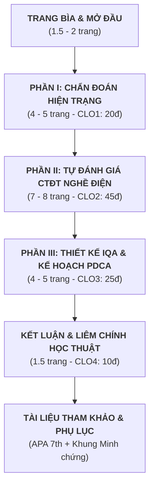

# DÀN Ý CHI TIẾT VÀ KẾ HOẠCH NỘI DUNG BÁO CÁO ĐỀ ÁN CUỐI KỲ (CHỦ ĐỀ 01)

**Tên đề án:** Đề án số 01 – *Trường Cao đẳng nghề Kỹ thuật - Công nghiệp A chuẩn bị đánh giá ngoài chương trình đào tạo*  
**Học phần:** Quản lý chất lượng giáo dục nghề nghiệp (ED6111)  
**Trình độ:** Thạc sĩ | **Trọng số:** 60% (Báo cáo: 45% + Vấn đáp: 15%)  
**Học viên:** Lê Hạnh Nguyên – Mã học viên: 20252233M  
**Giảng viên hướng dẫn:** PGS. TS. Lê Huy Tùng  
**Dung lượng quy định:** 18 – 20 trang A4 (không tính bìa, mục lục, phụ lục), Times New Roman 13, giãn dòng 1.3.

---

## TỔNG THỂ CẤU TRÚC, NỘI DUNG VÀ TÀI LIỆU THAM KHẢO

---

## BẢN THIẾT KẾ NỘI DUNG CHI TIẾT TỪNG MỤC

### TRANG BÌA & DANH MỤC ĐẦU BÁO CÁO (Trang i - iv)
- **Trang bìa chính & Bìa phụ:** Theo mẫu chuẩn tại `cuoiki/latex/trang_bia.tex` của Khoa KH&CN Giáo dục – ĐHBK Hà Nội.
- **Mục lục tự động:** Đầy đủ các tiêu đề từ Cấp 1, Cấp 2, Cấp 3 kèm số trang chính xác.
- **Danh mục chữ viết tắt:** GDNN, CTĐT, ĐBCL, IQA, EOMS, TQM, PDCA, VQF, CĐR, HSSV, CBQL, TT-BLĐTBXH, ĐVSUDLĐ.
- **Danh mục Bảng biểu và Sơ đồ:** Đánh số khoa học (Bảng 1.1, Bảng 2.1, Sơ đồ 3.1,...).

---

### MỞ ĐẦU (Dung lượng: 1.5 – 2.0 trang)

#### 1. Lý do lựa chọn đề án và tính cấp thiết
- **Sẽ viết gì:**
  * Bối cảnh đổi mới GDNN theo Luật số 124/2025/QH15 (có hiệu lực từ 01/01/2026 thay thế Luật Giáo dục nghề nghiệp số 74/2014/QH13) và Thông tư số 14/2024/TT-BLĐTBXH với yêu cầu chuyển từ kiểm tra hình thức sang kiểm định thực chất dựa trên văn hóa chất lượng và trách nhiệm giải trình.
  * Nghịch lý của Trường Cao đẳng nghề Kỹ thuật - Công nghiệp A: Có quy mô lớn (3.200 HSSV, 12 nghề), tỷ lệ giảng viên có trình độ khá cao (32% ThS trở lên, 45% kỹ năng nghề cao), nhưng kết quả tự đánh giá năm 2026 chỉ đạt 79/100 điểm – không đạt chuẩn kiểm định cấp trường; tỷ lệ người tốt nghiệp có việc làm đạt 72%, song chỉ 46% doanh nghiệp hài lòng và 58% sinh viên cảm thấy học được kỹ năng cần thiết.
  * Tầm quan trọng của việc chuẩn bị đánh giá ngoài CTĐT nghề Điện công nghiệp: Đây là nghề trọng điểm của trường; việc chuẩn bị tự đánh giá CTĐT vừa là cơ hội rà soát thực chất chất lượng đào tạo, vừa tạo đòn bẩy tái cấu trúc hệ thống ĐBCL bên trong (IQA) của toàn trường.
- **Tài liệu tham khảo sử dụng:**
  * Luật số 124/2025/QH15 (thay thế Luật Giáo dục nghề nghiệp số 74/2014/QH13).
  * Thông tư số 14/2024/TT-BLĐTBXH ngày 31/12/2024 của Bộ Lao động - Thương binh và Xã hội.
  * Lê Huy Tùng (Bài giảng QLCLGDNN, ĐHBK Hà Nội).

#### 2. Đối tượng, phạm vi và mục tiêu của đề án
- **Sẽ viết gì:**
  * *Đối tượng nghiên cứu:* Công tác quản lý chất lượng tại Trường Cao đẳng nghề Kỹ thuật - Công nghiệp A và CTĐT trình độ cao đẳng nghề Điện công nghiệp.
  * *Phạm vi nghiên cứu:* Dữ liệu tự đánh giá năm 2026 của trường; khung tiêu chuẩn kiểm định CTĐT cao đẳng theo Chương III Thông tư 14/2024; mô hình IQA và kế hoạch cải tiến trong chu kỳ 01 năm (2026 - 2027).
  * *Mục tiêu tổng quát:* Chẩn đoán nguyên nhân trường A chưa đạt chuẩn cấp cơ sở, thiết lập bộ công cụ tự đánh giá cho CTĐT nghề Điện công nghiệp, và thiết kế hệ thống IQA gắn với kế hoạch cải tiến PDCA để đưa trường đạt chuẩn.
- **Tài liệu tham khảo sử dụng:**
  * Đề cương học phần ED6111 (`course-info.md`).

#### 3. Phương pháp tiếp cận và cấu trúc báo cáo
- **Sẽ viết gì:**
  * Phương pháp phân tích văn bản pháp quy, phương pháp đối soát định lượng chuẩn kiểm định, phương pháp quy nạp - suy diễn theo mô hình 4M và chu trình PDCA.
  * Tóm tắt kết cấu báo cáo gồm 3 phần nội dung chính, kết luận, khuyến nghị và phụ lục.

---

### PHẦN I: PHÂN TÍCH BỐI CẢNH CHẤT LƯỢNG VÀ CHẨN ĐOÁN HIỆN TRẠNG KIỂM ĐỊNH CẤP CƠ SỞ CỦA TRƯỜNG A (Dung lượng: 4.0 – 5.0 trang | CLO1 - 20 điểm)

#### 1.1. Phân tích pháp lý: Đối chiếu hiện trạng tự đánh giá của Trường A với Khoản 1 Điều 5 Thông tư 14/2024/TT-BLĐTBXH
- **Sẽ viết gì:**
  * Lập bảng đối chiếu chi tiết điểm số tự đánh giá 8 tiêu chí của Trường A (Tổng 79/100 điểm) với các ngưỡng quy định tại Khoản 1 Điều 5:
    + **Bảng 1.1: Ma trận đối chiếu kết quả tự đánh giá của Trường A với 03 điều kiện của Khoản 1 Điều 5 Thông tư 14/2024/TT-BLĐTBXH.**
  * Phân tích toán học - pháp lý theo 3 điều kiện:
    1. *Điều kiện a (Tổng số điểm đạt từ 80 điểm trở lên):* Trường A đạt 79/100 điểm $\rightarrow$ **KHÔNG ĐẠT (vi phạm điểm a, thiếu 01 điểm)**.
    2. *Điều kiện b (Từng tiêu chí đạt từ 60% điểm chuẩn trở lên):* Rà soát tỷ lệ đạt của từng tiêu chí:
       - TC1: 8/10 (80.0%), TC2: 12/16 (75.0%), TC3: 12/14 (85.7%), TC4: 12/14 (85.7%), TC5: 12/16 (75.0%), TC6: 6/8 (75.0%), TC7: 8/10 (80.0%), TC8: 9/12 (75.0%).
       - Mọi tiêu chí đều $\ge$ 60% $\rightarrow$ **ĐẠT điều kiện b**.
    3. *Điều kiện c (Điểm đánh giá các tiêu chí 2, 3, 4, 5 đạt từ 80% điểm chuẩn trở lên):*
       - Tiêu chí 2 (*Hoạt động đào tạo*): 12/16 = **75.0% < 80%** $\rightarrow$ **VI PHẠM (không đạt)**.
       - Tiêu chí 3 (*Nhà giáo, CBQL, viên chức, NLĐ*): 12/14 = **85.7% $\ge$ 80%** $\rightarrow$ Đạt.
       - Tiêu chí 4 (*Chương trình đào tạo, giáo trình*): 12/14 = **85.7% $\ge$ 80%** $\rightarrow$ Đạt.
       - Tiêu chí 5 (*Cơ sở vật chất, thiết bị đào tạo*): 12/16 = **75.0% < 80%** $\rightarrow$ **VI PHẠM (không đạt)**.
  * **Kết luận pháp lý chuẩn xác:** Trường A trượt kiểm định cấp trường do **vi phạm đồng thời 02 điều kiện**: Điều kiện a (thiếu 1 điểm tổng) và Điều kiện c (cả hai tiêu chí cốt lõi là Tiêu chí 2 và Tiêu chí 5 đều không vượt qua ngưỡng 80% điểm chuẩn).
- **Tài liệu tham khảo sử dụng:**
  * Thông tư số 14/2024/TT-BLĐTBXH, Điều 4 và Điều 5.

#### 1.2. Phân tích bối cảnh theo các quan điểm đánh giá chất lượng GDNN
- **Sẽ viết gì:**
  * *Quan điểm Giá trị gia tăng (Value-added):* Phân tích dữ liệu người tốt nghiệp có việc làm đạt 72% trong 12 tháng. Đây là kết quả có đóng góp cho xã hội nhưng 28% còn lại phản ánh năng lực cạnh tranh chưa cao của sinh viên tốt nghiệp; giá trị gia tăng về kỹ năng chưa đủ bù đắp yêu cầu thị trường.
  * *Quan điểm Phù hợp mục tiêu (Fitness for purpose):* Chỉ có 58% sinh viên tốt nghiệp cho rằng đã học được kiến thức, kỹ năng cần thiết cho công việc $\rightarrow$ 42% cảm thấy chương trình lệch pha với công việc thực tế, mục tiêu đào tạo chưa bám sát chuẩn nghề nghiệp thực tế.
  * *Quan điểm Thỏa mãn khách hàng và các bên liên quan (Stakeholder satisfaction):* Khảo sát doanh nghiệp chỉ có 46% cho rằng người tốt nghiệp có thể sử dụng được ngay $\rightarrow$ 54% phải đào tạo lại hoặc không đáp ứng; phản ánh sự thất bại trong việc làm hài lòng khách hàng bên ngoài (nhà tuyển dụng).
  * *Tiêu chuẩn chất lượng theo INQAAHE:* 3 trụ cột (tuân thủ chuẩn, đạt mục tiêu đề ra, thỏa mãn nhu cầu người học). Trường A bị đứt gãy ở cả 3 trụ cột do thiếu sự tích hợp giữa thiết kế chương trình và vận hành thực tế.
- **Tài liệu tham khảo sử dụng:**
  * Trần Khánh Đức (2004), *Quản lý và kiểm định chất lượng đào tạo nhân lực theo ISO và TQM*.
  * Phạm Thành Nghị (2000), *Quản lý chất lượng giáo dục đại học*.
  * INQAAHE Guidelines of Good Practice.

#### 1.3. Phân tích tác động của các yếu tố Vĩ mô và Vi mô đến chất lượng Trường A
- **Sẽ viết gì:**
  * *Nhóm yếu tố vĩ mô:* Khung pháp lý Thông tư 14/2024 đặt ra tiêu chuẩn cao về tính xác thực của dữ liệu minh chứng; áp lực từ chuyển đổi số quốc gia và Cách mạng công nghiệp 4.0 đòi hỏi ngành kỹ thuật phải tích hợp IoT, tự động hóa; biến động thị trường lao động kỹ thuật tại các vùng kinh tế trọng điểm.
  * *Nhóm 7 yếu tố vi mô:*
    1. Mục tiêu đào tạo: Chưa cập nhật kịp yêu cầu công nghệ mới.
    2. Nội dung CTĐT: Tỷ lệ lý thuyết còn nặng, thiếu mô-đun công nghệ số.
    3. Phương pháp đào tạo: Chưa chuyển mạnh sang dạy học tích hợp và học theo dự án (Project-based learning).
    4. Đội ngũ giáo viên: Dù có 32% ThS và 45% tay nghề cao nhưng kỹ năng công nghệ mới còn chậm thích ứng.
    5. Người học: Đầu vào còn chênh lệch, động cơ học tập chưa cao.
    6. Quá trình tổ chức đào tạo: Lịch trình thực hành còn bị động, phụ thuộc thiết bị.
    7. Kiểm tra đánh giá: Còn thiên về kiểm tra kiến thức, chưa đánh giá xác thực năng lực thực hành (Authentic assessment).
- **Tài liệu tham khảo sử dụng:**
  * Lê Huy Tùng, *Bài giảng QLCLGDNN*, Mục 1.3 & 1.4 (`baigiang.md` lines 137-212).

#### 1.4. Chẩn đoán chuyên sâu nguyên nhân theo Quy tắc 4M (Men - Methods - Machines - Materials)
- **Sẽ viết gì:**
  * **Sơ đồ 1.1: Sơ đồ xương cá (Ishikawa Diagram) chẩn đoán nguyên nhân gốc rễ theo Quy tắc 4M tại Trường A.**
  * Phân tích 4 nhánh:
    1. **Men (Con người):** Lãnh đạo chưa quyết liệt; Ban ĐBCL mỗi năm họp 01 lần (hoạt động mang tính hình thức); giảng viên e ngại chia sẻ số liệu vì sợ bị quy trách nhiệm; chuyên viên Phòng Đào tạo quá tải vì phải kiêm nhiệm lưu giữ minh chứng.
    2. **Methods (Phương pháp):** Quản lý chất lượng mang tính "kiểm tra đối phó", thiếu chu trình PDCA; quy trình lưu giữ minh chứng phân tán, thủ công; thiếu cơ chế đối soát chéo và đo lường phản hồi thời gian thực; phương pháp giảng dạy thiếu tương tác.
    3. **Machines (Máy móc / Thiết bị):** Điểm Tiêu chí 5 chỉ đạt 12/16 (75%); thiết bị xưởng thực hành thiếu đồng bộ, lạc hậu so với dây chuyền thực tế của doanh nghiệp; tỷ lệ sinh viên/thiết bị thực hành vượt định mức cho phép.
    4. **Materials (Nguyên vật liệu / Học liệu):** Giáo trình thiếu tính cập nhật công nghệ mới; định mức vật tư tiêu hao cho các bài thực hành bị hạn chế; học liệu số và phần mềm mô phỏng chưa được trang bị đầy đủ.
- **Tài liệu tham khảo sử dụng:**
  * P. L. Jain (2006), *Quality Control and Total Quality Management*.

---

### PHẦN II: XÂY DỰNG BỘ TIÊU CHÍ, KHUNG MINH CHỨNG VÀ TỰ ĐÁNH GIÁ CTĐT NGHỀ ĐIỆN CÔNG NGHIỆP (Dung lượng: 7.0 – 8.0 trang | CLO2 - 45 điểm)

#### 2.1. Cơ sở pháp lý và phương pháp luận xây dựng bộ tiêu chí CTĐT
- **Sẽ viết gì:**
  * Căn cứ Chương III (Điều 9, Điều 10, Điều 11) và Phụ lục 03 Thông tư số 14/2024/TT-BLĐTBXH quy định kiểm định CTĐT trình độ cao đẳng.
  * Căn cứ Quyết định 1982/QĐ-TTg phê duyệt Khung trình độ quốc gia Việt Nam (VQF Bậc 5 đối với trình độ cao đẳng).
  * Nguyên tắc xây dựng: Tính chuẩn mực pháp lý, tính định lượng đo lường được, tính tương thích với chuẩn nghề nghiệp Điện công nghiệp và nguyên tắc minh chứng xác thực.
- **Tài liệu tham khảo sử dụng:**
  * Thông tư số 14/2024/TT-BLĐTBXH, Chương III.
  * Quyết định số 1982/QĐ-TTg ngày 18/10/2016 của Thủ tướng Chính phủ.

#### 2.2. Hệ thống hóa Bộ tiêu chí và Chỉ báo đánh giá CTĐT nghề Điện công nghiệp (07 tiêu chí, 40 tiêu chuẩn)
- **Sẽ viết gì:**
  * Bảng tổng hợp cấu trúc 07 tiêu chí, 40 tiêu chuẩn (mỗi tiêu chuẩn 2.5 điểm, tổng 100 điểm):
    + **Bảng 2.1: Bảng danh mục 07 tiêu chí, 40 tiêu chuẩn và thang điểm kiểm định CTĐT cao đẳng Điện công nghiệp.**
    + Tiêu chí 1: Mục tiêu, chuẩn đầu ra của CTĐT (3 tiêu chuẩn - 7.5 điểm).
    + Tiêu chí 2: Cấu trúc và nội dung của CTĐT, giáo trình (7 tiêu chuẩn - 17.5 điểm).
    + Tiêu chí 3: Hoạt động đào tạo (7 tiêu chuẩn - 17.5 điểm).
    + Tiêu chí 4: Đội ngũ nhà giáo, CBQL, viên chức và NLĐ (6 tiêu chuẩn - 15.0 điểm).
    + Tiêu chí 5: Cơ sở vật chất, thiết bị đào tạo và học liệu (7 tiêu chuẩn - 17.5 điểm).
    + Tiêu chí 6: Người học và hoạt động hỗ trợ người học (5 tiêu chuẩn - 12.5 điểm).
    + Tiêu chí 7: Giám sát, đánh giá chất lượng (5 tiêu chuẩn - 12.5 điểm).
  * Thiết lập bảng chỉ báo (Indicators) chi tiết cho từng tiêu chuẩn, thể hiện rõ các yêu cầu kỹ thuật đặc thù của nghề Điện công nghiệp (hệ thống cung cấp điện, trang bị điện, khí nén - thủy lực, điều khiển PLC, biến tần, SCADA, an toàn bảo hộ lao động điện).
- **Tài liệu tham khảo sử dụng:**
  * Thông tư 14/2024/TT-BLĐTBXH (Phụ lục 03).
  * Tiêu chuẩn kỹ năng nghề quốc gia nghề Điện công nghiệp.

#### 2.3. Khung danh mục minh chứng chuẩn hóa cho CTĐT nghề Điện công nghiệp
- **Sẽ viết gì:**
  * Quy tắc mã hóa minh chứng khoa học: `[H1.TC.TCh.STT]` (Ví dụ: `H1.01.03.01` là Minh chứng 01 của Tiêu chuẩn 3 thuộc Tiêu chí 1).
  * **Bảng 2.2: Khung danh mục minh chứng chuẩn hóa cho CTĐT nghề Điện công nghiệp (Ma trận gồm: Mã MC, Tên MC, Nguồn/Nơi lưu trữ, Đơn vị chủ trì, Hình thức số hóa/bản cứng).**
  * Bao quát các minh chứng then chốt: Quyết định ban hành chuẩn đầu ra, chương trình đào tạo, giáo trình, hồ sơ bài giảng tích hợp, lý lịch khoa học giảng viên, hồ sơ an toàn lao động xưởng điện, phiếu khảo sát doanh nghiệp, dữ liệu việc làm sinh viên.
- **Tài liệu tham khảo sử dụng:**
  * Lê Huy Tùng, *Bài giảng QLCLGDNN*, Mục 3.6 - Dữ liệu và minh chứng (`baigiang.md` lines 870-922).

#### 2.4. Thu thập thử và phân tích minh chứng cho 05 tiêu chuẩn điển hình
- **Sẽ viết gì:**
  * Lựa chọn 05 tiêu chuẩn mang tính quyết định chất lượng:
    1. *Tiêu chuẩn 1.2:* Chuẩn đầu ra xác định rõ ràng, đáp ứng VQF và công bố công khai.
    2. *Tiêu chuẩn 1.3:* Chuẩn đầu ra được tích hợp năng lực số theo yêu cầu chuyển đổi số trong GDNN.
    3. *Tiêu chuẩn 2.2:* Nội dung chương trình đáp ứng sự thay đổi công nghệ và có sự tham gia của doanh nghiệp.
    4. *Tiêu chuẩn 4.2:* Năng lực chuyên môn và kỹ năng thực hành của đội ngũ nhà giáo dạy nghề Điện công nghiệp.
    5. *Tiêu chuẩn 5.3:* Cơ sở vật chất, xưởng thực hành và thiết bị bảo đảm an toàn, vệ sinh lao động trong đào tạo nghề Điện.
  * **Bảng 2.3: Bảng phân tích và thẩm định thử 05 bộ hồ sơ minh chứng.**
  * Phân tích sâu 4 thuộc tính chất lượng của minh chứng: Tính pháp lý, Tính đầy đủ, Tính tin cậy và Tính tương thích. Chỉ ra các lỗi thường gặp trong thu thập minh chứng tại Trường A (minh chứng thiếu dấu giáp lai, chưa cập nhật số liệu mới, dữ liệu khảo sát thiếu chữ ký xác thực).
- **Tài liệu tham khảo sử dụng:**
  * Thông tư số 14/2024/TT-BLĐTBXH, Điều 10.
  * Hướng dẫn tự đánh giá của Tổng cục GDNN.

#### 2.5. Viết trọn vẹn 01 tiêu chuẩn mẫu theo cấu trúc báo cáo tự đánh giá
- **Sẽ viết gì:**
  * Lựa chọn **Tiêu chuẩn 1.3: "Chuẩn đầu ra của chương trình đào tạo được tích hợp năng lực số cho phù hợp với yêu cầu của chuyển đổi số trong giáo dục nghề nghiệp."**
  * Viết chi tiết đầy đủ 4 phần theo cấu trúc chuẩn:
    1. **Mô tả hiện trạng:** Trình bày chi tiết quá trình rà soát CĐR nghề Điện công nghiệp năm 2025; việc bổ sung các năng lực số (lập trình PLC qua phần mềm TIA Portal, thiết kế mạch điện trên phần mềm CAD/EPLAN, vận hành hệ thống giám sát năng lượng IoT); dẫn chứng viện dẫn các mã minh chứng cụ thể `[H1.01.03.01]`, `[H1.01.03.02]`.
    2. **Điểm mạnh:** 100% các môn học/mô-đun chuyên ngành đã tích hợp chuẩn năng lực số; sinh viên được thực hành mô phỏng trước khi thao tác trên thiết bị thật; nhà trường đã trang bị phòng máy tính chuyên dụng có bản quyền phần mềm thiết kế điện.
    3. **Tồn tại và nguyên nhân:** Một số giảng viên lớn tuổi còn lúng túng trong việc hướng dẫn phần mềm mô phỏng nâng cao; hệ thống phòng mô phỏng chưa kết nối đồng bộ với xưởng thực hành thực tế; chưa có bài thi đánh giá kỹ năng số độc lập.
    4. **Kế hoạch cải tiến chất lượng:** Nội dung bồi dưỡng năng lực số cho 100% giảng viên Khoa Điện; tích hợp bài tập tình huống thực tế từ doanh nghiệp; thời gian hoàn thành trước tháng 11/2026; người thực hiện: Trưởng khoa Điện phối hợp Trung tâm CNTT; chỉ số đạt được: 100% sinh viên đạt chứng chỉ kỹ năng số ứng dụng chuyên ngành trước khi tốt nghiệp.
- **Tài liệu tham khảo sử dụng:**
  * Quyết định số 2222/QĐ-TTg của Thủ tướng Chính phủ về Chương trình chuyển đổi số trong GDNN đến năm 2025, định hướng đến năm 2030.
  * Mẫu Báo cáo tự đánh giá của Bộ LĐTBXH.

#### 2.6. Bảng điểm tự đánh giá dự kiến và đối chiếu điều kiện công nhận đạt tại Điều 11
- **Sẽ viết gì:**
  * **Bảng 2.4: Bảng dự kiến điểm số tự đánh giá CTĐT nghề Điện công nghiệp (40 tiêu chuẩn thuộc 07 tiêu chí).**
    + Dự kiến tổng điểm: **82.5 / 100 điểm** (đạt 33/40 tiêu chuẩn).
  * Đối chiếu 3 điều kiện công nhận đạt chuẩn kiểm định CTĐT quy định tại Khoản 1 Điều 11 Thông tư 14/2024/TT-BLĐTBXH:
    1. *Điều kiện a:* Tổng số điểm đạt từ 80 điểm trở lên $\rightarrow$ Dự kiến đạt **82.5 $\ge$ 80 điểm $\rightarrow$ ĐẠT**.
    2. *Điều kiện b:* Điểm đánh giá các tiêu chí 2, 4, 5, 7 đạt từ 75% điểm chuẩn của từng tiêu chí trở lên:
       - TC2 (*Cấu trúc, nội dung CTĐT*): 15.0/17.5 = 85.7% $\ge$ 75% $\rightarrow$ Đạt.
       - TC4 (*Nhà giáo, CBQL...*): 12.5/15.0 = 83.3% $\ge$ 75% $\rightarrow$ Đạt.
       - TC5 (*Cơ sở vật chất, thiết bị*): 15.0/17.5 = 85.7% $\ge$ 75% $\rightarrow$ Đạt.
       - TC7 (*Giám sát, đánh giá CL*): 10.0/12.5 = 80.0% $\ge$ 75% $\rightarrow$ Đạt.
       $\rightarrow$ **ĐẠT điều kiện b**.
    3. *Điều kiện c:* Điểm đánh giá các tiêu chí 1, 3, 6 đạt từ 50% điểm chuẩn của từng tiêu chí trở lên:
       - TC1 (*Mục tiêu, CĐR*): 7.5/7.5 = 100% $\ge$ 50% $\rightarrow$ Đạt.
       - TC3 (*Hoạt động đào tạo*): 12.5/17.5 = 71.4% $\ge$ 50% $\rightarrow$ Đạt.
       - TC6 (*Người học và hỗ trợ*): 10.0/12.5 = 80.0% $\ge$ 50% $\rightarrow$ Đạt.
       $\rightarrow$ **ĐẠT điều kiện c**.
  * **Kết luận & Cảnh báo rủi ro:** CTĐT Điện công nghiệp có đủ điều kiện đạt kiểm định nếu hoàn thành các tiêu chuẩn dự kiến; tuy nhiên điểm số nằm sát ngưỡng 80 điểm, nếu để mất 1-2 tiêu chuẩn tại Tiêu chí 5 (thiết bị) hoặc Tiêu chí 7 (khảo sát việc làm) thì chương trình sẽ bị đánh trượt ngay lập tức.
- **Tài liệu tham khảo sử dụng:**
  * Thông tư số 14/2024/TT-BLĐTBXH, Điều 11.

---

### PHẦN III: THIẾT KẾ HỆ THỐNG ĐBCL BÊN TRONG VÀ KẾ HOẠCH CẢI TIẾN 01 NĂM THEO PDCA (Dung lượng: 4.0 – 5.0 trang | CLO3 - 25 điểm)

#### 3.1. Thiết kế hệ thống ĐBCL bên trong (IQA) theo 05 bước của Lim (2001)
- **Sẽ viết gì:**
  * **Sơ đồ 3.1: Kiến trúc hệ thống ĐBCL bên trong của Trường Cao đẳng nghề Kỹ thuật - Công nghiệp A theo mô hình Lim (2001).**
  * Triển khai chi tiết 05 bước:
    1. **Bước 1 - Xác định sứ mạng và mục đích chất lượng:** Tuyên bố sứ mạng của Trường A là đào tạo nguồn nhân lực kỹ thuật chất lượng cao, có kỹ năng thực hành xuất sắc và thích ứng nhanh với công nghệ số; ban hành Sổ tay chất lượng và Chính sách chất lượng giai đoạn 2026 - 2030 với cam kết "Lấy chất lượng đào tạo và sự hài lòng của doanh nghiệp làm thước đo cao nhất".
    2. **Bước 2 - Xác định các chức năng trọng yếu và tỷ trọng chiến lược:**
       - Chức năng 1: Đào tạo nghề và phát triển kỹ năng thực hành (Trọng số 45%).
       - Chức năng 2: Nghiên cứu ứng dụng và chuyển giao công nghệ kỹ thuật (Trọng số 20%).
       - Chức năng 3: Hợp tác doanh nghiệp và giải quyết việc làm (Trọng số 20%).
       - Chức năng 4: Quản trị nhà trường và phát triển nguồn lực (Trọng số 15%).
    3. **Bước 3 - Xác định mục tiêu của mỗi chức năng và hệ thống chỉ số KPIs:**
       - Xây dựng bảng chỉ số đo lường hiệu năng cốt lõi (KPIs) định lượng và định tính: Tỷ lệ sinh viên tốt nghiệp có việc làm đúng ngành > 80%; Tỷ lệ doanh nghiệp đánh giá sử dụng được ngay > 70%; Tỷ lệ duy trì sĩ số > 88%; 100% hồ sơ minh chứng được quản lý số hóa trên cổng thông tin IQA.
    4. **Bước 4 - Thiết lập hệ thống quản lý ĐBCL và quy trình vận hành:**
       - Tái cấu trúc bộ máy ĐBCL: Thành lập Hội đồng ĐBCL cấp trường do Hiệu trưởng làm Chủ tịch, Trưởng phòng ĐBCL làm Phó ban thường trực; thiết lập Tổ ĐBCL chuyên trách tại từng Khoa/Phòng (xóa bỏ cơ chế kiêm nhiệm lỏng lẻo); quy định họp giao ban ĐBCL định kỳ hàng tháng (thay vì 1 năm/lần như trước đây).
       - Ban hành danh mục 15 quy trình IQA cốt lõi (Kiểm soát đào tạo, khảo sát phản hồi thời gian thực, cảnh báo sớm học tập, quản lý minh chứng, kiểm tra an toàn xưởng).
    5. **Bước 5 - Thiết lập hệ thống kiểm định và đánh giá nội bộ định kỳ:**
       - Xây dựng quy trình tự đánh giá và đánh giá nội bộ hàng năm (Internal Audit); thành lập các đoàn đánh giá chéo giữa các khoa; thực hiện kiểm toán minh chứng độc lập để đảm bảo số liệu thực chất, loại bỏ tâm lý e ngại và bao che số liệu.
- **Tài liệu tham khảo sử dụng:**
  * Lim, D. (2001), *Quality Assurance in Higher Education: A Study of Developing Countries*, Ashgate Publishing.
  * Lê Huy Tùng, *Bài giảng QLCLGDNN*, Mục 2.2 - Các bước thiết lập hệ thống ĐBCL (Lim, 2001) (`baigiang.md` lines 404-410).
  * Sallis, E. (2002), *Total Quality Management in Education*.

#### 3.2. Kế hoạch cải tiến chất lượng 01 năm theo chu trình PDCA
- **Sẽ viết gì:**
  * **Mục tiêu tối thượng của kế hoạch:** Đưa các tiêu chí đang bị điểm liệt hoặc điểm yếu tại kỳ tự đánh giá 2026 (đặc biệt là Tiêu chí 2 và Tiêu chí 5 đang ở mức 75%) vượt ngưỡng 80% điểm chuẩn, đồng thời củng cố vững chắc Tiêu chí 3 và Tiêu chí 4 để trường A đủ điều kiện đạt chuẩn kiểm định cấp cơ sở và đưa CTĐT Điện công nghiệp đạt kiểm định ngoài.
  * **Sơ đồ 3.2: Chu trình PDCA khép kín 01 năm cải tiến chất lượng Trường A (Giai đoạn 2026 - 2027).**
  * Triển khai chi tiết 4 pha:
    1. **Plan (Quý I/2026 - Hoạch định & Thiết lập nền tảng):**
       - Phân tích nguyên nhân điểm liệt của Tiêu chí 2 (Hoạt động đào tạo) và Tiêu chí 5 (Cơ sở vật chất).
       - Ban hành Nghị quyết Hội đồng trường thông qua gói ngân sách đầu tư nâng cấp xưởng Điện công nghiệp và phòng thực hành (3.5 tỷ đồng).
       - Ký kết thỏa thuận hợp tác chiến lược với 15 doanh nghiệp trong KCN về tiếp nhận thực tập và tài trợ thiết bị.
       - Ban hành quy chế chia sẻ dữ liệu và bảo mật thông tin nội bộ nhằm xóa bỏ tâm lý "e ngại cung cấp số liệu".
    2. **Do (Quý II & III/2026 - Thực hiện & Vận hành giải pháp):**
       - Gói giải pháp Tiêu chí 2: Cải tiến phương pháp giảng dạy sang mô hình đào tạo kết hợp (Blended learning) và dự án; điều chỉnh tiến độ đào tạo thực hành linh hoạt; rà soát 100% ngân hàng đề thi.
       - Gói giải pháp Tiêu chí 5: Hoàn thành đấu thầu, mua sắm và lắp đặt đồng bộ thiết bị thực hành cho 03 xưởng Điện công nghiệp; nâng cấp hệ thống tiếp địa và bảo vệ an toàn điện đạt chuẩn quốc gia.
       - Gói giải pháp Nguồn nhân lực & Dữ liệu: Cử 45 lượt giảng viên đi bồi dưỡng thực tế 02 tháng tại doanh nghiệp; đưa vào vận hành phần mềm khảo sát trực tuyến qua ứng dụng di động để thu thập phản hồi của người học sau từng môn học.
    3. **Check (Quý III & IV/2026 - Kiểm tra, Đối soát & Đánh giá nội bộ):**
       - Tổ chức đợt đánh giá nội bộ toàn diện vào tháng 10/2026 theo đúng khung Thông tư 14/2024.
       - Khảo sát độc lập mức độ hài lòng của sinh viên (mục tiêu nâng từ 58% lên > 75%) và doanh nghiệp (mục tiêu nâng từ 46% lên > 65%).
       - Kiểm toán chéo hồ sơ minh chứng giữa Phòng Đào tạo, Phòng ĐBCL và Khoa Điện - Điện tử.
    4. **Act (Quý IV/2026 - Cải tiến liên tục & Chuẩn hóa):**
       - Xử lý các điểm không phù hợp (Non-conformity) phát hiện sau đợt đánh giá nội bộ.
       - Chuẩn hóa các quy trình thành công thành văn bản quy phạm nội bộ của nhà trường.
       - Khen thưởng các tập thể khoa/phòng có sáng kiến ĐBCL xuất sắc; chấn chỉnh các đơn vị chậm tiến độ.
       - Hoàn thiện Báo cáo tự đánh giá chính thức của Trường A và Hồ sơ đăng ký đánh giá ngoài CTĐT Điện công nghiệp vào đầu năm 2027.
- **Tài liệu tham khảo sử dụng:**
  * Deming, W. E. (1986), *Out of the crisis*, MIT CAES.
  * ISO 21001:2018, *Educational organizations — Management systems for educational organizations*.

#### 3.3. Ma trận phân công trách nhiệm (RACI) và Bảng kế hoạch hành động tổng thể (Action Plan)
- **Sẽ viết gì:**
  * Thiết lập ma trận RACI: R (Responsible - Người thực hiện), A (Accountable - Người chịu trách nhiệm phê duyệt), C (Consulted - Người được tham vấn), I (Informed - Người được thông báo).
  * **Bảng 3.1: Kế hoạch hành động cải tiến chất lượng 01 năm của Trường Cao đẳng nghề Kỹ thuật - Công nghiệp A (Bảng gồm: STT, Hạng mục công việc, Đơn vị chủ trì, Đơn vị phối hợp, Thời hạn hoàn thành, Nguồn kinh phí, Chuẩn đầu ra/KPIs nghiệm thu).**
  * Thể hiện rõ các mốc bàn giao cụ thể cho từng quý, phân định minh bạch giữa Phòng Đào tạo (chuyên môn đào tạo), Khoa Điện (thực hiện và xưởng), Phòng ĐBCL (giám sát và hồ sơ minh chứng), Phòng Kế hoạch - Tài chính (cấp kinh phí).
- **Tài liệu tham khảo sử dụng:**
  * Project Management Institute (PMI), Standard for Organizational Project Management.

---

### KẾT LUẬN VÀ KHUYẾN NGHỊ (Dung lượng: 1.0 – 1.5 trang | CLO4 - 5 điểm)

#### 1. Kết luận chung về đề án
- **Sẽ viết gì:**
  * Tổng kết 3 kết quả lớn đề án đã đạt được: (1) Làm rõ nguyên nhân pháp lý và bản chất suy giảm chất lượng của trường A; (2) Thiết lập thành công bộ công cụ và thực hành tự đánh giá CTĐT Điện công nghiệp đạt 82.5 điểm; (3) Cung cấp kiến trúc hệ thống IQA theo Lim (2001) cùng kế hoạch hành động PDCA khả thi.
  * Khẳng định việc đạt chuẩn kiểm định không phải là mục đích cuối cùng, mà là phương tiện để hình thành văn hóa chất lượng tự giác trong toàn trường.

#### 2. Khuyến nghị thực thi
- **Sẽ viết gì:**
  * *Đối với Ban Giám hiệu và Hội đồng trường:* Bảo đảm cam kết nguồn lực tài chính ổn định (dành ít nhất 3-5% tổng ngân sách chi thường xuyên cho hoạt động ĐBCL); phân quyền và trao quyền thực chất cho Phòng ĐBCL.
  * *Đối với Khoa Điện - Điện tử:* Tăng cường gắn kết hữu cơ với doanh nghiệp trong việc đồng thiết kế chương trình và đánh giá sinh viên; chủ động cập nhật công nghệ số cho giảng viên.
  * *Đối với các Phòng ban chức năng:* Thay đổi tư duy từ "giấu số liệu" sang "minh bạch dữ liệu"; coi dữ liệu ĐBCL là công cụ cải tiến công việc của chính mình.
  * *Đối với Cơ quan quản lý nhà nước về GDNN (Bộ Giáo dục và Đào tạo, Bộ Lao động - Thương binh và Xã hội):* Tiếp tục hoàn thiện hành lang pháp lý đồng bộ khi thực thi Luật số 124/2025/QH15; tăng cường các khóa tập huấn chuyên sâu về kỹ thuật thu thập, số hóa và kiểm chứng minh chứng theo Thông tư 14/2024/TT-BLĐTBXH.

---

### CAM KẾT LIÊM CHÍNH HỌC THUẬT (Dung lượng: 0.5 – 1.0 trang | CLO4 - 5 điểm)
- **Sẽ viết gì:**
  * Lời cam kết danh dự của học viên về tính trung thực, không sao chép, không ngụy tạo số liệu.
  * **Bảng kê khai sử dụng công cụ hỗ trợ:** Khai báo rõ ràng đã sử dụng công cụ nào (AI, phần mềm vẽ sơ đồ, công cụ tìm kiếm), sử dụng vào việc gì (tìm kiếm tài liệu văn bản quy phạm pháp luật, hỗ trợ định dạng bảng biểu, kiểm tra ngữ pháp); cam kết toàn bộ phần phân tích số liệu, lập luận pháp lý, thiết kế hệ thống IQA và kế hoạch cải tiến PDCA là sản phẩm tư duy độc lập của học viên.
  * Sẵn sàng giải trình và bảo vệ tính tự chủ của sản phẩm trước Hội đồng đánh giá vấn đáp.

---

### DANH MỤC TÀI LIỆU THAM KHẢO (Định dạng APA 7th)

#### 1. Văn bản quy phạm pháp luật
1. Bộ Lao động - Thương binh và Xã hội. (2024). *Quy định tiêu chí, tiêu chuẩn kiểm định chất lượng giáo dục nghề nghiệp* (Thông tư số 14/2024/TT-BLĐTBXH ngày 31 tháng 12 năm 2024). Cổng thông tin điện tử Bộ Lao động - Thương binh và Xã hội.
2. Quốc hội nước Cộng hòa Xã hội Chủ nghĩa Việt Nam. (2025). *Luật Giáo dục nghề nghiệp* (Luật số 124/2025/QH15 ban hành ngày 10 tháng 12 năm 2025, có hiệu lực từ ngày 01 tháng 01 năm 2026 thay thế Luật Giáo dục nghề nghiệp số 74/2014/QH13).
3. Thủ tướng Chính phủ. (2016). *Phê duyệt Khung trình độ quốc gia Việt Nam* (Quyết định số 1982/QĐ-TTg ngày 18 tháng 10 năm 2016). Cổng thông tin điện tử Chính phủ.
4. Thủ tướng Chính phủ. (2021). *Phê duyệt Chương trình chuyển đổi số trong giáo dục nghề nghiệp đến năm 2025, định hướng đến năm 2030* (Quyết định số 2222/QĐ-TTg ngày 30 tháng 12 năm 2021). Cổng thông tin điện tử Chính phủ.

#### 2. Sách, giáo trình và tài liệu tiếng Việt
5. Lê Huy Tùng. (2024). *Bài giảng Quản lý chất lượng giáo dục nghề nghiệp* (Tài liệu lưu hành nội bộ dùng cho cao học). Khoa Khoa học và Công nghệ Giáo dục, Đại học Bách khoa Hà Nội.
6. Phạm Thành Nghị. (2000). *Quản lý chất lượng giáo dục đại học*. NXB Đại học Quốc gia Hà Nội.
7. Trần Khánh Đức. (2004). *Quản lý và kiểm định chất lượng đào tạo nhân lực theo ISO và TQM*. NXB Giáo dục.
8. Trần Khánh Đức. (2010). *Giáo dục và phát triển nguồn nhân lực trong thế kỷ XXI*. NXB Giáo dục Việt Nam.

#### 3. Sách, bài báo nghiên cứu và tiêu chuẩn quốc tế
9. Deming, W. E. (1986). *Out of the crisis*. Massachusetts Institute of Technology, Center for Advanced Educational Services.
10. International Network for Quality Assurance Agencies in Higher Education (INQAAHE). (2018). *Guidelines of good practice in quality assurance*. INQAAHE.
11. International Organization for Standardization. (2018). *Educational organizations — Management systems for educational organizations — Requirements with guidance for use* (Tiêu chuẩn ISO số 21001:2018). ISO. https://www.iso.org/standard/66266.html
12. Jain, P. L. (2006). *Quality control and total quality management*. Tata McGraw-Hill Publishing Company Limited.
13. Lim, D. (2001). *Quality assurance in higher education: A study of developing countries*. Ashgate Publishing.
14. Sallis, E. (2002). *Total quality management in education* (3rd ed.). Routledge.
15. Tribus, M. (1993). *Quality management in education*. Exergy, Inc.

---

### PHỤ LỤC BÁO CÁO (Đính kèm ngoài số trang quy định)
- **Phụ lục 1:** Bảng tổng hợp 07 tiêu chí, 40 tiêu chuẩn và thang điểm kiểm định CTĐT cao đẳng (trích xuất từ Phụ lục 03, Thông tư 14/2024/TT-BLĐTBXH).
- **Phụ lục 2:** Danh mục chi tiết 40 minh chứng của CTĐT trình độ cao đẳng nghề Điện công nghiệp.
- **Phụ lục 3:** Mẫu phiếu khảo sát ý kiến người tốt nghiệp về chất lượng đào tạo (Mẫu số 01).
- **Phụ lục 4:** Mẫu phiếu khảo sát doanh nghiệp sử dụng lao động về năng lực người tốt nghiệp (Mẫu số 02).
- **Phụ lục 5:** Bảng kế hoạch tiến độ Gantt chi tiết triển khai chu trình PDCA 01 năm tại Trường A.
