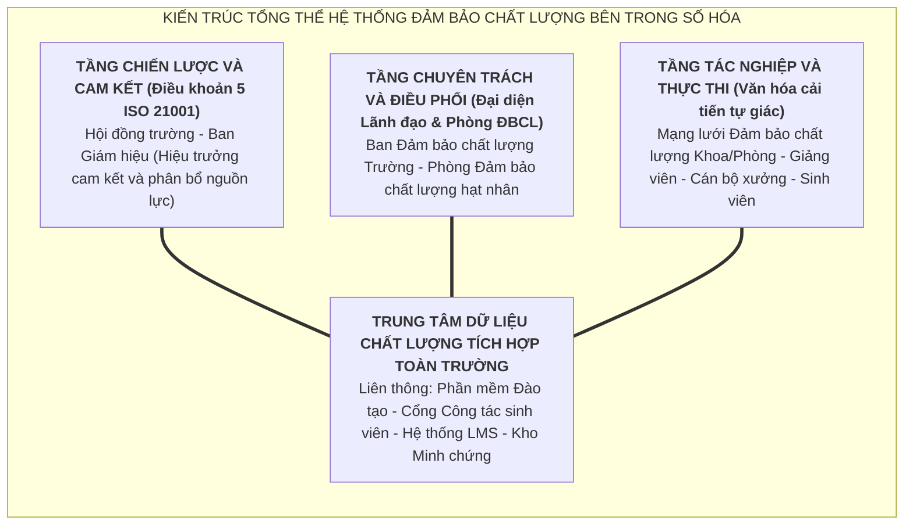
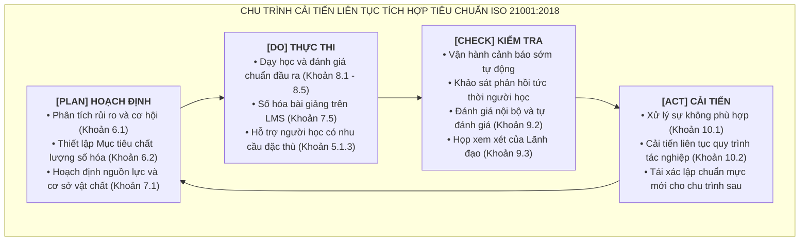
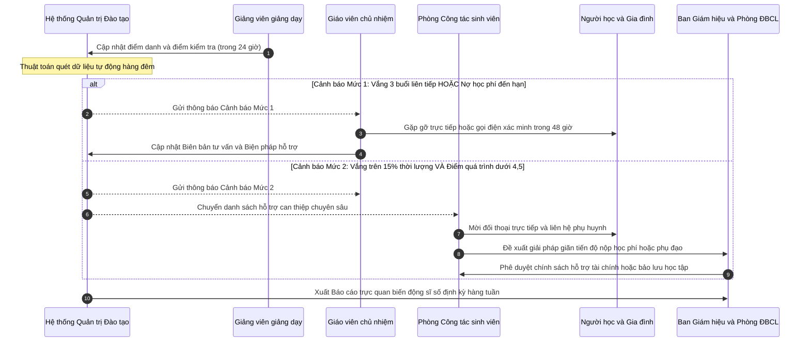
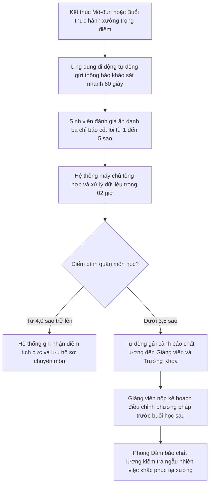
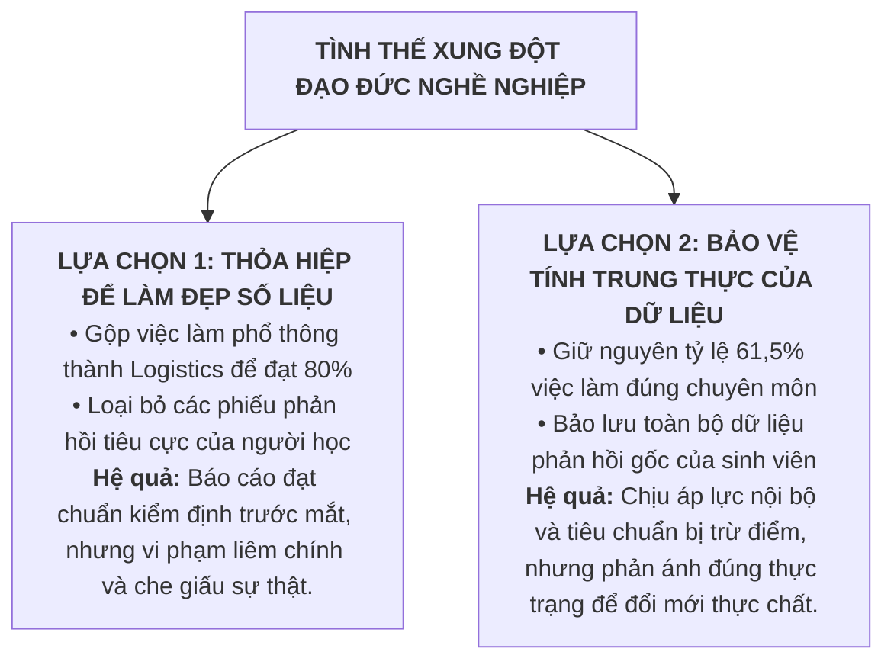
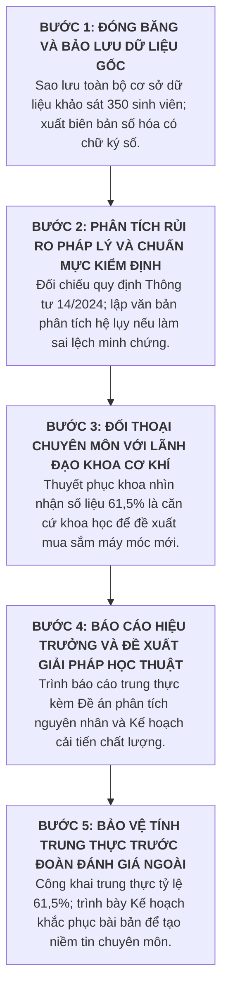

# BỘ GIÁO DỤC VÀ ĐÀO TẠO - ĐẠI HỌC BÁCH KHOA HÀ NỘI
## VIỆN SƯ PHẠM KỸ THUẬT

# ĐỀ ÁN CÁ NHÂN CUỐI KỲ
### HỌC PHẦN: QUẢN LÝ CHẤT LƯỢNG GIÁO DỤC NGHỀ NGHIỆP (MÃ HỌC PHẦN: ED6111)

**ĐỀ TÀI:**
# QUẢN TRỊ CHẤT LƯỢNG TOÀN DIỆN VÀ THIẾT KẾ HỆ THỐNG ĐẢM BẢO CHẤT LƯỢNG BÊN TRONG TẠI TRƯỜNG CAO ĐẲNG KỸ NGHỆ II TRONG BỐI CẢNH TỰ CHỦ VÀ CHUYỂN ĐỔI SỐ

- Học viên thực hiện: Lê Hạnh Nguyên - Mã số sinh viên: 20252233M
- Giảng viên hướng dẫn: Phó Giáo sư, Tiến sĩ Lê Huy Tùng
- Thời gian hoàn thành: Năm học 2025 – 2026

## MỤC LỤC TỔNG THỂ

- PHẦN I. THỰC TRẠNG VÀ ĐỊNH HƯỚNG QUẢN LÝ CHẤT LƯỢNG TẠI TRƯỜNG CAO ĐẲNG KỸ NGHỆ II
  - 1.1. Bối cảnh phát triển và định vị chiến lược trong cơ chế tự chủ
  - 1.2. Môi trường vận hành và các yếu tố tác động đến chất lượng
  - 1.3. Thực trạng công tác đảm bảo chất lượng qua kết quả tự đánh giá
  - 1.4. Các khoảng trống chất lượng cốt lõi và rủi ro quản trị
  - 1.5. Định hướng chiến lược phát triển chất lượng bền vững
- PHẦN II. TIÊU CHUẨN ĐÁNH GIÁ, HỆ THỐNG MINH CHỨNG VÀ THỰC HÀNH TỰ ĐÁNH GIÁ
  - 2.1. Cơ sở pháp lý và nguyên tắc phương pháp luận thiết lập tiêu chuẩn
  - 2.2. Khung tiêu chuẩn và ma trận tích hợp minh chứng quản trị nội bộ
  - 2.3. Bộ công cụ đo lường và đánh giá chất lượng đào tạo
  - 2.4. Báo cáo tự đánh giá thực nghiệm đối với tiêu chuẩn biến động người học
- PHẦN III. HỆ THỐNG ĐẢM BẢO CHẤT LƯỢNG BÊN TRONG TRÊN NỀN TẢNG SỐ HÓA VÀ ISO 21001:2018
  - 3.1. Triết lý quản trị và mô hình kiến trúc hệ thống
  - 3.2. Cơ cấu tổ chức và phân định trách nhiệm quản trị chất lượng
  - 3.3. Chu trình cải tiến liên tục theo tiêu chuẩn ISO 21001:2018
  - 3.4. Các quy trình kiểm soát chất lượng chủ động
  - 3.5. Văn hóa chất lượng và chính sách giáo dục hòa nhập
- PHẦN IV. ĐẠO ĐỨC NGHỀ NGHIỆP VÀ BẢO ĐẢM TÍNH TOÀN VẸN CỦA DỮ LIỆU CHẤT LƯỢNG
  - 4.1. Chuẩn mực đạo đức nghề nghiệp trong quản lý chất lượng giáo dục
  - 4.2. Tình huống thực tiễn về áp lực chỉ tiêu và tính xác thực của dữ liệu
  - 4.3. Đánh giá đa chiều về rủi ro pháp lý, đạo đức và trách nhiệm xã hội
  - 4.4. Giải pháp và lộ trình xử lý xung đột của nhà quản lý chất lượng
  - 4.5. Cơ chế kiểm soát nội bộ và bảo đảm tính trung thực của dữ liệu
- KẾT LUẬN VÀ KIẾN NGHỊ
- DANH MỤC TÀI LIỆU THAM KHẢO

# PHẦN I. THỰC TRẠNG VÀ ĐỊNH HƯỚNG QUẢN LÝ CHẤT LƯỢNG TẠI TRƯỜNG CAO ĐẲNG KỸ NGHỆ II

Trong tiến trình đổi mới căn bản và toàn diện giáo dục nghề nghiệp tại Việt Nam, chất lượng không còn dừng lại ở một khẩu hiệu hành động hay một mục tiêu tĩnh mang tính hình thức, mà đã trở thành nhân tố quyết định sự tồn tại, uy tín thương hiệu và tính bền vững của mỗi cơ sở đào tạo. Sự ra đời của Thông tư số 14/2024/TT-BLĐTBXH ngày 31 tháng 12 năm 2024 quy định tiêu chí, tiêu chuẩn kiểm định chất lượng giáo dục nghề nghiệp đã đánh dấu bước chuyển mình quan trọng: từ phương thức tiếp cận kiểm tra mang tính cơ học, xử lý sự việc đã rồi sang cơ chế quản trị chất lượng dựa trên dữ liệu thực chất, nhấn mạnh trách nhiệm giải trình xã hội và sự hài lòng của các bên liên quan.

Đối với Trường Cao đẳng Kỹ Nghệ II tại Thành phố Hồ Chí Minh – một trong những cơ sở giáo dục nghề nghiệp công lập tiên phong của cả nước thực hiện thí điểm cơ chế tự chủ tài chính toàn diện – bài toán chất lượng mang tính sống còn. Tự chủ mang lại không gian sáng tạo và quyền tự quyết cao trong phân bổ nguồn lực, nhưng đồng thời cũng đặt nhà trường dưới áp lực cạnh tranh khốc liệt của thị trường lao động tại Vùng kinh tế trọng điểm phía Nam. Nhằm đáp ứng toàn diện bốn chuẩn đầu ra của học phần Quản lý chất lượng giáo dục nghề nghiệp (mã học phần ED6111), đề án tập trung nghiên cứu và giải quyết hệ thống bốn nội dung trọng tâm: phân tích thực trạng và định hướng cải tiến chất lượng cơ sở; thiết lập bộ tiêu chuẩn, công cụ đánh giá và thực hành tự đánh giá; thiết kế hệ thống đảm bảo chất lượng bên trong số hóa tích hợp tiêu chuẩn ISO 21001:2018; và xử lý xung đột đạo đức nghề nghiệp nhằm bảo đảm tính toàn vẹn của dữ liệu kiểm định.

## 1.1. Bối cảnh phát triển và định vị chiến lược trong cơ chế tự chủ

Trường Cao đẳng Kỹ Nghệ II, tiền thân là Trường Công nhân Kỹ thuật chế biến gỗ Trung ương được thành lập từ năm 1978 trực thuộc Bộ Lao động - Thương binh và Xã hội, là một trong những cơ sở giáo dục nghề nghiệp công lập trọng điểm của khu vực phía Nam. Nhà trường tọa lạc tại vị trí cửa ngõ phía Đông của Thành phố Hồ Chí Minh, thuộc địa bàn Thành phố Thủ Đức. Vị trí địa lý này nằm tiếp giáp trực tiếp với mạng lưới các khu công nghiệp tập trung quy mô lớn như Khu Công nghệ cao Thành phố Hồ Chí Minh, Khu Chế xuất Linh Trung và Khu Công nghiệp Sóng Thần. Không gian liên kết kinh tế này tạo điều kiện thuận lợi để nhà trường xác lập mối quan hệ hợp tác đào tạo và tuyển dụng trực tiếp với hàng trăm doanh nghiệp sản xuất kỹ thuật hiện đại.

Về phương diện định vị chiến lược, Trường Cao đẳng Kỹ Nghệ II là một trong số ít các cơ sở giáo dục nghề nghiệp công lập trên toàn quốc được Thủ tướng Chính phủ phê duyệt thực hiện thí điểm cơ chế tự chủ tài chính toàn diện, bao gồm tự chủ toàn bộ chi thường xuyên và chi đầu tư theo tinh thần Nghị định số 60/2021/NĐ-CP. Sứ mạng của nhà trường được xác định nhất quán là đào tạo nguồn nhân lực kỹ thuật đa ngành có trình độ kỹ năng nghề xuất sắc, tác phong công nghiệp chuẩn mực và năng lực thích ứng linh hoạt với thị trường lao động trong nước cũng như quốc tế. Nhằm hiện thực hóa sứ mạng này, Chính sách chất lượng giai đoạn 2022 – 2025 của nhà trường mang thông điệp chỉ đạo là đổi mới tư duy và tự chủ để phát triển bền vững.

Cơ chế tự chủ tài chính toàn diện vừa mang lại quyền tự quyết chủ động trong việc tổ chức bộ máy, tuyển dụng nhân sự và phát triển chương trình đào tạo, vừa đặt nhà trường trước áp lực sống còn về chỉ tiêu tuyển sinh và duy trì nguồn thu. Trong bối cảnh không còn nguồn ngân sách nhà nước cấp chi thường xuyên trực tiếp, thương hiệu của nhà trường phụ thuộc hoàn toàn vào mức độ hài lòng của người học và sự thừa nhận của các doanh nghiệp sử dụng lao động. Vì vậy, việc thiết lập một hệ thống quản trị chất lượng thực chất, tránh bệnh hình thức trên hồ sơ văn bản là đòi hỏi cấp bách và mang tính chiến lược của nhà trường.

## 1.2. Môi trường vận hành và các yếu tố tác động đến chất lượng

Để có cơ sở khoa học cho việc đề xuất các định hướng cải tiến chất lượng, việc xem xét thực trạng của Trường Cao đẳng Kỹ Nghệ II cần được đặt trong mối tương quan giữa các lực đẩy vĩ mô của môi trường kinh tế xã hội và các điều kiện nguồn lực nội tại của cơ sở giáo dục.

### 1.2.1. Các yếu tố môi trường vĩ mô

Môi trường thể chế và chính sách pháp luật hiện nay đang trải qua bước chuyển đổi căn bản với việc ban hành Thông tư số 14/2024/TT-BLĐTBXH quy định tiêu chí, tiêu chuẩn kiểm định chất lượng giáo dục nghề nghiệp. Văn bản quy phạm pháp luật này chuyển trọng tâm từ việc kiểm tra số lượng hồ sơ cơ học sang đánh giá chất lượng thực chất dựa trên chuẩn đầu ra và trách nhiệm giải trình xã hội của người đứng đầu cơ sở giáo dục. Về mặt kinh tế, Vùng kinh tế trọng điểm phía Nam đang dịch chuyển mạnh mẽ sang các ngành công nghiệp bán dẫn, tự động hóa, logistics thông minh và sản xuất bền vững. Xu hướng chuyển dịch kinh tế này đòi hỏi cơ sở giáo dục nghề nghiệp phải liên tục cập nhật công nghệ đào tạo, nếu không sinh viên tốt nghiệp sẽ đối mặt với nguy cơ bị đào thải khỏi thị trường lao động kỹ thuật cao.

Về phương diện xã hội, định kiến về bằng cấp đại học và tâm lý e ngại học nghề của phụ huynh vẫn là rào cản lớn đối với công tác phân luồng học sinh sau trung học cơ sở và trung học phổ thông. Đối tượng tuyển sinh ngày càng đa dạng, đòi hỏi các dịch vụ chăm sóc và tư vấn hỗ trợ người học phải được chuyên nghiệp hóa. Trên bình diện công nghệ, sự bùng nổ của trí tuệ nhân tạo, thiết bị kết nối vạn vật và công nghệ mô phỏng số đã làm thay đổi hoàn toàn phương thức giảng dạy nghề nghiệp truyền thống. Cuối cùng, cam kết quốc gia về phát thải ròng bằng không cùng các tiêu chuẩn lao động quốc tế trong các hiệp định thương mại tự do thế hệ mới đòi hỏi chuẩn đầu ra của nhà trường phải tích hợp kỹ năng xanh và năng lực ngoại ngữ chuyên ngành theo Khung trình độ quốc gia Việt Nam.

**Bảng 1.1. Ma trận phân tích các yếu tố vĩ mô tác động đến Trường Cao đẳng Kỹ Nghệ II**

| Yếu tố vĩ mô | Nội dung tác động đến cơ sở giáo dục | Hàm ý đối với quản lý chất lượng |
| :--- | :--- | :--- |
| Chính trị và Pháp lý | Khung khổ pháp lý mới với Thông tư số 14/2024/TT-BLĐTBXH đặt trọng tâm vào chuẩn đầu ra và trách nhiệm giải trình. | Yêu cầu chuẩn hóa toàn diện kho minh chứng, chấm dứt việc lập hồ sơ đối phó và gắn trách nhiệm pháp lý với cam kết chất lượng. |
| Kinh tế | Vùng Đông Nam Bộ chuyển dịch mạnh sang tự động hóa, bán dẫn và logistics thông minh. | Chương trình đào tạo và thiết bị xưởng phải được nâng cấp liên tục để bảo đảm tỷ lệ sinh viên có việc làm đúng chuyên môn. |
| Xã hội | Tâm lý chuộng bằng cấp đại học vẫn phổ biến; sự phân hóa về hoàn cảnh gia đình của người học gia tăng. | Công tác tư vấn học đường, hỗ trợ sinh viên khó khăn và quản lý duy trì sĩ số trở thành yếu tố quyết định hiệu quả giáo dục. |
| Công nghệ | Trí tuệ nhân tạo, tự động hóa và công nghệ số hóa tái định hình các thao tác nghề nghiệp tại nhà xưởng. | Bắt buộc phải tích hợp chuẩn đầu ra năng lực số vào các ngành nghề và số hóa toàn diện quy trình kiểm tra đánh giá. |
| Môi trường và Hội nhập | Chiến lược tăng trưởng xanh và các cam kết kỹ năng nghề tiêu chuẩn khu vực Đông Nam Á. | Đưa tiêu chuẩn an toàn sinh thái vào giảng dạy và đối sánh chuẩn đầu ra theo Khung trình độ quốc gia Việt Nam. |

### 1.2.2. Nguồn lực nội tại và vị thế cạnh tranh

Xét trên phương diện điểm mạnh nội tại, Trường Cao đẳng Kỹ Nghệ II sở hữu ưu thế vượt trội về vị trí địa lý đắc địa tiếp giáp Khu Công nghệ cao Thành phố Hồ Chí Minh, giúp tạo lập mạng lưới doanh nghiệp đối tác tiếp nhận thực tập rộng lớn. Cơ sở vật chất của nhà trường được đầu tư đồng bộ với nhiều nhà xưởng thực hành hiện đại đáp ứng các tiêu chuẩn công nghiệp. Đội ngũ giảng viên có kỹ năng nghề thực tế vững vàng, hầu hết đều đạt chuẩn chức danh nghề nghiệp và có tỷ lệ tham gia bồi dưỡng tại doanh nghiệp hàng năm cao. Đặc biệt, nhà trường đã ban hành được hệ thống gồm sáu mươi lăm quy trình vận hành và kiểm soát nội bộ, tạo nền tảng văn bản hóa vững chắc cho toàn bộ hoạt động quản trị.

Tuy nhiên, phân tích điểm yếu nội tại cho thấy hệ thống dữ liệu phục vụ quản lý chất lượng của nhà trường vẫn trong tình trạng phân mảnh nghiêm trọng. Việc lưu trữ hồ sơ giấy tờ riêng rẽ tại các khoa và phòng chức năng làm cản trở quá trình đối soát dữ liệu liên thông theo thời gian thực. Cơ chế khảo sát ý kiến người học và nhà tuyển dụng vẫn chủ yếu thực hiện vào cuối học kỳ hoặc sau khi tốt nghiệp, gây ra độ trễ thông tin lớn và làm mất đi cơ hội điều chỉnh phương pháp giảng dạy ngay trong quá trình đào tạo. Thêm vào đó, nhận thức về công tác đảm bảo chất lượng tại một số khoa chuyên môn vẫn mang tính thụ động, xem đây là nhiệm vụ riêng của Phòng Đảm bảo chất lượng.

Về cơ hội phát triển, cơ chế tự chủ tài chính toàn diện cho phép nhà trường linh hoạt mở các ngành đào tạo mới đón đầu xu hướng công nghệ số và liên kết đào tạo song hành cùng các tập đoàn đa quốc gia. Quy định kiểm định mới theo Thông tư số 14/2024/TT-BLĐTBXH cũng tạo ra hành lang pháp lý minh bạch để khẳng định uy tín thương hiệu của những cơ sở có chất lượng thực chất. Ngược lại, thách thức bên ngoài lớn nhất xuất phát từ sự cạnh tranh tuyển sinh gay gắt của các trường đại học thông qua phương thức xét tuyển học bạ mở rộng, cùng với áp lực tài chính rất lớn trong việc tạo nguồn vốn tự tích lũy để bảo trì và thay mới các thiết bị công nghệ cao có chu kỳ hao mòn nhanh.

## 1.3. Thực trạng công tác đảm bảo chất lượng qua kết quả tự đánh giá

Công tác tự đánh giá chất lượng cơ sở giáo dục nghề nghiệp của Trường Cao đẳng Kỹ Nghệ II được thực hiện vào cuối năm 2024 và chính thức phê duyệt tại Báo cáo số 242/BC-CĐKNII ngày 31 tháng 01 năm 2025 của Hiệu trưởng, áp dụng bộ tiêu chí ban hành kèm theo Thông tư số 14/2024/TT-BLĐTBXH. Kết quả tự đánh giá ghi nhận nhà trường đạt điểm số tuyệt đối ở toàn bộ các tiêu chí và tiêu chuẩn kiểm định.

**Bảng 1.2. Tổng hợp kết quả tự đánh giá chất lượng cơ sở năm 2025 của Trường Cao đẳng Kỹ Nghệ II**

| Số thứ tự | Tên tiêu chí kiểm định chất lượng | Số lượng tiêu chuẩn | Điểm tối đa | Điểm tự đánh giá | Tỷ lệ đạt (%) |
| :-: | :--- | :-: | :-: | :-: | :-: |
| 1 | Sứ mạng, mục tiêu, tổ chức và quản lý | 5 | 10 | 10 | 100% |
| 2 | Hoạt động đào tạo | 8 | 16 | 16 | 100% |
| 3 | Nhà giáo, cán bộ quản lý, viên chức và người lao động | 7 | 14 | 14 | 100% |
| 4 | Chương trình đào tạo và giáo trình | 7 | 14 | 14 | 100% |
| 5 | Cơ sở vật chất, thiết bị đào tạo và thư viện | 8 | 16 | 16 | 100% |
| 6 | Nghiên cứu khoa học, chuyển giao công nghệ và hợp tác quốc tế | 4 | 8 | 8 | 100% |
| 7 | Dịch vụ người học | 5 | 10 | 10 | 100% |
| 8 | Giám sát, đánh giá chất lượng | 6 | 12 | 12 | 100% |
| **Tổng** | **Hệ thống đánh giá cơ sở giáo dục nghề nghiệp** | **50** | **100** | **100** | **100%** |

Xét trên phương diện tuân thủ pháp luật, kết quả tự đánh giá một trăm điểm khẳng định năng lực chuẩn bị hồ sơ minh chứng rất bài bản của tập thể nhà trường. Các tiêu chuẩn về tổ chức quản lý, trình độ đội ngũ nhà giáo, tiến độ rà soát chương trình đào tạo và diện tích phòng học, nhà xưởng bình quân trên mỗi người học đều được minh chứng đầy đủ bằng các quyết định hành chính, văn bằng chứng chỉ và sổ sách kỹ thuật hợp lệ. Chính sách miễn giảm học phí và cấp phát học bổng khuyến khích học tập cho người học được thực hiện công khai, minh bạch thông qua tài khoản ngân hàng, không để xảy ra khiếu nại phát sinh.

## 1.4. Các khoảng trống chất lượng cốt lõi và rủi ro quản trị

Dưới lăng kính của Total Quality Management (Quản lý chất lượng toàn diện - TQM) và nguyên tắc quản trị rủi ro tại Điều khoản 6.1 của tiêu chuẩn quốc tế ISO 21001:2018, việc đạt điểm chuẩn tuyệt đối trên hồ sơ tự đánh giá mới chỉ phản ánh mức độ tuân thủ quy chuẩn hành chính, chưa bảo đảm việc loại trừ các rủi ro chất lượng trong vận hành thực tế. Khi đối chiếu Báo cáo tự đánh giá với Bảng mười tám Mục tiêu chất lượng năm 2025 do Hiệu trưởng ban hành, ba khoảng trống chất lượng bản chất đã bộc lộ rõ rệt.

Khoảng trống thứ nhất nằm ở tư duy quản trị chấp nhận tỷ lệ hao hụt người học ở mức cao và sự thiếu vắng cơ chế cảnh báo sớm. Cụ thể, Mục tiêu chất lượng số 3 năm 2025 của nhà trường chỉ đặt chỉ tiêu duy trì sĩ số học sinh, sinh viên từ bảy mươi lăm phần trăm trở lên. Điều này đồng nghĩa với việc hệ thống quản trị của trường mặc nhiên chấp nhận tỷ lệ bỏ học, thôi học có thể lên tới hai mươi lăm phần trăm trong mỗi khóa đào tạo. Dưới góc độ kinh tế giáo dục và trách nhiệm xã hội, việc để một phần tư người học rời bỏ nhà trường giữa chừng gây thất thoát tài chính lớn cho trường tự chủ và lãng phí nguồn lực đầu tư của xã hội. Nguyên nhân sâu xa là nhà trường chỉ ghi nhận số liệu sau khi sự việc đã hoàn thành bằng các quyết định buộc thôi học, hoàn toàn thiếu một hệ thống cảnh báo sớm có khả năng tự động nhận diện các sinh viên có nguy cơ bỏ học thông qua dữ liệu chuyên cần và kết quả kiểm tra định kỳ để can thiệp hỗ trợ kịp thời.

Khoảng trống thứ hai liên quan đến độ trễ thông tin trong các quy trình thu thập phản hồi của các bên liên quan. Mặc dù các quy trình khảo sát người học có mã hiệu QT/BĐCL/02, quy trình khảo sát giảng viên có mã hiệu QT/BĐCL/03 và quy trình khảo sát việc làm có mã hiệu ĐT/QT25/KSVL đã được ban hành đầy đủ, phương thức thực hiện trên thực tế vẫn chủ yếu dùng bảng hỏi định kỳ phát vào cuối học kỳ hoặc sau khi người học đã tốt nghiệp một năm. Cách tiếp cận này mang bản chất của kiểm tra chất lượng hồi cứu nhằm tổng kết quá khứ hơn là đảm bảo chất lượng chủ động. Giảng viên không thể điều chỉnh phương pháp sư phạm cho chính lớp học đang đảm nhận khi chỉ nhận được kết quả phản hồi sau khi môn học đã kết thúc. Nhà trường hoàn toàn thiếu các công cụ khảo sát tức thời sau từng bài học để điều chỉnh chất lượng đào tạo liên tục.

Khoảng trống thứ ba xuất phát từ mức độ phân mảnh trong hệ thống dữ liệu quản lý và cơ chế kiểm chứng chéo minh chứng. Mặc dù nhà trường đã xây dựng danh mục sáu mươi lăm quy trình vận hành bằng văn bản, các nguồn dữ liệu tác nghiệp thực tế vẫn bị cô lập trong các phần mềm và sổ sách riêng lẻ giữa Phòng Đào tạo, Phòng Công tác sinh viên, Phòng Kế toán và các khoa chuyên môn. Tình trạng này khiến công tác trích xuất và kiểm tra tính xác thực của dữ liệu tốn nhiều công sức, đồng thời tiềm ẩn rủi ro phát sinh khoảng cách sai lệch giữa số liệu báo cáo minh chứng trên giấy tờ với mức độ thụ hưởng chất lượng thực tế của sinh viên tại các xưởng máy và giảng đường.

## 1.5. Định hướng chiến lược phát triển chất lượng bền vững

Căn cứ vào kết quả phân tích các yếu tố môi trường và ba khoảng trống chất lượng cốt lõi, bốn định hướng chiến lược cải tiến chất lượng mang tính đột phá được xác lập cho Trường Cao đẳng Kỹ Nghệ II trong giai đoạn 2026 – 2030.

Định hướng thứ nhất là chuyển đổi căn bản mô hình quản trị chất lượng từ phương thức đối phó tuân thủ sang xây dựng hệ thống đảm bảo chất lượng bên trong được thúc đẩy bởi công nghệ số, tích hợp chặt chẽ triết lý Quản lý chất lượng toàn diện và tiêu chuẩn quốc tế ISO 21001:2018. Nhà trường cần xây dựng trung tâm điều hành dữ liệu chất lượng liên thông toàn trường, số hóa toàn bộ dữ liệu tác nghiệp của sáu mươi lăm quy trình nội bộ lên nền tảng đám mây nhằm bảo đảm mọi minh chứng phục vụ kiểm định đều có dấu vết số hóa khách quan và không thể bị can thiệp làm sai lệch.

Định hướng thứ hai là thiết lập cơ chế kiểm soát chủ động biến động người học, phấn đấu nâng chỉ tiêu duy trì sĩ số toàn khóa lên mức tối thiểu tám mươi tám phần trăm, tương ứng với việc khống chế tỷ lệ bỏ học dưới mười hai phần trăm. Nhà trường cần xóa bỏ tư duy chấp nhận tỷ lệ hao hụt hai mươi lăm phần trăm bằng việc đưa vào vận hành hệ thống cảnh báo sớm tự động trên phần mềm quản trị đào tạo. Khi sinh viên có dấu hiệu bất thường về chuyên cần hoặc kết quả học tập sa sút, hệ thống sẽ tự động kích hoạt mạng lưới cố vấn học tập và bộ phận hỗ trợ sinh viên để can thiệp, tư vấn tâm lý và hỗ trợ tài chính trước khi người học rơi vào tình trạng buông xuôi.

Định hướng thứ ba là rút ngắn chu kỳ phản hồi chất lượng thông qua việc ứng dụng các công cụ khảo sát tức thời trên nền tảng ứng dụng di động của nhà trường. Thay thế các bảng hỏi dài dòng cuối kỳ bằng các phiếu khảo sát ngắn gọn từ ba đến năm câu hỏi được gửi tự động sau các bài thực hành trọng điểm, giúp giảng viên và cán bộ quản lý xưởng tiếp nhận phản hồi trong vòng hai mươi tư giờ để khắc phục ngay các bất cập sư phạm hoặc sự cố kỹ thuật. Song song với đó, nhà trường cần xây dựng văn hóa chất lượng tự giác, khuyến khích cán bộ, giảng viên và người học chủ động phát hiện và báo cáo các điểm nghẽn quy trình trên tinh thần cải tiến liên tục không đổ lỗi.

Định hướng thứ tư là thực hiện rà soát và cấu trúc lại toàn bộ hệ thống chuẩn đầu ra các ngành nghề đào tạo, tích hợp bắt buộc chuẩn đầu ra về năng lực số và kỹ năng chuyển đổi xanh. Nhà trường cần phối hợp chặt chẽ với các doanh nghiệp tại Khu Công nghệ cao Thành phố Hồ Chí Minh để đối sánh chương trình với tiêu chuẩn nghề nghiệp tiên tiến, đưa các học phần về tự động hóa, điều khiển số, an toàn dữ liệu và bảo vệ môi trường vào cấu trúc đào tạo bắt buộc, tạo lợi thế cạnh tranh vượt trội cho sinh viên sau khi tốt nghiệp.

# PHẦN II. TIÊU CHUẨN ĐÁNH GIÁ, HỆ THỐNG MINH CHỨNG VÀ THỰC HÀNH TỰ ĐÁNH GIÁ

## 2.1. Cơ sở pháp lý và nguyên tắc phương pháp luận thiết lập tiêu chuẩn

Căn cứ pháp lý trực tiếp để thiết lập hệ thống tiêu chuẩn đánh giá chất lượng tại Trường Cao đẳng Kỹ Nghệ II là Thông tư số 14/2024/TT-BLĐTBXH ngày 31 tháng 12 năm 2024 của Bộ trưởng Bộ Lao động - Thương binh và Xã hội quy định tiêu chí, tiêu chuẩn kiểm định chất lượng giáo dục nghề nghiệp. Văn bản quy phạm pháp luật này đã xác lập một bước chuyển quan trọng trong tư duy quản trị chất lượng, chuyển từ việc kiểm tra hồ sơ giấy tờ thuần túy sang đánh giá năng lực thực chất, mức độ đạt chuẩn đầu ra và khả năng thích ứng của người học với thị trường lao động.

Về phương diện phương pháp luận, hệ thống tiêu chí, công cụ đo lường và khung minh chứng của nhà trường được xây dựng dựa trên bốn nguyên tắc quản trị chất lượng hiện đại. 

Trước hết là nguyên tắc bảo đảm tính tương thích pháp lý tuyệt đối. Toàn bộ cấu trúc đánh giá bám sát chặt chẽ tám tiêu chí và năm mươi tiêu chuẩn được quy định tại Phụ lục 01 ban hành kèm theo Thông tư số 14/2024/TT-BLĐTBXH, bảo đảm tính thống nhất và đồng bộ với hệ thống kiểm định chất lượng giáo dục nghề nghiệp quốc gia.

Thứ hai là nguyên tắc bảo đảm tính tích hợp tác nghiệp trong quản trị nội bộ. Mỗi tiêu chuẩn kiểm định của Thông tư số 14/2024/TT-BLĐTBXH không tồn tại như một yêu cầu hành chính biệt lập, mà được kết nối và ánh xạ trực tiếp với ít nhất một trong sáu mươi lăm quy trình vận hành nội bộ đã được Hiệu trưởng nhà trường ký ban hành. Cách tiếp cận này giúp hoạt động tự đánh giá trở thành một phần tự nhiên của công tác điều hành hàng ngày thay vì tạo thêm gánh nặng thủ tục khi đến kỳ kiểm định.

Thứ ba là nguyên tắc bảo đảm tính đo lường được của các chỉ báo chất lượng. Nhà trường chủ động cụ thể hóa các tiêu chuẩn mang tính định tính thành hệ thống các chỉ số đo lường hiệu năng cốt lõi có thể định lượng khách quan. Việc định lượng hóa các chỉ số giúp các cấp quản lý từ Ban Giám hiệu, Trưởng khoa cho đến giảng viên có thể theo dõi tiến độ thực hiện và đối soát dữ liệu một cách minh bạch, chính xác.

Thứ tư là nguyên tắc tuân thủ nghiêm ngặt bốn thuộc tính của minh chứng kiểm định. Mọi dữ liệu và hồ sơ được sử dụng làm minh chứng phục vụ tự đánh giá và đánh giá ngoài đều phải thỏa mãn đồng thời bốn yêu cầu cốt lõi: tính đầy đủ nhằm bao quát toàn diện các khía cạnh của tiêu chuẩn; tính tường minh thể hiện qua nguồn gốc pháp lý, thẩm quyền ban hành, ngày tháng, chữ ký và con dấu rõ ràng; tính tin cậy bảo đảm dữ liệu có thể kiểm chứng độc lập mà không bị sai lệch; và tính tương thích phản ánh đúng nội hàm, bản chất của chỉ báo đánh giá.

## 2.2. Khung tiêu chuẩn và ma trận tích hợp minh chứng quản trị nội bộ

Nhằm thiết lập cầu nối vững chắc giữa bộ tiêu chuẩn kiểm định quốc gia với thực tiễn quản trị tại cơ sở, Trường Cao đẳng Kỹ Nghệ II đã xây dựng Ma trận tích hợp giữa tám tiêu chí kiểm định theo Thông tư số 14/2024/TT-BLĐTBXH, danh mục minh chứng cốt lõi và mã quy trình nội bộ tương ứng của nhà trường.

**Bảng 2.1. Ma trận tích hợp Bộ tiêu chuẩn kiểm định và sáu mươi lăm Quy trình nội bộ của Trường Cao đẳng Kỹ Nghệ II**

| Mã tiêu chí | Tên tiêu chí và Số tiêu chuẩn | Điểm tối đa | Danh mục minh chứng cốt lõi | Mã quy trình nội bộ tương ứng | Đơn vị chủ trì chịu trách nhiệm |
| :---: | :--- | :---: | :--- | :--- | :--- |
| **TC-01** | **Sứ mạng, mục tiêu, tổ chức và quản lý** *(5 tiêu chuẩn)* | 10 | Chiến lược phát triển trường; Quy chế tổ chức và hoạt động; Quyết định thành lập và kiện toàn Hội đồng trường; Sổ tay chất lượng; Báo cáo đánh giá nội bộ định kỳ. | QT/TCHCQT/01, QT/BĐCL/06 (Kiểm soát tài liệu), QT/BĐCL/07 (Đánh giá nội bộ). | Phòng Tổ chức - Hành chính - Quản trị, Phòng Đảm bảo chất lượng |
| **TC-02** | **Hoạt động đào tạo** *(8 tiêu chuẩn)* | 16 | Đề án tuyển sinh hàng năm; Kế hoạch tiến độ đào tạo; Thời khóa biểu số hóa; Sổ theo dõi giảng dạy; Đề thi và đáp án trong ngân hàng đề thi được phê duyệt. | ĐT/QT01/KHĐT, ĐT/QT02/TĐ, ĐT/QT03/TKB, ĐT/QT19/GDTT (Dạy học trực tuyến), QT/ĐT/10. | Phòng Đào tạo, các Khoa chuyên môn |
| **TC-03** | **Nhà giáo, cán bộ quản lý, viên chức và người lao động** *(7 tiêu chuẩn)* | 14 | Hồ sơ lý lịch khoa học; Văn bằng chuyên môn; Chứng chỉ sư phạm dạy nghề; Chứng chỉ kỹ năng nghề quốc gia; Kế hoạch bồi dưỡng và thực tế doanh nghiệp. | QT/TCHCQT/02, QT/TCHCQT/03 (Đào tạo bồi dưỡng), ĐT/QT10/DGG (Biên bản dự giờ giảng dạy). | Phòng Tổ chức - Hành chính - Quản trị, các Khoa chuyên môn |
| **TC-04** | **Chương trình đào tạo và giáo trình** *(7 tiêu chuẩn)* | 14 | Chương trình đào tạo chi tiết các ngành nghề; Chuẩn đầu ra công bố công khai; Biên bản lấy ý kiến doanh nghiệp; Quyết định ban hành giáo trình; Bản lưu chiểu giáo trình. | ĐT/QT04/CT-GT (Rà soát chương trình - giáo trình), ĐT/QT09/GTĐT (Thẩm định giáo trình), QT/TCHCQT/11. | Phòng Đào tạo, Hội đồng Khoa học và Đào tạo, Thư viện |
| **TC-05** | **Cơ sở vật chất, thiết bị đào tạo và thư viện** *(8 tiêu chuẩn)* | 16 | Giấy chứng nhận quyền sử dụng đất; Danh mục thiết bị thực hành tại xưởng; Sổ nhật ký bảo dưỡng máy móc định kỳ; Biên bản kiểm định an toàn; Thống kê tài liệu học liệu số. | QT/TCHCQT/06 (Bảo trì thiết bị), QT/TCHCQT/07 (Quản lý xưởng), QT/TCHCQT/08, QT/TCHCQT/09. | Trung tâm Quản trị thiết bị, Thư viện, các Xưởng thực hành |
| **TC-06** | **Nghiên cứu khoa học, chuyển giao công nghệ và hợp tác quốc tế** *(4 tiêu chuẩn)* | 8 | Thuyết minh và biên bản nghiệm thu đề tài nghiên cứu khoa học các cấp; Hợp đồng chuyển giao công nghệ; Danh mục bài báo khoa học; Biên bản ghi nhớ hợp tác quốc tế. | QT/KHHTQT/01, QT/KHHTQT/02 (Hỗ trợ bài báo), QT/KHHTQT/03, QT/KHHTQT/04 (Nghiệm thu đề tài). | Ban Quản lý Khoa học và Hợp tác Quốc tế |
| **TC-07** | **Dịch vụ người học** *(5 tiêu chuẩn)* | 10 | Quyết định miễn giảm học phí theo chính sách; Danh sách chi trả học bổng qua tài khoản ngân hàng; Sổ theo dõi cố vấn học tập; Biên bản các buổi đối thoại định kỳ với người học. | ĐT/QT28/HB (Học bổng), ĐT/QT31/HP, ĐT/QT32/TC, ĐT/QT34/CVHT (Cố vấn học tập), QT/ĐT/36. | Phòng Công tác sinh viên, Đoàn Thanh niên, Giáo viên chủ nhiệm |
| **TC-08** | **Giám sát, đánh giá chất lượng** *(6 tiêu chuẩn)* | 12 | Báo cáo thống kê tỷ lệ thôi học, bỏ học, tốt nghiệp; Báo cáo điều tra việc làm sau một năm; Báo cáo kết quả khảo sát sự hài lòng; Kế hoạch hành động cải tiến sau tự đánh giá. | QT/BĐCL/01 (Tự đánh giá), QT/BĐCL/02, QT/BĐCL/03, QT/BĐCL/04 (Cải tiến hệ thống chất lượng), ĐT/QT25/KSVL. | Phòng Đảm bảo chất lượng, Phòng Đào tạo, Trung tâm Hỗ trợ sinh viên và Quan hệ doanh nghiệp |
| **Tổng** | **50 Tiêu chuẩn** | **100** | **Hệ thống minh chứng chuẩn hóa** | **Tích hợp 65 quy trình vận hành** | **Toàn trường** |

## 2.3. Bộ công cụ đo lường và đánh giá chất lượng đào tạo

Để khắc phục khoảng trống thiếu công cụ đo lường thực tế và độ trễ thông tin trong thu thập phản hồi, Trường Cao đẳng Kỹ Nghệ II đã thiết kế hai công cụ đánh giá nòng cốt, bao gồm Phiếu khảo sát phản hồi người học theo thang đo Likert năm mức độ và Rubric đánh giá kỹ năng nghề nghiệp tích hợp năng lực số.

### 2.3.1. Công cụ khảo sát ý kiến phản hồi của người học

Công cụ khảo sát phản hồi người học có mã hiệu CC-BĐCL-01 được thiết kế dành riêng cho đối tượng học sinh, sinh viên các lớp cao đẳng chính quy. Thời điểm triển khai khảo sát được ấn định vào tuần thứ mười bốn của mỗi học kỳ, ngay trước khi bước vào kỳ thi kết thúc học phần. Để bảo đảm tính khách quan, trung thực và loại bỏ tâm lý e ngại của người học, quy trình khảo sát được thực hiện trực tuyến một trăm phần trăm qua ứng dụng di động nội bộ của nhà trường, tự động mã hóa danh tính sinh viên. Hệ thống sử dụng thang đo Likert năm mức độ được định nghĩa rõ ràng: Mức 1 là hoàn toàn không đồng ý, Mức 2 là không đồng ý, Mức 3 là phân vân hoặc bình thường, Mức 4 là đồng ý, và Mức 5 là hoàn toàn đồng ý.

Nội dung bảng hỏi khảo sát được chuẩn hóa chi tiết như sau:

**BẢNG HỎI KHẢO SÁT CHẤT LƯỢNG GIẢNG DẠY VÀ DỊCH VỤ ĐÀO TẠO**
*(Ban hành kèm theo Quy trình QT/BĐCL/02 - Bản chuẩn hóa năm 2025)*

**Phần A: Thông tin chung**
Hệ thống tự động ghi nhận mã lớp học phần, tuyệt đối không lưu danh tính sinh viên tham gia khảo sát. Khóa đào tạo: ..................; Khoa chuyên môn phụ trách: ..................; Môn học hoặc mô-đun được đánh giá: ..................; Giảng viên giảng dạy: ..................

**Phần B: Đánh giá nội dung và phương pháp giảng dạy của giảng viên**
Người học lựa chọn một mức độ phù hợp từ 1 đến 5 cho từng chỉ báo dưới đây:
1. Giảng viên phổ biến rõ ràng đề cương chi tiết, chuẩn đầu ra môn học và phương pháp đánh giá kết quả ngay trong buổi học đầu tiên.
2. Giảng viên lên lớp đúng giờ, thực hiện đầy đủ thời lượng và nội dung giảng dạy theo đúng kế hoạch tiến độ đào tạo đã công bố.
3. Phương pháp giảng dạy tích cực, kết hợp nhuần nhuyễn giữa lý thuyết cơ sở với thao tác mẫu thực hành trực quan và gợi mở tư duy người học.
4. Giảng viên làm chủ công nghệ, sử dụng thành thạo phần mềm mô phỏng chuyên ngành và các thiết bị kỹ thuật số hỗ trợ bài giảng.
5. Giảng viên tận tình hướng dẫn, uốn nắn chuẩn xác từng thao tác kỹ năng nghề và giải đáp kịp thời các thắc mắc của sinh viên tại xưởng máy.
6. Việc đánh giá kết quả học tập bảo đảm công bằng, khách quan, công khai kịp thời điểm kiểm tra định kỳ và sửa bài chi tiết cho người học.

**Phần C: Đánh giá cơ sở vật chất và dịch vụ hỗ trợ đào tạo**
7. Phòng học lý thuyết và xưởng thực hành bảo đảm đủ ánh sáng, thông thoáng và đáp ứng đầy đủ các quy định về an toàn, vệ sinh lao động.
8. Máy móc, thiết bị, dụng cụ thực hành tại xưởng hoạt động ổn định; vật tư thực hành tiêu hao được cấp phát đầy đủ, kịp thời theo bài học.
9. Giáo trình, tài liệu tham khảo số hóa và hạ tầng mạng internet không dây tại xưởng đáp ứng tốt nhu cầu tra cứu và thực hành bài giảng.
10. Đội ngũ cán bộ quản lý xưởng, giáo viên chủ nhiệm và chuyên viên hỗ trợ sinh viên có thái độ hòa nhã, tận tâm và giải quyết kịp thời các kiến nghị.

**Phần D: Ý kiến đóng góp tự do và đề xuất cải tiến**
Người học tự do chia sẻ cảm nhận về điều hài lòng nhất đối với môn học, đồng thời đưa ra các đề xuất cụ thể nhằm giúp nhà trường cải tiến chất lượng giảng dạy và dịch vụ xưởng trong các học kỳ tiếp theo.

### 2.3.2. Tiêu chí định lượng đánh giá kỹ năng nghề tích hợp năng lực số

Công cụ Rubric đánh giá có mã hiệu RB-ĐBCL-02 được thiết kế nhằm phục vụ đánh giá bài thi kết thúc mô-đun kỹ thuật tích hợp, điển hình như mô-đun Lắp đặt và lập trình điều khiển tự động hóa bằng bộ điều khiển lập trình (PLC) thuộc khối ngành Điện công nghiệp và Cơ điện tử. Thang điểm đánh giá gồm 10 điểm, phân thành bốn cấp độ năng lực tương ứng: Mức Kém (dưới 5,0 điểm), Mức Trung bình (từ 5,0 đến 6,9 điểm), Mức Khá (từ 7,0 đến 8,4 điểm) và Mức Xuất sắc (từ 8,5 đến 10,0 điểm).

**Bảng 2.2. Rubric đánh giá kỹ năng nghề nghiệp tích hợp năng lực số**

| Tiêu chuẩn đánh giá và Trọng số | Mức Kém (Dưới 50% số điểm) | Mức Trung bình (50% - 69% số điểm) | Mức Khá (70% - 84% số điểm) | Mức Xuất sắc (85% - 100% số điểm) |
| :--- | :--- | :--- | :--- | :--- |
| **Tiêu chí 1: Tuân thủ an toàn và Chuẩn bị (Trọng số 15%)** | Vi phạm quy tắc an toàn xưởng; không mang đủ trang thiết bị bảo hộ lao động cá nhân; sắp xếp vị trí thực hành lộn xộn, mất an toàn. | Có trang bị bảo hộ nhưng thao tác còn lúng túng; nhận biết được rủi ro cơ bản; dụng cụ chuẩn bị chưa thật sự ngăn nắp. | Tuân thủ tốt quy định an toàn; trang bị bảo hộ đầy đủ; sắp xếp bàn thực hành ngăn nắp theo nguyên tắc sàng lọc, sắp xếp, sạch sẽ. | Tuân thủ tuyệt đối an toàn lao động; chủ động kiểm tra ngắt nguồn điện và rà soát an toàn cho bạn học xung quanh; chuẩn bị chuyên nghiệp. |
| **Tiêu chí 2: Kỹ năng thao tác đấu nối phần cứng (Trọng số 25%)** | Đấu nối sai sơ đồ nguyên lý; mối nối lỏng lẻo, mất thẩm mỹ; gây chập mạch hoặc làm hỏng thiết bị linh kiện. | Đấu nối đúng sơ đồ cơ bản nhưng đường dây dẫn chưa ngay ngắn; cần giảng viên nhắc nhở để khắc phục lỗi tiếp xúc. | Đấu nối chính xác, chắc chắn, luồn dây trong máng kỹ thuật gọn gàng; tự kiểm tra thông mạch độc lập trước khi đóng điện. | Đấu nối hoàn hảo, đạt chuẩn thẩm mỹ công nghiệp; đánh số đầu dây chuyên nghiệp; thao tác nhanh nhẹn và chuẩn xác tuyệt đối. |
| **Tiêu chí 3: Năng lực số: Lập trình và Mô phỏng (Trọng số 35%)** | Không xây dựng được thuật toán; không sử dụng được phần mềm lập trình trên máy tính; không mô phỏng được hệ thống. | Viết được đoạn mã lệnh cơ bản nhưng thuật toán còn thô sơ; mô phỏng được một phần nhưng cần hỗ trợ khi nạp mã vào bộ điều khiển. | Sử dụng thành thạo phần mềm; lập trình cấu trúc thuật toán mạch lạc, tối ưu; mô phỏng chạy thử đạt đầy đủ các yêu cầu công nghệ. | Thuật toán lập trình thông minh, linh hoạt; tích hợp giao diện giám sát người - máy số hóa; tự kiểm tra lỗi và xử lý ngoại lệ hoàn hảo. |
| **Tiêu chí 4: Vận hành thử nghiệm và Xử lý sự cố (Trọng số 15%)** | Hệ thống không hoạt động; không xác định được nguyên nhân sự cố; thao tác hoảng loạn khi phát sinh lỗi kỹ thuật. | Hệ thống vận hành được ở chế độ điều khiển bằng tay; khi phát sinh lỗi kỹ thuật phải mất nhiều thời gian mới tìm ra nguyên nhân. | Vận hành trơn tru cả ở chế độ tự động và bằng tay; xác định và khắc phục nhanh chóng các sự cố kỹ thuật thông thường phát sinh. | Vận hành tối ưu; phân tích chính xác các thông số dữ liệu vận hành kỹ thuật; làm chủ hoàn toàn chu kỳ làm việc của hệ thống máy. |
| **Tiêu chí 5: Tác phong công nghiệp và Báo cáo số (Trọng số 10%)** | Chậm tiến độ quy định; không ghi chép nhật ký kỹ thuật; thái độ làm việc thiếu tập trung, lơ là nội quy. | Hoàn thành bài thi sát thời hạn; ghi chép nhật ký thực hành trên giấy còn sơ sài; vệ sinh khu vực xưởng chưa sạch sẽ. | Hoàn thành đúng tiến độ; xuất dữ liệu báo cáo kỹ thuật dưới định dạng số hóa rõ ràng; vệ sinh xưởng ngăn nắp, sạch sẽ. | Hoàn thành trước thời hạn; báo cáo kỹ thuật số hóa chuyên nghiệp, có đồ thị trực quan; thể hiện đĩnh đạc tác phong của kỹ sư thực hành. |

## 2.4. Báo cáo tự đánh giá thực nghiệm đối với tiêu chuẩn biến động người học

Nhằm chứng minh năng lực thực hành tự đánh giá gắn liền với tư duy phản biện học thuật và đề xuất các giải pháp khắc phục triệt để khoảng trống chất lượng, dưới đây là Báo cáo tự đánh giá chi tiết cho Tiêu chuẩn 8.1 thuộc Tiêu chí 8 theo đúng cấu trúc chuẩn của Thông tư số 14/2024/TT-BLĐTBXH.

### 2.4.1. Nội dung tự đánh giá Tiêu chuẩn 8.1 về theo dõi biến động người học

**Tiêu chí 8: Giám sát, đánh giá chất lượng**
**Tiêu chuẩn 8.1: Theo dõi, đánh giá tỷ lệ người học bỏ học, thôi học, chuyển trường, lưu ban, tốt nghiệp**

#### 1. Mô tả hiện trạng thực tế

Trong giai đoạn từ năm 2022 đến năm 2025, Trường Cao đẳng Kỹ Nghệ II đã ban hành và duy trì hệ thống văn bản quản lý liên quan đến công tác quản lý tiến độ đào tạo và biến động người học, trọng tâm là Quy chế đào tạo ban hành theo Quyết định số 188/QĐ-CĐKNII và Quy trình quản lý tiến độ đào tạo có mã hiệu ĐT/QT02/TĐ. Định kỳ từng học kỳ, Phòng Đào tạo phối hợp cùng Phòng Công tác sinh viên và các Khoa chuyên môn trích xuất dữ liệu từ phần mềm quản lý đào tạo để lập danh sách theo dõi học sinh, sinh viên nghỉ học, ban hành các thông báo cảnh báo học vụ và trình Hiệu trưởng ký các quyết định buộc thôi học hoặc công nhận tốt nghiệp theo đúng thẩm quyền được minh chứng tại tài liệu có mã hiệu H8.08.01.01.

Dữ liệu thống kê thực tế về biến động người học trong ba khóa đào tạo cao đẳng chính quy gần nhất của nhà trường được phản ánh chi tiết trong bảng dưới đây:

**Bảng 2.3. Thống kê tỷ lệ duy trì sĩ số và biến động người học tại Trường Cao đẳng Kỹ Nghệ II**

| Khóa đào tạo | Quy mô nhập học đầu vào (người) | Số sinh viên tốt nghiệp đúng hạn (người) | Tỷ lệ tốt nghiệp (%) | Số sinh viên thôi học, bỏ học lũy kế (người) | Tỷ lệ hao hụt sĩ số (%) | Chỉ tiêu theo Mục tiêu chất lượng của trường |
| :---: | :---: | :---: | :---: | :---: | :---: | :---: |
| **Khóa K45 (2021 – 2024)** | 1.850 | 1.425 | 77,0% | 425 | 23,0% | Duy trì sĩ số ≥ 75% |
| **Khóa K46 (2022 – 2025)** | 2.100 | 1.638 | 78,0% | 462 | 22,0% | Duy trì sĩ số ≥ 75% |
| **Khóa K47 (2023 – 2026)** *(Tính đến hết năm 2)* | 2.250 | Đang đào tạo | Dự kiến > 78% | 382 | 17,0% | Duy trì sĩ số ≥ 75% |

Dữ liệu thực tế cho thấy tỷ lệ duy trì sĩ số bình quân của Trường Cao đẳng Kỹ Nghệ II dao động từ 77,0% đến 78,0%, hoàn thành chỉ tiêu đề ra tại Mục tiêu chất lượng số 3 năm 2025 của trường là duy trì sĩ số học sinh, sinh viên từ 75% trở lên được lưu trữ tại minh chứng H8.08.01.02. Công tác xét công nhận tốt nghiệp được thực hiện đúng quy chế đào tạo; toàn bộ sinh viên đủ điều kiện đều được cấp văn bằng tốt nghiệp đúng thời hạn quy định theo minh chứng H8.08.01.03.

#### 2. Điểm mạnh

Nhà trường đã thiết lập được quy trình phối hợp tương đối nền nếp trong việc thống kê và đối soát dữ liệu biến động sĩ số giữa Phòng Đào tạo, Phòng Công tác sinh viên và các đơn vị chuyên môn. Tỷ lệ sinh viên tốt nghiệp đúng hạn so với tổng quy mô nhập học ban đầu đạt xấp xỉ 78%, phản ánh sự cố gắng trong khâu tổ chức đào tạo và giảng dạy. Đồng thời, toàn bộ hồ sơ công nhận tốt nghiệp và cấp phát văn bằng chứng chỉ được lưu trữ chặt chẽ và quản lý trên phần mềm số hóa, bảo đảm tính pháp lý và độ chính xác cao.

#### 3. Điểm tồn tại, hạn chế

Bên cạnh các kết quả đạt được, công tác quản trị biến động người học tại trường bộc lộ ba tồn tại căn bản. Tồn tại thứ nhất là tư duy quản trị chấp nhận mức hao hụt sĩ số quá cao. Việc nhà trường đặt chỉ tiêu duy trì sĩ số từ 75% trở lên đã vô hình trung tạo ra tâm lý thỏa mãn của các đơn vị khi tỷ lệ bỏ học thực tế từ 22% đến 23% vẫn được coi là hoàn thành nhiệm vụ. Đối với một cơ sở giáo dục nghề nghiệp tự chủ tài chính toàn diện, việc để mất đi gần một phần tư quy mô người học trong mỗi khóa đào tạo gây ra lãng phí nghiêm trọng nguồn lực giảng dạy và làm sụt giảm nguồn thu bền vững. Tồn tại thứ hai là phương thức quản lý biến động người học mang tính bị động và xử lý sự việc đã rồi. Nhà trường hiện chỉ thực hiện thống kê cơ học và ban hành quyết định xóa tên khi sinh viên đã bỏ học tự do quá số buổi quy định hoặc nợ học phí kéo dài mà hoàn toàn thiếu cơ chế tìm hiểu nguyên nhân gốc rễ để can thiệp kịp thời. Tồn tại thứ ba là sự vắng bóng của một công cụ cảnh báo sớm tự động dựa trên phân tích dữ liệu chuyên cần và điểm kiểm tra quá trình, dẫn đến việc nhà trường bỏ lỡ thời điểm vàng để hỗ trợ người học trong năm thứ nhất, giai đoạn chiếm tới 70% tổng số sinh viên thôi học toàn khóa.

#### 4. Kế hoạch hành động cải tiến chất lượng

Để giải quyết triệt để các tồn tại nêu trên và nâng cao tỷ lệ duy trì người học, Trường Cao đẳng Kỹ Nghệ II xác lập Kế hoạch hành động cải tiến chất lượng chi tiết cho giai đoạn 2026 – 2027 được trình bày trong bảng dưới đây:

**Bảng 2.4. Kế hoạch hành động cải tiến Tiêu chuẩn 8.1**

| Nội dung công việc cụ thể | Mục tiêu cần đạt | Đơn vị chủ trì và Phối hợp | Nguồn lực thực hiện | Thời hạn hoàn thành |
| :--- | :--- | :--- | :--- | :--- |
| **1. Nâng chuẩn chỉ tiêu duy trì sĩ số** trong Bảng Mục tiêu chất lượng năm 2026 của trường. | Nâng tỷ lệ duy trì sĩ số tối thiểu từ 75% lên 88%, khống chế tỷ lệ bỏ học dưới 12%. | Hiệu trưởng, Phòng Đảm bảo chất lượng | Văn bản pháp lý quản lý nội bộ | Tháng 01 năm 2026 |
| **2. Xây dựng và vận hành Hệ thống cảnh báo sớm** trên phần mềm quản trị đào tạo. | Tự động phân tích và gửi cảnh báo khi người học vắng ba buổi liên tiếp hoặc điểm quá trình dưới 4,0. | Phòng Đào tạo, Trung tâm Công nghệ thông tin, Phòng Đảm bảo chất lượng | Nguồn kinh phí chuyển đổi số (120 triệu đồng) | Tháng 06 năm 2026 |
| **3. Thiết lập mạng lưới can thiệp hỗ trợ sinh viên có nguy cơ bỏ học.** | 100% sinh viên nhận cảnh báo học vụ đều được giáo viên chủ nhiệm và Đoàn Thanh niên liên hệ hỗ trợ. | Phòng Công tác sinh viên, Đoàn Thanh niên, các Khoa chuyên môn | Quỹ Hỗ trợ người học và nguồn học bổng doanh nghiệp | Triển khai thường xuyên từ học kỳ 1 năm 2026 |
| **4. Ban hành Quy trình thao tác chuẩn theo dõi và can thiệp biến động sĩ số chủ động.** | Chuẩn hóa quy trình xử lý thông tin biến động người học thành quy trình chất lượng chính thức. | Phòng Đảm bảo chất lượng, Phòng Đào tạo | Hệ thống tài liệu quản trị nội bộ | Tháng 09 năm 2026 |

#### 5. Tự đánh giá tiêu chuẩn

Căn cứ theo các tiêu chí và chỉ báo quy định tại Thông tư số 14/2024/TT-BLĐTBXH, nhà trường tự đánh giá Tiêu chuẩn 8.1 đạt yêu cầu với mức điểm 2,0 trên thang điểm 2,0. Mặc dù đạt điểm tối đa trên hồ sơ kiểm định, nhà trường chủ động xếp tiêu chuẩn này vào danh mục ưu tiên cải tiến cấp độ một trong kế hoạch quản trị rủi ro giai đoạn 2026 – 2030 nhằm hướng tới sự phát triển chất lượng thực chất và bền vững.

Điểm tự đánh giá: 2,0 / 2,0 điểm.

#### 6. Danh mục minh chứng kèm theo Tiêu chuẩn 8.1

Danh mục minh chứng xác thực đính kèm báo cáo tự đánh giá tiêu chuẩn bao gồm: tài liệu mã hiệu H8.08.01.01 là Quyết định ban hành Quy chế đào tạo và Quy trình quản lý tiến độ đào tạo có mã hiệu ĐT/QT02/TĐ; tài liệu mã hiệu H8.08.01.02 là Quyết định ban hành Mục tiêu chất lượng năm 2024 và năm 2025 của Hiệu trưởng; tài liệu mã hiệu H8.08.01.03 là Báo cáo thống kê số liệu sinh viên tốt nghiệp và các Quyết định công nhận tốt nghiệp giai đoạn 2022 – 2025; và tài liệu mã hiệu H8.08.01.04 là Tập hợp các Quyết định cảnh báo học vụ, Quyết định xóa tên học sinh, sinh viên thôi học, bỏ học giai đoạn 2022 – 2025.

# PHẦN III. HỆ THỐNG ĐẢM BẢO CHẤT LƯỢNG BÊN TRONG TRÊN NỀN TẢNG SỐ HÓA VÀ ISO 21001:2018

## 3.1. Triết lý quản trị và mô hình kiến trúc hệ thống

Nhằm tạo lập nền tảng quản trị chất lượng vững chắc và thích ứng với yêu cầu tự chủ toàn diện, Trường Cao đẳng Kỹ Nghệ II xác lập mô hình Internal Quality Assurance (Hệ thống Đảm bảo chất lượng bên trong - IQA) thế hệ mới. Hệ thống này được xây dựng trên sự tích hợp hữu cơ giữa ba trụ cột khoa học hiện đại, bao gồm triết lý quản trị chất lượng toàn diện, bộ tiêu chuẩn quốc tế dành riêng cho tổ chức giáo dục và nền tảng hạ tầng công nghệ số hóa.

Trụ cột thứ nhất là triết lý Total Quality Management (Quản lý chất lượng toàn diện - TQM). Triết lý này định vị chất lượng không phải là nhiệm vụ hành chính biệt lập của riêng phòng ban chuyên trách, mà là đạo đức nghề nghiệp và trách nhiệm thường trực của toàn thể đội ngũ sư phạm, từ Ban Giám hiệu, đội ngũ giảng viên, viên chức quản lý cho đến từng người học. Mọi quy trình tác nghiệp đều hướng tới mục tiêu tối thượng là thỏa mãn tối đa nhu cầu của người học và yêu cầu kỹ năng khắt khe của doanh nghiệp sử dụng lao động.

Trụ cột thứ hai là khung tiêu chuẩn quốc tế ISO 21001:2018 về Educational Organizations Management Systems (Hệ thống quản lý dành riêng cho tổ chức giáo dục). Nhà trường vận dụng triệt để cấu trúc bậc cao của tiêu chuẩn này nhằm chuẩn hóa toàn bộ chuỗi cung ứng dịch vụ đào tạo. Cấu trúc quản trị bao quát từ cam kết của Lãnh đạo cao nhất tại Điều khoản 5; công tác hoạch định quản trị rủi ro tại Điều khoản 6; phát triển nguồn lực và cơ sở vật chất tại Điều khoản 7; vận hành quá trình dạy và học tại Điều khoản 8; giám sát, đánh giá hiệu năng tại Điều khoản 9; cho đến các hành động cải tiến liên tục tại Điều khoản 10.

Trụ cột thứ ba là nền tảng công nghệ số đóng vai trò như hệ thần kinh kết nối toàn bộ hoạt động của cơ sở giáo dục. Công nghệ số giúp chuyển hóa toàn bộ sáu mươi lăm quy trình vận hành trên văn bản giấy tờ thành các luồng dữ liệu tự động, khép kín và minh bạch theo thời gian thực. Sự kết hợp này hình thành nên mô hình Digital-driven TQM (Quản lý chất lượng toàn diện thúc đẩy bởi công nghệ số), loại bỏ hoàn toàn độ trễ thông tin và ngăn ngừa tình trạng ngụy tạo dữ liệu trong kiểm định.

## 3.2. Cơ cấu tổ chức và phân định trách nhiệm quản trị chất lượng

Để xóa bỏ triệt để tư duy thụ động coi công tác đảm bảo chất lượng là việc riêng của Phòng Đảm bảo chất lượng, bộ máy vận hành hệ thống được tái cấu trúc theo mô hình phân quyền ma trận. Trách nhiệm của từng chủ thể trong nhà trường được phân định tường minh theo chuẩn quản trị quốc tế RACI, bao gồm: trách nhiệm thực thi trực tiếp (Responsible - R), trách nhiệm giải trình cao nhất (Accountable - A), trách nhiệm tham vấn chuyên môn (Consulted - C) và quyền tiếp nhận thông tin báo cáo (Informed - I).

**Bảng 3.1. Ma trận phân quyền trách nhiệm trong hệ thống đảm bảo chất lượng bên trong của Trường Cao đẳng Kỹ Nghệ II**

| Nhóm quy trình và Hoạt động chất lượng cốt lõi | Hiệu trưởng (Lãnh đạo cao nhất) | Đại diện Lãnh đạo và Trưởng phòng ĐBCL | Trưởng khoa chuyên môn | Giảng viên và Cán bộ xưởng thực hành | Phòng Đào tạo và Phòng Công tác sinh viên | Người học và Doanh nghiệp sử dụng lao động |
| :--- | :---: | :---: | :---: | :---: | :---: | :---: |
| **1. Hoạch định Chính sách và Mục tiêu chất lượng hàng năm** | **A** | **R** | C | I | C | I |
| **2. Tự đánh giá cơ sở và chương trình đào tạo theo Thông tư 14** | A | **R** | R | C | R | I |
| **3. Vận hành Hệ thống cảnh báo sớm biến động sĩ số** | I | A | R | **R** | **R** | I |
| **4. Rà soát chuẩn đầu ra môn học tích hợp năng lực số** | I | C | **A** | **R** | C | **C** |
| **5. Triển khai khảo sát phản hồi tức thời sau bài học** | I | **A** | C | I | I | **R** |
| **6. Khảo sát tình hình việc làm của sinh viên tốt nghiệp sau một năm** | I | C | C | I | **R** / **A** | **R** |
| **7. Quản lý và kiểm soát tính xác thực của kho dữ liệu minh chứng** | I | **A** | R | R | R | I |
| **8. Tổ chức cuộc họp xem xét của Lãnh đạo về hệ thống chất lượng** | **A** | **R** | C | I | C | I |

Trong cơ chế phân quyền nêu trên, Hiệu trưởng nhà trường giữ vai trò Lãnh đạo cao nhất theo quy định tại Điều khoản 5 tiêu chuẩn ISO 21001:2018, chịu trách nhiệm giải trình toàn diện trước cơ quan quản lý nhà nước và xã hội về chất lượng đào tạo, đồng thời trực tiếp phê duyệt ngân sách và phân bổ nguồn lực cho hoạt động đảm bảo chất lượng. Đại diện Lãnh đạo về chất lượng kiêm Trưởng phòng Đảm bảo chất lượng đóng vai trò kiến trúc sư trưởng và kiểm toán viên độc lập, chịu trách nhiệm thiết lập các chuẩn mực kỹ thuật và báo cáo trực tiếp với Hiệu trưởng về mọi dấu hiệu vi phạm tính toàn vẹn của dữ liệu. Trưởng các khoa chuyên môn và đội ngũ giảng viên là những người trực tiếp kiến tạo chất lượng tại giảng đường và xưởng thực hành, chịu trách nhiệm thực thi các chuẩn đầu ra và cập nhật minh chứng tác nghiệp hàng ngày, chấm dứt hoàn toàn tình trạng đùn đẩy công việc thu thập hồ sơ kiểm định lên các phòng chức năng.

## 3.3. Chu trình cải tiến liên tục theo tiêu chuẩn ISO 21001:2018

Chu trình cải tiến liên tục gồm bốn giai đoạn Hoạch định (Plan), Thực hiện (Do), Kiểm tra (Check) và Cải tiến (Act) được vận hành liên tục và đồng bộ ở ba cấp độ: cấp trường, cấp khoa chuyên môn và cấp từng môn học hoặc mô-đun thực hành. Chu trình này gắn kết chặt chẽ với các điều khoản của tiêu chuẩn ISO 21001:2018:

Tại khâu Hoạch định, căn cứ vào dữ liệu phân tích từ trung tâm dữ liệu chất lượng của năm học trước, Ban Giám hiệu phối hợp với Phòng Đảm bảo chất lượng xây dựng hệ thống các mục tiêu chất lượng mới gắn với quản trị rủi ro; đồng thời phê duyệt kế hoạch tài chính nâng cấp nhà xưởng và bồi dưỡng chuyên môn cho giảng viên.

Tại khâu Thực hiện, các khoa chuyên môn và bộ môn triển khai giảng dạy tích hợp chuẩn đầu ra số; cập nhật toàn bộ giáo trình, bài giảng số lên hệ thống quản lý học tập; thực hiện nghiêm túc quy định nhập điểm chuyên cần và điểm đánh giá thường xuyên lên phần mềm trong vòng hai mươi tư giờ sau khi kết thúc buổi học.

Tại khâu Kiểm tra, hệ thống thông tin quản lý tự động phân tích dữ liệu chuyên cần để kích hoạt các cấp độ cảnh báo học vụ kịp thời. Song song với đó, Phòng Đảm bảo chất lượng tiến hành các đợt đánh giá nội bộ định kỳ hai lần trong một năm và kích hoạt các khảo sát phản hồi nhanh của sinh viên sau mỗi bài học thực hành trọng điểm.

Tại khâu Cải tiến, đối với bất kỳ mô-đun nào có tỷ lệ hài lòng của người học dưới 80% hoặc tỷ lệ sinh viên không đạt yêu cầu thực hành cao bất thường, Trưởng khoa và giảng viên phụ trách bắt buộc phải lập Báo cáo hành động khắc phục trong thời hạn bảy ngày. Các biện pháp khắc phục được rà soát và nghiệm thu thực tế trước khi môn học đó được tổ chức cho khóa tiếp theo.

## 3.4. Các quy trình kiểm soát chất lượng chủ động

Nhằm khắc phục triệt để các khoảng trống về quản trị biến động người học và độ trễ thông tin phản hồi, Trường Cao đẳng Kỹ Nghệ II đã xây dựng và đưa vào vận hành hai quy trình thao tác chuẩn nòng cốt.

### 3.4.1. Quy trình cảnh báo sớm biến động người học

Quy trình thao tác chuẩn có mã hiệu SOP/BĐCL/EWS-01 được thiết lập nhằm phát hiện sớm các chỉ dấu nguy cơ học sinh, sinh viên bỏ học hoặc thôi học. Quy trình giúp kích hoạt kịp thời mạng lưới hỗ trợ học tập, tư vấn tâm lý và giải pháp tài chính, hướng tới mục tiêu duy trì tỷ lệ sĩ số toàn khóa đạt từ 88% trở lên trên phạm vi toàn trường.

**Bảng 3.2. Bảng phân cấp chỉ báo rủi ro và hành động can thiệp trong Quy trình cảnh báo sớm**

| Cấp độ cảnh báo | Dấu hiệu nhận diện trên hệ thống số | Đơn vị chủ trì kích hoạt | Hành động can thiệp cụ thể | Thời hạn xử lý |
| :---: | :--- | :--- | :--- | :---: |
| **Cảnh báo Vàng (Mức 1)** | - Vắng mặt không phép 03 buổi học liên tiếp. - Chưa hoàn thành học phí sau 07 ngày kể từ hạn chót. | Giáo viên chủ nhiệm lớp | Gặp gỡ trực tiếp sinh viên; gọi điện thoại xác minh lý do; nhắc nhở chuyên cần và lập biên bản tư vấn học vụ. | Trong vòng 48 giờ |
| **Cảnh báo Cam (Mức 2)** | - Tỷ lệ vắng mặt từ 15% đến 20% thời lượng môn học. - Điểm đánh giá quá trình bình quân dưới 4,5. - Biểu hiện lơ là, không nộp bài tập thực hành xưởng. | Giáo viên chủ nhiệm phối hợp Phó Trưởng khoa chuyên môn | Liên hệ mời phụ huynh sinh viên phối hợp; bố trí giảng viên phụ đạo kỹ năng ngoài giờ; phân công đôi bạn cùng tiến giúp đỡ. | Trong vòng 05 ngày |
| **Cảnh báo Đỏ (Mức 3)** | - Nguy cơ thôi học cao do vắng trên 20% thời lượng. - Gia đình gặp biến cố đột xuất, kiệt quệ tài chính. - Điểm tích lũy học kỳ xếp loại yếu (dưới 1,0 trên thang 4). | Phòng Công tác sinh viên chủ trì phối hợp Ban Giám hiệu | Kích hoạt Quỹ học bổng hỗ trợ sinh viên khó khăn; xem xét miễn giảm học phí hoặc giãn thời hạn đóng tiền; tư vấn chuyển ngành. | Trong vòng 72 giờ |

### 3.4.2. Quy trình khảo sát phản hồi tức thời

Quy trình thao tác chuẩn có mã hiệu SOP/BĐCL/MICRO-02 được thiết lập nhằm xóa bỏ độ trễ thông tin trong công tác đánh giá chất lượng. Thay vì chờ đợi các bảng hỏi dài dòng vào cuối học kỳ, quy trình cho phép thu nhận các phản hồi cô đọng, tức thời của người học ngay sau khi kết thúc từng mô-đun hoặc buổi thực hành xưởng trọng điểm.

Nội dung khảo sát tức thời trên ứng dụng di động được thiết kế ngắn gọn với ba câu hỏi đánh giá cốt lõi kèm theo một khung góp ý mở:
1. Đánh giá mức độ nhiệt tình hướng dẫn và uốn nắn thao tác mẫu của giảng viên trong buổi thực hành hôm nay.
2. Đánh giá tình trạng hoạt động ổn định của máy móc, dụng cụ và mức độ đáp ứng của vật tư thực hành tại xưởng.
3. Đánh giá mức độ tự tin làm chủ kỹ năng nghề nghiệp của bản thân sau khi hoàn thành bài học thực tế hôm nay.
4. Ý kiến đóng góp hoặc đề xuất khắc phục nhanh của người học với độ dài không quá một trăm từ.

## 3.5. Văn hóa chất lượng và chính sách giáo dục hòa nhập

Hệ thống đảm bảo chất lượng bên trong chỉ phát huy hiệu quả thực chất và bền vững khi chuyển hóa thành văn hóa chất lượng tự giác trong toàn trường, nơi mỗi cán bộ, giảng viên và người học chủ động cam kết với sự hoàn thiện liên tục.

### 3.5.1. Văn hóa cải tiến liên tục và quản trị rủi ro tự giác

Nhà trường xây dựng cơ chế khích lệ đội ngũ nhà giáo và viên chức chủ động phát hiện và báo cáo các sai sót kỹ thuật hoặc các điểm nghẽn quy trình. Trường nhất quán áp dụng nguyên tắc văn hóa không đổ lỗi đối với các sai lỗi được phát hiện sớm và chủ động báo cáo nhằm tìm kiếm giải pháp cải tiến tối ưu cho tập thể. Đồng thời, hàng năm nhà trường trích lập Quỹ sáng kiến cải tiến chất lượng từ nguồn thu tự chủ với mức kinh phí tối thiểu ba trăm triệu đồng để biểu dương, khen thưởng kịp thời các sáng kiến số hóa và cải tiến quy trình của cán bộ, giảng viên và người học.

### 3.5.2. Chính sách hỗ trợ người học có nhu cầu đặc biệt

Quán triệt sâu sắc tinh thần nhân văn và trách nhiệm xã hội quy định tại Khoản 5.1.3 của tiêu chuẩn ISO 21001:2018, Trường Cao đẳng Kỹ Nghệ II triển khai đồng bộ ba nhóm giải pháp hòa nhập:

Về hạ tầng tiếp cận bình đẳng, toàn bộ các công trình giảng đường và xưởng thực hành mới đều được thiết kế bổ sung lối đi dốc dành riêng cho xe lăn, lắp đặt hệ thống tay vịn chuyên dụng, vận hành thang máy ưu tiên và bố trí các khu vệ sinh đạt chuẩn tiếp cận cho người khuyết tật.

Về học liệu số hỗ trợ, Thư viện số của trường được trang bị phần mềm đọc màn hình chuyên dụng cho học sinh, sinh viên khiếm thị; đồng thời toàn bộ video bài giảng thực hành trực quan đều được tích hợp phụ đề văn bản hoặc thuyết minh ngôn ngữ ký hiệu hỗ trợ người học khiếm thính.

Về chính sách hỗ trợ tài chính và việc làm, nhà trường duy trì nguồn quỹ học bổng hòa nhập, bảo đảm miễn giảm học phí một trăm phần trăm cho người khuyết tật theo đúng quy định pháp luật; đồng thời phối hợp chặt chẽ với các doanh nghiệp xã hội cam kết tuyển dụng và bố trí việc làm phù hợp cho người học đặc thù sau khi tốt nghiệp.

# PHẦN IV. ĐẠO ĐỨC NGHỀ NGHIỆP VÀ BẢO ĐẢM TÍNH TOÀN VẸN CỦA DỮ LIỆU CHẤT LƯỢNG

## 4.1. Chuẩn mực đạo đức nghề nghiệp trong quản lý chất lượng giáo dục

Công tác quản lý chất lượng và kiểm định chất lượng giáo dục nghề nghiệp không đơn thuần là một chuỗi các thao tác kỹ thuật hay thủ tục hành chính, mà là hoạt động chuyên môn mang tính chuẩn mực đạo đức sâu sắc, gắn liền với niềm tin của xã hội và người sử dụng lao động đối với sản phẩm giáo dục. Bốn nguyên tắc đạo đức nghề nghiệp cốt lõi chi phối toàn bộ quá trình thu thập, xử lý dữ liệu minh chứng và công bố kết quả kiểm định.

Nguyên tắc thứ nhất là tính khách quan. Mọi hoạt động thu thập thông tin, đánh giá, chấm điểm và đưa ra kết luận kiểm định đều phải dựa trên các bằng chứng thực tế có thể kiểm chứng được một cách độc lập. Người làm công tác đảm bảo chất lượng phải giữ vững tính độc lập chuyên môn, tuyệt đối không để các áp lực về chỉ tiêu thành tích, định kiến cá nhân hay lợi ích cục bộ của đơn vị chi phối kết quả đánh giá.

Nguyên tắc thứ hai là tính trung thực. Dữ liệu chất lượng được xem là tấm gương phản chiếu chân thực mọi khía cạnh trong hoạt động vận hành của cơ sở giáo dục nghề nghiệp. Nhà trường nghiêm cấm tuyệt đối mọi hành vi ngụy tạo hồ sơ, hợp thức hóa minh chứng hồi cứu, can thiệp chỉnh sửa dữ liệu khảo sát gốc hoặc báo cáo sai lệch kết quả điều tra để tạo ra bức tranh chất lượng hoàn hảo giả tạo.

Nguyên tắc thứ ba là tính liêm chính học thuật. Nguyên tắc này đòi hỏi sự tôn trọng tuyệt đối tính chính xác của dữ liệu nghiên cứu và điều tra xã hội học. Toàn bộ thông tin thu thập từ người học, nhà giáo và doanh nghiệp phải được bảo lưu nguyên vẹn, không được phép cắt xén, chọn lọc thiên vị hay loại bỏ các phản hồi tiêu cực nhằm mục đích tô hồng thành tích.

Nguyên tắc thứ tư là trách nhiệm giải trình xã hội. Cơ sở giáo dục nghề nghiệp và đội ngũ làm công tác chất lượng mang trách nhiệm đạo đức lớn lao trước người học, gia đình và thị trường lao động. Việc công bố sai lệch tỷ lệ việc làm hay năng lực thực tế của người học sau tốt nghiệp là hành vi lừa dối người học và xã hội, làm sai lệch cán cân cung - cầu nhân lực và làm suy giảm nghiêm trọng uy tín quốc gia của hệ thống giáo dục nghề nghiệp.

## 4.2. Tình huống nghiên cứu điển hình: Áp lực chỉ tiêu và tính xác thực của dữ liệu

*(Ghi chú: Dưới đây là tình huống nghiên cứu điển hình giả định – Case Study được xây dựng nhằm phục vụ phân tích, vận dụng và kiểm tra Chuẩn đầu ra 4 của học phần Quản lý chất lượng giáo dục nghề nghiệp. Các nhân vật, số liệu và tình tiết cụ thể mang tính chất minh họa học thuật, không phản ánh vụ việc có thật của bất kỳ cá nhân nào tại cơ sở đào tạo).*

### 4.2.1. Bối cảnh phát sinh vấn đề

Giả định bối cảnh nghiên cứu: Vào thời điểm nhà trường chuẩn bị đón Đoàn đánh giá ngoài của Trung tâm Kiểm định chất lượng giáo dục nghề nghiệp độc lập đến khảo sát chính thức, phục vụ công nhận đạt tiêu chuẩn kiểm định cơ sở giáo dục nghề nghiệp theo quy định của Thông tư số 14/2024/TT-BLĐTBXH. Để bảo vệ uy tín thương hiệu của một cơ sở giáo dục nghề nghiệp công lập tiên phong tự chủ toàn diện, Hội đồng trường và Hiệu trưởng giao chỉ tiêu tại Mục tiêu chất lượng: tỷ lệ học sinh, sinh viên tốt nghiệp có việc làm phù hợp với ngành, nghề đào tạo trong thời gian mười hai tháng kể từ khi tốt nghiệp phải đạt từ 80% trở lên.

Trong tình huống giả định này, chuyên viên phụ trách công tác tổng hợp dữ liệu kiểm định thuộc Phòng Đảm bảo chất lượng (tạm gọi là chuyên viên A) tiến hành rà soát, đối soát và làm sạch dữ liệu minh chứng phục vụ Tiêu chuẩn 8.2 về khảo sát việc làm sinh viên tốt nghiệp đối với khóa đào tạo gần nhất của Khoa Kỹ thuật Cơ khí - Tự động hóa. Qua quá trình xử lý dữ liệu độc lập từ 350 cựu sinh viên của khoa, chuyên viên A phát hiện một bài toán thực tế đáng quan ngại: do ảnh hưởng của làn sóng tái cấu trúc sản xuất tại các doanh nghiệp vệ tinh trong khu vực, nhu cầu tuyển dụng kỹ thuật viên cơ khí sụt giảm đáng kể. Kết quả khảo sát thực tế cho thấy chỉ có 61,5% sinh viên tìm được việc làm đúng hoặc phù hợp với chuyên môn đào tạo; 18,5% sinh viên đang làm các công việc phổ thông tạm thời như chạy xe ôm công nghệ hoặc giao hàng trực tuyến; và 20,0% sinh viên chưa có việc làm hoặc không duy trì liên lạc.

### 4.2.2. Xung đột đạo đức và các áp lực thực tế

Nhận thấy tỷ lệ việc làm thực tế 61,5% của Khoa Kỹ thuật Cơ khí - Tự động hóa sẽ kéo chỉ số bình quân toàn trường xuống dưới 75%, làm không đạt cam kết mục tiêu chất lượng 80% và khiến Tiêu chuẩn 8.2 có nguy cơ bị Đoàn đánh giá ngoài đánh giá Không đạt, Trưởng khoa Cơ khí đã chủ động đề xuất hai giải pháp can thiệp số liệu. Thứ nhất, gộp toàn bộ 18,5% sinh viên làm công việc xe ôm công nghệ và giao hàng vào nhóm việc làm kỹ thuật viên dịch vụ vận tải và logistics công nghiệp nhằm hợp thức hóa thành việc làm phù hợp chuyên môn, qua đó nâng tỷ lệ có việc làm của khoa lên đúng 80,0%. Thứ hai, loại bỏ bảy mươi phiếu khảo sát của những cựu sinh viên có phản hồi tiêu cực về việc khó tìm việc làm do trang thiết bị xưởng thực hành của trường thiếu các máy gia công điều khiển số hiện đại.

Trưởng khoa Cơ khí lập luận rằng sự sụt giảm việc làm là do bối cảnh suy thoái kinh tế khách quan, không xuất phát từ lỗi giảng dạy của khoa. Nếu báo cáo con số 61,5%, uy tín tuyển sinh của trường sẽ bị ảnh hưởng nặng nề, trực tiếp đe dọa đến thu nhập và công việc của các giảng viên trong khoa. Thậm chí, trong cuộc họp giao ban nội bộ, một đồng chí Phó Hiệu trưởng phụ trách đào tạo cũng định hướng rằng bộ phận chất lượng cần có tư duy đồng hành bảo vệ thương hiệu trường, bảo đảm hồ sơ gửi ra ngoài phải đạt chuẩn để không làm tổn hại công sức chung của tập thể.

## 4.3. Đánh giá đa chiều về rủi ro pháp lý, đạo đức và trách nhiệm xã hội

Để đưa ra cách xử lý thấu đáo, người làm công tác quản lý chất lượng cần phân tích tình huống trên ba phương diện nền tảng.

Xét về phương diện đạo đức nghề nghiệp và liêm chính học thuật, hành vi tái phân loại việc làm xe ôm công nghệ thành kỹ thuật viên vận tải logistics và loại bỏ phiếu khảo sát tiêu cực là hành vi ngụy tạo dữ liệu và gian lận học thuật nghiêm trọng. Nếu chuyên viên đảm bảo chất lượng đồng thuận với phương án này, bộ phận chất lượng sẽ đánh mất hoàn toàn vai trò người bảo vệ chuẩn mực khách quan, biến hệ thống đảm bảo chất lượng thành công cụ hợp thức hóa thành tích ảo.

Xét về phương diện pháp lý và rủi ro kiểm định, quy trình đánh giá ngoài theo Thông tư số 14/2024/TT-BLĐTBXH quy định chặt chẽ việc kiểm định viên tiến hành phỏng vấn ngẫu nhiên cựu người học và xác minh chéo với người sử dụng lao động. Khi hành vi thao túng minh chứng bị phát hiện, Trường Cao đẳng Kỹ Nghệ II sẽ phải đối mặt với các chế tài xử phạt hành chính nghiêm khắc, bị hủy bỏ kết quả kiểm định và bị công khai sai phạm trên cổng thông tin của Bộ Lao động - Thương binh và Xã hội. Tổn thất về mặt thương hiệu và uy tín tích lũy gần năm mươi năm của nhà trường là không thể cứu vãn.

Xét về phương diện trách nhiệm xã hội đối với người học, việc che đậy con số 61,5% sẽ khiến nhà trường đánh mất cơ hội nhận diện khoảng trống công nghệ trong chương trình đào tạo ngành Cơ khí. Hậu quả lâu dài là các thế hệ người học tiếp theo sẽ tiếp tục tốt nghiệp với những kỹ năng chưa bắt kịp thực tiễn sản xuất công nghiệp hiện đại, đẩy gánh nặng việc làm lên vai người học và xã hội.

## 4.4. Giải pháp và lộ trình xử lý xung đột của nhà quản lý chất lượng

Trước áp lực thỏa hiệp, chuyên viên phụ trách chất lượng cùng Lãnh đạo Phòng Đảm bảo chất lượng kiên định thực hiện Quy trình năm bước xử lý xung đột chuẩn mực, kết hợp hài hòa giữa sự liêm chính về nguyên tắc với tinh thần xây dựng và giải pháp đồng hành.

Tại Bước 1, chuyên viên chất lượng tiến hành đóng băng và bảo lưu toàn vẹn tập dữ liệu khảo sát gốc của 350 cựu sinh viên Cơ khí, bao gồm nhật ký thời gian gửi phiếu, địa chỉ mạng và các bản ghi phản hồi chi tiết. Dữ liệu được mã hóa và lưu trữ tại kho lưu trữ số của Phòng Đảm bảo chất lượng có chữ ký số xác thực, bảo đảm không một cá nhân nào có thể tùy tiện can thiệp hoặc thay đổi dữ liệu.

Tại Bước 2, Phòng Đảm bảo chất lượng soạn thảo Bản đánh giá rủi ro pháp lý và quy chuẩn kiểm định, viện dẫn rõ các quy định xử phạt vi phạm hành chính trong giáo dục nghề nghiệp và trách nhiệm giải trình minh chứng. Văn bản làm rõ rằng việc bị phát hiện gian lận dữ liệu sẽ gây ra thảm họa về uy tín lớn hơn nhiều so với việc nhận điểm chưa đạt ở một tiêu chuẩn cụ thể.

Tại Bước 3, Lãnh đạo Phòng Đảm bảo chất lượng chủ trì buổi đối thoại chuyên môn với Ban Chủ nhiệm Khoa Kỹ thuật Cơ khí - Tự động hóa. Buổi làm việc tập trung làm rõ: tỷ lệ 61,5% là dữ liệu thực tế phản ánh bối cảnh suy thoái kinh tế và khoảng cách về thiết bị công nghệ của trường, không phải là cơ sở để quy kết trách nhiệm cá nhân thầy cô. Thay vì tìm cách che giấu, khoa cần sử dụng chính dữ liệu xác thực này làm luận cứ thuyết phục để kiến nghị Hiệu trưởng phê duyệt gói đầu tư trang bị trung tâm gia công điều khiển số (CNC) hiện đại và tổ chức các lớp bồi dưỡng kỹ năng số ngắn hạn cho cựu sinh viên chưa có việc làm.

Tại Bước 4, Phòng Đảm bảo chất lượng gửi Báo cáo giải trình chính thức lên Hiệu trưởng, kiên định quan điểm giữ nguyên số liệu trung thực 61,5% trong Báo cáo tự đánh giá chính thức của trường. Đồng thời, báo cáo đính kèm một Kế hoạch hành động cải tiến chất lượng đột phá, bao gồm cam kết ký kết hợp tác tuyển dụng bổ sung với các hiệp hội doanh nghiệp cơ khí tại Thành phố Hồ Chí Minh và mở các khóa đào tạo bổ sung năng lực số nhằm nâng tỷ lệ việc làm lên 85% trong sáu tháng tiếp theo.

Tại Bước 5, khi làm việc với Đoàn đánh giá ngoài, nhà trường công khai minh bạch số liệu 61,5% tại Tiêu chuẩn 8.2 và chủ động giải trình sâu sắc về bối cảnh cùng Kế hoạch hành động khắc phục bài bản. Thực tiễn kiểm định chứng minh rằng các đoàn chuyên gia luôn đánh giá cao những cơ sở giáo dục nghề nghiệp dũng cảm nhìn thẳng vào sự thật, có năng lực nhận diện điểm nghẽn và đưa ra lộ trình cải tiến thuyết phục, hơn là một bộ hồ sơ hoàn hảo nhưng thiếu tính xác thực.

## 4.5. Cơ chế kiểm soát nội bộ và bảo đảm tính trung thực của dữ liệu

Để ngăn chặn tận gốc các áp lực thỏa hiệp và bảo vệ tính trung thực của hệ thống dữ liệu chất lượng lâu dài, Trường Cao đẳng Kỹ Nghệ II thiết lập hai cơ chế liêm chính mang tính thể chế.

Cơ chế thứ nhất là Quy chế bảo vệ người phản ánh sai phạm. Nhà trường thiết lập kênh tiếp nhận thông tin trực tuyến bảo mật độc lập, bao gồm hòm thư điện tử mã hóa và đường dây nóng do Trưởng Ban Thanh tra nhân dân và Đại diện Lãnh đạo về chất lượng trực tiếp quản lý. Nhà trường cam kết bảo vệ tuyệt đối danh tính, vị trí việc làm và quyền lợi chính đáng của mọi cán bộ, giảng viên, nhân viên và người học dũng cảm thông báo các hành vi thao túng hồ sơ, làm đẹp số liệu kiểm định hoặc trù dập người học. Mọi hành vi đe dọa, cản trở hoặc trù dập người phản ánh đều bị xử lý nghiêm minh theo quy định kỷ luật cao nhất.

Cơ chế thứ hai là Quy trình kiểm toán dữ liệu chất lượng độc lập. Trước khi Báo cáo tự đánh giá của nhà trường được ký ban hành chính thức, toàn bộ cơ sở dữ liệu minh chứng của năm mươi tiêu chuẩn bắt buộc phải trải qua một đợt kiểm toán dữ liệu độc lập do Tổ Kiểm toán chất lượng (gồm các chuyên gia kiểm định độc lập ngoài trường và đại diện doanh nghiệp đối tác) thực hiện. Tổ kiểm toán tiến hành đối soát ngẫu nhiên tối thiểu 10% mẫu dữ liệu khảo sát việc làm và sự hài lòng bằng phương thức gọi điện xác minh trực tiếp. Nếu phát hiện tỷ lệ sai lệch vượt quá 3%, toàn bộ hồ sơ của đơn vị đó sẽ bị yêu cầu làm sạch lại và người đứng đầu đơn vị phải chịu trách nhiệm giải trình trước Hội đồng trường.

# KẾT LUẬN VÀ KIẾN NGHỊ

## 5.1. Kết luận

Đề án cá nhân đã hoàn thành việc nghiên cứu, luận giải và giải quyết một cách toàn diện bốn chuẩn đầu ra của học phần Quản lý chất lượng giáo dục nghề nghiệp (mã học phần ED6111) thông qua trường hợp nghiên cứu điển hình tại Trường Cao đẳng Kỹ Nghệ II:

Về Chuẩn đầu ra 1, đề án đã phân tích thấu đáo bối cảnh tự chủ tài chính toàn diện, vận dụng thành công các công cụ quản trị chiến lược PESTEL và SWOT để làm rõ các lực đẩy môi trường; phân tích sâu sắc kết quả tự đánh giá đạt điểm tuyệt đối năm 2025 và chỉ ra ba khoảng trống chất lượng bản chất về tư duy hao hụt người học, độ trễ khảo sát và phân mảnh dữ liệu; từ đó xác lập bốn định hướng cải tiến chiến lược mang tính đột phá cho giai đoạn 2026 – 2030.

Về Chuẩn đầu ra 2, đề án đã xây dựng khung ma trận tích hợp toàn diện giữa tám tiêu chí, năm mươi tiêu chuẩn của Thông tư số 14/2024/TT-BLĐTBXH với sáu mươi lăm quy trình vận hành nội bộ của trường; thiết kế hoàn chỉnh hai công cụ đo lường chuyên biệt gồm Phiếu khảo sát phản hồi người học theo thang đo Likert năm mức độ và Rubric đánh giá kỹ năng nghề tích hợp năng lực số; đồng thời thực hành biên soạn mẫu mực Báo cáo tự đánh giá cho Tiêu chuẩn 8.1 với đầy đủ minh chứng và kế hoạch hành động khắc phục sâu sắc.

Về Chuẩn đầu ra 3, đề án đã kiến tạo kiến trúc hệ thống đảm bảo chất lượng bên trong theo mô hình Quản lý chất lượng toàn diện thúc đẩy bởi công nghệ số tích hợp tiêu chuẩn quốc tế ISO 21001:2018; phân định ma trận trách nhiệm RACI rành mạch; đóng kín chu trình cải tiến Hoạch định - Thực hiện - Kiểm tra - Cải tiến; thiết kế chi tiết hai quy trình thao tác chuẩn nòng cốt là Hệ thống cảnh báo sớm biến động sĩ số và Khảo sát phản hồi tức thời; đồng thời xây dựng chính sách hòa nhập cho người học có nhu cầu đặc biệt.

Về Chuẩn đầu ra 4, đề án đã phân tích và giải quyết thuyết phục một tình huống xung đột đạo đức nghề nghiệp điển hình về áp lực làm đẹp số liệu việc làm sinh viên tốt nghiệp; đề xuất Quy trình năm bước giải quyết xung đột dựa trên bốn trụ cột đạo đức: Khách quan, Trung thực, Liêm chính học thuật và Trách nhiệm xã hội; từ đó thiết lập hai cơ chế thể chế bảo đảm tính trung thực dữ liệu gồm Quy chế bảo vệ người phản ánh sai phạm và Cơ chế kiểm toán dữ liệu độc lập.

## 5.2. Kiến nghị

Nhằm hiện thực hóa các định hướng cải tiến chất lượng và lan tỏa mô hình quản trị hiệu quả, đề án đề xuất một số kiến nghị cụ thể:

Đối với Bộ Lao động - Thương binh và Xã hội cùng Tổng cục Giáo dục nghề nghiệp, kiến nghị cơ quan quản lý sớm hoàn thiện và đưa vào vận hành Cổng cơ sở dữ liệu kiểm định chất lượng giáo dục nghề nghiệp quốc gia liên thông, cho phép tích hợp trực tiếp dữ liệu số hóa từ các cơ sở đào tạo nhằm tự động hóa công tác đối soát minh chứng; đồng thời ban hành cẩm nang hướng dẫn chuyên môn về bảo đảm liêm chính học thuật và đạo đức nghề nghiệp trong công tác tự đánh giá và đánh giá ngoài.

Đối với Hội đồng trường và Ban Giám hiệu Trường Cao đẳng Kỹ Nghệ II, kiến nghị nhà trường sớm xem xét phê duyệt chỉ tiêu duy trì sĩ số toàn khóa tối thiểu 88% trong Bảng Mục tiêu chất lượng năm 2026; cấp kinh phí triển khai phân hệ Hệ thống cảnh báo sớm và công cụ khảo sát tức thời trên ứng dụng di động nội bộ của sinh viên ngay trong năm học 2026; đồng thời ban hành Quy chế bảo vệ người phản ánh sai phạm và thành lập Tổ Kiểm toán dữ liệu chất lượng độc lập trực thuộc Hội đồng trường.

# DANH MỤC TÀI LIỆU THAM KHẢO

1. Bộ Lao động - Thương binh và Xã hội (2024), *Thông tư số 14/2024/TT-BLĐTBXH ngày 31/12/2024 quy định tiêu chí, tiêu chuẩn kiểm định chất lượng giáo dục nghề nghiệp*.
2. Bộ Lao động - Thương binh và Xã hội (2017), *Thông tư số 15/2017/TT-BLĐTBXH ngày 08/6/2017 quy định tiêu chí, tiêu chuẩn kiểm định chất lượng giáo dục nghề nghiệp*.
3. Chính phủ nước Cộng hòa Xã hội Chủ nghĩa Việt Nam (2021), *Nghị định số 60/2021/NĐ-CP quy định cơ chế tự chủ tài chính của đơn vị sự nghiệp công lập*.
4. Đại học Bách khoa Hà Nội - Viện Sư phạm Kỹ thuật (2025), *Đề cương học phần Quản lý chất lượng giáo dục nghề nghiệp (Mã học phần: ED6111)*, Giảng viên: Phó Giáo sư, Tiến sĩ Lê Huy Tùng.
5. ISO (2018), *ISO 21001:2018 - Educational organizations - Management systems for educational organizations - Requirements with guidance for use*, International Organization for Standardization, Geneva.
6. ISO (2015), *ISO 9001:2015 - Quality management systems - Requirements*, International Organization for Standardization, Geneva.
7. Jain, P. L. (2006), *Quality Control and Total Quality Management*, Tata McGraw-Hill Publishing Company Limited, New Delhi.
8. Lê Huy Tùng (2024), *Bài giảng Quản lý chất lượng giáo dục nghề nghiệp*, Đại học Bách khoa Hà Nội.
9. Nguyễn Song Bình, Trần Thị Thu Hà (2006), *Quản lý chất lượng toàn diện*, Nhà xuất bản Khoa học và Kỹ thuật, Hà Nội.
10. Phạm Thành Nghị (2000), *Quản lý chất lượng giáo dục đại học*, Nhà xuất bản Đại học Quốc gia Hà Nội.
11. Quốc hội nước Cộng hòa Xã hội Chủ nghĩa Việt Nam (2014), *Luật Giáo dục nghề nghiệp (Luật số 74/2014/QH13)*.
12. Thủ tướng Chính phủ (2016), *Quyết định số 1982/QĐ-TTg phê duyệt Khung trình độ quốc gia Việt Nam*.
13. Trần Khánh Đức (2008), *Chất lượng đào tạo và quản lý chất lượng đào tạo nhân lực trong nền giáo dục hiện đại*, Nhà xuất bản Đại học Quốc gia Hà Nội.
14. Trường Cao đẳng Kỹ Nghệ II (2025), *Báo cáo tự đánh giá chất lượng cơ sở giáo dục nghề nghiệp năm 2025 (Số: 242/BC-CĐKNII ngày 31/01/2025)*, Thành phố Hồ Chí Minh.
15. Trường Cao đẳng Kỹ Nghệ II (2025), *Mục tiêu chất lượng năm 2025 và Danh mục 65 Quy trình vận hành, kiểm soát nội bộ giai đoạn 2022 – 2024*, Thành phố Hồ Chí Minh.
