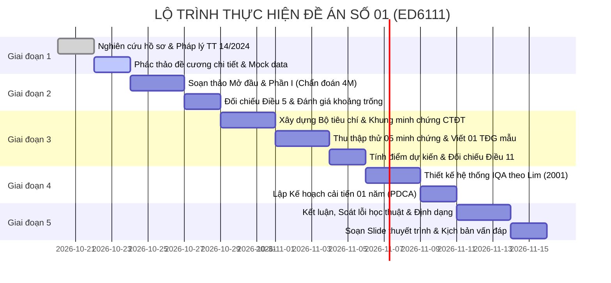

# KẾ HOẠCH TRIỂN KHAI ĐỀ ÁN CÁ NHÂN CUỐI KỲ (CHỦ ĐỀ 01)
**Học phần:** Quản lý chất lượng giáo dục nghề nghiệp (Mã học phần: ED6111)  
**Trình độ đào tạo:** Thạc sĩ | **Trọng số:** 60% điểm học phần (Báo cáo: 45% + Vấn đáp: 15%)  
**Chủ đề lựa chọn:** ĐỀ ÁN SỐ 01 – *Trường Cao đẳng nghề Kỹ thuật - Công nghiệp A chuẩn bị đánh giá ngoài chương trình đào tạo*  
**Học viên thực hiện:** Lê Hạnh Nguyên – Mã học viên: 20252233M  
**Giảng viên hướng dẫn:** PGS. TS. Lê Huy Tùng  

---

## I. MỤC TIÊU VÀ ĐỊNH VỊ CHẤT LƯỢNG ĐỀ ÁN

### 1. Mục tiêu đào tạo và Chuẩn đầu ra (CLOs) cần đạt
Đề án được thiết kế nhằm đáp ứng xuất sắc toàn diện 04 Chuẩn đầu ra của học phần theo quy định của Khoa Khoa học và Công nghệ Giáo dục – Đại học Bách khoa Hà Nội:
- **CLO1 (Mức R - 20 điểm):** Đề xuất được định hướng cải tiến chất lượng cho Trường Cao đẳng nghề Kỹ thuật - Công nghiệp A trên cơ sở phân tích thực trạng chất lượng theo các yếu tố vĩ mô, vi mô, quy tắc 4M và đối chiếu pháp lý với Điều 5 Thông tư số 14/2024/TT-BLĐTBXH.
- **CLO2 (Mức M - 45 điểm):** Xây dựng được bộ tiêu chí, chỉ báo và khung minh chứng tự đánh giá Chương trình đào tạo (CTĐT) trình độ cao đẳng nghề Điện công nghiệp theo Chương III Thông tư 14/2024/TT-BLĐTBXH (07 tiêu chí, 40 tiêu chuẩn); thu thập thử và phân tích minh chứng cho ít nhất 05 tiêu chuẩn; viết hoàn chỉnh 01 tiêu chuẩn theo cấu trúc báo cáo tự đánh giá; tính điểm dự kiến và đối chiếu Điều 11.
- **CLO3 (Mức R - 25 điểm):** Thiết kế được hệ thống ĐBCL bên trong (IQA) theo 05 bước của Lim (2001) và xây dựng Kế hoạch cải tiến 01 năm theo chu trình PDCA đưa các tiêu chí 2, 3, 4, 5 vượt ngưỡng 80% điểm chuẩn.
- **CLO4 (Mức R - 10 điểm):** Đảm bảo tính trung thực, liêm chính học thuật, cấu trúc văn bản khoa học, trích dẫn chuẩn mực, xử lý các vấn đề đạo đức nghề nghiệp trong thu thập minh chứng và công bố kết quả ĐBCL.

### 2. Tiêu chuẩn sản phẩm đầu ra
- **Dung lượng:** 18 – 20 trang A4 (không tính trang bìa, mục lục, danh mục từ viết tắt và phụ lục minh chứng).
- **Quy cách trình bày:** Font Times New Roman, size 13pt, dãn dòng 1.3 line, căn lề chuẩn văn bản học thuật (Top 2.0 cm, Bottom 2.0 cm, Left 3.0 cm, Right 2.0 cm).
- **Hệ thống minh chứng & Báo cáo:** Bản mềm báo cáo (PDF/Word/LaTeX), Bản cam kết liêm chính học thuật, Phụ lục khung minh chứng, Slide thuyết trình bảo vệ vấn đáp (10 – 12 slides).

---

## II. CẤU TRÚC BÁO CÁO VÀ PHÂN BỔ DUNG LƯỢNG (PAGE BUDGET)

| Phần | Nội dung trọng tâm | CĐR | Điểm | Số trang dự kiến |
| :--- | :--- | :---: | :---: | :---: |
| **Mở đầu** | Lý do chọn đề án; Giới thiệu Trường A và CTĐT nghề Điện công nghiệp; Mục tiêu, đối tượng, phạm vi và phương pháp nghiên cứu; Cấu trúc đề án. | CLO4 | 5 | 1.5 - 2 trang |
| **Phần I** | **Phân tích bối cảnh chất lượng và Chẩn đoán hiện trạng kiểm định cấp cơ sở:** - Đối chiếu 3 điều kiện công nhận đạt tại Khoản 1 Điều 5 Thông tư 14/2024/TT-BLĐTBXH. - Phân tích theo các quan điểm đánh giá chất lượng GDNN (Value-added, Fitness for purpose, INQAAHE). - Phân tích các yếu tố vĩ mô và vi mô. - Phân tích chuyên sâu hiện trạng theo Quy tắc 4M (Men - Methods - Machines - Materials). | CLO1 | 20 | 4 - 5 trang |
| **Phần II** | **Xây dựng bộ tiêu chí, khung minh chứng và tự đánh giá CTĐT nghề Điện công nghiệp:** - Hệ thống hóa 07 tiêu chí, 40 tiêu chuẩn theo Chương III Thông tư 14/2024/TT-BLĐTBXH. - Khung danh mục minh chứng chuẩn hóa cho CTĐT Điện công nghiệp. - Thu thập thử và phân tích minh chứng cho 05 tiêu chuẩn điển hình. - Viết trọn vẹn 01 tiêu chuẩn mẫu theo cấu trúc báo cáo TĐG (Mô tả – Điểm mạnh – Tồn tại – Kế hoạch cải tiến). - Dự kiến bảng điểm 7 tiêu chí và đối chiếu điều kiện đạt tại Điều 11 Thông tư 14/2024. | CLO2 | 45 | 7 - 8 trang |
| **Phần III** | **Thiết kế hệ thống ĐBCL bên trong (IQA) và Kế hoạch cải tiến 01 năm theo PDCA:** - Thiết kế hệ thống IQA cho Trường A theo 05 bước của Lim (2001). - Kế hoạch cải tiến chất lượng 01 năm theo chu trình PDCA (trọng tâm vượt ngưỡng 80% điểm chuẩn Tiêu chí 2, 3, 4, 5). - Phân công trách nhiệm (RACI), mốc thời gian và chuẩn cần đạt (KPIs). | CLO3 | 25 | 4 - 5 trang |
| **Kết luận & Kiến nghị** | Tổng kết các phát hiện chính; Kiến nghị đối với BGH, Khoa Điện - ĐT, các phòng ban và cơ quan quản lý. | CLO4 | 5 | 1 - 1.5 trang |
| **Tài liệu tham khảo & Phụ lục** | Danh mục tài liệu tham khảo (APA 7th); Bản cam kết liêm chính học thuật; Bảng chỉ báo & Khung minh chứng chi tiết. | CLO4 | - | 5 - 10 trang (ngoài dung lượng chính) |
| **Tổng cộng** | | | **100** | **18 - 20 trang** |

---

## III. NỘI HÀM KỸ THUẬT VÀ PHƯƠNG PHÁP LUẬN TỪNG PHẦN

### 1. Mở đầu và Bối cảnh nghiên cứu
- **Giới thiệu tổng quan:** Trường Cao đẳng nghề Kỹ thuật - Công nghiệp A (quy mô 3.200 HSSV, 12 nghề đào tạo, 180 nhà giáo; trong đó 32% trình độ thạc sĩ trở lên, 45% kỹ năng nghề bậc cao).
- **Vị trí ngành Điện công nghiệp:** Là ngành đào tạo mũi nhọn, có truyền thống và nhu cầu tuyển dụng cao, được nhà trường lựa chọn đăng ký đánh giá ngoài theo Thông tư 14/2024/TT-BLĐTBXH.
- **Tính cấp thiết:** Năm 2026 trường tự đánh giá cấp cơ sở chỉ đạt 79/100 điểm, bộc lộ nhiều điểm nghẽn về ĐBCL. Việc tự đánh giá cấp CTĐT nghề Điện công nghiệp và tái cấu trúc hệ thống IQA là bước đi sống còn để nâng cao uy tín và chuẩn bị đánh giá ngoài thành công.

### 2. Phần I: Phân tích bối cảnh và Chẩn đoán hiện trạng (CLO1)
- **Bài toán pháp lý – Đối chiếu Khoản 1 Điều 5 Thông tư 14/2024/TT-BLĐTBXH:**
  * *Điều kiện a (Tổng điểm >= 80/100):* Trường A đạt 79 điểm $\rightarrow$ **KHÔNG ĐẠT (vi phạm điểm a, thiếu 1 điểm)**.
  * *Điều kiện b (Mỗi tiêu chí >= 60% điểm chuẩn):*
    - TC1: 8/10 (80%) $\ge$ 60% $\rightarrow$ Đạt.
    - TC2: 12/16 (75%) $\ge$ 60% $\rightarrow$ Đạt.
    - TC3: 12/14 (85.7%) $\ge$ 60% $\rightarrow$ Đạt.
    - TC4: 12/14 (85.7%) $\ge$ 60% $\rightarrow$ Đạt.
    - TC5: 12/16 (75%) $\ge$ 60% $\rightarrow$ Đạt.
    - TC6: 6/8 (75%) $\ge$ 60% $\rightarrow$ Đạt.
    - TC7: 8/10 (80%) $\ge$ 60% $\rightarrow$ Đạt.
    - TC8: 9/12 (75%) $\ge$ 60% $\rightarrow$ Đạt.
    $\rightarrow$ **ĐẠT điều kiện b**.
  * *Điều kiện c (Các tiêu chí 2, 3, 4, 5 phải đạt từ 80% điểm chuẩn trở lên):*
    - TC2 (Hoạt động đào tạo): 12/16 = 75.0% < 80% $\rightarrow$ **VI PHẠM (không đạt)**.
    - TC3 (Nhà giáo, CBQL, viên chức, NLĐ): 12/14 = 85.7% $\ge$ 80% $\rightarrow$ Đạt.
    - TC4 (Chương trình đào tạo, giáo trình): 12/14 = 85.7% $\ge$ 80% $\rightarrow$ Đạt.
    - TC5 (Cơ sở vật chất, thiết bị đào tạo): 12/16 = 75.0% < 80% $\rightarrow$ **VI PHẠM (không đạt)**.
  * $\Rightarrow$ **KẾT LUẬN CHẨN ĐOÁN:** Trường A không đạt chuẩn kiểm định cấp cơ sở do vi phạm cả 02 điều kiện: Điều kiện a (tổng điểm 79 < 80) và Điều kiện c (Tiêu chí 2 và Tiêu chí 5 đều chỉ đạt 75% < 80%).
- **Vận dụng các quan điểm đánh giá chất lượng GDNN:**
  * *Quan điểm Giá trị gia tăng (Value-added):* Tỷ lệ tốt nghiệp có việc làm 72% cho thấy trường có đóng góp giá trị cho người học, nhưng 28% còn lại chưa có việc làm ổn định phản ánh năng lực cạnh tranh chưa cao.
  * *Quan điểm Phù hợp mục tiêu (Fitness for purpose):* 58% sinh viên tốt nghiệp thấy học được kiến thức/kỹ năng cần thiết $\rightarrow$ có tới 42% cảm thấy chương trình chưa đáp ứng công việc thực tế.
  * *Quan điểm Thỏa mãn khách hàng (Stakeholder satisfaction):* Chỉ 46% doanh nghiệp nhận định sinh viên "dùng được ngay", đồng nghĩa 54% doanh nghiệp phải đào tạo lại $\rightarrow$ khoảng cách kỹ năng (skill-gap) lớn.
  * *Tiêu chuẩn INQAAHE:* Chưa đồng bộ giữa mục tiêu công bố và năng lực đáp ứng thị trường lao động.
- **Phân tích bối cảnh Vĩ mô và Vi mô:**
  * *Vĩ mô:* Khung pháp lý mới (Thông tư 14/2024 khắt khe về minh chứng); yêu cầu công nghiệp 4.0 và chuyển đổi số; nhu cầu nhân lực kỹ thuật điện - tự động hóa tại các khu công nghiệp.
  * *Vi mô:* 7 yếu tố vi mô (Mục tiêu đào tạo, CTĐT, phương pháp giảng dạy, đội ngũ GV, người học, quá trình tổ chức đào tạo, kiểm tra đánh giá).
- **Chẩn đoán chuyên sâu theo Quy tắc 4M:**
  * **Men (Con người):** Đội ngũ 180 GV nhưng chỉ 32% có trình độ thạc sĩ trở lên, 45% đạt kỹ năng nghề bậc cao; Ban ĐBCL mỗi năm họp 1 lần (quản lý thụ động); các đơn vị e ngại chia sẻ số liệu (thiếu văn hóa chất lượng).
  * **Methods (Phương pháp):** Quản trị chất lượng hình thức; quy trình lưu giữ minh chứng tập trung đơn lẻ ở Phòng Đào tạo; phương pháp giảng dạy chậm đổi mới, thiếu công cụ đo lường phản hồi thời gian thực.
  * **Machines (Máy móc, thiết bị):** Điểm Tiêu chí 5 chỉ đạt 12/16 (75%); thiết bị thực hành có nguy cơ lạc hậu, tỷ lệ máy móc/sinh viên chưa đáp ứng quy mô 3.200 người học.
  * **Materials (Học liệu, chương trình, nguyên vật liệu):** Chương trình và giáo trình chưa tích hợp chuẩn chuyển đổi số và kỹ năng công nghệ mới; định mức vật tư tiêu hao cho thực hành bị cắt giảm.

### 3. Phần II: Bộ tiêu chí, Khung minh chứng và Tự đánh giá CTĐT Điện công nghiệp (CLO2)
- **Hệ thống hóa 07 tiêu chí, 40 tiêu chuẩn (Chương III Thông tư 14/2024/TT-BLĐTBXH):**
  * Tiêu chí 1: Mục tiêu, chuẩn đầu ra của chương trình đào tạo (3 tiêu chuẩn - 7.5 điểm).
  * Tiêu chí 2: Cấu trúc và nội dung của chương trình đào tạo, giáo trình (7 tiêu chuẩn - 17.5 điểm).
  * Tiêu chí 3: Hoạt động đào tạo (7 tiêu chuẩn - 17.5 điểm).
  * Tiêu chí 4: Đội ngũ nhà giáo, cán bộ quản lý và viên chức, người lao động (6 tiêu chuẩn - 15.0 điểm).
  * Tiêu chí 5: Cơ sở vật chất, thiết bị đào tạo và học liệu (7 tiêu chuẩn - 17.5 điểm).
  * Tiêu chí 6: Người học và hoạt động hỗ trợ người học (5 tiêu chuẩn - 12.5 điểm).
  * Tiêu chí 7: Giám sát, đánh giá chất lượng (5 tiêu chuẩn - 12.5 điểm).
  * *Tổng cộng: 40 tiêu chuẩn x 2.5 điểm/tiêu chuẩn = 100 điểm chuẩn.*
- **Khung minh chứng chuẩn hóa cho CTĐT Điện công nghiệp:**
  * Thiết lập mã hóa khoa học: `[Mã Tiêu chí].[Số Tiêu chuẩn].[Số thứ tự Minh chứng]`.
  * Xác định rõ: Tên minh chứng, Nguồn thu thập, Đơn vị chủ trì lưu giữ, Hình thức (bản cứng/số hóa).
- **Thu thập thử và phân tích minh chứng cho 05 tiêu chuẩn điển hình:**
  1. *Tiêu chuẩn 1.2:* Chuẩn đầu ra nghề Điện công nghiệp phù hợp Khung trình độ quốc gia và công bố công khai.
  2. *Tiêu chuẩn 1.3:* Tích hợp năng lực số vào chuẩn đầu ra nghề Điện công nghiệp.
  3. *Tiêu chuẩn 2.2:* Rà soát, cập nhật cấu trúc CTĐT với sự tham gia của doanh nghiệp ngành điện/tự động hóa.
  4. *Tiêu chuẩn 4.2:* Năng lực chuyên môn và kỹ năng nghề bậc cao của giảng viên dạy thực hành Điện công nghiệp.
  5. *Tiêu chuẩn 5.3:* Xưởng thực hành, thiết bị an toàn điện và bảo dưỡng trang thiết bị đào tạo nghề Điện.
- **Viết hoàn chỉnh 01 tiêu chuẩn theo cấu trúc báo cáo tự đánh giá:**
  * Chọn **Tiêu chuẩn 1.3** (Chuẩn đầu ra được tích hợp năng lực số) hoặc **Tiêu chuẩn 2.2** (Nội dung chương trình đào tạo đáp ứng sự thay đổi công nghệ và gắn kết doanh nghiệp).
  * Viết chi tiết 4 cấu phần bắt buộc:
    1. *Mô tả hiện trạng:* Trình bày rõ ràng các hoạt động, dẫn xuất các mã minh chứng cụ thể `[H1.01.03.01]`, `[H1.01.03.02]`.
    2. *Điểm mạnh:* Nêu bật các kết quả đã làm được với số liệu đối chiếu.
    3. *Tồn tại và nguyên nhân:* Chỉ rõ các khoảng trống thực tế (ví dụ: mô-đun IoT/SCADA trong điện công nghiệp chưa có bài tập mô phỏng số, năng lực số của giảng viên cao tuổi còn hạn chế).
    4. *Kế hoạch cải tiến chất lượng:* Hành động cụ thể, người chịu trách nhiệm, thời hạn hoàn thành, kết quả kỳ vọng đo lường được.
- **Dự kiến điểm đánh giá CTĐT và đối chiếu Điều 11 Thông tư 14/2024:**
  * Thiết lập bảng điểm dự kiến: Tổng điểm dự kiến 82.5/100 điểm.
  * Đối chiếu 3 điều kiện công nhận đạt chuẩn CTĐT tại Khoản 1 Điều 11:
    - *Điều kiện a:* Tổng điểm $\ge$ 80 điểm $\rightarrow$ Dự kiến 82.5 $\ge$ 80 $\rightarrow$ **ĐẠT**.
    - *Điều kiện b:* Tiêu chí 2, 4, 5, 7 đạt từ 75% điểm chuẩn trở lên $\rightarrow$ Tính toán từng tiêu chí để chứng minh tính khả thi.
    - *Điều kiện c:* Tiêu chí 1, 3, 6 đạt từ 50% điểm chuẩn trở lên $\rightarrow$ Tính toán chứng minh đạt.
  * Chỉ ra các điều kiện tiên quyết và rủi ro nếu không khắc phục kịp thời các tiêu chuẩn về thiết bị xưởng và khảo sát doanh nghiệp.

### 4. Phần III: Thiết kế hệ thống IQA và Kế hoạch cải tiến 01 năm theo PDCA (CLO3)
- **Thiết kế hệ thống IQA cho Trường A theo 05 bước của Lim (2001):**
  * *Bước 1 - Xác định sứ mạng, mục đích:* Tái định nghĩa sứ mạng Trường A là trung tâm đào tạo kỹ thuật thực hành chất lượng cao gắn với công nghệ số; ban hành Chính sách chất lượng mới.
  * *Bước 2 - Xác định các chức năng và tầm quan trọng:* 4 chức năng cốt lõi (Đào tạo thực hành, NCKH & dịch vụ chuyển giao kỹ thuật, Hợp tác doanh nghiệp, Đảm bảo chất lượng & quản trị trường).
  * *Bước 3 - Xác định mục tiêu và chỉ số thực hiện (KPIs):* Thiết lập bộ KPIs định tính và định lượng cho từng chức năng (tỷ lệ việc làm > 85%, tỷ lệ DN hài lòng > 75%, 100% hồ sơ minh chứng số hóa).
  * *Bước 4 - Thiết lập hệ thống quản lý ĐBCL và quy trình:* Tái lập Hội đồng ĐBCL (họp định kỳ hàng quý thay vì 1 lần/năm); chuyển Phòng Đào tạo khỏi vai trò "ôm đồm" minh chứng sang mô hình mạng lưới ĐBCL tại từng Khoa; thiết lập cổng thông tin dữ liệu minh chứng tập trung để xóa bỏ tâm lý "e ngại chia sẻ dữ liệu".
  * *Bước 5 - Thiết lập hệ thống kiểm định và đánh giá nội bộ:* Ban hành quy trình đánh giá nội bộ hàng năm (Internal Audit) độc lập, khách quan để nhận diện điểm nghẽn trước khi đánh giá ngoài.
- **Kế hoạch cải tiến chất lượng 01 năm theo chu trình PDCA:**
  * *Trọng tâm:* Nâng Tiêu chí 2 (Hoạt động đào tạo) và Tiêu chí 5 (Cơ sở vật chất) từ 75% lên vượt 80% điểm chuẩn, đồng thời củng cố Tiêu chí 3 và Tiêu chí 4.
  * *Chu trình PDCA cụ thể:*
    - **Plan (Quý I/2026):** Rà soát ma trận nguyên nhân điểm liệt; phân bổ ngân sách 3.5 tỷ đồng nâng cấp xưởng điện công nghiệp; ký kết thỏa thuận thực tập với 15 doanh nghiệp FDI/KCN; lập kế hoạch bồi dưỡng chuẩn hóa giảng viên.
    - **Do (Quý II & III/2026):** Mua sắm thiết bị xưởng điện công nghiệp theo danh mục chuẩn; áp dụng phương pháp đào tạo theo dự án (Project-based learning); đưa 40 giảng viên đi bồi dưỡng thực tế tại doanh nghiệp; triển khai phần mềm khảo sát trực tuyến.
    - **Check (Quý III & IV/2026):** Kiểm toán nội bộ độc lập; đối soát dữ liệu khảo sát sinh viên và doanh nghiệp; kiểm tra tiến độ giải ngân và tỷ lệ đạt chuẩn của thiết bị xưởng.
    - **Act (Quý IV/2026):** Chuẩn hóa các quy trình cải tiến thành quy định chính thức; khắc phục các tồn tại còn sót lại; hoàn thiện hồ sơ tự đánh giá sẵn sàng đón đoàn đánh giá ngoài vào đầu năm 2027.
  * *Bảng kế hoạch hành động tổng thể (Action Plan):* Thể hiện rõ Nội dung, Đơn vị chủ trì, Đơn vị phối hợp, Thời hạn hoàn thành, Nguồn lực, Chỉ số đầu ra (Deliverables / KPIs).

### 5. Kết luận, Khuyến nghị và Liêm chính học thuật (CLO4)
- **Kết luận:** Tổng kết các đóng góp thực tiễn của đề tài trong việc giải quyết bài toán kép: khắc phục tồn tại cấp cơ sở và chuẩn bị đánh giá ngoài cấp CTĐT.
- **Khuyến nghị:**
  * Đối với Hội đồng trường & Ban Giám hiệu: Cam kết ngân sách và phân quyền mạnh mẽ cho hệ thống ĐBCL.
  * Đối với Khoa Điện - Điện tử: Chủ động gắn kết doanh nghiệp, cập nhật năng lực số cho nhà giáo.
  * Đối với Phòng ĐBCL và các đơn vị phòng ban: Xây dựng văn hóa chất lượng tự giác, minh bạch dữ liệu.
- **Liêm chính học thuật:** Khai báo trung thực dữ liệu, công cụ hỗ trợ và phương pháp phân tích; cam kết tính độc lập trong tư duy và giải pháp.

---

## IV. LỘ TRÌNH THỰC HIỆN CHI TIẾT (WBS & TIMELINE)

Kế hoạch thực hiện được chia làm 5 giai đoạn nối tiếp (Sprint), mỗi giai đoạn có mốc kiểm soát chất lượng rõ ràng:

### Chi tiết các gói công việc (Work Packages):

#### Gói 1: Thiết lập cấu trúc dự án và Hồ sơ dữ liệu giả lập (Ngày 1 - 3)
- **Công việc 1.1:** Xây dựng khung thư mục làm việc trong repository:
  * `qlclgdnn/cuoiki/baocao/`: Chứa các file nội dung markdown (`00_modau.md`, `01_phan1.md`, `02_phan2.md`, `03_phan3.md`, `04_ketluan.md`, `phu_luc.md`).
  * `qlclgdnn/cuoiki/latex/`: Chứa mã nguồn LaTeX hoàn chỉnh xuất file PDF nộp bài.
  * `qlclgdnn/cuoiki/slide/`: Chứa tài liệu thuyết trình bảo vệ vấn đáp.
- **Công việc 1.2:** Thiết lập bộ số liệu giả định đồng bộ và logic cho Trường A và Khoa Điện - Điện tử (số lượng sinh viên ngành Điện, quy mô xưởng, số lượng giảng viên cơ hữu môn Điện, các thiết bị thực hành cụ thể).

#### Gói 2: Hoàn thành Phần Mở đầu và Phần I (Ngày 4 - 8)
- **Công việc 2.1:** Viết hoàn chỉnh Phần Mở đầu (Lý do chọn đề án, phạm vi, phương pháp).
- **Công việc 2.2:** Phân tích toán học - pháp lý đối chiếu Khoản 1 Điều 5 Thông tư 14/2024.
- **Công việc 2.3:** Luận giải hiện trạng dựa trên 4 quan điểm đánh giá chất lượng GDNN.
- **Công việc 2.4:** Chẩn đoán nguyên nhân vi mô - vĩ mô và phân tích sâu theo quy tắc 4M.

#### Gói 3: Hoàn thành Phần II – Trọng tâm Đề án (Ngày 9 - 16)
- **Công việc 3.1:** Xây dựng bảng ma trận 07 tiêu chí, 40 tiêu chuẩn kiểm định CTĐT cao đẳng Điện công nghiệp.
- **Công việc 3.2:** Xây dựng khung danh mục minh chứng (tối thiểu 40 minh chứng đại diện cho 40 tiêu chuẩn).
- **Công việc 3.3:** Viết hồ sơ thẩm định và thu thập thử minh chứng cho 05 tiêu chuẩn then chốt.
- **Công việc 3.4:** Viết trọn vẹn Báo cáo tự đánh giá cho 01 tiêu chuẩn (gồm 4 mục: Mô tả - Điểm mạnh - Tồn tại - Cải tiến).
- **Công việc 3.5:** Xây dựng bảng điểm dự kiến và lập luận đối chiếu Điều 11 Thông tư 14/2024.

#### Gói 4: Hoàn thành Phần III – Giải pháp hệ thống & Cải tiến (Ngày 17 - 21)
- **Công việc 4.1:** Thiết kế hệ thống IQA theo 05 bước của Lim (2001) gắn với đặc thù trường kỹ thuật A.
- **Công việc 4.2:** Thiết kế cơ cấu tổ chức và ma trận trách nhiệm RACI cho Ban ĐBCL và các Khoa/Phòng.
- **Công việc 4.3:** Xây dựng Kế hoạch hành động 01 năm theo chu trình PDCA kèm bảng tiến độ Gantt chi tiết và ngân sách phân bổ.

#### Gói 5: Hoàn thiện Báo cáo, Định dạng và Chuẩn bị Vấn đáp (Ngày 22 - 26)
- **Công việc 5.1:** Viết Phần Kết luận, Kiến nghị và Tài liệu tham khảo chuẩn APA 7th.
- **Công việc 5.2:** Soát xét liêm chính học thuật, rà soát tỷ lệ trùng lặp, hoàn thiện bản cam kết liêm chính.
- **Công việc 5.3:** Biên dịch sang định dạng LaTeX/PDF theo đúng quy cách chuẩn của Đại học Bách khoa Hà Nội.
- **Công việc 5.4:** Thiết kế Slide báo cáo bảo vệ vấn đáp (10 - 12 slides) và bộ câu hỏi phản biện giả định.

---

## V. MA TRẬN PHÂN BỔ TRÁCH NHIỆM VÀ TIÊU CHÍ NGHIỆM THU

### 1. Ma trận kiểm soát chất lượng (Quality Assurance Checklist)

| Hạng mục kiểm tra | Tiêu chuẩn nghiệm thu | Tình trạng kiểm tra |
| :--- | :--- | :---: |
| **Phù hợp đề bài** | Giải quyết trọn vẹn các yêu cầu của Đề án số 01 tại debai.md. | [ ] |
| **Tính chuẩn xác pháp lý** | Dẫn chiếu chuẩn xác các điều khoản của Thông tư số 14/2024/TT-BLĐTBXH (Điều 5, Điều 9, 10, 11). | [ ] |
| **Tính logic lý thuyết** | Ứng dụng đúng quy tắc 4M, các quan điểm CLGDNN, mô hình Lim (2001) và chu trình PDCA. | [ ] |
| **Độ tin cậy của dữ liệu** | Số liệu minh chứng logic, tương thích với bối cảnh thực tế ngành Điện công nghiệp. | [ ] |
| **Quy chuẩn hình thức** | Đúng độ dài 18-20 trang; font chữ TNR 13; dãn dòng 1.3; bảng biểu có tiêu đề và nguồn; công thức rõ ràng. | [ ] |
| **Liêm chính học thuật** | Không đạo văn; trích dẫn nguồn đầy đủ theo APA 7th; có bản cam kết liêm chính học thuật. | [ ] |

### 2. Kịch bản chuẩn bị bảo vệ vấn đáp (15% điểm học phần)
- **Phân bổ thời lượng:** 10 phút thuyết trình tóm tắt + 10 - 15 phút trả lời câu hỏi vấn đáp của Hội đồng.
- **Các nhóm câu hỏi dự kiến:**
  1. *Về cơ sở pháp lý:* Tại sao trường A vi phạm Điều 5? Điểm khác biệt lớn nhất giữa kiểm định cơ sở và kiểm định CTĐT trong Thông tư 14/2024 là gì?
  2. *Về dữ liệu 4M:* Trong 4 yếu tố 4M của trường A, yếu tố nào đóng vai trò nghẽn mạch cốt lõi? Giải pháp nào để tháo gỡ tâm lý "ngại cung cấp số liệu"?
  3. *Về mô hình Lim (2001):* 5 bước của Lim (2001) được áp dụng thế nào để khắc phục tình trạng "Ban ĐBCL mỗi năm họp một lần"?
  4. *Về kế hoạch PDCA:* Làm thế nào để đảm bảo Tiêu chí 2 và Tiêu chí 5 vượt ngưỡng 80% chỉ trong vòng 01 năm với nguồn lực tài chính có hạn?
