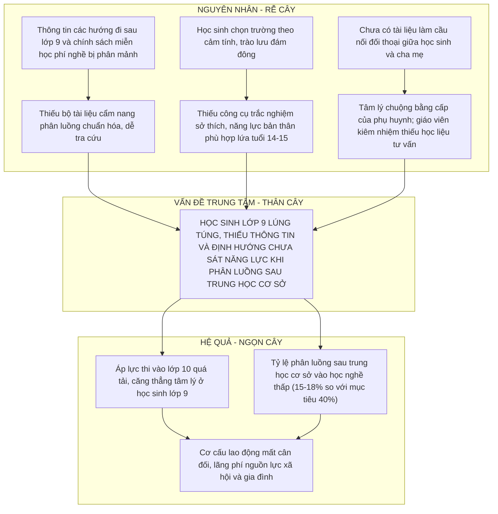
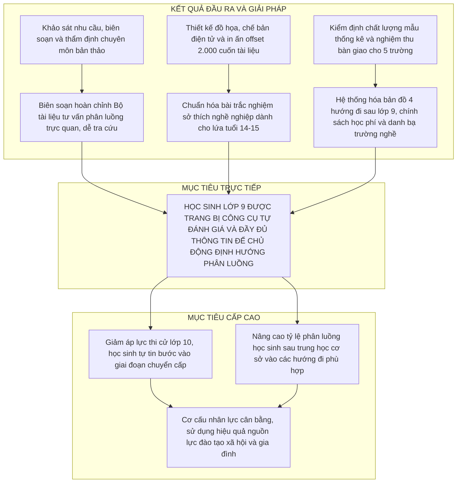
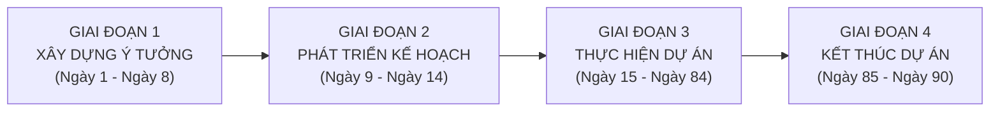

# CHƯƠNG 1. BỐI CẢNH THỰC TIỄN VÀ CƠ SỞ XÁC ĐỊNH DỰ ÁN GIÁO DỤC

Chương này vận dụng `Logical Framework Approach` (Phương pháp tiếp cận khung logic) và lý thuyết chu trình dự án giáo dục để phân tích quan hệ nhân quả của bài toán phân luồng tại trường trung học cơ sở, xác lập hệ thống mục tiêu, luận chứng lựa chọn chiến lược can thiệp và định hình bốn giai đoạn vòng đời dự án.

## 1.1. Cấu trúc vấn đề thực tiễn theo mô hình Cây vấn đề

Mô hình `Problem Tree` (Cây vấn đề) được sử dụng để bóc tách các nguyên nhân trực tiếp, nguyên nhân gốc rễ và hệ quả của tình trạng lúng túng trong định hướng phân luồng cho học sinh cuối cấp trung học cơ sở.

### 1.1.1. Vấn đề trung tâm

Vấn đề trung tâm cần giải quyết là: Học sinh lớp 9 thiếu thông tin hệ thống và công cụ tự đánh giá năng lực, dẫn đến lúng túng và định hướng chưa sát thực tế khi lựa chọn con đường học tập sau tốt nghiệp trung học cơ sở.

### 1.1.2. Hệ thống nguyên nhân và hệ quả

Vấn đề trung tâm xuất phát từ ba nhánh nguyên nhân chính tại cơ sở giáo dục phổ thông. Nhánh nguyên nhân thứ nhất là sự thiếu hụt một bộ tài liệu cẩm nang phân luồng tổng hợp: thông tin về các hướng đi sau lớp 9, điều kiện dự tuyển và chính sách miễn học phí học nghề hiện nằm rải rác ở các văn bản hành chính hoặc tờ rơi tuyển sinh riêng lẻ, trong khi thời lượng nội dung hướng nghiệp trong sách giáo khoa còn khá khái quát. Nhánh nguyên nhân thứ hai là việc học sinh thiếu công cụ khoa học để tự nhận diện sở thích và năng lực nghề nghiệp phù hợp với lứa tuổi 14 đến 15, dẫn đến xu hướng chọn trường theo cảm tính hoặc theo tâm lý đám đông. Nhánh nguyên nhân thứ ba đến từ rào cản nhận thức của phụ huynh và sự thiếu hụt học liệu hỗ trợ đối thoại giữa nhà trường với gia đình, khiến giáo viên kiêm nhiệm gặp khó khăn khi tư vấn phân luồng.

Nếu không được tháo gỡ kịp thời, vấn đề này kéo theo hai hệ quả trực tiếp là áp lực thi tuyển vào lớp 10 trung học phổ thông công lập tiếp tục quá tải và tỷ lệ phân luồng vào giáo dục nghề nghiệp duy trì ở mức thấp (15% đến 18%). Về dài hạn, sự lệch pha trong lựa chọn đường học dẫn đến tình trạng học sinh đuối sức ở bậc trung học phổ thông và gây mất cân đối cơ cấu nhân lực qua đào tạo.

## 1.2. Hệ thống mục tiêu dự án theo mô hình Cây mục tiêu

Từ cấu trúc Cây vấn đề, mô hình `Objective Tree` (Cây mục tiêu) chuyển hóa các trạng thái hạn chế hiện tại thành hệ thống mục tiêu kỳ vọng theo ba cấp độ: mục tiêu phát triển cấp cao, mục tiêu trực tiếp của dự án và các kết quả đầu ra cụ thể.

Ở cấp độ phát triển vĩ mô, dự án góp phần nâng cao hiệu quả phân luồng học sinh sau trung học cơ sở theo định hướng của Quyết định số 522/QĐ-TTg và giảm tải áp lực tâm lý trong kỳ thi tuyển sinh vào lớp 10. Ở cấp độ mục tiêu trực tiếp, dự án trang bị cho học sinh lớp 9 công cụ tự đánh giá bản thân và hệ thống thông tin minh bạch về các lộ trình học tập để chủ động xây dựng kế hoạch chọn trường cùng gia đình.

Để đạt được mục tiêu trực tiếp đó, dự án xác lập bốn kết quả chuyển giao cụ thể: hoàn thành bản thảo bộ tài liệu tư vấn phân luồng có tích hợp trắc nghiệm sở thích nghề nghiệp theo mô hình mật mã Holland rút gọn và bản đồ các hướng đi sau lớp 9; thẩm định chuyên môn bản thảo đáp ứng yêu cầu cần đạt của Chương trình Giáo dục phổ thông 2018 (Thông tư số 32/2018/TT-BGDĐT); xuất bản và bàn giao 2.000 cuốn ấn phẩm đạt chuẩn kỹ thuật cho năm trường trung học cơ sở đại diện; đồng thời cung cấp bộ phiếu đối thoại hướng nghiệp giúp gắn kết học sinh, giáo viên tư vấn và phụ huynh.

## 1.3. Cơ sở luận chứng và lựa chọn chiến lược can thiệp

Nhằm lựa chọn phương thức can thiệp phù hợp nhất với nguồn lực 185.000.000 đồng và thời gian 90 ngày của địa phương, nhóm lập kế hoạch đặt lên bàn cân ba phương án chiến lược:

Phương án 1 (Tổ chức chuỗi sự kiện và ngày hội tư vấn phân luồng trực tiếp): Tạo được hiệu ứng truyền thông tại thời điểm diễn ra sự kiện nhưng chi phí thuê mặt bằng, dàn dựng sân khấu cao; thời gian tiếp xúc ngắn (chỉ một đến hai buổi) nên học sinh khó tra cứu sâu thông tin và không để lại học liệu lưu giữ lâu dài.

Phương án 2 (Xây dựng phần mềm hoặc cổng thông tin hướng nghiệp trực tuyến): Có lợi thế về khả năng truy cập số nhưng đòi hỏi chi phí lập trình, thuê máy chủ và bảo trì hàng năm vượt quá ngân sách sự nghiệp ngắn hạn; đồng thời tiềm ẩn rủi ro chậm tiến độ do lỗi kỹ thuật phần mềm.

Phương án 3 (Biên soạn, thẩm định và in ấn bộ tài liệu chuẩn hóa): Tập trung ngân sách vào chất lượng nội dung sư phạm và tạo ra ấn phẩm vật lý cụ thể. Học sinh có thể trực tiếp làm bài trắc nghiệm trên giấy, mang tài liệu về nhà cùng cha mẹ đối chiếu các phương án chọn trường, trong khi cơ quan quản lý dễ dàng kiểm soát định mức chi phí, tiến độ và nghiệm thu sản phẩm đầu ra.

**Bảng 1.1. Ma trận đánh giá và lựa chọn chiến lược can thiệp (Thang điểm 10)**

| Tiêu chí đánh giá | Trọng số | Phương án 1: Tổ chức chuỗi sự kiện | Phương án 2: Xây dựng phần mềm | Phương án 3: Biên soạn ấn phẩm chuẩn hóa |
| :--- | :---: | :---: | :---: | :---: |
| 1. Tính khả thi kỹ thuật và quản lý | 20% | 6 (Điểm: 1,20) | 5 (Điểm: 1,00) | 9 (Điểm: 1,80) |
| 2. Tính kinh tế và tối ưu ngân sách | 25% | 5 (Điểm: 1,25) | 4 (Điểm: 1,00) | 9 (Điểm: 2,25) |
| 3. Mức độ tác động và tính bền vững | 25% | 4 (Điểm: 1,00) | 7 (Điểm: 1,75) | 8 (Điểm: 2,00) |
| 4. Khả năng tiếp cận của học sinh và phụ huynh | 20% | 5 (Điểm: 1,00) | 6 (Điểm: 1,20) | 8 (Điểm: 1,60) |
| 5. Tính kiểm soát chất lượng và nghiệm thu | 10% | 6 (Điểm: 0,60) | 5 (Điểm: 0,50) | 9 (Điểm: 0,90) |
| **Tổng điểm có trọng số** | **100%** | **5,05** | **5,45** | **8,55** |

Kết quả phân tích đa tiêu chí tại Bảng 1.1 cho thấy Phương án 3 đạt tổng điểm có trọng số cao nhất là **8,55/10 điểm** (so với 5,05 điểm của Phương án 1 và 5,45 điểm của Phương án 2). Do đó, chiến lược biên soạn và xuất bản bộ tài liệu in ấn được lựa chọn để triển khai.

## 1.4. Đặc trưng dự án và chu trình vòng đời bốn giai đoạn

### 1.4.1. Các đặc trưng cơ bản của dự án

Dự án thể hiện rõ bảy đặc trưng của một dự án giáo dục: có mục tiêu xác định nhằm giải quyết khoảng trống học liệu phân luồng cấp trung học cơ sở; có sản phẩm bàn giao định lượng rõ ràng (2.000 cuốn ấn phẩm và bộ tệp tin chế bản gốc); bị giới hạn chặt chẽ trong khung thời gian 90 ngày (từ ngày 02/03/2026 đến ngày 30/05/2026) và ngân sách 185.000.000 đồng; được vận hành bởi một Ban Quản lý dự án thành lập tạm thời; đòi hỏi sự phối hợp liên ngành giữa nhà khoa học giáo dục, chuyên gia tâm lý, cán bộ quản lý và doanh nghiệp in ấn; liên quan đến nhiều nhóm chủ thể từ Phòng Giáo dục và Đào tạo đến các nhà trường, phụ huynh; đồng thời chịu tác động của các yếu tố bất định về tiến độ biên soạn và kỹ thuật xuất bản.

### 1.4.2. Khung chu trình bốn giai đoạn vòng đời dự án

Vòng đời 90 ngày của dự án được tổ chức thành bốn giai đoạn nối tiếp, khớp với mười gói công việc từ A đến J trên sơ đồ mạng tiến độ:

Giai đoạn 1 (Xây dựng ý tưởng, từ ngày 1 đến ngày 8 - công việc A): Triển khai khảo sát nhu cầu thực tế trên 350 bộ phiếu tại năm trường trung học cơ sở đại diện, thu thập dữ liệu tuyển sinh và hoàn thành báo cáo khảo sát đầu vào.

Giai đoạn 2 (Phát triển kế hoạch, từ ngày 9 đến ngày 14 - công việc B): Thiết kế khung cấu trúc bốn phần của tài liệu, tổ chức hội thảo thông qua đề cương chi tiết và phê duyệt kế hoạch quản lý tổng thể, cấu trúc phân rã công việc, tiến độ đường găng cùng dự toán ngân sách.

Giai đoạn 3 (Thực hiện dự án, từ ngày 15 đến ngày 84 - các công việc từ C đến I): Tổ chức cho bốn nhóm tác giả biên soạn bản thảo (C), đồng thời lựa chọn nhà thầu in ấn (D); tiến hành thẩm định chuyên môn độc lập hai vòng (E) và hiệu đính bản thảo sạch (F); thiết kế đồ họa, dàn trang chế bản điện tử (G), in thử bản bông màu để ký duyệt mẫu (H) và in ấn offset hàng loạt 2.000 cuốn tài liệu (I).

Giai đoạn 4 (Kết thúc dự án, từ ngày 85 đến ngày 90 - công việc J): Rút mẫu thống kê 384 cuốn để kiểm định chất lượng tại kho, họp Hội đồng nghiệm thu cấp cơ sở, vận chuyển bàn giao 2.000 cuốn tài liệu cho năm trường trung học cơ sở, thanh lý hợp đồng, đóng gói 03 bộ hồ sơ lưu trữ và giải thể Ban Quản lý dự án.
