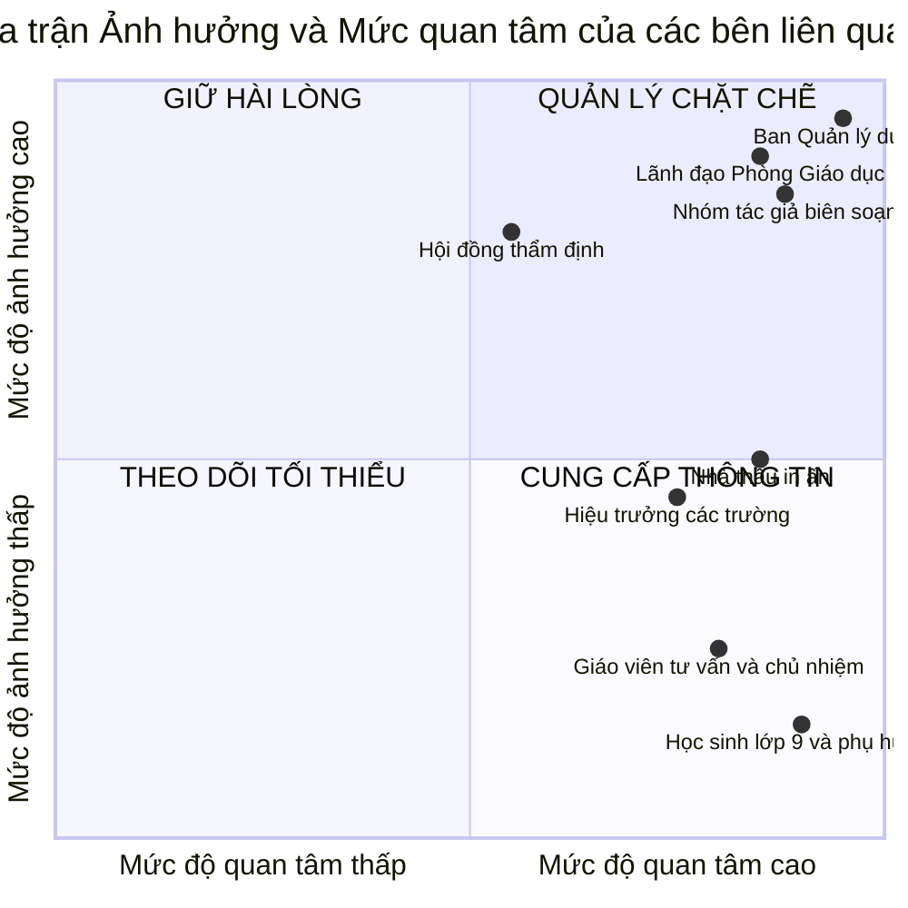
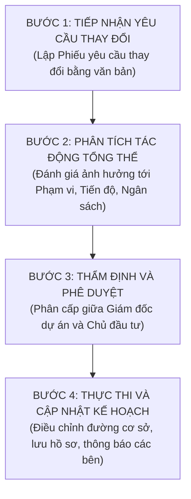

# CHƯƠNG 2. KẾ HOẠCH QUẢN LÝ TỔNG THỂ VÀ KHỞI ĐỘNG DỰ ÁN

Chương này thiết lập văn kiện pháp lý khởi động dự án, phân tích mức độ ảnh hưởng và mối quan tâm của các bên liên quan, đồng thời xác lập quy chế điều hành tích hợp và quy trình kiểm soát thay đổi tổng thể.

## 2.1. Báo cáo tóm tắt dự án và văn kiện khởi động

Văn kiện `Project Charter` (Báo cáo tóm tắt dự án) được ban hành kèm theo Quyết định số 128/QĐ-PGDĐT ngày 02 tháng 3 năm 2026 của Trưởng phòng Giáo dục và Đào tạo, chính thức xác lập tư cách pháp lý cho Dự án xây dựng bộ tài liệu tư vấn phân luồng và định hướng nghề nghiệp cho học sinh cuối cấp trung học cơ sở (mã hiệu DA-GDHN-2026) và trao quyền cho Giám đốc dự án huy động nguồn lực thực hiện.

Dự án sử dụng nguồn ngân sách sự nghiệp giáo dục địa phương năm 2026 kết hợp kinh phí chương trình giáo dục hướng nghiệp theo Quyết định số 522/QĐ-TTg với tổng mức đầu tư được duyệt là 185.000.000 đồng, thực hiện trong 90 ngày lịch (từ ngày 02/03/2026 đến ngày 30/05/2026). Phần nội dung học thuật và thiết kế ma-két chế bản điện tử do đội ngũ chuyên gia sư phạm, tâm lý học và họa sĩ thiết kế chuyên ngành đảm nhiệm; phần bình bản kẽm và in ấn công nghiệp 2.000 cuốn được thuê ngoài thông qua hình thức chào hàng cạnh tranh rút gọn. Cơ cấu nhân sự chủ chốt của dự án được xác lập tại Bảng 2.1.

**Bảng 2.1. Cơ cấu nhân sự chủ chốt trong văn kiện khởi động dự án**

| Vai trò trong dự án | Họ và tên | Đơn vị công tác và chức danh | Trách nhiệm chính xác lập | Thông tin liên hệ |
| :--- | :--- | :--- | :--- | :--- |
| Đại diện cơ quan phê duyệt | Tiến sĩ Trần Văn Hùng | Trưởng phòng Giáo dục và Đào tạo | Đại diện Chủ đầu tư, phê duyệt chủ trương, ngân sách và ký biên bản nghiệm thu | 0903.111.222 |
| Giám đốc dự án | Thạc sĩ Lê Hoàng Nam | Chuyên viên chính Phòng Giáo dục và Đào tạo | Điều hành tổng thể, chịu trách nhiệm về tiến độ, chi phí, chất lượng và nhân sự | 0912.345.678 |
| Chủ biên chuyên môn | Phó Giáo sư, Tiến sĩ Nguyễn Minh Hà | Giảng viên cao cấp Trường Đại học Sư phạm | Chủ trì thiết kế khung cấu trúc, điều phối bốn nhóm tác giả, hiệu đính nội dung | 0913.222.333 |
| Chủ tịch Hội đồng thẩm định | Tiến sĩ Vũ Thị Mai | Chuyên gia Viện Khoa học Giáo dục | Chủ trì thẩm định độc lập chất lượng khoa học và tính sư phạm của bản thảo | 0988.444.555 |
| Phụ trách Mua sắm và Tài chính | Thạc sĩ Phạm Quang Thắng | Chuyên viên Kế hoạch Tài chính Phòng Giáo dục và Đào tạo | Tổ chức chào hàng cạnh tranh in ấn, điều phối chế bản, quản lý giải ngân hợp đồng | 0977.555.666 |
| Đại diện đơn vị thụ hưởng | Thạc sĩ Đỗ Thị Lan | Hiệu trưởng trường trung học cơ sở đại diện cụm | Điều phối khảo sát thực địa, chủ trì kiểm định mẫu thống kê và tiếp nhận tài liệu | 0945.777.888 |

## 2.2. Cơ cấu và vai trò của các bên liên quan

Nhóm lập kế hoạch tiến hành nhận diện `Stakeholders` (Các bên liên quan) tham gia hoặc chịu tác động của dự án, đánh giá mức độ ảnh hưởng và mức độ quan tâm của từng nhóm chủ thể để xác lập chiến lược phối hợp phù hợp.

**Bảng 2.2. Phân tích cơ cấu và chiến lược quản lý các bên liên quan**

| Bên tham gia | Vai trò trong dự án | Mối quan tâm cốt lõi | Mức độ ảnh hưởng | Mức độ quan tâm | Chiến lược quản lý mối quan hệ |
| :--- | :--- | :--- | :---: | :---: | :--- |
| Lãnh đạo Phòng Giáo dục và Đào tạo | Cấp phê duyệt chủ trương và ngân sách | Tính tuân thủ pháp luật, tiến độ giải ngân và chất lượng xuất bản phẩm | Cao | Cao | Báo cáo định kỳ tại các mốc kiểm soát; trình phê duyệt kịp thời khi có đề xuất thay đổi |
| Ban Quản lý dự án | Cơ quan điều hành và tổ chức thực hiện | Kiểm soát đường găng tiến độ, cân đối ngân sách và giám sát chất lượng từng khâu | Cao | Cao | Duy trì giao ban tiến độ sáng thứ Hai hàng tuần, cập nhật bảng theo dõi công việc |
| Bốn nhóm tác giả biên soạn | Trực tiếp sáng tạo nội dung bản thảo | Độ tin cậy của bài trắc nghiệm Holland, tính sư phạm và tiến độ nộp bản thảo | Cao | Cao | Cung cấp đầy đủ dữ liệu khảo sát đầu vào; tạm ứng và thanh toán thù lao đúng hạn |
| Hội đồng thẩm định chuyên môn | Đánh giá và phản biện độc lập | Chuẩn mực học thuật, độ chính xác pháp lý và khả năng áp dụng cho học sinh lớp 9 | Cao | Trung bình | Gửi bản thảo trước phiên họp 07 ngày; lập báo cáo giải trình tiếp thu từng ý kiến |
| Bộ phận chế bản và Nhà thầu in | Đơn vị thực hiện kỹ thuật xuất bản | Quy cách kỹ thuật chế bản, độ chuẩn màu sắc, tiến độ giao hàng và thanh toán | Trung bình | Cao | Ràng buộc bằng hợp đồng trọn gói; ký duyệt niêm phong mẫu in thử bản bông trước khi in |
| Hiệu trưởng 5 trường trung học cơ sở | Đơn vị phối hợp và tiếp nhận sản phẩm | Tiếp nhận đủ 2.000 cuốn tài liệu đạt chuẩn để phát cho học sinh trước kỳ đăng ký thi | Trung bình | Cao | Thông báo sớm lịch khảo sát và lịch bàn giao; mời tham gia giám sát nghiệm thu |
| Giáo viên tư vấn và chủ nhiệm | Người sử dụng tài liệu hỗ trợ tư vấn | Cấu trúc tài liệu rõ ràng, có hướng dẫn chấm điểm trắc nghiệm dễ áp dụng | Thấp | Cao | Mời tham gia nhóm đọc thử bản thảo; bàn giao kèm hướng dẫn sử dụng tài liệu |
| Học sinh lớp 9 và cha mẹ học sinh | Đối tượng thụ hưởng trực tiếp | Ấn phẩm trình bày sinh động, ngôn ngữ dễ hiểu, thông tin trường nghề cụ thể | Thấp | Cao | Khảo sát nhu cầu 350 phiếu đầu vào và tổ chức đọc thử với 20 học sinh đại diện |

## 2.3. Kế hoạch quản lý tổng thể và quy chế điều hành dự án

Bản kế hoạch quản lý tổng thể đóng vai trò điều phối tám kế hoạch thành phần (phạm vi, tiến độ, chi phí, chất lượng, nhân lực, rủi ro, truyền thông và mua sắm) thành một thể thống nhất. Để vận hành dự án thông suốt, Ban Quản lý dự án áp dụng cơ chế `Work Authorization System` (Hệ thống ủy quyền giao việc) bằng văn bản: mỗi gói công việc trên sơ đồ mạng chỉ được phát lệnh triển khai khi gói công việc tiền nhiệm liền trước đã có biên bản xác nhận hoàn thành đạt yêu cầu chất lượng.

Chế độ hội họp điều hành được duy trì theo bốn hình thức: họp giao ban tiến độ vào sáng thứ Hai hàng tuần để rà soát các công việc trên đường găng; họp đánh giá sau các mốc kiểm soát trọng tâm (ngày thứ 14 sau khi duyệt đề cương, ngày thứ 40 sau khi thu bản thảo lần một, ngày thứ 52 sau khi họp Hội đồng thẩm định và ngày thứ 76 sau khi duyệt bản bông); cùng các cuộc họp đột xuất và họp ứng biến được triệu tập trong vòng 24 giờ khi phát sinh vướng mắc kỹ thuật hoặc cần kích hoạt phương án dự phòng.

## 2.4. Cơ chế kiểm soát thay đổi tổng thể

Quy trình `Integrated Change Control` (Kiểm soát thay đổi tổng thể) được thiết lập nhằm thẩm định mọi đề xuất điều chỉnh phát sinh trong quá trình thực hiện, giữ vững tính ổn định của ba đường cơ sở về phạm vi, tiến độ và ngân sách.

Mọi đề xuất điều chỉnh trong quá trình biên soạn và chế bản phải được lập thành Phiếu yêu cầu thay đổi bằng văn bản (Bước 1). Ngay khi tiếp nhận, Giám đốc dự án cùng bộ phận chuyên môn phân tích tác động của đề xuất đối với dung lượng 80 trang ruột, kiểm tra xem sự thay đổi có nằm trên đường găng làm ảnh hưởng đến mốc bàn giao 90 ngày hay làm vượt dự toán 185.000.000 đồng hay không (Bước 2).

Về thẩm quyền phê duyệt (Bước 3), Giám đốc dự án quyết định các điều chỉnh kỹ thuật nội bộ không làm thay đổi tiến độ đường găng và không phát sinh chi phí; trong khi Lãnh đạo Phòng Giáo dục và Đào tạo phê duyệt các thay đổi liên quan đến việc sử dụng quỹ dự phòng hoặc điều chỉnh mốc bàn giao. Khi yêu cầu thay đổi được chấp thuận, Ban Quản lý dự án cập nhật lại tài liệu kế hoạch cơ sở và thông báo bằng văn bản tới các bên liên quan để thống nhất thực hiện (Bước 4).
