# CHƯƠNG 3. KẾ HOẠCH QUẢN LÝ PHẠM VI DỰ ÁN

Chương này xác lập văn bản `Scope Statement` (Tuyên bố phạm vi dự án) nhằm định rõ quy cách sản phẩm chuyển giao và ranh giới công việc, đồng thời thiết lập `Work Breakdown Structure - WBS` (Cấu trúc phân rã công việc) kèm từ điển mô tả chi tiết và quy trình kiểm soát thay đổi phạm vi.

## 3.1. Tuyên bố phạm vi dự án và đặc tả sản phẩm

Văn bản Tuyên bố phạm vi dự án là cam kết chính thức giữa Ban Quản lý dự án, Phòng Giáo dục và Đào tạo cùng năm trường trung học cơ sở thụ hưởng về các sản phẩm bàn giao.

Sản phẩm chuyển giao cuối cùng là 2.000 cuốn ấn phẩm "Bộ tài liệu tư vấn phân luồng và định hướng nghề nghiệp cho học sinh cuối cấp trung học cơ sở" kèm theo 01 bộ tệp tin chế bản điện tử gốc. Ấn phẩm được thiết kế theo khổ tiêu chuẩn 17 x 24 cm, gồm **80 trang ruột** (chia thành 5 tay sách 16 trang, in trên giấy Fort trắng định lượng 100 gsm chống lóa) và **4 trang bìa ngoài** (Bìa 1, 2, 3, 4 in trên giấy Couche định lượng 250 gsm cán màng mờ mặt ngoài), in offset bốn màu toàn bộ và gia công đóng gáy keo nhiệt.

Nội dung 80 trang ruột được cấu trúc thành phần mở đầu và bốn phần chuyên môn (tổng cộng 20 bài chuẩn), kế thừa quy trình định hướng nghề nghiệp bốn bước của Lê Thị Quỳnh Nga, Nguyễn Thị Hương và Chu Cẩm Thơ (2026) cùng nghiên cứu chuẩn hóa công cụ mật mã Holland của Phạm Mạnh Hà (2020):

Trang đầu sách (từ trang 1 đến trang 4, gồm 4 trang): Trang phụ bìa, lời giới thiệu, hướng dẫn cách khai thác tài liệu và mục lục tổng thể.

Phần 1 - Khám phá tiềm năng và nhận diện bản thân (từ trang 5 đến trang 22, gồm 18 trang, 5 bài chuẩn): Giới thiệu bài trắc nghiệm sở thích nghề nghiệp theo mật mã Holland rút gọn gồm 36 câu hỏi dành cho lứa tuổi 14 đến 15, hướng dẫn tự chấm điểm, vẽ biểu đồ nhận diện nhóm sở thích nổi trội và đối chiếu với năng lực học tập các môn văn hóa.

Phần 2 - Bản đồ các con đường học tập sau tốt nghiệp trung học cơ sở (từ trang 23 đến trang 44, gồm 22 trang, 6 bài chuẩn): Hệ thống hóa bằng sơ đồ đồ họa thông tin và bảng so sánh bốn hướng đi sau lớp 9 (trường trung học phổ thông công lập, trường trung học phổ thông ngoài công lập, trung tâm Giáo dục nghề nghiệp - Giáo dục thường xuyên và các trường trung cấp, cao đẳng đào tạo hệ chín cộng), làm rõ điều kiện xét tuyển, thời gian đào tạo và lộ trình học liên thông.

Phần 3 - Thế giới nghề nghiệp và chính sách hỗ trợ học nghề (từ trang 45 đến trang 62, gồm 18 trang, 5 bài chuẩn): Cung cấp thông tin dự báo nhu cầu nhân lực tại địa phương và giải thích cụ thể quy định miễn 100% học phí học nghề đối với học sinh tốt nghiệp trung học cơ sở theo Nghị định số 81/2021/NĐ-CP và Nghị định số 97/2023/NĐ-CP.

Phần 4 - Cẩm nang ra quyết định và đồng hành cùng gia đình (từ trang 63 đến trang 80, gồm 18 trang, 4 bài chuẩn): Hướng dẫn quy trình năm bước lựa chọn nguyện vọng, cung cấp bộ phiếu bài tập đối thoại giữa cha mẹ và học sinh, kèm danh bạ thông tin tuyển sinh của 25 cơ sở giáo dục nghề nghiệp uy tín trên địa bàn.

## 3.2. Cấu trúc phân rã công việc

### 3.2.1. Phương pháp tiếp cận và nguyên lý xây dựng

Dự án áp dụng phương pháp `Top-down` (Tiếp cận từ trên xuống) kết hợp kỹ thuật `Mind-mapping` (Sơ đồ tư duy) để phân rã tổng thể dự án thành 5 giai đoạn ở cấp độ 1 và 20 gói công việc cụ thể ở cấp độ 2.

Cấu trúc phân rã công việc tuân thủ bảy nguyên lý chuẩn mực: bao quát đúng 100% phạm vi công việc đã cam kết; mỗi gói công việc chỉ xuất hiện tại một vị trí duy nhất; mỗi gói công việc ở cấp thấp nhất chỉ gắn với một sản phẩm đầu ra và do duy nhất một cá nhân chịu trách nhiệm chính; phù hợp với trình tự tổ chức thực hiện thực tế; có sự tham gia xây dựng của các tiểu ban chuyên môn và được định nghĩa rõ trong bảng từ điển công việc.

### 3.2.2. Sơ đồ cây phân rã công việc

```mermaid
graph TD
    DA["DỰ ÁN XÂY DỰNG BỘ TÀI LIỆU TƯ VẤN PHÂN LUỒNG TRUNG HỌC CƠ SỞ"]
    
    DA --> G1["1.0 KHẢO SÁT VÀ XÂY DỰNG KHUNG CẤU TRÚC"]
    DA --> G2["2.0 BIÊN SOẠN BẢN THẢO BỘ TÀI LIỆU"]
    DA --> G3["3.0 THẨM ĐỊNH VÀ HIỆU ĐÍNH BẢN THẢO"]
    DA --> G4["4.0 THIẾT KẾ CHẾ BẢN VÀ IN ẤN TÀI LIỆU"]
    DA --> G5["5.0 KIỂM ĐỊNH, NGHIỆM THU VÀ BÀN GIAO"]

    G1 --> G1_1["1.1 Khảo sát nhu cầu thực tế (350 bộ phiếu)"]
    G1 --> G1_2["1.2 Tổng hợp dữ liệu và phân tích số liệu"]
    G1 --> G1_3["1.3 Xây dựng và hội thảo phê duyệt đề cương"]

    G2 --> G2_1["2.1 Biên soạn Phần 1: Khám phá bản thân (18 trang)"]
    G2 --> G2_2["2.2 Biên soạn Phần 2: Bản đồ phân luồng (22 trang)"]
    G2 --> G2_3["2.3 Biên soạn Phần 3: Thị trường và chính sách (18 trang)"]
    G2 --> G2_4["2.4 Biên soạn Phần 4: Cẩm nang quyết định (18 trang)"]
    G2 --> G2_5["2.5 Tổng hợp và biên tập bản thảo lần một (80 trang)"]

    G3 --> G3_1["3.1 Thẩm định chuyên môn độc lập (3 chuyên gia)"]
    G3 --> G3_2["3.2 Tổ chức họp Hội đồng thẩm định (2 phiên)"]
    G3 --> G3_3["3.3 Lấy ý kiến đọc thử của học sinh và giáo viên"]
    G3 --> G3_4["3.4 Tiếp thu, chỉnh sửa và hiệu đính bản sạch"]

    G4 --> G4_1["4.1 Lựa chọn nhà thầu in ấn công nghiệp"]
    G4 --> G4_2["4.2 Thiết kế bìa, vẽ minh họa và dàn trang"]
    G4 --> G4_3["4.3 In bản bông thử nghiệm và ký duyệt mẫu"]
    G4 --> G4_4["4.4 In ấn offset hàng loạt 2.000 cuốn và đóng gáy"]

    G5 --> G5_1["5.1 Kiểm tra chất lượng mẫu thống kê (384 cuốn)"]
    G5 --> G5_2["5.2 Tổ chức họp Hội đồng nghiệm thu cấp cơ sở"]
    G5 --> G5_3["5.3 Đóng thùng, vận chuyển và bàn giao 5 trường"]
    G5 --> G5_4["5.4 Thanh lý hợp đồng và lưu trữ 3 bộ hồ sơ"]
```

### 3.2.3. Bảng từ điển phân rã công việc chi tiết

Tài liệu `WBS Dictionary` (Từ điển phân rã công việc) tại Bảng 3.1 xác định rõ phạm vi tác nghiệp, kết quả bàn giao và cá nhân chịu trách nhiệm chính cho toàn bộ 20 gói công việc, làm cơ sở trực tiếp để lập dự toán chi phí tại Chương 5.

**Bảng 3.1. Từ điển phân rã công việc chi tiết**

| Mã công việc | Tên gói công việc chi tiết | Nội dung công việc triển khai | Sản phẩm đầu ra đạt được | Cá nhân chịu trách nhiệm chính |
| :---: | :--- | :--- | :--- | :--- |
| **1.0** | **Khảo sát nhu cầu và lập khung cấu trúc** | **Thu thập dữ liệu đầu vào và thiết kế khung chương trình** | **Hồ sơ khung đề cương được duyệt** | **Phó Giáo sư, Tiến sĩ Nguyễn Minh Hà** |
| 1.1 | Khảo sát nhu cầu thực tế | Thiết kế phiếu hỏi, phát và thu 350 bộ phiếu khảo sát (300 học sinh lớp 9 và 50 giáo viên, phụ huynh) tại 5 trường trung học cơ sở | 350 bộ phiếu khảo sát hợp lệ | Chuyên viên điều tra khảo sát |
| 1.2 | Tổng hợp dữ liệu và phân tích số liệu | Xử lý định lượng số liệu khảo sát; thu thập dữ liệu tuyển sinh lớp 10, danh mục 25 trường nghề và chính sách miễn học phí | Báo cáo kết quả khảo sát và dữ liệu | Thư ký dự án |
| 1.3 | Xây dựng và phê duyệt đề cương | Thiết kế khung đề cương chi tiết 4 phần (20 bài chuẩn) và tổ chức hội thảo chuyên môn (12 đại biểu) thông qua đề cương | Bản khung đề cương được phê duyệt | Chủ biên chuyên môn |
| **2.0** | **Biên soạn bản thảo bộ tài liệu** | **Triển khai viết nội dung chi tiết 80 trang ruột** | **Bản thảo thô lần một (80 trang ruột)** | **Phó Giáo sư, Tiến sĩ Nguyễn Minh Hà** |
| 2.1 | Biên soạn Phần 1 (Khám phá bản thân) | Viết 5 bài chuẩn và chuẩn hóa bảng hỏi trắc nghiệm Holland 36 câu kèm hướng dẫn tự chấm điểm (trang 5 đến trang 22) | Bản thảo Phần 1 (18 trang) | Trưởng nhóm Tác giả 1 (Tâm lý học) |
| 2.2 | Biên soạn Phần 2 (Bản đồ phân luồng) | Viết 6 bài chuẩn và lập ma trận so sánh 4 hướng đi sau tốt nghiệp trung học cơ sở (trang 23 đến trang 44) | Bản thảo Phần 2 (22 trang) | Trưởng nhóm Tác giả 2 (Giáo dục học) |
| 2.3 | Biên soạn Phần 3 (Thị trường và chính sách) | Viết 5 bài chuẩn phân tích xu hướng nghề nghiệp và chính sách miễn 100% học phí học nghề (trang 45 đến trang 62) | Bản thảo Phần 3 (18 trang) | Trưởng nhóm Tác giả 3 (Chính sách nghề) |
| 2.4 | Biên soạn Phần 4 (Cẩm nang quyết định) | Viết 4 bài chuẩn, thiết kế bộ phiếu đối thoại gia đình và lập danh bạ 25 cơ sở giáo dục nghề nghiệp (trang 63 đến trang 80) | Bản thảo Phần 4 (18 trang) | Trưởng nhóm Tác giả 4 (Kỹ năng gia đình) |
| 2.5 | Tổng hợp và biên tập bản thảo lần một | Soạn 4 trang đầu sách (trang 1 đến trang 4), ráp nối 20 bài và biên tập đồng nhất văn phong 80 trang ruột | Toàn văn bản thảo lần một (80 trang) | Chủ biên chuyên môn |
| **3.0** | **Thẩm định và hiệu đính bản thảo** | **Phản biện độc lập và hoàn thiện chất lượng bản thảo** | **Bản thảo sạch sẵn sàng chế bản** | **Tiến sĩ Vũ Thị Mai** |
| 3.1 | Thẩm định chuyên môn độc lập | Ba chuyên gia độc lập đọc phản biện toàn văn 80 trang bản thảo và lập phiếu nhận xét đánh giá | Ba bản nhận xét phản biện độc lập | Chủ tịch Hội đồng thẩm định |
| 3.2 | Tổ chức họp Hội đồng thẩm định | Tổ chức 2 phiên họp Hội đồng thẩm định (5 thành viên) đánh giá mức độ đáp ứng yêu cầu xuất bản | Biên bản họp Hội đồng thẩm định | Chủ tịch Hội đồng thẩm định |
| 3.3 | Lấy ý kiến đọc thử thực tế | Tổ chức 2 nhóm thảo luận tập trung (20 học sinh lớp 9 và 5 giáo viên tư vấn) đọc thử và góp ý bản thảo | Báo cáo tổng hợp ý kiến đọc thử | Thư ký Hội đồng thẩm định |
| 3.4 | Tiếp thu, chỉnh sửa và hiệu đính | Bốn nhóm tác giả và ban biên tập chỉnh sửa theo kết luận thẩm định, rà soát chính tả và hoàn thiện bản thảo sạch | Bản thảo sạch ký duyệt xuất bản | Chủ biên chuyên môn |
| **4.0** | **Thiết kế chế bản và in ấn tài liệu** | **Thiết kế đồ họa chế bản và thuê ngoài in ấn công nghiệp** | **2.000 cuốn tài liệu thành phẩm** | **Thạc sĩ Phạm Quang Thắng** |
| 4.1 | Lựa chọn nhà thầu in ấn công nghiệp | Lập hồ sơ yêu cầu báo giá, đánh giá chào hàng cạnh tranh rút gọn và ký hợp đồng in ấn trọn gói | Báo cáo đánh giá và Hợp đồng in ấn | Phụ trách Mua sắm và Tài chính |
| 4.2 | Thiết kế bìa, vẽ minh họa và dàn trang | Thiết kế 4 trang bìa ngoài và phụ bìa, vẽ 25 hình đồ họa thông tin và dàn trang điện tử 80 trang ruột | Bộ tệp tin ma-két chế bản hoàn chỉnh | Trưởng nhóm thiết kế chế bản |
| 4.3 | In bản bông thử nghiệm và duyệt mẫu | In thử 2 bộ bản bông màu, rà soát lỗi chế bản và ký niêm phong duyệt mẫu màu trước khi in hàng loạt | Bản bông mẫu có chữ ký niêm phong | Chủ biên chuyên môn |
| 4.4 | In ấn hàng loạt và gia công đóng gáy | Bình bản xuất kẽm, in offset 4 màu 2.000 cuốn, cán màng mờ bìa và gia công vào keo nhiệt gáy sách | Lô hàng 2.000 cuốn ấn phẩm hoàn chỉnh | Giám đốc nhà thầu in ấn |
| **5.0** | **Kiểm định, nghiệm thu và bàn giao** | **Kiểm định xuất bản phẩm và bàn giao cho các trường** | **Biên bản nghiệm thu và bàn giao** | **Thạc sĩ Lê Hoàng Nam** |
| 5.1 | Kiểm tra chất lượng mẫu thống kê | Rút mẫu phân tầng ngẫu nhiên 384 cuốn từ lô hàng 2.000 cuốn để đo đạc và kiểm tra quy cách kỹ thuật | Phiếu kiểm định chất lượng mẫu 384 cuốn | Đại diện đơn vị thụ hưởng |
| 5.2 | Tổ chức họp nghiệm thu cấp cơ sở | Họp Hội đồng nghiệm thu cấp cơ sở đánh giá toàn diện kết quả dự án và ký biên bản nghiệm thu | Biên bản nghiệm thu cấp cơ sở | Giám đốc dự án |
| 5.3 | Đóng thùng, vận chuyển và bàn giao | Đóng gói 40 thùng giấy tiêu chuẩn (50 cuốn/thùng), vận chuyển và bàn giao cho Hiệu trưởng 5 trường trung học cơ sở | Biên bản bàn giao tài liệu tại 5 trường | Đại diện đơn vị thụ hưởng |
| 5.4 | Thanh lý hợp đồng và lưu trữ hồ sơ | Thanh lý hợp đồng in ấn, quyết toán tài chính, đóng gói 03 bộ hồ sơ lưu trữ gốc và giải thể Ban Quản lý dự án | Biên bản thanh lý và 03 bộ hồ sơ lưu | Phụ trách Mua sắm và Tài chính |

## 3.3. Quy trình xác nhận và kiểm soát sự thay đổi phạm vi

Xác nhận phạm vi được thực hiện tại điểm kết thúc của từng giai đoạn thông qua việc đối chiếu sản phẩm trung gian thực tế với tiêu chí đầu ra trong Bảng 3.1. Nhằm ngăn ngừa hiện tượng `Scope Creep` (Trượt phạm vi dự án), Ban Quản lý dự án áp dụng hai chốt kiểm soát định lượng: khống chế dung lượng phần ruột ở mức cố định 80 trang (5 tay sách) để không làm biến động đơn giá chế bản và giấy in; đồng thời từ chối mọi đề xuất bổ sung các hoạt động ngoài phạm vi xuất bản học liệu đã được phê duyệt tại Điều lệ dự án.
