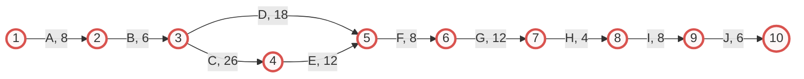
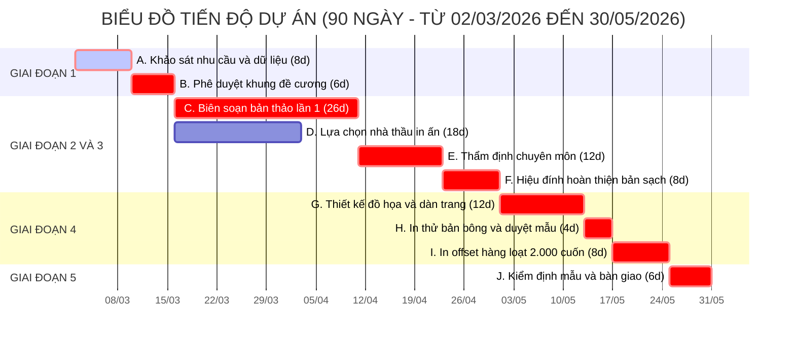

# CHƯƠNG 4. KẾ HOẠCH QUẢN LÝ TIẾN ĐỘ DỰ ÁN

Chương này xác định danh mục mười công việc trên sơ đồ mạng từ cấu trúc phân rã công việc, ước lượng thời gian thực hiện, mô hình hóa mạng công việc theo phương pháp mũi tên và phương pháp nút, tính toán sáu bước thông số mạng theo phương pháp đường găng, lập biểu đồ tiến độ ngang Gantt và đề xuất phương án điều hòa nguồn lực trong khung thời gian 90 ngày lịch (từ ngày 02/03/2026 đến ngày 30/05/2026).

## 4.1. Danh mục công việc và ước lượng thời gian thực hiện

Từ 20 gói công việc tại Chương 3, tiến trình thực thi dự án được tích hợp thành mười công việc mạng ký hiệu từ A đến J, nối giữa mười sự kiện đánh số từ 1 đến 10. Thời gian thực hiện từng công việc ($t_{ij}$) được ước lượng theo phương pháp tất định dựa trên khối lượng trang viết, quy trình thẩm định xuất bản và định mức thời gian chào hàng cạnh tranh.

**Bảng 4.1. Danh mục công việc, mã phân rã tương ứng và thời gian thực hiện**

| Thứ tự | Ký hiệu |Sự kiện $(i - j)$ | Mã phân rã tương ứng | Nội dung công việc chi tiết | Thời gian $t_{ij}$ (Ngày) | Điều kiện bắt đầu |
| :---: | :---: | :---: | :---: | :--- | :---: | :--- |
| **1** | **A** | $(1 - 2)$ | 1.1, 1.2 | Khảo sát nhu cầu thực tế (350 phiếu) và tổng hợp dữ liệu hướng nghiệp | **8** | Khởi công ngày thứ 1 (02/03/2026) |
| **2** | **B** | $(2 - 3)$ | 1.3 | Xây dựng khung cấu trúc 4 phần và hội thảo phê duyệt đề cương | **6** | Ngay sau khi hoàn thành A |
| **3** | **C** | $(3 - 4)$ | 2.1 – 2.5 | Biên soạn và biên tập sơ bộ bản thảo lần một (80 trang ruột) | **26** | Ngay sau khi hoàn thành B |
| **4** | **D** | $(3 - 5)$ | 4.1 | Lập hồ sơ mời báo giá, đánh giá chào hàng và ký hợp đồng in ấn | **18** | Ngay sau khi hoàn thành B (song song với C, E) |
| **5** | **E** | $(4 - 5)$ | 3.1 – 3.3 | Phản biện độc lập, đọc thử nghiệm và họp Hội đồng thẩm định | **12** | Ngay sau khi hoàn thành C |
| **6** | **F** | $(5 - 6)$ | 3.4 | Tiếp thu ý kiến thẩm định, chỉnh sửa và hoàn thiện bản thảo sạch | **8** | Sau khi hoàn thành cả D và E |
| **7** | **G** | $(6 - 7)$ | 4.2 | Thiết kế mỹ thuật 4 trang bìa, vẽ 25 hình minh họa và dàn trang 80 trang | **12** | Ngay sau khi hoàn thành F |
| **8** | **H** | $(7 - 8)$ | 4.3 | In thử nghiệm 2 bộ bản bông màu, rà soát lỗi và ký duyệt mẫu in | **4** | Ngay sau khi hoàn thành G |
| **9** | **I** | $(8 - 9)$ | 4.4 | Bình bản xuất kẽm, in offset 2.000 cuốn, cán màng và đóng keo nhiệt | **8** | Ngay sau khi hoàn thành H |
| **10** | **J** | $(9 - 10)$ | 5.1 – 5.4 | Kiểm định mẫu 384 cuốn, nghiệm thu, bàn giao 5 trường và thanh lý | **6** | Ngay sau khi hoàn thành I |

## 4.2. Sơ đồ mạng công việc theo phương pháp mũi tên và phương pháp nút

### 4.2.1. Sơ đồ mạng công việc theo phương pháp mũi tên

Phương pháp `Activity on Arrow - AOA` (Phương pháp biểu diễn công việc trên mũi tên) biểu thị mỗi công việc bằng một mũi tên nối giữa hai sự kiện tròn. Tại Sự kiện 3 (sau khi duyệt đề cương), mạng công việc tách thành hai nhánh chạy song song gồm nhánh biên soạn, thẩm định học thuật ($C \rightarrow E$) và nhánh lựa chọn nhà thầu in ấn ($D$). Hai nhánh này hội tụ tại Sự kiện 5, xác lập điều kiện rằng khâu hoàn thiện bản thảo sạch để chuyển giao chế bản (công việc F) chỉ bắt đầu khi cả bản thảo đã được Hội đồng thẩm định thông qua và hợp đồng in ấn đã được ký kết.

### 4.2.2. Sơ đồ mạng công việc theo phương pháp nút

Phương pháp `Activity on Node - AON` (Phương pháp biểu diễn công việc trên nút) đặt các công việc vào trong các ô hình chữ nhật kèm theo thông số thời điểm bắt đầu sớm ($ES$), thời điểm kết thúc sớm ($EF$) và thời gian thực hiện ($t$), còn các mũi tên thể hiện quan hệ phụ thuộc trước sau:

```mermaid
flowchart LR
    A["Công việc A: Khảo sát và dữ liệu<br>ES = 0 | EF = 8 | t = 8 ngày"] --> B["Công việc B: Duyệt đề cương<br>ES = 8 | EF = 14 | t = 6 ngày"]
    B --> C["Công việc C: Biên soạn bản thảo<br>ES = 14 | EF = 40 | t = 26 ngày"]
    B --> D["Công việc D: Lựa chọn nhà in<br>ES = 14 | EF = 32 | t = 18 ngày"]
    C --> E["Công việc E: Thẩm định bản thảo<br>ES = 40 | EF = 52 | t = 12 ngày"]
    E --> F["Công việc F: Hiệu đính bản sạch<br>ES = 52 | EF = 60 | t = 8 ngày"]
    D --> F
    F --> G["Công việc G: Thiết kế và dàn trang<br>ES = 60 | EF = 72 | t = 12 ngày"]
    G --> H["Công việc H: In thử và duyệt mẫu<br>ES = 72 | EF = 76 | t = 4 ngày"]
    H --> I["Công việc I: In ấn hàng loạt<br>ES = 76 | EF = 84 | t = 8 ngày"]
    I --> J["Công việc J: Kiểm định và bàn giao<br>ES = 84 | EF = 90 | t = 6 ngày"]

    style A stroke:#d9534f,stroke-width:2px
    style B stroke:#d9534f,stroke-width:2px
    style C stroke:#d9534f,stroke-width:2px
    style E stroke:#d9534f,stroke-width:2px
    style F stroke:#d9534f,stroke-width:2px
    style G stroke:#d9534f,stroke-width:2px
    style H stroke:#d9534f,stroke-width:2px
    style I stroke:#d9534f,stroke-width:2px
    style J stroke:#d9534f,stroke-width:2px
    style D stroke:#0275d8,stroke-width:2px
```

## 4.3. Các thông số sơ đồ mạng và xác định đường găng

Việc giải sơ đồ mạng được tiến hành theo quy trình sáu bước của phương pháp `Critical Path Method - CPM` (Phương pháp đường găng).

### 4.3.1. Thời điểm sớm của các sự kiện

Thời điểm sớm của sự kiện $j$ ($E_j$) được tính theo chiều thuận từ Sự kiện 1 đến Sự kiện 10 theo công thức $E_1 = 0$ và $E_j = \max_{i} (E_i + t_{ij})$. Cụ thể, xuất phát từ $E_1 = 0$, ta xác định được $E_2 = 0 + 8 = 8$ ngày; $E_3 = 8 + 6 = 14$ ngày; và $E_4 = 14 + 26 = 40$ ngày. Tại Sự kiện 5, do có hai công việc E và D cùng đi vào, thời điểm sớm được lấy theo giá trị cực đại giữa hai nhánh:

$$E_5 = \max\left[E_4 + t_{45};\ E_3 + t_{35}\right] = \max\left[40 + 12;\ 14 + 18\right] = \max[52;\ 32] = 52\text{ ngày}$$

Tiếp tục tính thuận theo chuỗi công việc nối tiếp phía sau, ta thu được $E_6 = 52 + 8 = 60$ ngày; $E_7 = 60 + 12 = 72$ ngày; $E_8 = 72 + 4 = 76$ ngày; $E_9 = 76 + 8 = 84$ ngày; và tại sự kiện kết thúc dự án là $E_{10} = 84 + 6 = 90$ ngày.

### 4.3.2. Thời điểm muộn của các sự kiện

Thời điểm muộn của sự kiện $i$ ($L_i$) được tính lùi từ Sự kiện 10 về Sự kiện 1 theo công thức $L_{10} = E_{10} = 90$ ngày và $L_i = \min_{j} (L_j - t_{ij})$. Lần lượt trừ lùi thời gian thực hiện của các công việc cuối mạng, ta có $L_9 = 90 - 6 = 84$ ngày; $L_8 = 84 - 8 = 76$ ngày; $L_7 = 76 - 4 = 72$ ngày; $L_6 = 72 - 12 = 60$ ngày; $L_5 = 60 - 8 = 52$ ngày; và $L_4 = 52 - 12 = 40$ ngày. Tại Sự kiện 3, do có hai công việc C và D cùng đi ra, thời điểm muộn được xác định bằng giá trị cực tiểu:

$$L_3 = \min\left[L_4 - t_{34};\ L_5 - t_{35}\right] = \min\left[40 - 26;\ 52 - 18\right] = \min[14;\ 34] = 14\text{ ngày}$$

Từ kết quả $L_3 = 14$ ngày, tính lùi tiếp về đầu mạng xác định được $L_2 = 14 - 6 = 8$ ngày và $L_1 = 8 - 8 = 0$ ngày.

### 4.3.3. Thời gian dự trữ sự kiện và xác định đường găng

Thời gian dự trữ của sự kiện $j$ được tính bằng hiệu số $R_j = L_j - E_j$. Các sự kiện có $R_j = 0$ là các sự kiện găng.

**Bảng 4.2. Thời gian dự trữ của các sự kiện trên sơ đồ mạng**

| Sự kiện ($j$) | Thời điểm sớm $E_j$ (ngày) | Thời điểm muộn $L_j$ (ngày) | Thời gian dự trữ $R_j = L_j - E_j$ | Kết luận tính chất sự kiện |
| :---: | :---: | :---: | :---: | :---: |
| **1** | 0 | 0 | 0 | **Sự kiện găng** |
| **2** | 8 | 8 | 0 | **Sự kiện găng** |
| **3** | 14 | 14 | 0 | **Sự kiện găng** |
| **4** | 40 | 40 | 0 | **Sự kiện găng** |
| **5** | 52 | 52 | 0 | **Sự kiện găng** |
| **6** | 60 | 60 | 0 | **Sự kiện găng** |
| **7** | 72 | 72 | 0 | **Sự kiện găng** |
| **8** | 76 | 76 | 0 | **Sự kiện găng** |
| **9** | 84 | 84 | 0 | **Sự kiện găng** |
| **10** | 90 | 90 | 0 | **Sự kiện găng** |

Đường găng của dự án đi qua toàn bộ mười sự kiện găng theo tuyến chín công việc nối tiếp:

$$A \rightarrow B \rightarrow C \rightarrow E \rightarrow F \rightarrow G \rightarrow H \rightarrow I \rightarrow J$$

Độ dài đường găng ấn định tổng thời gian hoàn thành dự án:

$$T_{CP} = 8 + 6 + 26 + 12 + 8 + 12 + 4 + 8 + 6 = 90\text{ ngày}$$

### 4.3.4. Các thông số thời gian của công việc và bảng tổng hợp thông số mạng

Đối với mỗi công việc $(i - j)$, bốn mốc thời điểm sớm/muộn được xác định gồm: bắt đầu sớm ($ES_{ij} = E_i$), kết thúc sớm ($EF_{ij} = E_i + t_{ij}$), kết thúc muộn ($LF_{ij} = L_j$) và bắt đầu muộn ($LS_{ij} = L_j - t_{ij}$). Bốn thông số thời gian dự trữ của công việc gồm: dự trữ toàn phần ($GR_{ij} = L_j - E_i - t_{ij}$), dự trữ bắt đầu ($SR_{ij} = L_j - L_i - t_{ij}$), dự trữ kết thúc ($FR_{ij} = E_j - E_i - t_{ij}$) và dự trữ độc lập ($IR_{ij} = E_j - L_i - t_{ij}$).

**Bảng 4.3. Bảng tổng hợp các thông số thời gian và dự trữ của công việc**

| Công việc | Sự kiện $(i - j)$ | Thời gian $t_{ij}$ | Bắt đầu sớm $ES_{ij}$ | Kết thúc sớm $EF_{ij}$ | Kết thúc muộn $LF_{ij}$ | Bắt đầu muộn $LS_{ij}$ | Dự trữ toàn phần $GR_{ij}$ | Dự trữ bắt đầu $SR_{ij}$ | Dự trữ kết thúc $FR_{ij}$ | Dự trữ độc lập $IR_{ij}$ | Phân loại tính chất |
| :---: | :---: | :---: | :---: | :---: | :---: | :---: | :---: | :---: | :---: | :---: | :---: |
| **A** | $(1 - 2)$ | 8 | 0 | 8 | 8 | 0 | **0** | 0 | 0 | 0 | **Găng** |
| **B** | $(2 - 3)$ | 6 | 8 | 14 | 14 | 8 | **0** | 0 | 0 | 0 | **Găng** |
| **C** | $(3 - 4)$ | 26 | 14 | 40 | 40 | 14 | **0** | 0 | 0 | 0 | **Găng** |
| **D** | $(3 - 5)$ | 18 | 14 | 32 | 52 | 34 | **20** | 20 | 20 | 20 | **Không găng** |
| **E** | $(4 - 5)$ | 12 | 40 | 52 | 52 | 40 | **0** | 0 | 0 | 0 | **Găng** |
| **F** | $(5 - 6)$ | 8 | 52 | 60 | 60 | 52 | **0** | 0 | 0 | 0 | **Găng** |
| **G** | $(6 - 7)$ | 12 | 60 | 72 | 72 | 60 | **0** | 0 | 0 | 0 | **Găng** |
| **H** | $(7 - 8)$ | 4 | 72 | 76 | 76 | 72 | **0** | 0 | 0 | 0 | **Găng** |
| **I** | $(8 - 9)$ | 8 | 76 | 84 | 84 | 76 | **0** | 0 | 0 | 0 | **Găng** |
| **J** | $(9 - 10)$ | 6 | 84 | 90 | 90 | 84 | **0** | 0 | 0 | 0 | **Găng** |

Bảng 4.3 cho thấy chín công việc trên đường găng có mọi thông số dự trữ bằng không. Riêng công việc D (lựa chọn nhà thầu in ấn) có thời gian dự trữ ở cả bốn chỉ số bằng 20 ngày ($GR_D = SR_D = FR_D = IR_D = 20$ ngày), cho phép bộ phận mua sắm hoàn thành ký hợp đồng sớm nhất vào ngày thứ 32 hoặc muộn nhất vào ngày thứ 52 mà không làm chậm tiến độ chung.

## 4.4. Phương pháp biểu đồ tiến độ ngang Gantt

### 4.4.1. Bảng phân tích tiến độ theo tuần

Trục thời gian 90 ngày lịch được chia thành 13 tuần (mỗi tuần 7 ngày, riêng tuần 13 gồm 6 ngày cuối từ ngày 85 đến ngày 90):

**Bảng 4.4. Phân bổ tiến độ dự án theo tuần trên biểu đồ ngang Gantt**

| Thứ tự | Tên công việc | Mã | Thời lượng | Bắt đầu sớm | Kết thúc sớm | Tuần 1-2 (N1-14) | Tuần 3-4 (N15-28) | Tuần 5-6 (N29-42) | Tuần 7-8 (N43-56) | Tuần 9 (N57-63) | Tuần 10-11 (N64-77) | Tuần 12 (N78-84) | Tuần 13 (N85-90) |
| :---: | :--- | :---: | :---: | :---: | :---: | :---: | :---: | :---: | :---: | :---: | :---: | :---: | :---: |
| 1 | Khảo sát nhu cầu và dữ liệu | **A** | 8 ngày | Ngày 1 | Ngày 8 | `██████` | | | | | | | |
| 2 | Duyệt khung đề cương chi tiết | **B** | 6 ngày | Ngày 9 | Ngày 14 | `  ████` | | | | | | | |
| 3 | Biên soạn bản thảo bộ tài liệu | **C** | 26 ngày | Ngày 15 | Ngày 40 | | `████████` | `███████ ` | | | | | |
| 4 | Lựa chọn nhà in và ký hợp đồng | **D** | 18 ngày | Ngày 15 | Ngày 32 | | `░░░░░░░░` | `░░[+20d]`| `[+20d]` | | | | |
| 5 | Thẩm định chuyên môn bản thảo | **E** | 12 ngày | Ngày 41 | Ngày 52 | | | `       █` | `██████  ` | | | | |
| 6 | Hiệu đính, hoàn thiện bản sạch | **F** | 8 ngày | Ngày 53 | Ngày 60 | | | | `      ██` | `████  ` | | | |
| 7 | Thiết kế đồ họa và dàn trang | **G** | 12 ngày | Ngày 61 | Ngày 72 | | | | | `    ██` | `██████  ` | | |
| 8 | In bản bông thử và duyệt mẫu | **H** | 4 ngày | Ngày 73 | Ngày 76 | | | | | | `      ██` | | |
| 9 | In ấn offset hàng loạt 2.000 cuốn | **I** | 8 ngày | Ngày 77 | Ngày 84 | | | | | | `       █` | `████████` | |
| 10 | Kiểm định chất lượng và bàn giao | **J** | 6 ngày | Ngày 85 | Ngày 90 | | | | | | | | `████████` |

Ghi chú quy ước: Khối đậm (`████`) biểu thị công việc găng; khối nhạt (`░░░░`) biểu thị công việc không găng; ký hiệu `[+20d]` biểu thị khoảng thời gian dự trữ 20 ngày của công việc D (kéo dài tối đa đến ngày thứ 52).

### 4.4.2. Sơ đồ Gantt trực quan

## 4.5. Cơ chế kiểm soát tiến độ và điều hòa nguồn lực

### 4.5.1. Kiểm soát các mốc sự kiện găng trung gian

Ban Quản lý dự án giám sát chặt chẽ bảy mốc sự kiện găng gắn với sản phẩm nghiệm thu và lịch giải ngân: Mốc 1 tại ngày thứ 14 (15/03/2026) phê duyệt khung đề cương chi tiết; Mốc 2 tại ngày thứ 40 (10/04/2026) thu hồi bản thảo lần một đủ 80 trang ruột; Mốc 3 tại ngày thứ 52 (22/04/2026) ký biên bản kết luận của Hội đồng thẩm định chuyên môn; Mốc 4 tại ngày thứ 60 (30/04/2026) ký duyệt bản thảo sạch để chuyển giao chế bản; Mốc 5 tại ngày thứ 76 (16/05/2026) ký niêm phong bản bông mẫu màu; Mốc 6 tại ngày thứ 84 (24/05/2026) tiếp nhận lô hàng 2.000 cuốn xuất xưởng tại kho; và Mốc 7 tại ngày thứ 90 (30/05/2026) hoàn tất nghiệm thu cấp cơ sở, bàn giao tài liệu cho năm trường trung học cơ sở.

### 4.5.2. Điều hòa nguồn lực và nén tiến độ khi phát sinh chậm trễ

Nhờ công việc D có thời gian dự trữ độc lập 20 ngày, trong trường hợp bộ phận hành chính và mua sắm cần tập trung hỗ trợ nhóm tác giả tổng hợp dữ liệu trường nghề ở tuần thứ ba, thời điểm phát hành hồ sơ mời báo giá có thể lùi từ ngày thứ 15 sang ngày thứ 25 mà vẫn hoàn tất ký hợp đồng trước ngày thứ 52.

Đối với nhánh công việc găng có thời lượng dài nhất là biên soạn bản thảo (C, 26 ngày), nếu một nhóm tác giả chậm tiến độ tổng hợp số liệu tuyển sinh, Giám đốc dự án sẽ điều động trợ lý nghiên cứu hỗ trợ chuẩn hóa bảng biểu. Đồng thời, dự án áp dụng kỹ thuật `Fast-tracking` (Kỹ thuật thực hiện gối đầu) bằng cách gửi trước các phần bản thảo đã hoàn chỉnh cho ba chuyên gia phản biện đọc độc lập ngay từ ngày thứ 36, giúp rút ngắn thời gian thẩm định (công việc E) từ 12 ngày xuống 9 ngày để bù đắp độ trễ mà không làm tăng chi phí dự toán.
