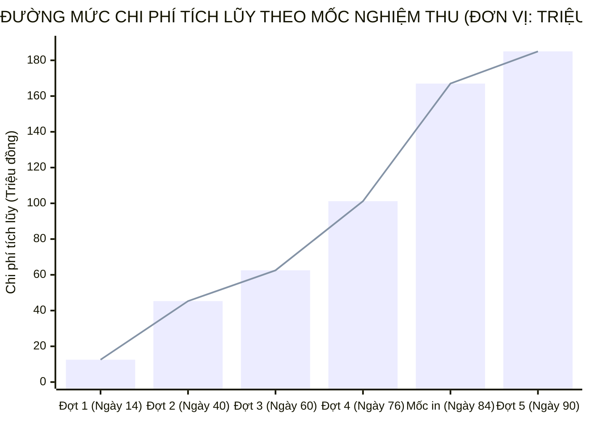

# CHƯƠNG 5. KẾ HOẠCH QUẢN LÝ CHI PHÍ DỰ ÁN

Chương này vận dụng quy trình quản lý chi phí bốn bước gồm lập kế hoạch nguồn tài nguyên, ước tính chi phí từ dưới lên theo các định mức tài chính hiện hành, thiết lập dự toán ngân sách gắn với đường mức chi phí cơ sở và xác lập cơ chế kiểm soát giải ngân trong phạm vi tổng ngân sách 185.000.000 đồng.

## 5.1. Khung quản lý chi phí và kế hoạch nguồn lực tài chính

Kế hoạch nguồn lực tài chính của dự án được xác lập dựa trên bốn yếu tố quản trị thực tế: cố định quy mô xuất bản ở mức 2.000 cuốn (80 trang ruột và 4 trang bìa ngoài) để kiểm soát trần chi phí vật tư giấy in; áp dụng định mức thù lao biên soạn, thẩm định theo quy định của Bộ Tài chính đối với nguồn vốn ngân sách nhà nước; kết hợp huy động chuyên gia trong ngành giáo dục cho khâu biên soạn nội dung với việc thuê ngoài trọn gói khâu bình bản kẽm và in ấn công nghiệp; đồng thời trích lập quỹ dự phòng rủi ro chi phí để chủ động trước biến động giá giấy in trên thị trường.

## 5.2. Phương pháp ước tính chi phí theo mô hình từ dưới lên

### 5.2.1. Phân loại ước tính theo các giai đoạn dự án

Quá trình xác định ngân sách dự án đi qua ba cấp độ ước tính có biên độ sai số thu hẹp dần: cấp độ `Order of Magnitude` (Ước tính độ lớn thô) ở giai đoạn hình thành ý tưởng với biên độ sai số từ $-25\%$ đến $+75\%$ (khoảng 150.000.000 đồng đến 220.000.000 đồng); cấp độ `Budget Estimate` (Ước tính ngân sách) khi lập Điều lệ dự án với biên độ sai số từ $-10\%$ đến $+25\%$, xác lập mức trần ngân sách là 185.000.000 đồng; và cấp độ `Definitive Estimate` (Ước tính xác định) khi lập kế hoạch chi tiết với sai số từ $-5\%$ đến $+10\%$, gắn từng khoản mục chi tiêu với từng gói công việc trong cấu trúc phân rã công việc.

### 5.2.2. Phương pháp ước tính chi phí từ dưới lên và căn cứ định mức

Dự án sử dụng phương pháp `Bottom-up Estimating` (Phương pháp ước tính chi phí từ dưới lên), bóc tách khối lượng và áp đơn giá cho từng gói công việc từ mã `1.1` đến `5.4` đã thiết lập tại Chương 3, sau đó tổng hợp thành ngân sách từng giai đoạn.

Đơn giá dự toán được xây dựng dựa trên ba căn cứ: Thông tư số 51/2019/TT-BTC ngày 15 tháng 8 năm 2019 của Bộ Tài chính hướng dẫn xây dựng dự toán, thanh quyết toán kinh phí biên soạn, chỉnh lý và thẩm định tài liệu giáo dục của địa phương; Thông tư số 76/2018/TT-BTC ngày 17 tháng 8 năm 2018 của Bộ Tài chính hướng dẫn mức chi xây dựng chương trình đào tạo, biên soạn giáo trình tài liệu; và báo giá khảo sát thị trường của các doanh nghiệp in xuất bản phẩm đối với gói dịch vụ in offset bốn màu.

## 5.3. Dự toán ngân sách chi tiết theo cấu trúc phân rã công việc

Bảng 5.1 trình bày dự toán chi tiết cho toàn bộ 20 gói công việc (từ `1.1` đến `5.4`) và Quỹ dự phòng rủi ro chi phí (`6.0`), khớp trực tiếp với Từ điển phân rã công việc tại Bảng 3.1.

**Bảng 5.1. Bảng dự toán chi tiết ngân sách dự án theo mã phân rã công việc**

| Mã công việc | Hạng mục công việc và nội dung chi tiêu | Căn cứ định mức và khối lượng tính toán | Thành tiền (đồng) | Tỷ trọng (%) |
| :---: | :--- | :--- | :---: | :---: |
| **1.0** | **Khảo sát nhu cầu và lập khung cấu trúc** | | **12.500.000** | **6,76%** |
| 1.1a | In ấn phiếu khảo sát nhu cầu thực tế | 350 bộ phiếu $\times$ 3.000 đồng/bộ phiếu | 1.050.000 | |
| 1.1b | Thù lao điều tra viên phát và thu phiếu khảo sát | 5 trường $\times$ 500.000 đồng/trường | 2.500.000 | |
| 1.2 | Xử lý số liệu khảo sát và tổng hợp dữ liệu trường nghề | 2 chuyên viên $\times$ 1.500.000 đồng/người | 3.000.000 | |
| 1.3a | Thù lao xây dựng khung đề cương chi tiết 4 phần | Định mức trọn gói theo Thông tư số 51/2019/TT-BTC | 3.500.000 | |
| 1.3b | Tổ chức hội thảo chuyên môn thông qua đề cương | Bồi dưỡng 12 đại biểu $\times$ 150.000 đồng (1.800.000 đồng) và tài liệu, nước uống (650.000 đồng) | 2.450.000 | |
| **2.0** | **Biên soạn bản thảo bộ tài liệu (80 trang ruột)** | | **32.800.000** | **17,73%** |
| 2.1 | Biên soạn Phần 1: Khám phá bản thân (18 trang) | 5 bài chuẩn $\times$ 450.000 đồng/bài (2.250.000 đồng, Thông tư số 51/2019/TT-BTC) và chuẩn hóa trắc nghiệm Holland 36 câu (4.750.000 đồng) | 7.000.000 | |
| 2.2 | Biên soạn Phần 2: Bản đồ phân luồng (22 trang) | 6 bài chuẩn $\times$ 450.000 đồng/bài (2.700.000 đồng, Thông tư số 51/2019/TT-BTC) và lập ma trận so sánh 4 hướng đi (3.300.000 đồng) | 6.000.000 | |
| 2.3 | Biên soạn Phần 3: Thị trường và chính sách (18 trang) | 5 bài chuẩn $\times$ 450.000 đồng/bài (2.250.000 đồng, Thông tư số 51/2019/TT-BTC) và tổng hợp dữ liệu chính sách học phí (3.550.000 đồng) | 5.800.000 | |
| 2.4 | Biên soạn Phần 4: Cẩm nang quyết định (18 trang) | 4 bài chuẩn $\times$ 450.000 đồng/bài (1.800.000 đồng, Thông tư số 51/2019/TT-BTC) và lập bộ phiếu gia đình, danh bạ 25 trường nghề (5.200.000 đồng) | 7.000.000 | |
| 2.5 | Tổng hợp và biên tập sơ bộ bản thảo lần một | Thù lao Chủ biên 20 bài $\times$ 50.000 đồng/bài (1.000.000 đồng, Thông tư số 51/2019/TT-BTC) và biên tập 80 trang $\times$ 75.000 đồng/trang (6.000.000 đồng) | 7.000.000 | |
| **3.0** | **Thẩm định chuyên môn và hiệu đính bản thảo** | | **17.200.000** | **9,30%** |
| 3.1 | Thù lao đọc phản biện độc lập (3 chuyên gia) | 80 trang $\times$ 10.000 đồng/trang $\times$ 3 người (Thông tư số 51/2019/TT-BTC) | 2.400.000 | |
| 3.2a | Thù lao Chủ tịch, Ủy viên, Thư ký Hội đồng thẩm định | Chủ tịch: 2 buổi $\times$ 200.000 đồng (400.000 đồng); 4 Ủy viên, Thư ký: 4 người $\times$ 150.000 đồng $\times$ 2 buổi (1.200.000 đồng) theo Thông tư số 51/2019/TT-BTC | 1.600.000 | |
| 3.2b | Chi phí phục vụ 2 phiên họp Hội đồng thẩm định | In sao bản thảo thẩm định và hậu cần 2 phiên họp $\times$ 1.000.000 đồng/phiên | 2.000.000 | |
| 3.3 | Tổ chức lấy ý kiến đọc thử thực tế | 2 nhóm thảo luận tập trung (20 học sinh lớp 9 và 5 giáo viên tư vấn) | 3.200.000 | |
| 3.4 | Chỉnh sửa sau thẩm định và hiệu đính bản thảo sạch | Bốn nhóm tác giả chỉnh sửa nội dung và ban biên tập hiệu đính 80 trang bản sạch | 8.000.000 | |
| **4.0** | **Thiết kế chế bản và in ấn tài liệu** | | **104.500.000** | **56,49%** |
| 4.1 | Tổ chức lựa chọn nhà thầu in ấn công nghiệp | Thực hiện chào hàng cạnh tranh rút gọn (chi phí hành chính lồng ghép trong mục 6.2) | 0 | |
| 4.2a | Thiết kế mỹ thuật 4 trang bìa ngoài và trang phụ bìa | 4 trang bìa ngoài $\times$ 350.000 đồng/trang (1.400.000 đồng) và trang phụ bìa (100.000 đồng) theo Thông tư số 51/2019/TT-BTC | 1.500.000 | |
| 4.2b | Vẽ minh họa chuyên môn và sơ đồ đồ họa thông tin | 25 hình minh họa $\times$ 160.000 đồng/hình (Thông tư số 51/2019/TT-BTC) | 4.000.000 | |
| 4.2c | Dàn trang chế bản điện tử trên phần mềm chuyên dụng | 80 trang ruột $\times$ 50.000 đồng/trang kỹ thuật | 4.000.000 | |
| 4.3 | In thử nghiệm 2 bộ bản bông màu và rà soát lỗi | Chi phí in thử màu kỹ thuật số và kiểm tra đối soát mẫu | 1.000.000 | |
| 4.4 | Hợp đồng thuê ngoài in ấn offset hàng loạt 2.000 cuốn | 2.000 cuốn $\times$ 47.000 đồng/cuốn (trúng thầu trọn gói, dự toán gói thầu là 95.000.000 đồng) | 94.000.000 | |
| **5.0** | **Kiểm định, nghiệm thu và bàn giao** | | **8.500.000** | **4,59%** |
| 5.1 | Thù lao kiểm định chất lượng mẫu thống kê tại kho | Đo đạc và kiểm tra quy cách 384 cuốn mẫu ngẫu nhiên | 2.000.000 | |
| 5.2 | Chi phí tổ chức họp Hội đồng nghiệm thu cấp cơ sở | Bồi dưỡng hội đồng nghiệm thu và hậu cần phiên họp | 2.500.000 | |
| 5.3a | Mua thùng giấy tiêu chuẩn và đóng gói bảo quản | 40 thùng (50 cuốn/thùng) $\times$ 25.000 đồng/thùng | 1.000.000 | |
| 5.3b | Chi phí vận chuyển và bàn giao đến 5 trường | Thuê phương tiện vận chuyển bàn giao tận kho 5 trường trung học cơ sở | 3.000.000 | |
| 5.4 | Thanh lý hợp đồng và đóng gói 03 bộ hồ sơ lưu trữ | Thực hiện nghiệp vụ thanh quyết toán và lưu trữ hành chính | 0 | |
| **6.0** | **Quỹ dự phòng rủi ro chi phí** | | **9.500.000** | **5,14%** |
| 6.1 | Dự phòng rủi ro biến động giá vật tư giấy in | Dự phòng trượt giá giấy và vật tư xuất bản | 6.000.000 | |
| 6.2 | Dự phòng chi phí hành chính và chỉnh lý kỹ thuật | Chi phí in ấn hồ sơ mời báo giá, lưu trữ và chỉnh lý phát sinh | 3.500.000 | |
| | **Tổng cộng toàn bộ ngân sách dự án** | **Cân đối với Điều lệ dự án** | **185.000.000** | **100,0%** |

Trong tổng ngân sách 185.000.000 đồng, khối lượng công việc học thuật từ khảo sát đến hoàn thiện bản thảo sạch (Mục 1.0, 2.0 và 3.0) chiếm 33,78% (62.500.000 đồng); khối lượng thiết kế chế bản và in ấn (Mục 4.0) chiếm 56,49% (104.500.000 đồng, gồm 10.500.000 đồng thiết kế dàn trang, in thử và 94.000.000 đồng hợp đồng in công nghiệp); công tác kiểm định, nghiệm thu bàn giao (Mục 5.0) chiếm 4,59% (8.500.000 đồng); và khoản `Contingency Fund` (Quỹ dự phòng rủi ro chi phí - Mục 6.0) chiếm 5,14% (9.500.000 đồng).

## 5.4. Đường mức chi phí cơ sở và quy trình kiểm soát giải ngân

### 5.4.1. Đường mức chi phí cơ sở gắn với năm đợt giải ngân theo mốc nghiệm thu

Đường `Cost Baseline` (Đường mức chi phí cơ sở) của dự án được thiết lập dựa trên nguyên tắc chỉ giải ngân khi gói công việc tại mốc sự kiện găng tương ứng đã có biên bản nghiệm thu kỹ thuật. Tiến trình giải ngân lũy kế từ ngày khởi công đến ngày kết thúc dự án được thể hiện trên biểu đồ và phân kỳ qua năm đợt thanh toán:

Đợt giải ngân thứ nhất tại Ngày thứ 14 (Tuần 2): Giải ngân **12.500.000 đồng** (tương ứng 6,76% ngân sách, lũy kế đạt **12,5 triệu đồng**) để thanh toán chi phí khảo sát 350 bộ phiếu, xử lý dữ liệu và hội thảo phê duyệt khung đề cương (Mục 1.0) sau khi đề cương chi tiết được thông qua.

Đợt giải ngân thứ hai tại Ngày thứ 40 (Tuần 6): Giải ngân **32.800.000 đồng** (tương ứng 17,73% ngân sách, nâng lũy kế lên **45,3 triệu đồng**, đạt 24,49%) để chi trả thù lao viết 20 bài chuẩn, xây dựng công cụ trắc nghiệm và biên tập sơ bộ (Mục 2.0) khi Chủ biên bàn giao đủ 80 trang bản thảo lần một.

Đợt giải ngân thứ ba tại Ngày thứ 60 (Tuần 9): Giải ngân **17.200.000 đồng** (tương ứng 9,30% ngân sách, nâng lũy kế lên **62,5 triệu đồng**, đạt 33,78%) để thanh toán thù lao phản biện độc lập, chi phí họp Hội đồng thẩm định, nhóm đọc thử và thù lao hiệu đính (Mục 3.0) sau khi Giám đốc dự án ký duyệt bản thảo sạch.

Đợt giải ngân thứ tư tại Ngày thứ 76 (Tuần 11): Giải ngân **38.700.000 đồng** (tương ứng 20,92% ngân sách, nâng lũy kế lên **101,2 triệu đồng**, đạt 54,70%) ngay sau khi ký niêm phong mẫu in thử bản bông, bao gồm thanh toán 10.500.000 đồng chi phí thiết kế bìa, vẽ minh họa, dàn trang và in thử (`4.2a` đến `4.3`) cùng khoản tạm ứng 30% giá trị hợp đồng in ấn cho nhà thầu ($30\% \times 94.000.000 = 28.200.000$ đồng) để nhập vật tư giấy in.

Đợt thanh quyết toán thứ năm từ Ngày thứ 84 đến Ngày thứ 90 (Tuần 12 và Tuần 13): Tại ngày thứ 84 khi nhà thầu bàn giao 2.000 cuốn tại kho, giá trị khối lượng hoàn thành cộng thêm 70% hợp đồng in còn lại (65.800.000 đồng) đưa chi phí tích lũy bốn giai đoạn đầu lên **167,0 triệu đồng** (90,27%). Sau khi kiểm định mẫu 384 cuốn đạt yêu cầu, dự án chuyển khoản thanh toán nốt 65.800.000 đồng cho nhà thầu in vào ngày thứ 88, đồng thời giải ngân **8.500.000 đồng** chi phí kiểm định, họp nghiệm thu cấp cơ sở, đóng thùng vận chuyển bàn giao (Mục 5.0) và quyết toán **9.500.000 đồng** quỹ dự phòng (Mục 6.0) vào ngày thứ 90, khép lại tổng mức ngân sách **185.000.000 đồng** (100%).

### 5.4.2. Cơ chế quản lý và sử dụng quỹ dự phòng chi phí

Khoản quỹ dự phòng rủi ro trị giá 9.500.000 đồng (Mục 6.0) thuộc thẩm quyền phê duyệt của Trưởng phòng Giáo dục và Đào tạo (Chủ đầu tư). Quỹ này chỉ được phép giải ngân khi phát sinh biến động giá giấy in công nghiệp trên thị trường vượt quá 10% tại thời điểm ký hợp đồng hoặc khi Hội đồng thẩm định yêu cầu bổ sung thêm các bảng biểu đồ họa ngoài dự toán ban đầu. Khi cần sử dụng, Giám đốc dự án phải lập tờ trình thuyết minh nguyên nhân và dự toán chi tiết trình Chủ đầu tư phê duyệt bằng văn bản trước khi chi tiêu; phần kinh phí dự phòng không sử dụng đến được hoàn trả ngân sách nhà nước khi quyết toán đóng dự án.
