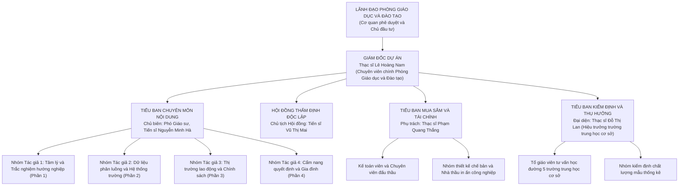

# CHƯƠNG 7. KẾ HOẠCH QUẢN LÝ NGUỒN NHÂN LỰC DỰ ÁN

Chương này thiết lập sơ đồ cơ cấu tổ chức dự án theo mô hình ma trận cân bằng, phân định trách nhiệm của từng vị trí bằng ma trận phân công trách nhiệm, đồng thời vận dụng thuyết thứ bậc nhu cầu, mười phẩm chất tâm lý của người lãnh đạo và bảy thói quen quản lý hiệu quả vào điều hành đội ngũ nhân sự dự án.

## 7.1. Cơ cấu tổ chức và bộ máy quản lý dự án

Ban Quản lý dự án được tổ chức theo mô hình ma trận chức năng cân bằng nhằm huy động đội ngũ chuyên gia tâm lý học, giáo dục học từ các trường đại học, viện nghiên cứu phối hợp cùng đội ngũ cán bộ quản lý của Phòng Giáo dục và Đào tạo và các trường trung học cơ sở mà không làm xáo trộn biên chế thường xuyên của các đơn vị.

### 7.1.1. Sơ đồ cơ cấu tổ chức Ban Quản lý dự án

Bộ máy dự án gồm bốn tiểu ban chuyên trách đặt dưới sự điều phối trực tiếp của Giám đốc dự án, trong đó Tiểu ban Chuyên môn nội dung quản lý bốn nhóm tác giả phụ trách bốn phần của bộ tài liệu:

### 7.1.2. Chức năng và nhiệm vụ của các tiểu ban chuyên trách

Trên cơ sở danh sách nhân sự chủ chốt đã xác lập tại Bảng 2.1 (Chương 2), phạm vi điều hành của bốn tiểu ban được quy định cụ thể theo từng mảng nghiệp vụ:

Tiểu ban Chuyên môn nội dung (do Chủ biên Phó Giáo sư, Tiến sĩ Nguyễn Minh Hà phụ trách) chịu trách nhiệm thiết kế khung đề cương 20 bài chuẩn, điều phối bốn nhóm tác giả biên soạn 80 trang ruột, tổ chức đọc chéo nội bộ, biên tập đồng nhất văn phong sư phạm và trực tiếp chỉnh sửa, hiệu đính bản thảo sạch theo kết luận của Hội đồng thẩm định.

Hội đồng thẩm định độc lập (do Tiến sĩ Vũ Thị Mai làm Chủ tịch) chịu trách nhiệm điều phối ba chuyên gia phản biện độc lập đánh giá toàn văn bản thảo, chủ trì hai phiên họp thẩm định chính thức và giám sát mức độ tiếp thu chỉnh sửa trước khi cấp phép chế bản.

Tiểu ban Mua sắm và Tài chính (do Thạc sĩ Phạm Quang Thắng phụ trách) điều phối nhóm họa sĩ thiết kế bìa, vẽ 25 hình minh họa và dàn trang điện tử; đồng thời tổ chức quy trình chào hàng cạnh tranh rút gọn để lựa chọn nhà thầu in ấn, kiểm soát chứng từ giải ngân năm đợt theo mốc nghiệm thu và thực hiện thủ tục thanh quyết toán, lưu trữ hồ sơ.

Tiểu ban Kiểm định và Thụ hưởng (do Thạc sĩ Đỗ Thị Lan đại diện) điều phối mạng lưới giáo viên tư vấn tại năm trường trung học cơ sở để thu thập 350 bộ phiếu khảo sát đầu vào, tổ chức hai nhóm đọc thử bản thảo (20 học sinh và 5 giáo viên), chủ trì rút mẫu phân tầng 384 cuốn để kiểm định chất lượng kỹ thuật tại kho và tổ chức tiếp nhận, phân phối 2.000 cuốn ấn phẩm về các trường.

## 7.2. Ma trận phân bổ trách nhiệm

Dự án áp dụng mô hình `RACI` (`Responsible` - Người trực tiếp thực hiện, `Accountable` - Người chịu trách nhiệm phê duyệt, `Consulted` - Người được tham vấn, `Informed` - Người được thông báo) đối với mười công việc từ A đến J trên sơ đồ mạng. Nguyên tắc cốt lõi được duy trì xuyên suốt là mỗi công việc chỉ có duy nhất một vị trí giữ vai trò `A` để tránh chồng chéo thẩm quyền hoặc đùn đẩy trách nhiệm khi nghiệm thu.

**Bảng 7.1. Ma trận phân bổ trách nhiệm theo mô hình RACI**

| Mã | Tên công việc trên sơ đồ mạng | Lãnh đạo Phòng | Giám đốc dự án | Chủ biên chuyên môn | Bốn nhóm tác giả | Hội đồng thẩm định | Cán bộ mua sắm | Thiết kế và Nhà thầu in | Hiệu trưởng và giáo viên |
| :---: | :--- | :---: | :---: | :---: | :---: | :---: | :---: | :---: | :---: |
| **A** | Khảo sát nhu cầu và thu thập dữ liệu hướng nghiệp | I | **A** | C | **R** | I | I | I | C |
| **B** | Xây dựng khung cấu trúc và phê duyệt đề cương chi tiết | **A** | C | **R** | C | C | I | I | I |
| **C** | Tổ chức biên soạn chi tiết bản thảo lần một (80 trang) | I | **A** | **R** | **R** | I | I | I | I |
| **D** | Lập hồ sơ mời báo giá, chọn nhà in và ký hợp đồng | C | **A** | I | I | I | **R** | C | I |
| **E** | Thẩm định chuyên môn và họp Hội đồng thẩm định | I | **A** | C | I | **R** | I | I | C |
| **F** | Tiếp thu ý kiến góp ý, hiệu đính bản thảo sạch | I | **A** | **R** | C | C | I | I | I |
| **G** | Thiết kế đồ họa mỹ thuật, dàn trang chế bản điện tử | I | **A** | C | I | I | C | **R** | I |
| **H** | In ấn bản bông thử nghiệm và ký duyệt mẫu in | I | **A** | **R** | I | I | C | C | I |
| **I** | In ấn offset hàng loạt 2.000 cuốn và gia công đóng gáy | I | **A** | I | I | I | C | **R** | I |
| **J** | Kiểm định mẫu thống kê, nghiệm thu và bàn giao 5 trường | **A** | **R** | C | I | C | C | C | C |

## 7.3. Động lực làm việc và nghệ thuật lãnh đạo nhóm dự án

### 7.3.1. Ứng dụng thuyết thứ bậc nhu cầu trong tạo động lực nhân sự

Do đội ngũ tham gia dự án gồm cả các giảng viên đại học, nghiên cứu viên và cán bộ quản lý cơ sở có đặc thù công việc kiêm nhiệm, Giám đốc dự án vận dụng thuyết thứ bậc nhu cầu của Abraham Maslow để thiết kế cơ chế khuyến khích phù hợp với từng nhóm nhân sự.

Ở tầng nhu cầu cơ bản và nhu cầu an toàn, dự án bảo đảm chi trả thù lao viết bài, phản biện và dàn trang đúng định mức tại Thông tư số 51/2019/TT-BTC, giải ngân kịp thời ngay sau từng mốc nghiệm thu để các thành viên yên tâm công tác. Ở tầng nhu cầu xã hội và sự gắn kết, Ban Quản lý dự án duy trì không khí trao đổi học thuật cởi mở trong các buổi hội thảo đề cương và thảo luận nhóm, kết nối góc nhìn lý luận của nhà nghiên cứu với kinh nghiệm thực tiễn của giáo viên trung học cơ sở.

Ở tầng nhu cầu được tôn trọng và tự khẳng định bản thân, học hàm, học vị và họ tên của Chủ biên, từng tác giả biên soạn bốn phần và các ủy viên Hội đồng thẩm định được ghi nhận trang trọng tại trang thông tin xuất bản của cuốn sách. Đồng thời, giá trị thực tiễn của bộ tài liệu khi đến tay 2.000 học sinh lớp 9 và các gia đình trên địa bàn chính là động lực nghề nghiệp bền vững đối với đội ngũ những người làm giáo dục.

### 7.3.2. Mười phẩm chất tâm lý của người lãnh đạo tài năng

Trong điều hành tác nghiệp, Giám đốc dự án rèn luyện phong cách lãnh đạo đồng hành thông qua mười chuẩn mực hành vi đối lập với lối quản lý mệnh lệnh hành chính đơn thuần:

**Bảng 7.2. Bảng đối chiếu mười phẩm chất tâm lý của người lãnh đạo nhóm dự án**

| Tiêu chí | Phẩm chất tâm lý của người lãnh đạo tài năng | Hành vi quản lý tiêu cực cần loại bỏ |
| :---: | :--- | :--- |
| **1** | Hướng dẫn và chia sẻ kinh nghiệm chuyên môn; cung cấp rõ quy chuẩn biên soạn ngay từ đầu. | Ra lệnh cứng nhắc, áp đặt ý kiến chủ quan từ trên xuống. |
| **2** | Đặt niềm tin vào năng lực học thuật và trách nhiệm nghề nghiệp của các tác giả, chuyên gia. | Sử dụng quyền lực hành chính để gây sức ép nặng nề. |
| **3** | Động viên, khích lệ đội ngũ khi xử lý các bộ dữ liệu tuyển sinh và trường nghề phức tạp. | Tạo tâm lý căng thẳng, đe dọa cắt giảm kinh phí hoặc kỷ luật. |
| **4** | Sử dụng đại từ tập thể "chúng ta" và "các bạn" nhằm đề cao sự đóng góp của cả nhóm dự án. | Thường xuyên nhấn mạnh chữ "tôi", đề cao cái tôi cá nhân. |
| **5** | Chủ động tháo gỡ vướng mắc thủ tục và nhận trách nhiệm điều hành khi phát sinh độ trễ. | Đổ lỗi cho tác giả hoặc nhà thầu khi xảy ra sự cố tiến độ. |
| **6** | Lắng nghe cầu thị các ý kiến phản biện độc lập để nâng cao chất lượng bản thảo. | Độc đoán, tự quyết định các vấn đề chuyên môn không qua tham vấn. |
| **7** | Khơi dậy niềm hứng khởi sáng tạo học liệu phục vụ học sinh cuối cấp. | Biến việc viết tài liệu thành nghĩa vụ hành chính khô khan. |
| **8** | Khuyến khích các giải pháp thiết kế sơ đồ hóa thông tin và bảng hỏi trực quan, sinh động. | Bảo thủ, định kiến, chỉ tin dùng một nhóm hẹp quen thuộc. |
| **9** | Xây dựng quan hệ hợp tác tôn trọng, minh bạch giữa Ban Quản lý dự án và nhà thầu in ấn. | Đặt ra các yêu cầu phi thực tế rồi dồn ép đối tác thực hiện. |
| **10** | Trực tiếp sát cánh cùng các tiểu ban tại cơ sở theo tinh thần cùng nhau làm việc. | Đứng ngoài chỉ đạo hình thức và khoán trắng cho cấp dưới. |

### 7.3.3. Hệ thống bảy thói quen quản lý hiệu quả trong điều hành dự án

Cùng với mười phẩm chất tâm lý trên, bảy thói quen quản lý hiệu quả được cụ thể hóa vào quy trình điều hành 90 ngày của dự án: giữ thái độ chủ động trong việc cập nhật sớm chỉ tiêu tuyển sinh lớp 10 và khảo sát giá giấy in; luôn bắt đầu từ mục tiêu cuối cùng là hình ảnh cuốn cẩm nang hoàn chỉnh đến tay học sinh trước kỳ đăng ký nguyện vọng; ưu tiên nguồn lực cho điều quan trọng nhất là chín công việc nằm trên đường găng; duy trì tư duy cùng thắng trong thương thảo hợp đồng in ấn và phân bổ thù lao tác giả; lắng nghe thấu đáo ý kiến của học sinh, giáo viên trong buổi đọc thử nghiệm trước khi chốt bản thảo; kết hợp sức mạnh cộng hưởng giữa chuyên gia tâm lý, nhà giáo dục và họa sĩ thiết kế; đồng thời bố trí nhịp độ làm việc hợp lý giữa các chặng biên soạn và thẩm định để duy trì sức sáng tạo của toàn đội ngũ.
