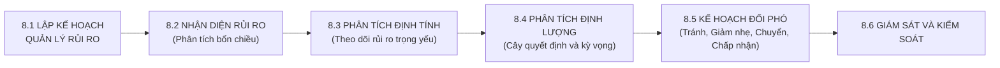
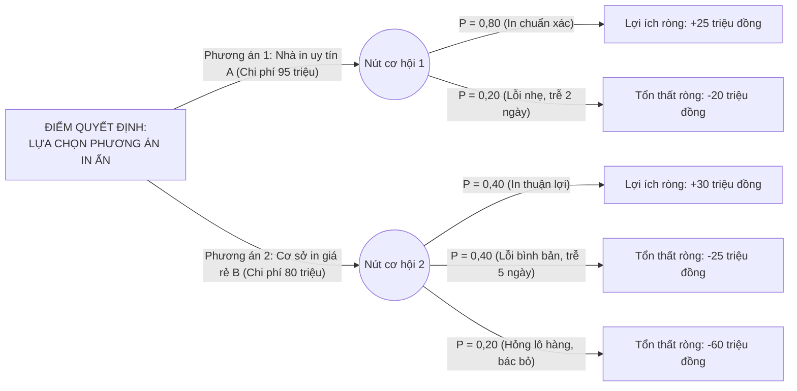

# CHƯƠNG 8. KẾ HOẠCH PHÂN TÍCH VÀ QUẢN LÝ RỦI RO DỰ ÁN

Chương này vận dụng quy trình quản lý rủi ro sáu bước nhằm nhận diện các yếu tố bất định qua ma trận bốn chiều, phân tích định tính danh mục rủi ro trọng yếu theo tháng, phân tích định lượng phương án hợp đồng in ấn bằng mô hình cây quyết định và giá trị tiền tệ kỳ vọng, từ đó xác lập các chiến lược ứng phó và kế hoạch dự phòng.

## 8.1. Khung quản lý rủi ro dự án

Trong dự án phát triển học liệu hướng nghiệp, rủi ro bao gồm mọi biến cố không chắc chắn có thể làm chậm tiến độ đường găng 90 ngày, làm biến động dự toán 185.000.000 đồng hoặc ảnh hưởng đến chất lượng của 2.000 cuốn tài liệu. Quy trình quản lý rủi ro được thiết lập khép kín qua sáu bước:

## 8.2. Ma trận nhận diện rủi ro theo mô hình điểm mạnh, điểm yếu, thời cơ và nguy cơ

Nhóm lập kế hoạch sử dụng mô hình `SWOT` (`Strengths` - Điểm mạnh, `Weaknesses` - Điểm yếu, `Opportunities` - Thời cơ, `Threats` - Nguy cơ) để rà soát các yếu tố nội tại của Ban Quản lý dự án và các tác động từ môi trường bên ngoài, làm cơ sở nhận diện các rủi ro tiềm ẩn:

**Bảng 8.1. Ma trận nhận diện rủi ro dự án theo mô hình SWOT**

| Chiều phân tích | Đặc điểm thực tế của dự án | Rủi ro tiềm ẩn được nhận diện |
| :--- | :--- | :--- |
| **Điểm mạnh** | Đội ngũ Chủ biên và bốn nhóm tác giả có chuyên môn sâu về tâm lý học và giáo dục học; Ban Quản lý dự án trực thuộc Phòng Giáo dục và Đào tạo nên thuận lợi khi điều phối 5 trường trung học cơ sở. | Nguy cơ tác giả trình bày thiên về lý luận hàn lâm, thiếu tính trực quan đối với học sinh lớp 9. |
| **Điểm yếu** | Nhân sự tham gia chủ yếu làm việc kiêm nhiệm; Ban Quản lý dự án ít kinh nghiệm giám sát kỹ thuật bình bản kẽm và in offset công nghiệp; 9/10 công việc nằm trên đường găng không có thời gian dự trữ. | Rủi ro chậm hạn nộp bản thảo lần một (ngày thứ 40); rủi ro phát sinh lỗi màu sắc hoặc keo gáy nếu thiếu khâu kiểm duyệt mẫu in thử. |
| **Thời cơ** | Chủ trương phân luồng theo Quyết định số 522/QĐ-TTg và chính sách miễn 100% học phí học nghề được Nhà nước ưu tiên; các trường trung học cơ sở đang cần học liệu hướng nghiệp chuẩn hóa. | Thuận lợi trong khâu khảo sát đầu vào, đọc thử bản thảo và tiếp nhận ấn phẩm tại các nhà trường. |
| **Nguy cơ** | Tâm lý chuộng bằng cấp đại học của phụ huynh còn nặng nề; giá giấy in Fort và Couche trên thị trường có xu hướng biến động; chỉ tiêu tuyển sinh lớp 10 của địa phương có thể điều chỉnh. | Rủi ro phụ huynh ít quan tâm đến lộ trình học nghề hệ chín cộng; rủi ro trượt giá vật tư in ấn; rủi ro số liệu tuyển sinh trong bản thảo cần cập nhật gấp. |

## 8.3. Danh mục các rủi ro trọng yếu theo chu kỳ tháng

Từ các rủi ro đã nhận diện, dự án lập bảng theo dõi thứ hạng ưu tiên của năm rủi ro trọng yếu nhất qua ba tháng thực hiện (Tháng 1: từ ngày 1 đến ngày 30; Tháng 2: từ ngày 31 đến ngày 60; Tháng 3: từ ngày 61 đến ngày 90):

**Bảng 8.2. Bảng theo dõi danh mục năm rủi ro trọng yếu theo chu kỳ tháng**

| Danh mục rủi ro trọng yếu | Xếp hạng Tháng 1 | Xếp hạng Tháng 2 | Xếp hạng Tháng 3 | Xu hướng biến đổi | Biện pháp kiểm soát theo giai đoạn |
| :--- | :---: | :---: | :---: | :---: | :--- |
| **1. Tác giả chậm nộp bản thảo (Công việc C)** | **1** | **2** | Đã qua | Giảm dần sau ngày 40 | Giao khoán theo 20 bài chuẩn; kiểm điểm tiến độ trang viết vào sáng thứ Hai hàng tuần; bố trí trợ lý hỗ trợ tổng hợp bảng biểu. |
| **2. Bản thảo phải sửa nhiều sau thẩm định (Công việc E, F)** | **3** | **1** | Đã qua | Đạt đỉnh ở Tháng 2 | Thông qua đề cương chi tiết ngay từ ngày 14; tổ chức đọc chéo nội bộ và đọc thử với 20 học sinh trước khi họp Hội đồng. |
| **3. Nhà in trễ hạn hoặc lỗi kỹ thuật (Công việc I)** | **4** | **3** | **1** | Tăng cao ở Tháng 3 | Ký duyệt niêm phong bản bông tại ngày 76; áp dụng phạt hợp đồng 1%/ngày trễ; kiểm định mẫu thống kê 384 cuốn tại kho. |
| **4. Biến động tăng giá giấy in (Công việc D, I)** | **2** | **4** | Đã qua | Giảm sau khi ký hợp đồng | Tổ chức chào hàng cạnh tranh sớm và ký hợp đồng trọn gói cố định đơn giá ngay từ ngày thứ 32. |
| **5. Phụ huynh e ngại thông tin phân luồng nghề** | **5** | **5** | **2** | Tăng khi bàn giao sách | Thiết kế Phần 4 gồm bộ phiếu đối thoại gia đình và làm rõ quyền lợi miễn 100% học phí cùng lộ trình học liên thông. |

## 8.4. Mô hình cây quyết định và giá trị tiền tệ kỳ vọng

Để định lượng rủi ro khi lựa chọn phương thức thực hiện gói thầu in ấn 2.000 cuốn tài liệu (mục `4.4`), Ban Quản lý dự án sử dụng `Decision Tree` (Mô hình cây quyết định) kết hợp chỉ số `Expected Monetary Value - EMV` (Giá trị tiền tệ kỳ vọng).

### 8.4.1. Bài toán lựa chọn phương án hợp đồng in ấn công nghiệp

Tại điểm quyết định lựa chọn nhà thầu in ấn, dự án cân nhắc hai phương án có cấu trúc chi phí và phân bố xác suất rủi ro khác nhau:

Phương án 1 (Ký hợp đồng in ấn trọn gói với nhà in công nghiệp uy tín A): Chi phí hợp đồng dự toán là **95.000.000 đồng**. Nếu quá trình bình bản kẽm và chạy máy offset diễn ra thuận lợi (xác suất $P_1 = 0,80$), sản phẩm đạt chuẩn ngay lần đầu và đúng tiến độ, mang lại giá trị quy đổi cho dự án là 120.000.000 đồng; lợi ích ròng đạt $120.000.000 - 95.000.000 = +25.000.000$ đồng. Nếu xảy ra lỗi lệch màu nhẹ ở một số tay sách phải căn chỉnh chạy lại máy làm chậm tiến độ 2 ngày (xác suất $P_2 = 0,20$), giá trị thu về giảm xuống còn 75.000.000 đồng do phát sinh chi phí giám sát hiện trường và áp lực tiến độ; lợi ích ròng trong trường hợp này là $75.000.000 - 95.000.000 = -20.000.000$ đồng.

Phương án 2 (Thuê cơ sở in gia công giá rẻ B sử dụng thiết bị cũ): Chi phí hợp đồng là **80.000.000 đồng** (thấp hơn 15.000.000 đồng so với Phương án 1). Nếu quá trình in thuận lợi (xác suất $P_1 = 0,40$), giá trị mang lại ước tính đạt 110.000.000 đồng; lợi ích ròng đạt $110.000.000 - 80.000.000 = +30.000.000$ đồng. Nếu gặp sự cố lệch tram khi xuất kẽm làm kéo dài thời gian in thêm 5 ngày (xác suất $P_2 = 0,40$), giá trị thu về giảm xuống còn 55.000.000 đồng; lợi ích ròng là $55.000.000 - 80.000.000 = -25.000.000$ đồng. Nếu xảy ra lỗi nghiêm trọng (lem mực, bung keo gáy diện rộng không vượt qua kỳ kiểm định mẫu 384 cuốn với xác suất $P_3 = 0,20$), giá trị thu về chỉ còn 20.000.000 đồng; lợi ích ròng âm ở mức $20.000.000 - 80.000.000 = -60.000.000$ đồng.

### 8.4.2. Sơ đồ cây quyết định và tính toán giá trị tiền tệ kỳ vọng

Trên sơ đồ cây quyết định, điểm quyết định được biểu diễn bằng ô hình vuông (chữ nhật) và các điểm cơ hội gắn với xác suất biến cố được biểu diễn bằng nút hình tròn:

Tính toán giá trị tiền tệ kỳ vọng từ phải sang trái tại hai nút cơ hội:

$$\text{EMV}_1 = (0,80 \times 25.000.000) + (0,20 \times (-20.000.000)) = 20.000.000 - 4.000.000 = +16.000.000\text{ đồng}$$

$$\text{EMV}_2 = (0,40 \times 30.000.000) + (0,40 \times (-25.000.000)) + (0,20 \times (-60.000.000)) = 12.000.000 - 10.000.000 - 12.000.000 = -10.000.000\text{ đồng}$$

Do $\text{EMV}(\text{Phương án 1}) = +16.000.000\text{ đồng} > \text{EMV}(\text{Phương án 2}) = -10.000.000\text{ đồng}$, Ban Quản lý dự án quyết định lựa chọn Phương án 1 (mời thầu các doanh nghiệp in công nghiệp uy tín có máy in offset bốn màu hiện đại với mức trần dự toán gói thầu 95.000.000 đồng) và loại bỏ phương án thuê cơ sở in gia công giá rẻ.

## 8.5. Chiến lược đối phó rủi ro và kế hoạch dự phòng

### 8.5.1. Bốn chiến lược đối phó rủi ro

Dự án thiết lập hệ thống giải pháp ứng phó theo bốn nhóm chiến lược gồm `Risk Avoidance` (Tránh rủi ro), `Risk Mitigation` (Giảm nhẹ rủi ro), `Risk Transference` (Thuyên chuyển rủi ro) và `Risk Acceptance` (Chấp nhận rủi ro):

**Bảng 8.3. Phân nhóm chiến lược đối phó rủi ro của dự án**

| Chiến lược | Nguyên tắc tác động | Rủi ro áp dụng trong dự án | Giải pháp thực thi cụ thể |
| :--- | :--- | :--- | :--- |
| **Tránh rủi ro** | Thay đổi phương thức thực hiện để loại bỏ nguyên nhân gây rủi ro. | Rủi ro hỏng lô hàng và trễ tiến độ do thuê cơ sở in gia công thiếu đồng bộ. | Đưa tiêu chí bắt buộc sở hữu máy in offset 4 màu công nghiệp và mẫu giấy đạt chuẩn vào vòng đánh giá kỹ thuật để loại ngay các cơ sở in yếu kém. |
| **Giảm nhẹ rủi ro** | Giảm xác suất xảy ra hoặc thu hẹp mức độ thiệt hại của rủi ro. | Rủi ro chậm tiến độ biên soạn (C) và rủi ro bản thảo không qua được vòng thẩm định (E). | Áp dụng kỹ thuật gối đầu gửi đọc phản biện từng phần và tổ chức khảo nghiệm trước với học sinh để điều chỉnh sớm trước khi họp Hội đồng. |
| **Thuyên chuyển rủi ro** | Chuyển giao gánh nặng tài chính của rủi ro cho bên thứ ba qua hợp đồng. | Rủi ro biến động giá giấy in và rủi ro sai hỏng kỹ thuật trong quá trình in hàng loạt. | Ký hợp đồng trọn gói cố định đơn giá 47.000 đồng/cuốn; ràng buộc điều khoản nhà thầu chịu 100% chi phí in đền bù nếu mẫu kiểm định vượt ngưỡng lỗi. |
| **Chấp nhận rủi ro** | Ghi nhận rủi ro khách quan và chuẩn bị phương án xử lý khi xuất hiện. | Rủi ro địa phương điều chỉnh cục bộ chỉ tiêu tuyển sinh của một số trường sau khi sách đã in. | Thiết lập sẵn mẫu tờ rời phụ lục cập nhật chỉ tiêu để kẹp bổ sung vào cuốn sách khi bàn giao cho 5 trường trung học cơ sở. |

### 8.5.2. Kế hoạch dự phòng và kế hoạch rút lui

Đối với nhân sự biên soạn, dự án thiết lập `Contingency Plan` (Kế hoạch dự phòng): nếu một tác giả chính gặp sự cố sức khỏe đột xuất trong giai đoạn viết bản thảo (từ ngày 15 đến ngày 40), Chủ biên chuyên môn cùng thành viên dự bị trong nhóm tác giả sẽ trực tiếp tiếp quản phần bài viết đó để giữ vững mốc bàn giao bản thảo lần một vào ngày thứ 40.

Đối với nhà thầu in ấn, dự án xác lập `Fallback Plan` (Kế hoạch rút lui): trong trường hợp dây chuyền in của nhà thầu trúng thầu gặp sự cố kỹ thuật không thể khắc phục trước ngày thứ 77, Ban Quản lý dự án sẽ kích hoạt biên bản bảo lưu kết quả chào hàng để ký hợp đồng thay thế với nhà thầu xếp hạng hai (Công ty Cổ phần In và Truyền thông Giáo dục Thủ đô). Các phát sinh tài chính ngoài dự toán (nếu có) được xử lý thông qua Quỹ dự phòng rủi ro chi phí 9.500.000 đồng theo đúng quy trình phê duyệt đã xác lập tại Mục 5.4.2 (Chương 5).
