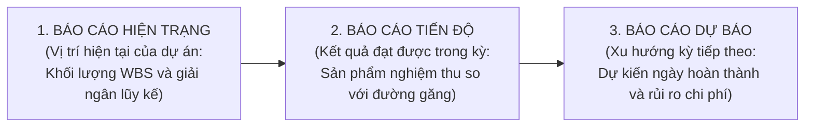

# CHƯƠNG 9. KẾ HOẠCH QUẢN LÝ TRUYỀN THÔNG DỰ ÁN

Chương này xác lập kế hoạch truyền thông với các bên liên quan, quy định phương thức phân phối thông tin hành chính và tác nghiệp, thiết kế hệ thống báo cáo kết quả công việc (gồm báo cáo hiện trạng, báo cáo tiến độ và báo cáo dự báo) và chuẩn hóa thủ tục kết thúc hành chính, lưu trữ hồ sơ dự án.

## 9.1. Kế hoạch truyền thông với các bên liên quan

Để bảo đảm thông tin điều hành được chuyển tải đúng đối tượng và đúng thời điểm, Bảng 9.1 quy định cụ thể nội dung, định dạng, tần suất và đầu mối chịu trách nhiệm truyền thông đối với bảy nhóm chủ thể tham gia dự án:

**Bảng 9.1. Kế hoạch truyền thông chi tiết với các bên liên quan**

| Nhóm chủ thể nhận thông tin | Nội dung thông tin truyền thông | Hình thức và kênh truyền đạt | Đầu mối chịu trách nhiệm | Tần suất và thời điểm gửi | Mục đích quản trị truyền thông |
| :--- | :--- | :--- | :--- | :--- | :--- |
| **Lãnh đạo Phòng Giáo dục và Đào tạo (Chủ đầu tư)** | Tờ trình phê duyệt kế hoạch; báo cáo định kỳ tại các mốc kiểm soát; hồ sơ nghiệm thu và báo cáo tổng kết. | Văn bản hành chính có chữ ký, đóng dấu pháp nhân gửi kèm thư điện tử công vụ. | Giám đốc dự án | Ngày khởi công; cuối mỗi tháng (ngày 30, 60); ngày kết thúc dự án (ngày 90). | Thực hiện trách nhiệm giải trình, xin ý kiến chỉ đạo và phê chuẩn nghiệm thu, giải ngân. |
| **Ban Quản lý dự án (Nhóm điều hành nội bộ)** | Kế hoạch tác nghiệp tuần; biên bản giao ban; bảng theo dõi đường găng và cảnh báo rủi ro. | Họp giao ban trực tiếp kết hợp trao đổi qua nhóm điều hành trực tuyến. | Giám đốc dự án và Thư ký dự án | Sáng thứ Hai hàng tuần và ngay khi phát sinh sự cố kỹ thuật. | Điều phối tiến độ hàng tuần, tháo gỡ kịp thời các vướng mắc trên đường găng. |
| **Chủ biên và Bốn nhóm tác giả biên soạn** | Khung đề cương chi tiết; bản thảo các phần; phiếu nhận xét phản biện và kết luận thẩm định. | Tệp tin văn bản trên thư mục đám mây dùng chung và họp chuyên môn trực tiếp. | Chủ biên chuyên môn | Hàng tuần trong giai đoạn viết (ngày 15–40) và giai đoạn hiệu đính (ngày 53–60). | Đồng nhất cấu trúc, thuật ngữ sư phạm và hướng dẫn chỉnh sửa bản thảo sau thẩm định. |
| **Hội đồng thẩm định chuyên môn** | Giấy mời họp; bản in đóng cuốn toàn văn bản thảo lần một; mẫu phiếu đánh giá phản biện. | Hồ sơ văn bản giấy gửi trực tiếp kèm tệp tin định dạng bảo mật qua thư điện tử. | Chủ tịch Hội đồng thẩm định | Gửi trước phiên họp Hội đồng chính thức tối thiểu 07 ngày. | Cung cấp đầy đủ tài liệu để chuyên gia đọc phản biện độc lập trước khi họp tập trung. |
| **Nhóm thiết kế chế bản và Nhà thầu in ấn** | Hồ sơ yêu cầu báo giá; hợp đồng kinh tế; tệp tin ma-két chế bản; bản bông ký niêm phong duyệt màu. | Hợp đồng văn bản giấy; dữ liệu đồ họa qua máy chủ lưu trữ và biên bản giao nhận mẫu. | Phụ trách Mua sắm và Tài chính | Giai đoạn mời thầu (ngày 15–32) và giai đoạn chế bản, in ấn (ngày 61–84). | Xác lập ràng buộc pháp lý, kiểm soát quy cách chế bản và giám sát tiến độ xuất xưởng. |
| **Hiệu trưởng 5 trường trung học cơ sở** | Công văn phối hợp khảo sát đầu vào; thông báo lịch bàn giao và giấy mời dự nghiệm thu. | Công văn phát hành qua hệ thống quản lý văn bản điện tử của ngành giáo dục. | Đại diện Tiểu ban Kiểm định và Thụ hưởng | Tuần 1 (khảo sát 350 phiếu) và Tuần 13 (bàn giao 2.000 cuốn tài liệu). | Phối hợp thu thập dữ liệu thực tế và chuẩn bị kho tiếp nhận, phân phối ấn phẩm. |
| **Giáo viên tư vấn, học sinh và phụ huynh** | Bản đọc thử nghiệm (20 học sinh, 5 giáo viên); ấn phẩm chính thức sau khi bàn giao về trường. | Tài liệu in thử trong buổi thảo luận nhóm và sách thành phẩm tại thư viện, lớp học. | Tổ giáo viên tư vấn tại 5 trường cơ sở | Tuần 7 (tổ chức đọc thử) và sau ngày thứ 90 (khai thác sử dụng). | Ghi nhận phản hồi của người học thực tế và đưa ấn phẩm vào hỗ trợ tư vấn chuyển cấp. |

## 9.2. Cơ chế phân phối thông tin và quản lý phiên bản tài liệu

Hệ thống thông tin của dự án được phân luồng thành hai kênh rõ rệt. Kênh văn bản hành chính pháp lý được áp dụng bắt buộc đối với các tài liệu làm căn cứ thanh quyết toán và nghiệm thu nhà nước (Quyết định phê duyệt, Hợp đồng kinh tế, Biên bản họp Hội đồng thẩm định, Biên bản kiểm định mẫu thống kê và Biên bản bàn giao tài liệu), yêu cầu lập thành văn bản giấy có đầy đủ chữ ký tươi và dấu pháp nhân.

Kênh tác nghiệp số hóa được sử dụng cho hoạt động biên soạn và chế bản hàng ngày thông qua thư điện tử công vụ và thư mục lưu trữ đám mây phân quyền theo từng tiểu ban. Để tránh nhầm lẫn giữa các lần chỉnh sửa bản thảo của bốn nhóm tác giả, mọi tệp tin đưa lên hệ thống đều được đặt tên theo quy tắc mã hóa thống nhất gồm: `[Mã gói công việc]_[Tên phần]_[Ngày cập nhật]_[Phiên bản V1.0 cho bản thảo lần một / V2.0 cho bản thảo sạch sau thẩm định]`.

## 9.3. Hệ thống báo cáo kết quả công việc dự án

### 9.3.1. Cấu trúc ba chiều của hệ thống báo cáo dự án

Theo lý thuyết quản lý truyền thông dự án, báo cáo kết quả công việc được cấu trúc thành ba phần bổ trợ nhau: `Status Report` (Báo cáo hiện trạng) phản ánh vị trí hiện tại của dự án về tỷ lệ hoàn thành cấu trúc phân rã công việc và số tiền đã giải ngân so với đường mức chi phí cơ sở; `Progress Report` (Báo cáo tiến độ) tổng hợp các sản phẩm đầu ra cụ thể đã hoàn thành nghiệm thu trong kỳ và đối chiếu với các mốc sự kiện trên đường găng; và `Forecast Report` (Báo cáo dự báo) đưa ra dự kiến về khả năng hoàn thành các công việc tiếp theo cùng cảnh báo sớm về tiến độ hoặc chi phí.

### 9.3.2. Báo cáo tích hợp tại mốc kiểm soát ngày thứ 60 (Ngày 30/04/2026)

Tại thời điểm kết thúc Giai đoạn 3.0 trên cấu trúc phân rã công việc (ngày thứ 60 của dự án, tức ngày 30 tháng 4 năm 2026), Giám đốc dự án trình Lãnh đạo Phòng Giáo dục và Đào tạo Báo cáo tích hợp số 02/BC-GDHN:

Về hiện trạng dự án tại ngày thứ 60: Dự án đã đi qua $60/90$ ngày (tương ứng 66,7% tổng quỹ thời gian), hoàn thành trọn vẹn 6 trên 10 công việc của sơ đồ mạng (gồm các công việc A, B, C, D, E, F, đạt 60% số công việc mạng) và 13 trên 20 gói công việc trong cấu trúc phân rã công việc (toàn bộ các mục `1.0`, `2.0`, `3.0` và gói `4.1`, đạt 65% số gói công việc). Về tài chính, bộ phận kế toán đã hoàn tất giải ngân 3 đợt đầu tiên với tổng số tiền lũy kế là **62.500.000 đồng** (gồm 12.500.000 đồng Đợt 1, 32.800.000 đồng Đợt 2 và 17.200.000 đồng Đợt 3), đạt **33,78%** tổng ngân sách, khớp với đường mức chi phí cơ sở tại Chương 5.

Về kết quả tiến độ đạt được trong kỳ (từ ngày thứ 31 đến ngày thứ 60): Bốn nhóm tác giả đã bàn giao bản thảo lần một đúng ngày thứ 40. Hội đồng thẩm định chuyên môn đã họp hai phiên và thông qua bản thảo với tỷ lệ 5/5 phiếu tán thành vào ngày thứ 52. Sau khi tiếp thu ý kiến chuyên gia và kết quả đọc thử của 20 học sinh, Chủ biên đã hoàn thành bản thảo sạch 80 trang ruột và được Giám đốc dự án ký duyệt xuất bản đúng ngày thứ 60 (đảm bảo mốc sự kiện găng thứ 6). Ở nhánh mua sắm song song, Hợp đồng in ấn trọn gói số 08/HĐ-IN đã được ký kết từ ngày thứ 32 với giá trúng thầu 94.000.000 đồng (tiết kiệm 1.000.000 đồng so với dự toán gói thầu 95.000.000 đồng).

Về dự báo kỳ tiếp theo (từ ngày thứ 61 đến ngày thứ 90): Nhóm thiết kế chế bản bắt đầu thực hiện công việc G đúng ngày thứ 61 (01/05/2026) và dự kiến bàn giao tệp tin ma-két vào ngày thứ 72 để in thử bản bông (ký duyệt ngày thứ 76). Nhờ nhà thầu in đã chuẩn bị sẵn nguồn giấy Fort 100 gsm và Couche 250 gsm theo hợp đồng, lô hàng 2.000 cuốn dự báo sẽ hoàn thành xuất xưởng đúng ngày thứ 84 và bàn giao cho 5 trường vào ngày thứ 90 mà không cần sử dụng đến quỹ dự phòng 9.500.000 đồng.

## 9.4. Thủ tục kết thúc hành chính và lưu trữ hồ sơ

### 9.4.1. Thủ tục xác nhận và bàn giao chính thức sản phẩm

Tại ngày thứ 90 (30/05/2026), thủ tục kết thúc hành chính và chấp nhận sản phẩm được thực hiện khi hội đủ ba căn cứ: Phiếu xác nhận kết quả kiểm định mẫu thống kê 384 cuốn tại kho đạt yêu cầu kỹ thuật; Giấy phép xuất bản và xác nhận nộp lưu chiểu theo Luật Xuất bản; cùng Biên bản bàn giao ba bên (giữa đại diện Phòng Giáo dục và Đào tạo, Ban Quản lý dự án và Hiệu trưởng năm trường trung học cơ sở) xác nhận đã giao nhận đủ 2.000 cuốn ấn phẩm (40 thùng) kèm 01 bộ tệp tin chế bản điện tử gốc.

### 9.4.2. Đóng gói lưu trữ hồ sơ và đúc rút bài học kinh nghiệm

Theo đúng định mức tại gói công việc `5.4` (Chương 3), toàn bộ chứng từ và tài liệu phát sinh trong 90 ngày được đóng thành **03 bộ hồ sơ lưu trữ gốc** (01 bộ lưu tại Văn phòng Phòng Giáo dục và Đào tạo, 01 bộ lưu tại bộ phận Kế hoạch - Tài chính phục vụ kiểm toán nhà nước, và 01 bộ lưu tại trường trung học cơ sở đại diện cụm). Mỗi bộ hồ sơ lưu trữ bao gồm năm tập tài liệu thành phần:
1. *Tập 1 - Hồ sơ pháp lý và kế hoạch cơ sở*: Quyết định số 128/QĐ-PGDĐT, Điều lệ dự án, Tuyên bố phạm vi, Từ điển phân rã công việc, Sơ đồ mạng đường găng và Dự toán ngân sách.
2. *Tập 2 - Hồ sơ khảo sát và học thuật*: 350 phiếu khảo sát gốc, Báo cáo dữ liệu đầu vào, Khung đề cương, Bản thảo lần một, 03 phiếu nhận xét phản biện độc lập, Biên bản họp Hội đồng thẩm định và Bản thảo sạch.
3. *Tập 3 - Hồ sơ chế bản và mẫu đối chứng*: Thiết bị lưu trữ chứa tệp tin chế bản gốc và cuốn bản bông mẫu có chữ ký niêm phong duyệt màu.
4. *Tập 4 - Hồ sơ mua sắm và thanh quyết toán*: Hồ sơ yêu cầu báo giá, Báo cáo đánh giá của Tổ chuyên gia, Hợp đồng in ấn số 08/HĐ-IN, Hóa đơn giá trị gia tăng, Biên bản thanh lý hợp đồng và chứng từ giải ngân 5 đợt.
5. *Tập 5 - Hồ sơ kiểm định và nghiệm thu bàn giao*: Phiếu đo đạc mẫu thống kê 384 cuốn, Biên bản nghiệm thu cấp cơ sở, Biên bản bàn giao cho 5 trường và Báo cáo tổng kết đóng dự án.

Báo cáo tổng kết đóng dự án đồng thời ghi nhận ba bài học kinh nghiệm cốt lõi cho cơ quan quản lý giáo dục địa phương: việc tách nhánh mua sắm in ấn (công việc D) chạy song song với nhánh biên soạn (công việc C) trên sơ đồ mạng giúp tiết kiệm 18 ngày trên trục tiến độ; việc kết hợp thẩm định của nhà khoa học với buổi đọc thử của chính học sinh lớp 9 giúp dung hòa tính chuẩn mực pháp lý với ngôn ngữ gần gũi lứa tuổi; và việc ràng buộc thanh toán qua chốt ký duyệt bản bông cùng kiểm định mẫu thống kê $n = 384$ cuốn giúp bảo vệ an toàn chất lượng cho nguồn vốn ngân sách nhà nước.
