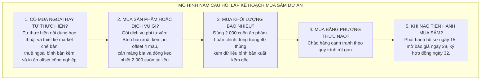

# CHƯƠNG 10. KẾ HOẠCH QUẢN LÝ MUA SẮM DỰ ÁN

Chương này vận dụng quy trình quản lý mua sắm sáu bước và các quy định hiện hành của Luật Đấu thầu số 22/2023/QH15 (được sửa đổi, bổ sung bởi Luật số 57/2024/QH15 và Luật số 90/2025/QH15) cùng Nghị định số 24/2024/NĐ-CP để lập kế hoạch mua sắm, xây dựng hồ sơ yêu cầu báo giá, đánh giá lựa chọn nhà thầu in ấn, quản lý hợp đồng trọn gói và thực hiện nghiệm thu, thanh lý hợp đồng.

## 10.1. Kế hoạch mua sắm và quyết định thuê ngoài

Kế hoạch mua sắm của dự án được xác lập thông qua việc giải quyết năm câu hỏi định hướng chiến lược, khởi đầu từ kỹ thuật `Make or Buy Analysis` (Phân tích quyết định tự thực hiện hay thuê ngoài) và lập `Request for Quotation - RFQ` (Hồ sơ yêu cầu báo giá):

Phân tích tự thực hiện hay thuê ngoài chỉ rõ: Phòng Giáo dục và Đào tạo cùng đội ngũ chuyên gia sư phạm, tâm lý học và nhóm họa sĩ đồ họa chuyên môn có đủ năng lực thực hiện các gói công việc nghiên cứu khảo sát (`1.0`), biên soạn (`2.0`), thẩm định (`3.0`) cũng như thiết kế bìa, vẽ 25 hình minh họa, dàn trang điện tử 80 trang ruột và in thử kỹ thuật số (`4.2a` đến `4.3` với kinh phí 10.500.000 đồng). Ngược lại, cơ quan giáo dục không có chức năng in xuất bản phẩm công nghiệp và không sở hữu dây chuyền máy ghi kẽm, máy in offset bốn màu khổ lớn hay máy vào keo nhiệt tự động. Do đó, dự án quyết định thuê ngoài trọn gói khâu bình bản kẽm, in ấn offset hàng loạt 2.000 cuốn và gia công thành phẩm (gói công việc `4.4`).

Về hình thức lựa chọn nhà thầu, gói thầu in ấn là dịch vụ phi tư vấn thông dụng, có tiêu chuẩn kỹ thuật rõ ràng và có giá dự toán gói thầu được duyệt là **95.000.000 đồng** (nằm trong hạn mức áp dụng chào hàng cạnh tranh). Căn cứ Điều 24 Luật Đấu thầu số 22/2023/QH15 và Điều 78, Điều 79 Nghị định số 24/2024/NĐ-CP, dự án áp dụng hình thức **Chào hàng cạnh tranh theo quy trình rút gọn** để tiết kiệm thời gian và chi phí tổ chức đấu thầu. Toàn bộ thủ tục lựa chọn nhà thầu được thực hiện trong 18 ngày của công việc không găng D (từ ngày thứ 15 đến ngày thứ 32).

## 10.2. Hồ sơ yêu cầu báo giá và tiếp cận nhà thầu

### 10.2.1. Các thông số pháp lý và kỹ thuật trong hồ sơ yêu cầu báo giá

Hồ sơ yêu cầu báo giá do Ban Quản lý dự án phát hành vào ngày thứ 15 (16/03/2026) xác định rõ tên gói thầu là *"Dịch vụ bình bản kẽm công nghiệp, in ấn offset và gia công thành phẩm 2.000 cuốn Bộ tài liệu tư vấn phân luồng và định hướng nghề nghiệp cho học sinh cuối cấp trung học cơ sở"*, với mức trần giá gói thầu là **95.000.000 đồng** (đã bao gồm thuế giá trị gia tăng, vật tư giấy, kẽm, mực in, gia công và chi phí giao hàng tại kho).

Hồ sơ yêu cầu nhà thầu cam kết đáp ứng đầy đủ các tiêu chuẩn kỹ thuật xuất bản đã quy định tại Mục 3.1 (Chương 3) và Mục 6.2.2 (Chương 6), đồng thời gửi kèm mẫu giấy ruột Fort trắng 100 gsm và mẫu giấy bìa Couche 250 gsm trong hồ sơ chào giá để Tổ chuyên gia kiểm tra thực tế.

Thời gian thực hiện hợp đồng tại xưởng in được ấn định là **12 ngày** (từ ngày thứ 73 đến ngày thứ 84 của dự án), tính từ thời điểm nhà thầu nhận bộ tệp tin ma-két chế bản điện tử vào cuối ngày thứ 72: bao gồm **4 ngày** bình bản và phối hợp in thử, rà soát ký duyệt mẫu bản bông (công việc H, từ ngày 73 đến ngày 76) và **8 ngày** chạy máy in offset hàng loạt 2.000 cuốn, cán màng mờ bìa, vào keo nhiệt và đóng thùng xuất xưởng (công việc I, từ ngày 77 đến ngày 84).

### 10.2.2. Danh sách các nhà thầu được gửi yêu cầu báo giá

Ban Quản lý dự án gửi trực tiếp Hồ sơ yêu cầu báo giá tới ba doanh nghiệp có giấy phép hoạt động in xuất bản phẩm độc lập trên địa bàn:
1. Nhà thầu 1: Công ty Trách nhiệm hữu hạn In ấn và Thương mại Quân đội.
2. Nhà thầu 2: Công ty Cổ phần In và Truyền thông Giáo dục Thủ đô.
3. Nhà thầu 3: Công ty Trách nhiệm hữu hạn Sản xuất Bao bì và Xuất bản phẩm Bách Khoa.

## 10.3. Kết quả đánh giá báo giá và lựa chọn nhà thầu

Đúng ngày thứ 28 (29/03/2026), Tổ chuyên gia mở và đánh giá ba hồ sơ báo giá theo quy trình hai bước: kiểm tra tư cách pháp lý, năng lực kỹ thuật theo tiêu chí *"Đạt / Không đạt"*, sau đó xếp hạng giá dự thầu thấp nhất trong số các nhà thầu vượt qua vòng kỹ thuật.

**Bảng 10.1. Bảng đánh giá hồ sơ chào hàng cạnh tranh gói thầu in ấn**

| Tiêu chí đánh giá năng lực và tài chính | Mức yêu cầu | Nhà thầu 1: Công ty In Quân đội | Nhà thầu 2: Công ty In Giáo dục | Nhà thầu 3: Công ty In Bách Khoa |
| :--- | :---: | :---: | :---: | :---: |
| **Bước 1: Đánh giá năng lực kỹ thuật** | | | | |
| 1. Tư cách pháp nhân và giấy phép in xuất bản | Đạt / Không đạt | Đạt | Đạt | Đạt |
| 2. Dây chuyền máy in offset 4 màu công nghiệp | Đạt / Không đạt | Đạt (Máy Heidelberg 4 màu) | Đạt (Máy Komori 4 màu) | Đạt (Máy Ryobi 4 màu) |
| 3. Mẫu giấy gửi kèm (Fort 100 gsm, Couche 250 gsm) | Đạt / Không đạt | Đạt chuẩn định lượng, độ trắng | Đạt chuẩn định lượng, độ trắng | Không đạt (Giấy Fort chỉ đạt 80 gsm) |
| 4. Cam kết tiến độ thực hiện tại xưởng (12 ngày) | Đạt / Không đạt | Đạt (Cam kết đúng 12 ngày) | Đạt (Cam kết đúng 12 ngày) | Đạt (Cam kết đúng 12 ngày) |
| *Kết luận vòng đánh giá kỹ thuật* | | **Đạt vào vòng xét giá** | **Đạt vào vòng xét giá** | **Bị loại ở vòng kỹ thuật** |
| **Bước 2: Đánh giá tài chính và xếp hạng giá** | | | | |
| Giá chào thầu trọn gói (đã gồm thuế và vận chuyển) | Trần: 95.000.000 đồng | **94.000.000 đồng** | **96.800.000 đồng** | Không xét giá |
| Đơn giá tính trên một cuốn ấn phẩm thành phẩm | Trần: 47.500 đồng/cuốn | **47.000 đồng/cuốn** | **48.400 đồng/cuốn** | Không áp dụng |
| Chênh lệch so với giá dự toán gói thầu | | **Tiết kiệm 1.000.000 đồng** | Vượt dự toán 1.800.000 đồng | Không áp dụng |
| **Kết luận xếp hạng nhà thầu** | | **Xếp hạng 1 (Trúng thầu)** | **Xếp hạng 2 (Dự bị)** | **Không đạt** |

Căn cứ kết quả tại Bảng 10.1, vào ngày thứ 32 (02/04/2026), Giám đốc dự án phê duyệt kết quả lựa chọn nhà thầu và ký Hợp đồng kinh tế số 08/HĐ-IN với **Công ty Trách nhiệm hữu hạn In ấn và Thương mại Quân đội** với giá hợp đồng trọn gói là **94.000.000 đồng** (đơn giá 47.000 đồng/cuốn, tiết kiệm 1.000.000 đồng cho ngân sách dự án).

## 10.4. Khung hợp đồng kinh tế và cơ chế kiểm soát thay đổi

### 10.4.1. Hình thức hợp đồng và các điều khoản ràng buộc

Dự án áp dụng hình thức `Lump-sum Fixed-price Contract` (Hợp đồng trọn gói) quy định tại Điều 64 Luật Đấu thầu số 22/2023/QH15, trong đó mức giá 94.000.000 đồng được cố định trong suốt thời gian thực hiện hợp đồng.

Nội dung Hợp đồng số 08/HĐ-IN ràng buộc chặt chẽ bốn nghĩa vụ pháp lý giữa hai bên: nhà thầu có nghĩa vụ bảo mật bản thảo và bản quyền, không được tự ý sao chụp hoặc in thêm ngoài số lượng 2.000 cuốn; nhà thầu chỉ được phép xuất kẽm chạy máy in hàng loạt sau khi có chữ ký duyệt niêm phong mẫu bản bông của Giám đốc dự án và Chủ biên tại ngày thứ 76; nếu giao hàng trễ sau ngày thứ 84 mà không do sự kiện bất khả kháng, nhà thầu chịu mức phạt vi phạm tiến độ bằng 1% giá trị hợp đồng cho mỗi ngày chậm trễ (khấu trừ trực tiếp vào đợt thanh toán cuối); đồng thời nhà thầu phải thực hiện nghĩa vụ in bù đổi mới trong vòng 48 giờ hoặc tái sản xuất lô hàng theo đúng các ngưỡng nghiệm thu mẫu thống kê 384 cuốn đã quy định tại Mục 6.4.2 (Chương 6).

Về lộ trình thanh toán hợp đồng, khớp với lịch giải ngân tại Chương 5, Ban Quản lý dự án chuyển khoản tạm ứng 30% giá trị hợp đồng (**28.200.000 đồng**) vào ngày thứ 76 ngay sau khi ký duyệt bản bông, và tất toán 70% giá trị hợp đồng còn lại (**65.800.000 đồng**) sau khi hoàn thành kiểm định nghiệm thu lô hàng.

### 10.4.2. Kiểm soát thay đổi hợp đồng

Trong quá trình thực hiện hợp đồng, mọi điều chỉnh về thông số kỹ thuật hoặc lịch giao nhận (nếu phát sinh) đều phải được lập thành Phụ lục hợp đồng bằng văn bản có chữ ký của đại diện pháp luật hai bên; nhân viên giám sát kỹ thuật và thợ in tại xưởng không được tự ý thỏa thuận thay đổi quy cách giấy, mực hoặc bỏ qua bước ký duyệt bản bông.

## 10.5. Xác minh sản phẩm và thanh lý hợp đồng

Vào ngày thứ 84 (24/05/2026), nhà thầu bàn giao đủ 2.000 cuốn tài liệu trong 40 thùng giấy niêm phong tại kho tiếp nhận. Tiểu ban Kiểm định chất lượng thực hiện rút mẫu phân tầng 384 cuốn theo quy trình tại Chương 6; kết quả đo đạc thực tế ghi nhận toàn bộ 384/384 cuốn mẫu đều đạt chuẩn kích thước 17 x 24 cm, giấy đúng định lượng, màu sắc khớp với bản bông đối chứng và keo gáy chắc chắn (0 cuốn lỗi), đủ điều kiện ký Biên bản xác minh và giao nhận hàng hóa.

Vào ngày thứ 88 (28/05/2026), sau khi nhà thầu bàn giao bộ dữ liệu bình bản xuất kẽm gốc và Hóa đơn giá trị gia tăng trị giá 94.000.000 đồng, hai bên ký Biên bản thanh lý Hợp đồng kinh tế số 08/TLHĐ-IN. Bộ phận kế toán dự án thực hiện lệnh chuyển khoản thanh toán nốt **65.800.000 đồng** (70% giá trị hợp đồng còn lại) cho nhà thầu và chuyển toàn bộ chứng từ vào 03 bộ hồ sơ lưu trữ dự án trước khi kết thúc dự án vào ngày thứ 90.
