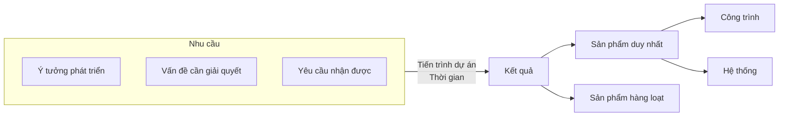
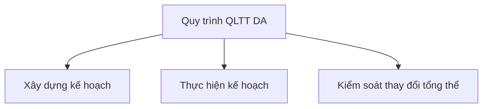
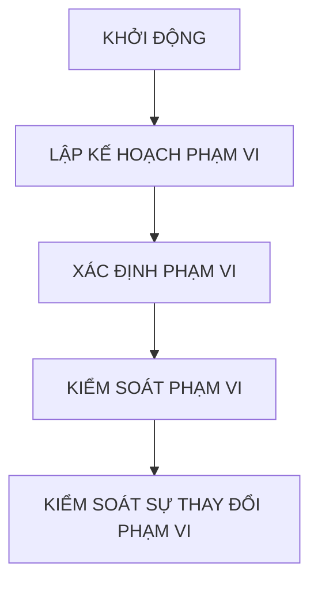
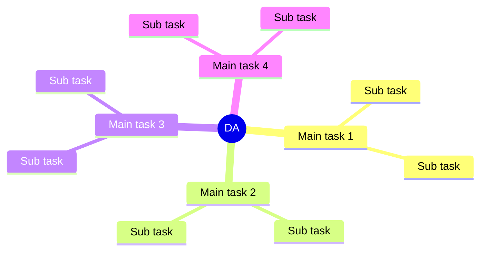
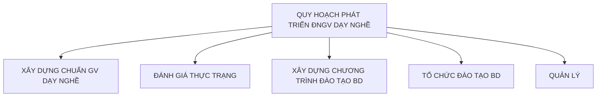

### Slide 1

**BỘ GIÁO DỤC VÀ ĐÀO TẠO**

**ĐẠI HỌC BÁCH KHOA HÀ NỘI**

**CAO HỌC LÝ LUẬN VÀ PHƯƠNG PHÁP GIẢNG DẠY**

# QUẢN LÝ DỰ ÁN GIÁO DỤC

**PGS.TS BÙI THỊ THÚY HẰNG**

09/08/2026

Hà Nội, 2/2026

1

---

### Slide 2

## MỤC TIÊU MÔN HỌC

Kết thúc môn học, học viên có thể:

* Xác định một dự án giáo dục

* Phân tích, lập kế hoạch và tổ chức thực hiện dự án có hiệu quả

09/08/2026

2

---

### Slide 3

## NỘI DUNG MÔN HỌC

* Chương 1: Tổng quan về quản lý dự án (QLDA)

* Chương 2: Quản lý tổng thể dự án

* Chương 3: Quản lý phạm vi dự án

* Chương 4: Quản lý tiến độ dự án

* Chương 5: Quản lý chi phí dự án

* Chương 6: Quản lý chất lượng dự án

* Chương 7: Quản lý nguồn nhân lực

* Chương 8: Phân tích và quản lý rủi ro

* Chương 9: Quản lý truyền thông dự án

* Chương 10: Quản lý mua sắm dự án

* Chương 11: Phân tích một dự án giáo dục

09/08/2026

3

---

### Slide 4

09/08/2026

# CHƯƠNG 1: TỔNG QUAN VỀ QUẢN LÝ DỰ ÁN GIÁO DỤC

* Evaluate

* Project Management

* Analyze

* Develop

4

---

### Slide 5

### 1.1. Khái niệm dự án

Theo ngôn ngữ thông dụng, DA chỉ mục đích muốn đạt được.

Theo ngôn ngữ chuyên nghiệp, DA là quy trình dẫn dắt từ chỗ nhận ra một nhu cầu đến mục tiêu phải thỏa mãn nó.

Dự án là một chuỗi các công việc (nhiệm vụ, hoạt động) được thực hiện nhằm đạt được mục tiêu đề ra trong điều kiện ràng buộc về phạm vi, thời gian và ngân sách.

09/08/2026

5

---

### Slide 6

09/08/2026

6

---

### Slide 7

### Dự án giáo dục

* Giải quyết những vấn đề của thực tiễn giáo dục

* Theo đuổi mục tiêu giáo dục

* Hoạt động gắn liền với thị trường giáo dục mà dự án sẽ cung cấp sản phẩm

09/08/2026

7

---

### Slide 8

### Quản lý dự án là gì?

* QLDA là « áp dụng kiến thức, kỹ năng, công cụ và kỹ thuật vào các hoạt động dự án để thỏa mãn các yêu cầu của dự án », Project Management Body of Knowledge, 2000, tr. 6.

* QLDA là một quá trình lập kế hoạch, điều phối thời gian, nguồn lực và giám sát quá trình phát triển của DA nhằm đảm bảo cho DA hoàn thành đúng thời hạn, trong phạm vi ngân sách được duyệt và đạt được các yêu cầu đã định về kỹ thuật, chất lượng của sản phẩm, dịch vụ, bằng các phương pháp và điều kiện tốt nhất cho phép.

09/08/2026

8

---

### Slide 9

### 1.2. Đặc trưng của dự án

* Dự án có mục đích, kết quả rõ ràng

* Thời gian tồn tại của dự án bị giới hạn và ấn định từ trước

* Có nhiều rủi ro

* Nhiều thay đổi và vấn đề xuất hiện

* Được thực hiện bởi một êkíp được thành lập tạm thời

* Hoạt động hợp tác

* Dự án liên quan đến nhiều người và tổ chức với nhu cầu và mối quan tâm khác nhau.

09/08/2026

9

---

### Slide 10

### 1.3. Các giai đoạn của một DA

* Chia các giai đoạn của dự án thực chất là nhóm các hoạt động của dự án vào một số nhóm có các đặc điểm như:

* Kế tiếp nhau về mặt thời gian

* Mỗi giai đoạn là một mốc xác định rõ ràng trong tiến trình đi đến kết quả

* Vòng đời dự án xác định các giai đoạn mà một dự án phải trải qua tính từ lúc bắt đầu cho tới khi kết thúc dự án.

09/08/2026

10

---

### Slide 11

### 4 GIAI ĐOẠN CỦA DỰ ÁN

* Giai đoạn xây dựng ý tưởng

* Giai đoạn phát triển

* Giai đoạn thực hiện

* Giai đoạn kết thúc

09/08/2026

11

---

### Slide 12

### 4 GIAI ĐOẠN CỦA DỰ ÁN (tiếp)

i) Giai đoạn xây dựng ý tưởng: xác định bức tranh toàn cảnh về mục tiêu, kết quả và phương pháp thực hiện.

Cần tính đến:

* Mục đích yêu cầu của dự án

* Tính khả thi:

* Lợi nhuận

* Chi phí

* Rủi ro

* Các nguồn lực

09/08/2026

12

---

### Slide 13

### 4 GIAI ĐOẠN CỦA DỰ ÁN (tiếp)

ii) Giai đoạn phát triển: chi tiết hóa việc thực hiện dự án, tập trung vào việc thiết kế và lập kế hoạch.

Nội dung:

* Thành lập nhóm dự án, xác định cơ cấu tổ chức

* Lập kế hoạch tổng thể

* Phân tích, lập bảng chi tiết công việc (WBS)

* Lập kế hoạch tiến độ thời gian

* Lập kế hoạch ngân sách

* Lập kế hoạch nguồn lực cần thiết

* Lập kế hoạch chi phí

* Xin phê chuẩn thực hiện tiếp

09/08/2026

13

---

### Slide 14

### 4 GIAI ĐOẠN CỦA DỰ ÁN (tiếp)

iii) Giai đoạn thực hiện: quản lý triển khai các nguồn lực

* Nội dung: lựa chọn, mua sắm công cụ thiết bị dựa trên những yêu cầu kỹ thuật cụ thể

iv) Giai đoạn kết thúc: hoàn tất những việc còn lại:

* Hoàn thành sản phẩm

* Bàn giao hệ thống, công trình và tài liệu liên quan

* Đánh giá dự án

* Giải phóng nguồn lực

09/08/2026

14

---

### Slide 15

### 1.4. Các bên liên quan tới dự án

Các bên tham gia là tất cả những ai có liên quan hoặc bị ảnh hưởng bởi các hoạt động của dự án, đó là:

* Những người có lợi ích trong kết quả dự án

* Liên quan trực tiếp tới dự án

* Đóng góp các nguồn lực cho dự án

Thông thường, các bên liên quan bao gồm: nhà tài trợ, người quản lý dự án (giám đốc dự án), nhà quản lý chức năng, khách hàng, nhà cung cấp.

09/08/2026

15

---

### Slide 16

## BÀI TẬP CHƯƠNG 1

* Kể tên 4 giai đoạn DA và nội dung các công việc trong mỗi giai đoạn

* Xác định một dự án giáo dục

09/08/2026

16

---

### Slide 17

09/08/2026

# CHƯƠNG 2: QUẢN LÝ TỔNG THỂ DỰ ÁN

17

---

### Slide 18

09/08/2026

**Quy trình quản lý tổng thể dự án**

18

---

### Slide 19

### 2.1. Xây dựng kế hoạch dự án

* KHDA là tài liệu điều phối mọi kế hoạch thành phần

* KHDA hướng dẫn thực hiện và kiểm soát dự án

* Hỗ trợ cho người QLDA lãnh đạo thực hiện và đánh giá tình hình thực hiện DA

* Chất lượng DA cần đánh giá trên kế hoạch cơ sở

09/08/2026

19

---

### Slide 20

### CÁC THÀNH PHẦN CỦA KHDA

* Tổng quan về DA

* Kế hoạch triển khai

* Các quy trình quản lý

* Các kỹ thuật dùng trong DA

* Thông tin về công việc

* Lịch biểu DA

* Ngân sách DA

* Các nguồn tài nguyên

09/08/2026

20

---

### Slide 21

### PHÂN TÍCH CÁC BÊN THAM GIA

* Tên và đơn vị của các bên tham gia

* Vai trò trong DA

* Các thông tin thực

* Mức ảnh hưởng và quan tâm đến DA

* Đề xuất cho QL các mqh

09/08/2026

21

---

### Slide 22

### Bài tập

Xác định một DA GD rồi xây dựng kế hoạch cho DA đó

* Thời gian: 10 phút

* Mục tiêu: Mô tả các thành phần của KHDA, phân tích các bên tham gia

09/08/2026

22

---

### Slide 23

### 2.2. Thực hiện kế hoạch DA

* Quản lý và thực hiện các công việc mô tả trong KHDA

* Thời gian và chi phí chủ yếu dùng ở giai đoạn này

* Tạo ra sản phẩm của DA

09/08/2026

23

---

### Slide 24

### CÁC KỸ NĂNG THỰC HIỆN KHDA

* Quản lý: kỹ năng lãnh đạo, giao tiếp và chính trị

* Kỹ năng về sản phẩm và kiến thức sử dụng công cụ và kỹ thuật chuyên dụng

09/08/2026

24

---

### Slide 25

### CÁC CÔNG CỤ VÀ KỸ THUẬT THỰC HIỆN DA

* Hệ giao việc: PP bảo đảm con người đủ điều kiện làm việc đúng lúc và đúng trình tự

* Các cuộc họp của dự án: Họp sau các mốc DA, họp theo tiến độ, họp đột xuất, họp ứng biến

* Phần mềm quản lý DA

09/08/2026

25

---

### Slide 26

### 2.3. Kiểm soát thay đổi tổng thể

* Nhận diện, đánh giá và quản lý những thay đổi trong suốt tiến trình DA

**Mục tiêu của KSTĐ:**

* Tác động đến các yếu tố tạo ra sự thay đổi để đảm bảo sự có lợi

* Xác định những thay đổi đã xảy ra

* Quản lý những thay đổi thực tế

09/08/2026

26

---

### Slide 27

### DÙNG PHẦN MỀM HỖ TRỢ QLTTDA

* Phần mềm soạn thảo văn bản

* Powerpoint

* Email và web

* Microsoft Project

09/08/2026

27

---

### Slide 28

09/08/2026

# CHƯƠNG 3: QUẢN LÝ PHẠM VI DỰ ÁN

28

---

### Slide 29

### GIỚI THIỆU CHUNG

* Phạm vi (Scope): là những gì DA phải làm

* Kết quả chuyển giao (Deliverables): là những kết quả mà DA sẽ chuyển giao như: phần cứng, phần mềm, tài liệu, đào tạo và phương thức chuyển giao

* Nhóm DA và các bên liên quan (Stakeholders) phải cùng hiểu sản phẩm nào được tạo ra và cách thức tạo ra.

09/08/2026

29

---

### Slide 30

09/08/2026

**QUY TRÌNH QUẢN LÝ PHẠM VI**

30

---

### Slide 31

### 3.1. KHỞI ĐỘNG

* Kế hoạch chiến lược: xác định các mục tiêu lâu dài của một tổ chức để dự báo xu hướng nhu cầu của sản phẩm và dịch vụ trong tương lai

* Lựa chọn DA: tập trung vào nhu cầu chung, phân loại DA, phân tích tài chính

09/08/2026

31

---

### Slide 32

### TẬP TRUNG VÀO NHU CẦU CHUNG (các tiêu chí lựa chọn)

* DA có giá trị cao

* Thỏa mãn các điều kiện:

* Có nhu cầu cao

* Có ngân sách

* Có sự quyết tâm mạnh để thực hiện thành công DA

09/08/2026

32

---

### Slide 33

### PHÂN LOẠI DỰ ÁN

* Theo nhóm: giải quyết một vấn đề, nắm bắt một cơ hội, xác định một hướng

* Thời gian: kéo dài bao lâu và khi nào cần thiết

* Mức độ ưu tiên

09/08/2026

33

---

### Slide 34

### PHƯƠNG PHÁP XÁC ĐỊNH GIÁ TRỊ TÀI CHÍNH

* Phân tích Net present value (NPV): PP tính lượng tiền thực thu hoặc thực chi từ DA. Giá trị NPV càng lớn càng tốt.

$$NPV=\sum_{t=0}^{T}\frac{CF_{t}}{(1+r)^{t}}=CF_{0}+\frac{CF_{1}}{(1+r)^{1}}+\frac{CF_{2}}{(1+r)^{2}}+...+\frac{CF_{T}}{(1+r)^{T}}$$

* $CF_t$ là dòng tiền ở thời điểm $t$

* $r$ là chi phí vốn (lãi suất)

* Giá trị hoàn lại từ đầu tư (Return on investment – ROI):

$$ROI = \frac{\text{tổng thu nhập} - \text{tổng chi phí}}{\text{chi phí}}$$

Giá trị ROI càng lớn càng tốt

* Phân tích lợi nhuận từ đầu tư (Payback analysis): Tính thời gian thu lại số tiền đã đầu tư cho DA

09/08/2026

34

---

### Slide 35

### Net Present Value: Giá trị hiện tại thuần của dòng tiền

* Dự án A và B có độ dài 5 năm với chi phí vốn 10% và dòng tiền ở các năm như bảng sau. Nên chọn dự án nào nếu chỉ được phép chọn 1 trong 2 dự án?

| Year | Project A Cash Flow | Project B Cash Flow |
| --- | --- | --- |
| 0 | $-1000 \vert{}$-1000 |  |
| 1 | 500 | 100 |
| 2 | 400 | 200 |
| 3 | 200 | 200 |
| 4 | 200 | 400 |
| 5 | 100 | 700 |

**Project A:**

$$NPV=-1000+\frac{500}{(1+.10)^{1}}+\frac{400}{(1+.10)^{2}}+\frac{200}{(1+.10)^{3}}+\frac{200}{(1+.10)^{4}}+\frac{100}{(1+.10)^{5}}=\$134.08$$

**Project B:**

$$NPV=-1000+\frac{100}{(1+.10)^{1}}+\frac{200}{(1+.10)^{2}}+\frac{200}{(1+.10)^{3}}+\frac{400}{(1+.10)^{4}}+\frac{700}{(1+.10)^{5}}=\$114.31$$

Như vậy, dự án A có NPV cao hơn, nếu không có thông tin nào khác, chọn dự án A.

09/08/2026

35

---

### Slide 36

### BÁO CÁO TÓM TẮT DA

* Tên DA:

* Ngày bắt đầu: .................... Ngày kết thúc: ....................

* Thông tin về kinh phí:

* Giám đốc DA (Tên, ĐT, email):

* Cách tiếp cận:

* Vai trò và trách nhiệm (vai trò, họ tên, tổ chức/vị trí, liên hệ):

| Vai trò | Họ tên | Tổ chức/vị trí | Liên hệ |
| --- | --- | --- | --- |
|  |  |  |  |
|  |  |  |  |

* Ký tên (mọi thành viên tham gia)

* Chú thích

09/08/2026

36

---

### Slide 37

09/08/2026

### TÓM TẮT QUÁ TRÌNH KHỞI ĐỘNG DA

| Đầu vào | Công cụ và kỹ thuật | Kết quả |
| --- | --- | --- |
| 1. Kế hoạch chiến lược 

 2. Cơ hội ứng dụng 

 3. Tiêu chí lựa chọn 

 4. Kinh nghiệm quá khứ | 1. Phương pháp lựa chọn DA 

 2. Tham gia chuyên khảo | 1. Báo cáo tóm tắt DA 

 2. Đề xuất người quản lý DA 

 3. Các ràng buộc và các giả định |

37

---

### Slide 38

### 3.2. LẬP KẾ HOẠCH VỀ PHẠM VI

* Là quá trình xây dựng các tài liệu nhằm cung cấp nền tảng về phạm vi của DA.

* Tuyên bố phạm vi: một tài liệu dùng để phát triển và khẳng định sự hiểu thống nhất về phạm vi DA bao gồm:

* Kiểm chứng về DA

* Mô tả sản phẩm

* Tổng kết các sản phẩm trung gian

* Các yếu tố thành công của DA

09/08/2026

38

---

### Slide 39

### TUYÊN BỐ PHẠM VI

* Tên DA

* Ngày

* Người viết

* Các tính chất và yêu cầu của sản phẩm

* Tổng kết về các sản phẩm chuyển giao của DA

* Các kết quả liên quan đến QLDA: tóm tắt DA, hợp đồng, tuyên bố phạm vi, WBS, lịch biểu, tài chính, báo cáo định kỳ, báo cáo kết thúc, bài học...

* Sản phẩm liên quan:

* Các tiêu chí đánh giá thành công của DA

09/08/2026

39

---

### Slide 40

09/08/2026

### XÂY DỰNG KẾ HOẠCH PHẠM VI

| Đầu vào | Công cụ & kỹ thuật | Kết quả |
| --- | --- | --- |
| 1. DA đã chọn 

 2. Tóm tắt DA 

 3. Giả định và ràng buộc | 1. Phân tích lợi ích 

 2. Phân tích sản phẩm 

 3. Ý kiến chuyên gia | 1. Tuyên bố phạm vi 

 2. Phụ lục đi kèm 

 3. Kế hoạch quản lý phạm vi |

40

---

### Slide 41

### 3.3. XÁC ĐỊNH PHẠM VI

* Xác định chi tiết công việc: chia công việc ở mức độ nhỏ hơn có thể quản lý được

* Xác định đúng phạm vi:

* Giúp cải tiến sự chính xác về thời gian, chi phí và tài nguyên

* Xác định cơ sở để đo hiệu suất vận hành và điều khiển DA

* Truyền đạt rõ ràng các trách nhiệm của mỗi công việc

09/08/2026

41

---

### Slide 42

### CẤU TRÚC PHÂN RÃ ĐẦU VIỆC (WORK BREAKDOWN STRUCTURE)

* WBS: Chia nhỏ DA thành các đầu việc theo hướng có thể bàn giao được, tập hợp các đầu việc đó để xác định phạm vi DA

* WBS là một tài liệu cơ bản trong QLDA cung cấp yếu tố cơ bản của việc lập và quản lý kế hoạch tiến độ, chi phí và những thay đổi của DA

09/08/2026

42

---

### Slide 43

09/08/2026

WBS cho Dự án:

Người viết:

Ngày:

* 1.0 Loại công việc chính 1

* 1.1 Loại công việc con

* 1.2 Loại công việc con

* 1.2.1 Sub-subcategory

* 1.2.2 Sub-subcategory

* 1.3 Loại công việc con

* 1.4 Loại công việc con

* 2.0 Loại công việc chính 2

* 2.1 Loại công việc con

* 2.2 Loại công việc con

* 2.2.1 Sub-subcategory

* 2.2.2 Sub-subcategory

* 2.3 Loại công việc con

* 2.4 Loại công việc con

* 3.0 Loại công việc chính 3

* 3.1 Loại công việc con

* 3.2 Loại công việc con

* 3.2.1 Sub-subcategory

* 3.2.2 Sub-subcategory

* 3.3 Loại công việc con

* 3.4 Loại công việc con

43

---

### Slide 44

### CÁC TIẾP CẬN PHÁT TRIỂN WBS

* Tiếp cận tương tự: Tham khảo WBS của các DA tương tự

* Tiếp cận từ trên xuống (Top-down): bắt đầu từ thành phần lớn nhất của DA sau đó chia nhỏ dần

* Tiếp cận từ dưới lên (Bottom-up): bắt đầu từ các công việc chi tiết và kết hợp dần thành công việc lớn hơn

* Tiếp cận Mind-mapping: ghi ra các công việc dưới dạng phi tuyến và sau đó tạo WBS

09/08/2026

44

---

### Slide 45

09/08/2026

### PHƯƠNG PHÁP SƠ ĐỒ TƯ DUY (MIND-MAPPING)

45

---

### Slide 46

09/08/2026

### VÍ DỤ : BIỂU ĐỒ CÂY CÔNG VIỆC

46

---

### Slide 47

### CÁC NGUYÊN LÝ CƠ BẢN TẠO WBS

* Một đơn vị công việc chỉ xuất hiện một lần.

* Nội dung công việc trong một mục WBS bằng tổng các công việc dưới nó.

* Một mục WBS là nhiệm vụ của chỉ một người, ngay cả khi có nhiều người thực hiện công việc này.

* WBS phải nhất quán với cách thực hiện công việc; trước hết nó phải phục vụ nhóm dự án.

* Các thành viên nhóm dự án phải tham gia phát triển WBS để bảo đảm tính nhất quán.

* Mỗi mục WBS phải có tài liệu đi kèm để bảo đảm hiểu được chính xác phạm vi công việc.

* WBS phải là công cụ linh hoạt để đáp ứng những thay đổi không tránh được, điều khiển nội dung công việc theo đúng tuyên bố về phạm vi.

09/08/2026

47

---

### Slide 48

09/08/2026

### XÁC ĐỊNH PHẠM VI

| Đầu vào | Công cụ & kỹ thuật | Kết quả |
| --- | --- | --- |
| 1. Tuyên bố phạm vi 

 2. Tóm tắt dự án 

 3. Giả định và ràng buộc 

 4. Kinh nghiệm | 1. WBS 

 2. Phân rã | 1. WBS |

48

---

### Slide 49

09/08/2026

### 3.4. Kiểm soát phạm vi

| Đầu vào | Công cụ & kỹ thuật | Kết quả |
| --- | --- | --- |
| 1. Kết quả công việc (WBS, sản phẩm) 

 2. Tài liệu sản phẩm | 1. Giám sát (đo đạc, kiểm toán, thực địa, xem xét sản phẩm) | 1. Bản chấp nhận của các bên liên quan (chủ đầu tư) |

49

---

### Slide 50

### 3.5. Kiểm soát sự thay đổi phạm vi

* Nhân tố ảnh hưởng đến sự thay đổi

* Thay đổi đã xảy ra chưa

* Quản lý được sự thay đổi đã xảy ra

09/08/2026

50

---

### Slide 51

09/08/2026

### KIỂM SOÁT THAY ĐỔI

| Đầu vào | Công cụ & kỹ thuật | Kết quả |
| --- | --- | --- |
| 1. WBS 

 2. Báo cáo chất lượng công việc 

 3. Yêu cầu thay đổi phạm vi 

 4. Kế hoạch quản lý phạm vi | 1. Hệ thống kiểm soát sự thay đổi 

 2. Phép đo 

 3. Kế hoạch dự phòng | 1. Sự thay đổi phạm vi 

 2. Hành động điều chỉnh 

 3. Bài học |

51

---

### Slide 52

### SỬ DỤNG PHẦN MỀM ĐỂ QUẢN LÝ PHẠM VI DA

* Phần mềm soạn thảo các báo cáo

* SPREADSHEETS thực hiện các phép tính tài chính, mô hình cho điểm có trọng số và vẽ các biểu đồ

* E-mail và WEB giúp truyền thông

* Microsoft Project tạo WBS, làm cơ sở cho các đầu việc của biểu đồ Gantt

09/08/2026

52